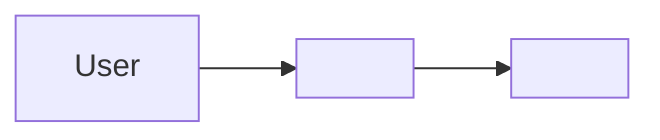

# AWS <NN> — <Service / Topic>

> **নিয়ম (D5):** আগে বুঝি → লোকালে চালাই → তারপর free-tier-এ, budget alarm চালু রেখে, শেষে teardown।
> আগের মডিউল: [<NN-1>](<NN-1>-<slug>.md) · পরের: [<NN+1>](<NN+1>-<slug>.md) · সময়: ~<N> ঘণ্টা

## ১. সহজ ভাষায় (শূন্য থেকে)

- **এক লাইনে:** <service> হলো ... (দৈনন্দিন উপমা দিয়ে)
- **কোন সমস্যা সমাধান করে:** ...
- **মূল টার্ম:** (প্রতিটা এক লাইনে)
  - `<term>` — ...
- **লোকাল সমতুল্য:** <যেমন S3 ≈ MinIO, SQS ≈ LocalStack SQS, EKS ≈ k3d>

## ২. DistroSaaS today `[inferred]`

<D6-এর জানা তথ্য থেকে: আজ এই কাজটা কীভাবে হয় (যেমন EC2-তে self-hosted Redis, GitHub Actions → SSH deploy)।
যা নিশ্চিত না, প্রতিটায় `[inferred]` আর নিচের "ask-your-team"-এ প্রশ্ন।>

## ৩. Target architecture



<আজ → টার্গেট: কী বদলাবে, কেন (cost / reliability / ops কম)। এক বাক্যে migration risk।>

## ৪. 🧪 LOCAL LAB (আগে এটা, খরচ ০)

**টুল:** Docker · LocalStack · MinIO · k3d · OpenTofu (যেটা লাগে)
**লক্ষ্য:** <ল্যাব শেষে কী কাজ করবে>

```bash
# 1. start
docker compose up -d
# 2. create resource (awslocal / tofu)
# 3. verify
# 4. cleanup
docker compose down -v
```

**যাচাই:** <কোন কমান্ডের আউটপুট দেখলে বুঝবে ঠিক হয়েছে>

## ৫. ☁️ Free-tier lab (লোকাল ল্যাব পাস করার পরে)

> ⚠️ শুরুর আগে: budget alarm ($1) চালু আছে? region ঠিক আছে? free-tier সীমা: <সীমা>

1. ...

### 🧹 Teardown (বাধ্যতামূলক)

```bash
# প্রতিটা রিসোর্স মোছার কমান্ড
```

**নিশ্চিত হও:** Billing → Free tier usage / Cost Explorer-এ ০ চলমান রিসোর্স।

## ৬. SAA-C03 points

- <পরীক্ষায় যা আসে: সীমা, কোন সার্ভিস কখন, সাধারণ ফাঁদ>
- **"Which service?" ফাঁদ:** <X vs Y — কখন কোনটা>

## ৭. Interview Q&A

### Q1. <প্রশ্ন>

**Key points:**
1. ...

🎤 **Say this in interview:** "<English, 1–3 sentences.>"
🔗 **DistroSaaS:** <S?> · অথবা "সরাসরি অভিজ্ঞতা নেই — এভাবে বলো: …"

## ৮. ❓ Ask-your-team (manager/টিমকে জিজ্ঞেস করে যাচাই)

- [ ] <`[inferred]` প্রতিটা দাবি এখানে প্রশ্ন হিসেবে>

## কী বাকি

- [ ] ...
