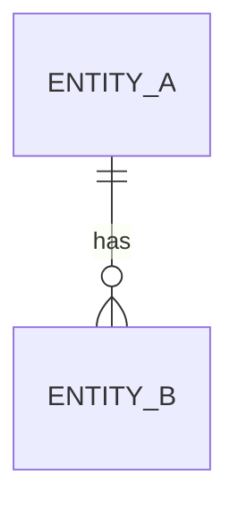
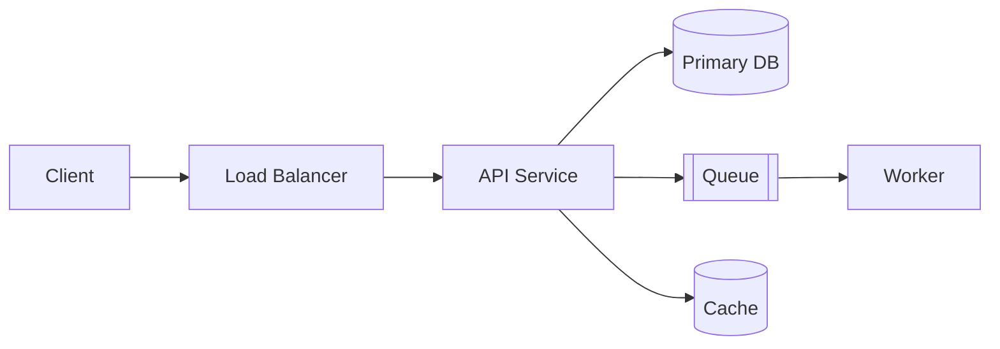

# Design <System Name>

> **৪৫ মিনিটের ইন্টারভিউ টাইমবক্স:** requirements ৫ · estimation ৩ · API ৫ · data model ৫ · HLD ১০ · deep dive ১২ · trade-offs ৫
> পূর্বশর্ত কনসেপ্ট: [<concept>](../concepts/<file>.md)

## 🎤 ৩০-সেকেন্ডের ওপেনিং

"<English: restate the problem, name the 2–3 hardest parts, say what you'll clarify first.>"

## ১. Requirements

**Functional:**
- ...

**Non-functional:** (সংখ্যা দিয়ে)
- Availability: ...
- Latency: p99 < ... ms
- Consistency: strong / eventual — কোথায় কোনটা, কেন
- Scale: ...

**Out of scope:** ...

**যে প্রশ্নগুলো ইন্টারভিউয়ারকে জিজ্ঞেস করবে:**
1. ...

## ২. Estimation (back-of-envelope)

| মেট্রিক | হিসাব | ফল |
|---|---|---|
| DAU | ... | ... |
| Write QPS (avg / peak) | ... | ... |
| Read QPS | ... | ... |
| Storage / বছর | ... | ... |
| Bandwidth | ... | ... |

## ৩. API

```http
POST /v1/<resource>        Idempotency-Key: <uuid>
GET  /v1/<resource>/{id}
```

<auth, pagination, rate limit, versioning-এর এক লাইন করে>

## ৪. Data Model



- DB পছন্দ: <SQL / NoSQL / দুটো> — কেন
- Index / partition / shard key: ...

## ৫. High-Level Design



<প্রতিটা কম্পোনেন্ট এক লাইনে: কী করে, কেন আছে। একটা মূল request-এর flow ধাপে ধাপে।>

## ৬. Deep Dive

### ৬.১ <সবচেয়ে কঠিন অংশ, যেমন: double-spend / hot key / ordering>
<সমস্যা → ২টা বিকল্প → বাছাই + কেন>

### ৬.২ <failure scenario: X down হলে কী হয়?>

### ৬.৩ <scaling: ১০x লোডে কী ভাঙবে প্রথমে?>

## ৭. Trade-offs

| সিদ্ধান্ত | বেছে নিলাম | ছেড়ে দিলাম | কেন |
|---|---|---|---|
| ... | ... | ... | ... |

## 🔗 DistroSaaS relates

<Komol-এর SaaS-এ এর কাছাকাছি কোন সমস্যা ছিল (জেনেরিকভাবে), কোন সিদ্ধান্ত মিলে, কোথায় আলাদা। স্টোরি ID: S?
যাচাই-না-করা অংশে `[inferred]`। মিল না থাকলে সৎভাবে বলো।>

🎤 **Say this in interview:** "<In my current work on a multi-tenant distribution SaaS, we faced a similar … >"

## Follow-up প্রশ্ন (ইন্টারভিউয়ার যা চাপ দেবে)

1. <প্রশ্ন> → <২ লাইনে উত্তর>

## কী বাকি

- [ ] ...
