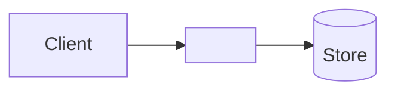

# <Topic Title>

> **১৫ মিনিটে রিভিশন:** নিচের "এক নজরে" + প্রতিটা প্রশ্নের 🎤 লাইন পড়লেই চলবে।
> সম্পর্কিত: [<other-topic>](../<path>.md) · দুর্বলতা: `weak-areas.md` → <row>

## এক নজরে

- এটা কী: <১ লাইনে, বাংলায়; টার্ম ইংরেজিতে>
- কেন দরকার: <কোন সমস্যা সমাধান করে>
- কখন ব্যবহার করবে না: <trade-off / anti-pattern>

## ১. Theory

<সহজ বাংলায় মূল ধারণা। ছোট প্যারাগ্রাফ + বুলেট। দরকার হলে mermaid ডায়াগ্রাম।>



## ২. Example

<একটা ছোট, নিজে-লেখা উদাহরণ। ভাষা: PHP/Laravel বা যেটা টপিকে মানায়। আসল কোড কপি করবে না।>

```php
// minimal, runnable-looking example
```

## ৩. DistroSaaS link

<Komol-এর multi-tenant distribution SaaS-এ এটা কোথায় এসেছে — জেনেরিক ভাষায়। যাচাই-না-করা হলে `[inferred]`।
সরাসরি অভিজ্ঞতা না থাকলে: "সরাসরি অভিজ্ঞতা নেই — কাছাকাছি: …">

## ৪. Interview Q&A

### Q1. <প্রশ্ন, ইংরেজিতে যেভাবে আসে>

**Description:** <২–৩ লাইনে প্রশ্নটা আসলে কী যাচাই করছে>

**Key points:**
1. ...
2. ...
3. ...
4. ...
5. ...
6. ...

🎤 **Say this in interview:** "<1–3 English sentences, spoken style.>"
🔗 **DistroSaaS:** <S?> — <এক লাইনে প্রমাণ> · অথবা "সরাসরি অভিজ্ঞতা নেই — এভাবে বলো: …"

### Q2. ...

<!-- ৮–১০টা প্রশ্ন: ৩টা basic, ৪টা deep/trade-off, ২–৩টা scenario ("production-এ X হলে কী করবে?") -->

## ৫. ভুল / ফাঁদ

- <সাধারণ ভুল উত্তর এবং কেন ভুল>

## ৬. কী বাকি

- [ ] <এই ফাইলে যা এখনো নেই>
