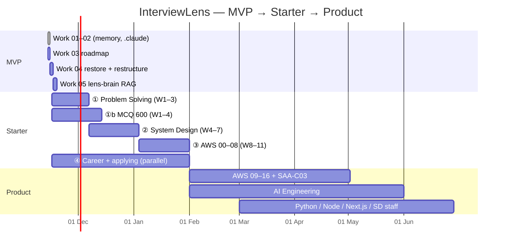

# Roadmap — MVP → Starter → Product

> উৎস: [`MASTER-PLAN.md`](../MASTER-PLAN.md) §2–§3। এই ফাইল বলে **কোন সপ্তাহে কী**; `today.md` বলে **আজ কী** (`/study-start` এখান থেকে বানায়)।
> অগ্রগতির সংখ্যা থাকে `tracker.md` + `DASHBOARD.md`-এ, এখানে না। এখানে শুধু প্ল্যান আর ✔।

**মূল নিয়ম:**
- Starter টপিক-বাই-টপিক (D11): ① Problem Solving → ② System Design → ③ AWS। MCQ আর Career সমান্তরালে।
- প্রতিদিন PS ব্লক কখনো বাদ যাবে না — লাইভ কোডিং-এ freeze সবচেয়ে বড় দুর্বলতা।
- **আসল ইন্টারভিউ সব প্ল্যানের ওপরে:** রাউন্ড ঠিক হলে সেই সপ্তাহের মূল টপিক বদলে সেই রাউন্ডের প্রস্তুতি (কোম্পানি ফোল্ডার, পরে `99-archive/`-এ যাবে)। শেষ হলে যেখানে ছিলাম সেখানে ফিরি।
- কোন টপিক আগে: `weak-areas.md`-এর সবচেয়ে কম `Now` + 🔴।

---

## ১. টাইমলাইন এক নজরে

| ফেজ | সপ্তাহ | তারিখ | মূল টপিক (দৈনিক ২ ঘণ্টা) |
|---|---|---|---|
| MVP | W0 | ১১-১৪ → ১১-১৭ | Work 03–05 (MVP ২ দিন দেরি হলে W1-এর lab ঘণ্টা থেকে নেবে, PS ব্লক থেকে না) |
| Starter ① | W1–W3 | ১১-১৬ → ১২-০৬ | Problem Solving |
| Starter ② | W4–W7 | ১২-০৭ → ০১-০৩ | System Design |
| Starter ③ | W8–W11 | ০১-০৪ → ০১-৩১ | AWS foundations 00–08 |
| Product | — | ফেব্রুয়ারি ২০২৭ থেকে | Starter শেষে নতুন করে প্ল্যান (§৬) |

---

## ২. দিনের টেমপ্লেট (≈৭ ঘণ্টা)

| সময় | ব্লক | কী করবে |
|---|---|---|
| 1.5 h | **Problem solving** | ২–৩টা প্রবলেম **PHP-তে** (লাইভ কোডিং স্ক্রিপ্ট মুখে বলে) + ২০টা timed MCQ |
| 1.5 h | **System design / LLD** | সপ্তাহের SD/LLD আইটেম (§৪-এর কলাম) |
| 2 h | **মূল টপিক** | ফেজের কনটেন্ট বানানো + পড়া (`/gen-topic`, একবারে একটা ফাইল) |
| 1 h | **Hands-on lab** | `// BUILD` প্রজেক্ট বা AWS লোকাল ল্যাব (§৫) |
| 30 m | **Spoken English** | একটা STAR স্টোরি বা একটা design জোরে বলা, ফোনে রেকর্ড করে শোনা |
| 30 m | **Applications** | নতুন আবেদন + follow-up → `12-career/applications.md` |
| 15 m | `/study-end` | tracker, weak-areas, handoff, DASHBOARD |

**৬ ঘণ্টার দিন:** lab আধা ঘণ্টা + SD আধা ঘণ্টা কাটো। **৮ ঘণ্টার দিন:** বাড়তি ঘণ্টা মূল টপিকে।

**সাপ্তাহিক ছন্দ:**

| দিন | কী আলাদা |
|---|---|
| সোম–শুক্র | পুরো টেমপ্লেট |
| শনি | **মক দিন:** ৫০টা timed MCQ টেস্ট (৫০ মিনিট) + একটা পূর্ণ মক (লাইভ কোডিং ৪৫ মিনিট বা SD ৪৫ মিনিট, পালা করে) → `11-mocks/` · সপ্তাহের রিভিউ: `weak-areas.md` `Now` আপডেট |
| রবি | হালকা: ভুল প্রবলেম/MCQ আবার, পরের সপ্তাহের ফাইল তালিকা ঠিক করা, বাকি কাজ ধরা। ৩–৪ ঘণ্টা, বাকিটা বিশ্রাম |

---

## ৩. Starter-এর লক্ষ্য (শেষ হলো কখন বলব)

| ট্র্যাক | Starter শেষে (W11, ২০২৭-০১-৩১) |
|---|---|
| Problem solving | ২২টা প্যাটার্ন ফাইল সম্পূর্ণ, ~১৮০টা কিউরেটেড প্রবলেম, **≥ ১৫০টা নিজে সমাধান** (PHP), ৪৫ মিনিটের লাইভ মকে freeze ছাড়া শেষ |
| MCQ | ৬০০+ প্রশ্ন ব্যাখ্যাসহ, timed টেস্টে ধারাবাহিক **≥ ৭৫%** |
| System design | ৫টা নতুন concept + ১১টা নতুন case + `drills.md`; যেকোনো case ৪৫ মিনিটে ইংরেজিতে বলা |
| AWS | মডিউল 00–08, প্রতিটার লোকাল ল্যাব পাস, ≥ ৪টা free-tier ল্যাব teardown-সহ |
| Career | ৪টা রোলের pitch, সাধারণ story bank, প্রতি সপ্তাহে আবেদন, ≥ ২টা `// BUILD` প্রজেক্ট GitHub-এ |

---

## ৪. সপ্তাহ-ভিত্তিক প্ল্যান

প্রতিটা সারির ফাইলগুলো `/gen-topic` দিয়ে, একবারে একটা। ✔ দাও সপ্তাহ শেষে।

### ① Problem Solving + MCQ — W1–W3

| সপ্তাহ | মূল টপিক (2 h) — `01-problem-solving/` | MCQ (`02-cs-fundamentals-mcq/`, ১৫০/সপ্তাহ) | SD / LLD (1.5 h) | ✔ |
|---|---|---|---|---|
| **W1** ১১-১৬ → ১১-২২ | `which-pattern.md` (decision sheet) · `live-coding-script.md` · `hard.md` স্টাব পূরণ: 01 arrays, 02 strings, 03 hashing, 04 two-pointers, 05 stack-queue, 06 linked-list, 07 recursion | OS (75) + complexity (75) | পুরনো SD framework রিভিশন + পুরনো ৮টা case থেকে ২টা ইংরেজিতে জোরে বলা · LLD: **Facade, Composite** | |
| **W2** ১১-২৩ → ১১-২৯ | `hard.md`: 08 sorting-searching, 09 trees, 10 graphs, 11 greedy, 12 dp, 13 math-bit, 14 sql · নতুন প্যাটার্ন: **15 heap, 16 intervals, 17 prefix-sum, 18 monotonic-stack** | Networking (75) + DBMS (75) | পুরনো case থেকে আরও ৩টা বলা · LLD: **Iterator, Abstract Factory** + notification dispatcher | |
| **W3** ১১-৩০ → ১২-০৬ | নতুন প্যাটার্ন: **19 trie, 20 union-find, 21 topo-sort, 22 binary-search-on-answer** · `curated-180.md` (সব প্রবলেমের ইনডেক্স, E/M/H, কোন প্যাটার্ন) | OOP + SOLID (75) + code-output PHP/JS/Python (75) | LLD machine coding (৪৫ মিনিট): **elevator, splitwise** | |
| **W4** | (PS শুধু দৈনিক ব্লকে চলবে) | Aptitude + logic (75) + mixed review (75) → **৬০০ পূর্ণ** | → নিচে ② | |

- দৈনিক PS ব্লক: যে প্যাটার্নের ফাইল এই সপ্তাহে বানানো হলো, সেটার easy → medium → hard ক্রমে সমাধান। লক্ষ্য **~১৫টা/সপ্তাহ**।
- `Problem Solving/06-html-css` PS না → Work 04-এ `08-frontend-nextjs/`-এ যাবে, এখানে গোনা হবে না।

### ② System Design — W4–W7 (`03-system-design/`)

| সপ্তাহ | মূল টপিক (2 h) | SD / LLD ব্লক (1.5 h) এই ফেজে = | ✔ |
|---|---|---|---|
| **W4** ১২-০৭ → ১২-১৩ | Concepts: **estimation**, **API design + rate limiting**, **LB / proxy**, **ID generation + consistent hashing** · Case: **distributed message queue** | মূল টপিকের case জোরে বলা (৪৫ মিনিট টাইমার) + পুরনো outbox/saga/idempotency রিভিশন (`05-backend/messaging-streaming/`) | |
| **W5** ১২-১৪ → ১২-২০ | Concept: **storage / CDN / search / geo** · Cases: **hotel/train/flight reservation**, **real-time leaderboard**, **payment system** | ঐ | |
| **W6** ১২-২১ → ১২-২৭ | Cases: **digital wallet**, **stock exchange**, **email service**, **object storage** | ঐ | |
| **W7** ১২-২৮ → ০১-০৩ | Cases: **nearby friends**, **Uber**, **Google Maps** · `drills.md` (১০ মিনিটের মিনি-ড্রিল: estimation, bottleneck খোঁজা, trade-off বাছা) | শনিবার: **২টা পূর্ণ SD মক** | |

- প্রতিটা case `sd-case.md` টেমপ্লেটে, `🔗 DistroSaaS relates` সহ (multi-tenant, heavy report, Kafka events — যেখানে মেলে)।

### ③ AWS foundations — W8–W11 (`06-aws-devops/`)

D5: প্রতিটা মডিউলে **আগে লোকাল ল্যাব** (খরচ ০), তারপর free-tier, শেষে teardown। ভুল/সন্দেহের তথ্য → মডিউলের "ask-your-team"-এ, টিমের কাছে যাচাই।

| সপ্তাহ | মূল টপিক + lab (3 h একসাথে) | SD / LLD ব্লক (1.5 h) এই ফেজে = | ✔ |
|---|---|---|---|
| **W8** ০১-০৪ → ০১-১০ | **00** local lab setup (Docker, LocalStack, MinIO, OpenTofu) + AWS account + **budget alarm** · **01** cloud basics + global infra · **02** IAM | Real-world case: **multi-tenancy** (`09-real-world-cases/`) + ১টা পুরনো SD case | |
| **W9** ০১-১১ → ০১-১৭ | **03** VPC · **04** EC2 + ALB + Auto Scaling | Real-world case: **heavy report pipeline** | |
| **W10** ০১-১৮ → ০১-২৪ | **05** S3 / EBS + CloudFront · **06** RDS + read replicas | Real-world case: **primary/secondary orders + Kafka** | |
| **W11** ০১-২৫ → ০১-৩১ | **07** ElastiCache vs self-hosted Redis · **08** SQS / SNS / EventBridge, MSK vs self-hosted Kafka · **Starter retro** | Real-world case: **approval engine** · শনিবার পূর্ণ মক লুপ (PS + SD + behavioral) | |

### ④ Career + behavioral — W1 থেকে সমান্তরালে (প্রতিদিন 30 m spoken + 30 m applications)

| সপ্তাহ | কাজ | ✔ |
|---|---|---|
| **W1** | CV-র অযাচাই দাবি ঠিক করা (RabbitMQ microservices, Node services, payment HMAC — রাখো/বাদ/নতুন শব্দে) · `profile.md`-এর ফাঁকা অংশ (notice period, স্যালারি রেঞ্জ) · `12-career/applications.md` পাইপলাইন শুরু | |
| **W1–W2** | ৪টা রোলের pitch (Laravel / Node / Python / AI), প্রতিটা ৬০–৯০ সেকেন্ড, ইংরেজিতে → `10-behavioral-leadership/` | |
| **W2–W3** | story bank জেনেরিক করা (DistroSaaS, public-safe); S10 (disagreement) আর S11 (mistake) পূর্ণ করা | |
| **প্রতি সপ্তাহ** | আবেদন: লক্ষ্য **৫–১০টা/সপ্তাহ** [Komol ঠিক করবে] · প্রতি শনিবার pipeline রিভিউ | |

**কোন CV পাঠাবে (`// BUILD` প্রজেক্ট তৈরি হওয়ার আগে):**
- `// BUILD` প্রজেক্ট GitHub-এ না থাকা পর্যন্ত সেই CV পাঠাবে না — ইন্টারভিউয়ার লিংক খুলবে।
- এখন পাঠানো যায়: **Common CV** (কোনো `// BUILD` নেই)। Laravel রোলেও আপাতত এটা, যতক্ষণ Laravel CV-র দুটো প্রজেক্ট না হয়।
- JS CV → Multi-Tenant Order API হওয়ার পরে (≈W3)। Python+AI CV → RAG হওয়ার পরে (≈W7)।

---

## ৫. Hands-on lab ঘণ্টা — `// BUILD` প্রজেক্ট

CV-তে ৮টা প্রজেক্ট আছে যেগুলো এখনো বানানো হয়নি। দৈনিক ১ ঘণ্টা lab (W1–W7) এগুলোতে যায়, ছোট থেকে "দেখানোর মতো" অবস্থা পর্যন্ত (README, চলে, টেস্ট আছে)।

| ক্রম | প্রজেক্ট | কোন CV | কখন | "দেখানোর মতো" মানে |
|---|---|---|---|---|
| 1 | **Multi-Tenant Order Management API** (NestJS, Prisma, PostgreSQL, Redis, BullMQ) | JS | **W1–W3** | tenant isolation, JWT + RBAC, order + approval, একটা queue job, Docker Compose, e2e টেস্ট |
| 2 | **Sales Report Q&A Assistant — RAG** (FastAPI, pgvector, Claude API) | Python+AI | **W4–W7** | CSV ইনজেস্ট → embed → cited উত্তর; একটা ছোট eval সেট |
| 3 | Laravel Multi-Tenancy Package | Laravel | W8–W11 (AWS ল্যাবের পাশে, সময় থাকলে) | DB-per-tenant, tenant-scoped cache key, Pest টেস্ট, ডেমো অ্যাপ |
| 4 | Laravel Report Engine | Laravel | Product | |
| 5 | Sales Analytics Dashboard (Next.js) | JS | Product (Next.js ট্র্যাক) | |
| 6 | Real-Time Field Tracking (Socket.IO, Mongo geo) | JS | Product | |
| 7 | Field Agent AI Assistant (Django, DRF, Celery) | Python+AI | Product (AI + Python ট্র্যাক) | |
| 8 | Demand Forecasting API (Flask, scikit-learn) | Python+AI | Product (ML foundations) | |

- W8–W11-এ lab ঘণ্টা AWS লোকাল ল্যাবে যায় (মূল টপিকের সাথে)। প্রজেক্ট 1-কে LocalStack/Docker-এ ডিপ্লয় করাই সেরা AWS ল্যাব।
- সব প্রজেক্ট public-safe: DistroSaaS-এর কোনো আসল কোড, নাম বা ডেটা না।

---

## ৬. Product টিয়ার (ফেব্রুয়ারি ২০২৭ থেকে, প্রস্তাবিত)

Starter retro (W11)-তে `weak-areas.md` আর ইন্টারভিউ ফলাফল দেখে এই অংশ নতুন করে লেখা হবে। আপাতত ক্রম:

| ট্র্যাক | কী | প্রস্তাবিত সময় |
|---|---|---|
| AWS 100% | 09 API Gateway + rate limiting + WAF + Lambda · 10 ECR + ECS Fargate · 11 k3d → EKS · 12 CI/CD + Terraform · 13 observability · 14 security · 15 cost + Well-Architected + DR · 16 SAA-C03 practice → **exam** · Capstone: DistroSaaS on AWS v0→v4 | ফেব্রু–এপ্রিল; **SAA-C03 লক্ষ্য: এপ্রিল ২০২৭-এর শেষ** |
| AI Engineering | ML foundations (math, scikit-learn, NN, PyTorch, transformers, LoRA) + applied (LLM API, embeddings, RAG, agents, MCP, evals, guardrails, LLMOps) · প্রজেক্ট 7, 8 | ফেব্রু–মে |
| Python frameworks | FastAPI deep, Flask, Django + DRF, Celery, Pydantic, async | মার্চ–এপ্রিল (AI প্রজেক্টের সাথে) |
| Node / Next.js | NestJS deep, Next.js App Router, RSC, SSR/ISR · প্রজেক্ট 5, 6 | এপ্রিল–মে |
| System Design 100% | Staff level: multi-region, migration, data platform, cost · সপ্তাহে ২টা পূর্ণ মক লুপ | মার্চ থেকে চলমান |
| Real-world cases | বাকিগুলো: global settings, custom report builder, promotion engine, field tracking, territory hierarchy, benchmark service, AI opportunities | চলমান, সপ্তাহে ১টা |
| Leadership | design doc/RFC, product thinking, metrics, prioritization, incident leadership, mentoring · cases থেকে ৬টা blog post | মে থেকে |

**২–৩ বছরের লক্ষ্য:** Senior Engineer / Product Lead। Product টিয়ার শেষ = সার্টিফিকেট পাস, ২টা পোর্টফোলিও রিপো, পূর্ণ মক লুপে আত্মবিশ্বাসী।

---

## ৭. চেকপয়েন্ট

| তারিখ | চেক | পাস না হলে |
|---|---|---|
| ১১-১৭ | MVP শেষ: health check clean, `/study-start` চলে, RAG উত্তর দেয় | W1-এর lab ঘণ্টা MVP-তে |
| ১২-০৬ (W3 শেষ) | ২২টা প্যাটার্ন ফাইল, ≥ ৪০টা সমাধান, ৪৫০ MCQ, Order API চলে | SD ১ সপ্তাহ পেছাও, PS সপ্তাহ বাড়াও |
| ০১-০৩ (W7 শেষ) | ১১টা case, ২টা SD মক, MCQ ≥ ৭০%, RAG প্রজেক্ট চলে | AWS-এর 07–08 Product-এ সরাও |
| ০১-৩১ (W11 শেষ) | §৩-এর সব লক্ষ্য → **Starter retro**, Product প্ল্যান নতুন করে | — |
