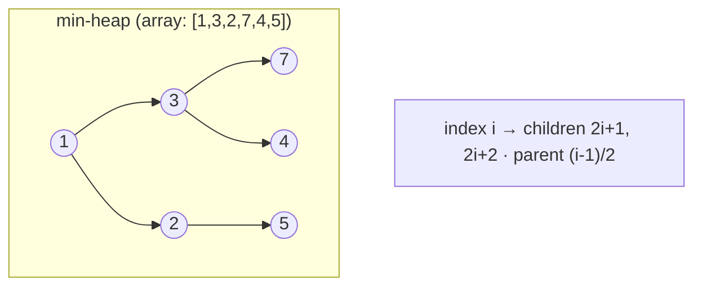

# 15 — Heap / Priority Queue

> Graded problems: [easy.md](easy.md) · [medium.md](medium.md) · [hard.md](hard.md)
> **লক্ষ্য:** "সবচেয়ে ছোট/বড়টা বারবার দরকার" দেখলেই heap; আর **top-K-তে উল্টো heap** (K largest → size-K **min**-heap) মুখস্থ।

---

## Theory

**Heap** হলো একটা complete binary tree (array-তে রাখা) যেখানে প্রতিটা parent তার children-এর চেয়ে ছোট (min-heap) বা বড় (max-heap)। তাই root-এ সবসময় min/max।

| অপারেশন | খরচ |
|---|---|
| peek (min/max দেখা) | O(1) |
| push / pop | O(log n) |
| array থেকে heapify | O(n) |
| যেকোনো উপাদান খোঁজা | O(n) — heap খোঁজার জন্য না |

**কখন heap, কখন sort:** পুরো ক্রম একবার দরকার হলে sort (O(n log n))। ডেটা **আসতে থাকে** (stream) বা শুধু top-K দরকার হলে heap (O(n log k))।

### চেনার সংকেত

- "K largest / smallest / closest / most frequent" → size-K heap
- "merge K sorted …" → প্রতিটা list-এর head heap-এ
- "stream-এর median" → দুই heap (নিচের অর্ধেক max-heap, উপরের অর্ধেক min-heap)
- "সবচেয়ে কম খরচের পরেরটা" (Dijkstra, scheduling) → min-heap
- "প্রতিবার সবচেয়ে বড় দুটো নাও" → max-heap

### Top-K-র উল্টো কৌশল

K **largest** চাই → size-K **min**-heap রাখো। নতুন উপাদান heap-এর min-এর চেয়ে বড় হলে min ফেলে দাও। শেষে heap-এ ঠিক K largest, আর root = K-তম largest। খরচ O(n log k), memory O(k)।

## Diagram



## Templates

**PHP** — `SplMinHeap`, `SplMaxHeap`, `SplPriorityQueue`:
```php
<?php
$min = new SplMinHeap();
foreach ([5, 1, 4] as $x) $min->insert($x);
assert($min->top() === 1);            // peek
assert($min->extract() === 1);        // pop

$max = new SplMaxHeap();
foreach ([5, 1, 4] as $x) $max->insert($x);
assert($max->extract() === 5);

// tuples: arrays compare element by element -> [priority, tiebreak, payload]
$h = new SplMinHeap();
$h->insert([3, 'c']); $h->insert([1, 'a']);
assert($h->extract() === [1, 'a']);

// top-K largest with a size-K min-heap
function topK(array $nums, int $k): array
{
    $h = new SplMinHeap();
    foreach ($nums as $x) {
        $h->insert($x);
        if (count($h) > $k) $h->extract();   // drop the smallest
    }
    $out = iterator_to_array($h, false);
    rsort($out);
    return $out;
}
assert(topK([3, 1, 5, 12, 2, 11], 3) === [12, 11, 5]);
```

> ⚠️ `SplPriorityQueue` হলো **max**-heap, আর সমান priority-তে ক্রম নিশ্চিত না। min চাইলে priority `-x`, স্থির ক্রম চাইলে `[priority, -seq]`। `foreach` করলে heap খালি হয়ে যায় (extract করে)।

**Python** — `heapq` শুধু **min**-heap:
```python
import heapq

h = []
for x in [5, 1, 4]:
    heapq.heappush(h, x)
assert h[0] == 1 and heapq.heappop(h) == 1

mx = []                                  # max-heap: push negatives
for x in [5, 1, 4]:
    heapq.heappush(mx, -x)
assert -heapq.heappop(mx) == 5

assert heapq.nlargest(3, [3, 1, 5, 12, 2, 11]) == [12, 11, 5]

def top_k(nums, k):
    h = []
    for x in nums:
        heapq.heappush(h, x)
        if len(h) > k:
            heapq.heappop(h)
    return sorted(h, reverse=True)

assert top_k([3, 1, 5, 12, 2, 11], 3) == [12, 11, 5]
```

## Common traps

- K largest-এ max-heap-এ সব ঢুকিয়ে K বার pop → O(n + k log n), চলে; কিন্তু stream-এ memory O(n)। size-K min-heap ভালো।
- Python-এ tuple `(priority, obj)` — সমান priority-তে `obj` তুলনা করে `TypeError`; মাঝে counter দাও।
- heap sorted array না: `h[1]` দ্বিতীয় ছোট হবে এমন নিশ্চয়তা নেই।
- "decrease key" heapq-তে নেই → নতুন এন্ট্রি push করো, pop-এর সময় পুরনো (stale) এন্ট্রি skip করো (lazy deletion)।

## Interview Q&A

**Q: Heap আর BST-এর পার্থক্য? কখন কোনটা?**
Heap শুধু min/max দ্রুত দেয়; ক্রমে সাজানো traversal বা যেকোনো key খোঁজা পারে না। Balanced BST (TreeMap) সব পারে O(log n)-এ, কিন্তু constant factor বেশি আর বেশিরভাগ ভাষার standard library-তে (PHP, Python) নেই।
🎤 "A heap only guarantees the min or max at the root, which is exactly what scheduling and top-K need, at a lower constant cost than a balanced BST."

**Q: n উপাদান থেকে heap বানানো O(n) কেন, O(n log n) না?**
Bottom-up heapify-তে বেশিরভাগ node নিচের দিকে, তাদের sift-down খুব ছোট; যোগফল একটা converging series → O(n)।
🎤 "Most nodes are near the leaves and sift down only a level or two, so the total work sums to linear."

**Q: Stream থেকে top-K কীভাবে, memory সীমিত?**
size-K min-heap; O(k) memory, প্রতি উপাদান O(log k)।

🔗 DistroSaaS: job queue-তে priority (জরুরি report আগে) আর "top-K SKU / outlet" রিপোর্ট — **[Komol পূরণ করবে: priority queue বা top-N রিপোর্টের স্টোরি ID]**। Redis sorted set (`ZADD`/`ZPOPMIN`) একই আইডিয়া — DB লেভেলে।
