# 16 — Intervals

> Graded problems: [easy.md](easy.md) · [medium.md](medium.md) · [hard.md](hard.md)
> **লক্ষ্য:** প্রায় সব interval প্রবলেমের প্রথম লাইন: **sort**। কোন key দিয়ে sort (start না end) সেটাই আসল সিদ্ধান্ত।

---

## Theory

Interval = `[start, end]`। দুটো interval `a`, `b` (a.start ≤ b.start ধরে):
- **overlap করে** যদি `b.start <= a.end` (closed interval) — প্রবলেম `<` না `<=` বলছে, clarify করো ("[1,2] আর [2,3] কি overlap?")।
- merge = `[a.start, max(a.end, b.end)]`

### কোন key দিয়ে sort?

| প্রশ্ন | Sort by | কেন |
|---|---|---|
| merge / insert / overlap আছে কি | **start** | পাশাপাশি এলে শুধু শেষেরটার সাথে তুলনা |
| সর্বোচ্চ কয়টা non-overlapping বাছবে / কয়টা মুছবে / কয়টা তীর | **end** | যেটা আগে শেষ, সেটা নিলে বাকিদের জন্য সবচেয়ে বেশি জায়গা থাকে (greedy) |
| একসাথে সর্বোচ্চ কয়টা চলে (meeting rooms) | start + end আলাদা, অথবা **sweep line** | ঘটনা ধরে গোনা |

### Sweep line

প্রতিটা interval-কে দুটো ঘটনায় ভাঙো: `(start, +1)`, `(end, −1)`। সময় অনুযায়ী sort করে চলমান যোগফল = সেই মুহূর্তে কয়টা সক্রিয়। একই সময়ে end আর start হলে কোনটা আগে, সেটা প্রবলেমের সংজ্ঞা অনুযায়ী (half-open `[s, e)` হলে end আগে)।

## Diagram

```mermaid
gantt
    dateFormat X
    axisFormat %s
    section input
    A [1,3] :0, 1, 3
    B [2,6] :0, 2, 6
    C [8,10] :0, 8, 10
    D [15,18] :0, 15, 18
    section merged
    [1,6] :0, 1, 6
    [8,10] :0, 8, 10
    [15,18] :0, 15, 18
```



## Templates

**PHP:**
```php
<?php
// merge overlapping (sort by start)
function mergeIntervals(array $iv): array
{
    usort($iv, fn($a, $b) => $a[0] <=> $b[0]);
    $out = [];
    foreach ($iv as [$s, $e]) {
        if ($out && $s <= $out[count($out) - 1][1]) {
            $out[count($out) - 1][1] = max($out[count($out) - 1][1], $e);
        } else {
            $out[] = [$s, $e];
        }
    }
    return $out;
}
assert(mergeIntervals([[1, 3], [8, 10], [2, 6], [15, 18]]) === [[1, 6], [8, 10], [15, 18]]);

// max concurrent (sweep line, half-open [s, e))
function maxConcurrent(array $iv): int
{
    $events = [];
    foreach ($iv as [$s, $e]) { $events[] = [$s, 1]; $events[] = [$e, -1]; }
    sort($events);                      // at equal time, -1 sorts before +1 -> end first
    $cur = $best = 0;
    foreach ($events as [, $d]) { $cur += $d; $best = max($best, $cur); }
    return $best;
}
assert(maxConcurrent([[0, 30], [5, 10], [15, 20]]) === 2);
assert(maxConcurrent([[1, 5], [5, 10]]) === 1);
```

**Python:**
```python
def merge_intervals(iv):
    out = []
    for s, e in sorted(iv):
        if out and s <= out[-1][1]:
            out[-1][1] = max(out[-1][1], e)
        else:
            out.append([s, e])
    return out

def max_concurrent(iv):
    events = sorted([(s, 1) for s, _ in iv] + [(e, -1) for _, e in iv])
    cur = best = 0
    for _, d in events:
        cur += d
        best = max(best, cur)
    return best

assert merge_intervals([[1, 3], [8, 10], [2, 6], [15, 18]]) == [[1, 6], [8, 10], [15, 18]]
assert max_concurrent([[0, 30], [5, 10], [15, 20]]) == 2 and max_concurrent([[1, 5], [5, 10]]) == 1
```

## Common traps

- merge-এ `max(end)` ভুলে `end = e` লেখা — `[1,10]`-এর ভেতরে `[2,3]` থাকলে ভেঙে যায়।
- boundary: `[1,2]` আর `[2,3]` — touching কি overlap? প্রবলেম পড়ো।
- PHP-তে `usort` দরকার (`sort` nested array-তে কাজ করে, কিন্তু ইচ্ছা স্পষ্ট রাখতে comparator লেখো)।
- non-overlapping বাছাইয়ে start দিয়ে sort করা — ভুল greedy।

## Interview Q&A

**Q: কোন interval প্রবলেমে end অনুযায়ী sort?**
যখন সর্বোচ্চ সংখ্যক পরস্পর-বিচ্ছিন্ন interval বাছতে হয় (activity selection)। যেটা সবচেয়ে আগে শেষ হয়, সেটা নিলে বাকিদের জন্য সবচেয়ে বেশি সময় থাকে — exchange argument দিয়ে প্রমাণ।
🎤 "For selecting the most non-overlapping intervals I sort by end time, because finishing earliest leaves the most room for the rest — any optimal schedule can swap its first choice for mine without getting worse."

**Q: Meeting rooms II — heap না sweep line?**
দুটোই O(n log n)। Heap: start অনুযায়ী sort, min-heap-এ চলমান মিটিংয়ের end; sweep line: ঘটনা গোনা। Sweep line সহজ আর সাধারণীকরণযোগ্য।

🔗 DistroSaaS: delivery/visit slot overlap, ডিসকাউন্ট/promotion-এর date range overlap চেক, শিফট শিডিউল — **[Komol পূরণ করবে: promotion বা scheme-এর date range overlap validation-এর স্টোরি ID]**।
