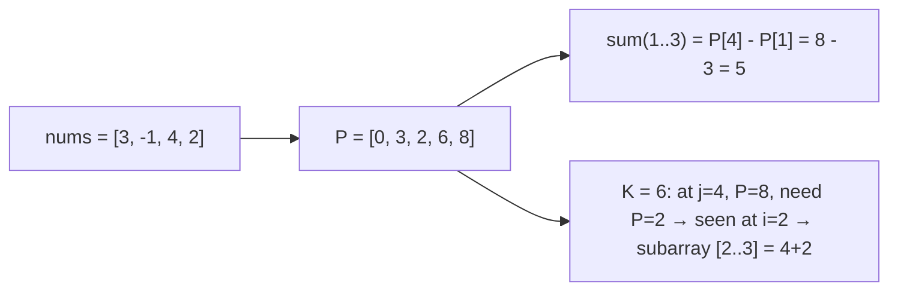

# 17 — Prefix Sum

> Graded problems: [easy.md](easy.md) · [medium.md](medium.md) · [hard.md](hard.md)
> **লক্ষ্য:** "range-এর যোগফল" → O(1); আর **"subarray sum = K" (negative সহ) → prefix sum + hash map** — এই দ্বিতীয়টাই ইন্টারভিউতে সবচেয়ে বেশি আসে।

---

## Theory

`P[i]` = প্রথম `i`টা উপাদানের যোগফল (`P[0] = 0`)। তাহলে `nums[l..r]`-এর যোগফল = `P[r+1] − P[l]`। একবার O(n)-এ বানাও, তারপর প্রতিটা query O(1)।

### তিনটা রূপ

| রূপ | মূল সূত্র | উদাহরণ |
|---|---|---|
| Range sum query | `sum(l..r) = P[r+1] − P[l]` | LC 303 |
| Subarray sum = K (count / longest) | `P[j] − P[i] = K` ⟺ `P[i] = P[j] − K` → map-এ আগের prefix গোনো | LC 560, 325 |
| Divisible / modulo | `P[j] ≡ P[i] (mod k)` → map-এ remainder | LC 974, 523 |
| 2-D | `S(r1,c1,r2,c2) = P[r2+1][c2+1] − P[r1][c2+1] − P[r2+1][c1] + P[r1][c1]` | LC 304 |
| Difference array (range update) | `D[l] += x; D[r+1] −= x`, শেষে prefix | Corporate Flight Bookings (1109) |

### Sliding window বনাম prefix sum + map

- সব সংখ্যা **non-negative** → sliding window (window বড় করলে যোগফল বাড়ে, monotonic)।
- **negative থাকলে** → window কাজ করে না → prefix sum + hash map।

## Diagram



## Templates

**PHP:**
```php
<?php
function prefix(array $nums): array
{
    $p = [0];
    foreach ($nums as $x) $p[] = end($p) + $x;
    return $p;
}
$p = prefix([3, -1, 4, 2]);
assert($p === [0, 3, 2, 6, 8]);
assert($p[4] - $p[1] === 5);                // sum of nums[1..3]

// count subarrays with sum == k (works with negatives)
function subarraySum(array $nums, int $k): int
{
    $seen = [0 => 1];                        // empty prefix
    $sum = 0; $count = 0;
    foreach ($nums as $x) {
        $sum += $x;
        $count += $seen[$sum - $k] ?? 0;     // earlier prefixes that make a k-sum ending here
        $seen[$sum] = ($seen[$sum] ?? 0) + 1;
    }
    return $count;
}
assert(subarraySum([1, 1, 1], 2) === 2);
assert(subarraySum([3, -1, 4, 2], 6) === 2);   // [3,-1,4] and [4,2]
```

**Python:**
```python
from itertools import accumulate
from collections import defaultdict

p = [0, *accumulate([3, -1, 4, 2])]
assert p == [0, 3, 2, 6, 8] and p[4] - p[1] == 5

def subarray_sum(nums, k):
    seen = defaultdict(int, {0: 1})
    s = count = 0
    for x in nums:
        s += x
        count += seen[s - k]
        seen[s] += 1
    return count

assert subarray_sum([1, 1, 1], 2) == 2
```

## Common traps

- `seen[0] = 1` (খালি prefix) ভুলে যাওয়া → শুরু থেকে শুরু হওয়া subarray গোনা হয় না।
- map-এ **আগে খোঁজো, পরে বসাও** — উল্টো করলে `k = 0`-এ খালি subarray গুনে ফেলে।
- "longest" চাইলে map-এ **প্রথম** index রাখো (overwrite কোরো না); "count" চাইলে frequency।
- negative modulo: PHP/C-তে `-1 % 5 = -1`, Python-এ `4` → PHP-তে `(($x % $k) + $k) % $k`।
- বড় যোগফল — 32-bit ভাষায় overflow; PHP/Python-এ সমস্যা কম।

## Interview Q&A

**Q: Subarray sum = K-তে sliding window কেন চলে না?**
negative থাকলে window বড় করলে যোগফল কমতেও পারে — কখন বাম দিক ছোট করবে সেই সিদ্ধান্ত monotonic থাকে না।
🎤 "Sliding window needs the sum to move in one direction as the window grows; with negatives that breaks, so I switch to prefix sums with a hash map of earlier prefixes."

**Q: অনেক range **update** আর query থাকলে?**
শুধু query → prefix sum। শুধু শেষে একবার পড়া, অনেক update → difference array। দুটো মিশে → Fenwick tree (BIT) বা segment tree, O(log n) প্রতিটা।

🔗 DistroSaaS: "যেকোনো তারিখ-range-এর মোট বিক্রি" রিপোর্ট — দৈনিক cumulative total আগে থেকে রাখলে যেকোনো range O(1); SQL-এ `SUM() OVER (ORDER BY day)` একই আইডিয়া — **[Komol পূরণ করবে: date-range summary/aggregate টেবিলের স্টোরি ID]**।
