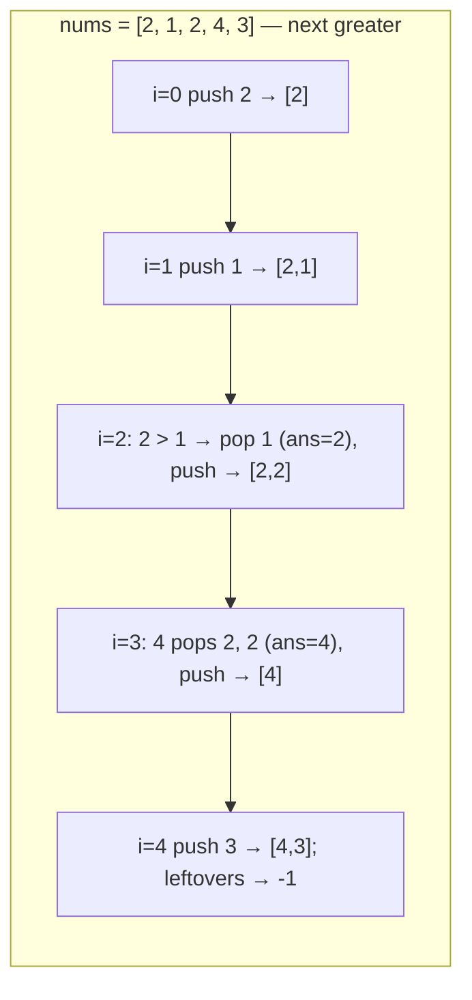

# 18 — Monotonic Stack

> Graded problems: [easy.md](easy.md) · [medium.md](medium.md) · [hard.md](hard.md)
> **লক্ষ্য:** "প্রতিটা উপাদানের next / previous greater বা smaller" — O(n²) থেকে O(n)। প্রতিটা উপাদান একবার push, একবার pop।

---

## Theory

Stack-কে সবসময় sorted রাখো: নতুন উপাদান ঢোকার আগে যারা নিয়ম ভাঙে তাদের pop করো। **pop হওয়ার মুহূর্তটাই উত্তর** — যে উপাদান তাকে pop করালো, সেটাই তার "next greater/smaller"।

| চাই | Stack-এর ক্রম (নিচ → উপর) | কখন pop | pop হওয়া উপাদানের উত্তর |
|---|---|---|---|
| next **greater** | decreasing | `nums[top] < x` | `x` |
| next **smaller** | increasing | `nums[top] > x` | `x` |
| previous greater | decreasing | (push-এর আগে pop শেষে) stack top | top |
| previous smaller | increasing | একইভাবে | top |

### চেনার সংকেত

- "কতদিন পরে বেশি তাপমাত্রা" / "পরের বড় সংখ্যা" → next greater
- "histogram-এ সবচেয়ে বড় আয়তক্ষেত্র" → প্রতিটা বারের বাম আর ডান smaller সীমা
- "সব subarray-এর min-এর যোগফল" → প্রতিটা উপাদান কতগুলো subarray-এর min (বাম × ডান দূরত্ব)
- "k digit সরিয়ে সবচেয়ে ছোট সংখ্যা" → increasing stack, greedy pop
- circular array → দুইবার ঘোরো (`i % n`)

## Diagram


উত্তর: `[4, 2, 4, -1, -1]`

## Templates

**PHP:**
```php
<?php
// next greater element for each index (-1 if none)
function nextGreater(array $nums): array
{
    $res = array_fill(0, count($nums), -1);
    $stack = [];                               // indices, values decreasing bottom -> top
    foreach ($nums as $i => $x) {
        while ($stack && $nums[end($stack)] < $x) {
            $res[array_pop($stack)] = $x;      // x is the first greater to the right
        }
        $stack[] = $i;
    }
    return $res;
}
assert(nextGreater([2, 1, 2, 4, 3]) === [4, 2, 4, -1, -1]);

// previous smaller element (-1 if none)
function prevSmaller(array $nums): array
{
    $res = []; $stack = [];
    foreach ($nums as $x) {
        while ($stack && end($stack) >= $x) array_pop($stack);
        $res[] = $stack ? end($stack) : -1;
        $stack[] = $x;
    }
    return $res;
}
assert(prevSmaller([3, 7, 8, 4]) === [-1, 3, 7, 3]);
```

**Python:**
```python
def next_greater(nums):
    res, stack = [-1] * len(nums), []
    for i, x in enumerate(nums):
        while stack and nums[stack[-1]] < x:
            res[stack.pop()] = x
        stack.append(i)
    return res

def prev_smaller(nums):
    res, stack = [], []
    for x in nums:
        while stack and stack[-1] >= x:
            stack.pop()
        res.append(stack[-1] if stack else -1)
        stack.append(x)
    return res

assert next_greater([2, 1, 2, 4, 3]) == [4, 2, 4, -1, -1]
assert prev_smaller([3, 7, 8, 4]) == [-1, 3, 7, 3]
```

## Common traps

- stack-এ **index** রাখো (দূরত্ব বা অবস্থান লাগে প্রায় সবসময়), মান না।
- `<` বনাম `<=` — সমান মান কীভাবে হ্যান্ডেল করবে (strictly greater কি না) প্রবলেম ধরে ঠিক করো। "sum of subarray minimums"-এ duplicate দুবার না গুনতে এক দিকে `<`, অন্য দিকে `<=`।
- PHP-তে `end()` খালি array-তে `false` দেয় — আগে `$stack` চেক করো।
- complexity প্রশ্নে বলো: nested `while` থাকলেও O(n) — প্রতিটা index ঠিক একবার push আর সর্বোচ্চ একবার pop।

## Interview Q&A

**Q: ভেতরে while loop, তবু O(n) কেন?**
🎤 "Each index is pushed once and popped at most once, so across the whole loop the inner while runs at most n times in total — amortised O(n)."

**Q: Monotonic stack আর monotonic deque-এর পার্থক্য?**
Stack: শুধু এক দিক থেকে (উপর) ঢোকা-বেরোনো — next/previous greater। Deque: সামনে থেকেও বাদ দেওয়া যায় — sliding window max/min, যেখানে পুরনো উপাদান window থেকে বেরিয়ে যায় ([04 hard](../04-two-pointers-sliding-window/hard.md))।

🔗 DistroSaaS: "স্টকের দাম/বিক্রি কতদিন পরে আগের সর্বোচ্চ ছাড়াল" ধরনের trend রিপোর্ট — **[Komol পূরণ করবে: থাকলে স্টোরি ID]**; না থাকলে বলো এটা অ্যালগরিদম অনুশীলন।
