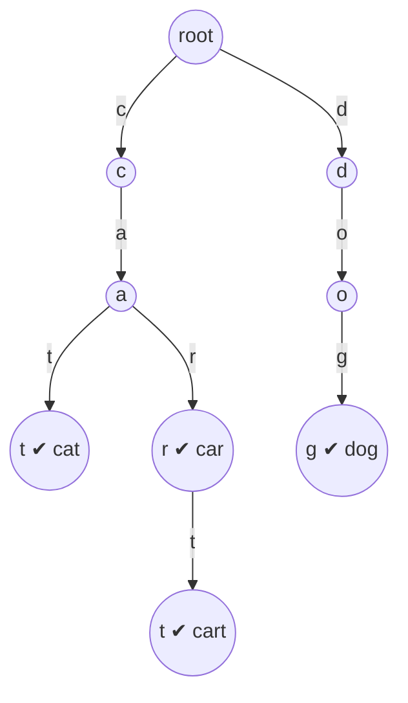

# 19 — Trie (Prefix Tree)

> Graded problems: [easy.md](easy.md) · [medium.md](medium.md) · [hard.md](hard.md)
> **লক্ষ্য:** "অনেক শব্দ, **prefix** দিয়ে খোঁজা" → trie। ইন্টারভিউতে ১০ মিনিটে `insert / search / startsWith` লিখতে পারা চাই।

---

## Theory

Trie হলো একটা tree যেখানে প্রতিটা edge একটা অক্ষর; root থেকে কোনো node পর্যন্ত পথ = একটা prefix। শব্দ শেষ হলে node-এ `end = true` চিহ্ন।

| অপারেশন | Trie | Hash set |
|---|---|---|
| exact search | O(L) | O(L) গড় (hash করতে) |
| **prefix আছে কি / prefix দিয়ে সব শব্দ** | O(L) (+ output) | O(N·L) — সব শব্দ স্ক্যান |
| memory | বেশি (প্রতিটা অক্ষরে node) | কম |

L = শব্দের দৈর্ঘ্য, N = শব্দ সংখ্যা।

### চেনার সংকেত

- autocomplete, "prefix দিয়ে শুরু হওয়া শব্দ"
- একটা grid/text-এ **অনেক** শব্দ একসাথে খোঁজা (Word Search II) — প্রতিটা শব্দের জন্য আলাদা DFS না করে, trie ধরে একবার DFS
- "সবচেয়ে ছোট root দিয়ে বদলাও" (Replace Words)
- wildcard `.` সহ খোঁজা → trie + DFS
- **bit trie**: সংখ্যার binary রূপ (MSB → LSB) দিয়ে trie → "maximum XOR"

## Diagram



## Templates

**PHP** — nested array হলো সবচেয়ে ছোট trie (`'$'` key = শব্দের শেষ):
```php
<?php
final class Trie
{
    private array $root = [];

    public function insert(string $word): void
    {
        $node = &$this->root;                     // reference: we mutate nested arrays in place
        foreach (str_split($word) as $ch) {
            $node[$ch] ??= [];
            $node = &$node[$ch];
        }
        $node['$'] = true;
    }

    private function walk(string $s): ?array
    {
        $node = $this->root;
        foreach (str_split($s) as $ch) {
            if (!isset($node[$ch])) return null;
            $node = $node[$ch];
        }
        return $node;
    }

    public function search(string $word): bool { return isset($this->walk($word)['$']); }
    public function startsWith(string $prefix): bool { return $this->walk($prefix) !== null; }
}

$t = new Trie();
$t->insert('apple');
assert($t->search('apple') && !$t->search('app') && $t->startsWith('app'));
$t->insert('app');
assert($t->search('app'));
```

> ⚠️ PHP array **value** দিয়ে কপি হয় — insert-এ `&` reference না দিলে root বদলায় না। `'$'` key-টা কোনো অক্ষরের সাথে মেলে না, কারণ ইনপুট a–z। (`str_split('')` PHP 8.2+-এ `[]` দেয়, কিন্তু 8.1 বা তার আগে `['']` — পুরনো সার্ভারে খালি string-এ সাবধান।)

**Python:**
```python
class Trie:
    def __init__(self):
        self.root: dict = {}

    def insert(self, word: str) -> None:
        node = self.root
        for ch in word:
            node = node.setdefault(ch, {})
        node["$"] = True

    def _walk(self, s: str):
        node = self.root
        for ch in s:
            if ch not in node:
                return None
            node = node[ch]
        return node

    def search(self, word: str) -> bool:
        node = self._walk(word)
        return node is not None and "$" in node

    def starts_with(self, prefix: str) -> bool:
        return self._walk(prefix) is not None

t = Trie()
t.insert("apple")
assert t.search("apple") and not t.search("app") and t.starts_with("app")
```

ইন্টারভিউয়ার class-ভিত্তিক node চাইলে: `children: dict[str, Node]` (বা ২৬-এর array) + `is_end: bool`।

## Common traps

- `search("app")` true দেওয়া যখন শুধু "apple" ঢোকানো — `end` চিহ্ন চেক ভুলে যাওয়া।
- PHP-তে reference (`&`) ছাড়া insert।
- Word Search II-তে পাওয়া শব্দ বারবার যোগ হওয়া → পেলেই `end` মুছে দাও।
- memory প্রশ্ন: ২৬-array node vs map node — sparse হলে map।

## Interview Q&A

**Q: Trie আর hash set — কখন কোনটা?**
🎤 "If I only need exact lookups, a hash set is simpler and lighter. A trie wins when I need prefix queries — autocomplete, or pruning a search as soon as a prefix can't lead to any word."

**Q: লাখ লাখ শব্দে memory কমাবে কীভাবে?**
Compressed trie (radix tree): একটাই child-ওয়ালা chain-গুলো এক edge-এ জোড়া। অথবা sorted array + binary search দিয়ে prefix range।

🔗 DistroSaaS: product/outlet নামের autocomplete search — **[Komol পূরণ করবে: autocomplete/search API-র স্টোরি ID]**। বাস্তবে DB-তে `LIKE 'abc%'` + B-tree index একই prefix আইডিয়া (B-tree prefix scan), আর বড় স্কেলে Elasticsearch-এর edge n-gram।
