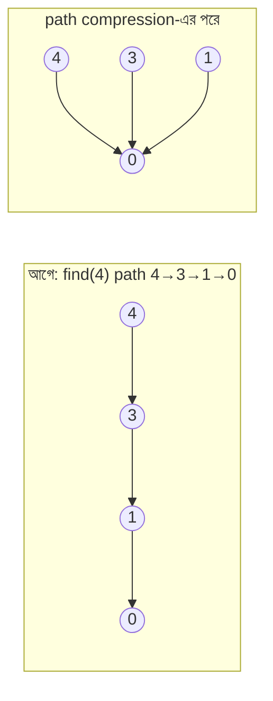

# 20 — Union-Find (Disjoint Set Union)

> Graded problems: [easy.md](easy.md) · [medium.md](medium.md) · [hard.md](hard.md)
> **লক্ষ্য:** "এই দুটো কি একই group-এ?" আর "এদের জোড়া লাগাও" — বারবার, প্রায় O(1)-এ। টেমপ্লেটটা ৩ মিনিটে লিখতে পারা চাই।

---

## Theory

প্রতিটা উপাদানের একটা `parent`; group-এর প্রতিনিধি (root) = যার parent নিজেই।
- `find(x)` — root খোঁজো। **Path compression:** পথে সবার parent সরাসরি root বানিয়ে দাও।
- `union(a, b)` — দুই root আলাদা হলে একটাকে আরেকটার নিচে বসাও। **Union by rank/size:** ছোট tree বড়টার নিচে।
- দুটো optimisation একসাথে → প্রতিটা অপারেশন amortised **O(α(n))** (inverse Ackermann, বাস্তবে ≤ 4) — কার্যত O(1)।

### কখন DSU, কখন BFS/DFS?

| পরিস্থিতি | ভালো পছন্দ |
|---|---|
| graph স্থির, একবার connected components গুনবো | DFS/BFS বা DSU — দুটোই O(V+E) |
| edge **একে একে আসে**, প্রতিবার "এখন কয়টা component?" | **DSU** (BFS প্রতিবার আবার চালাতে হয়) |
| undirected graph-এ cycle ধরো / redundant edge | **DSU** — `union` false দিলে cycle |
| Kruskal's MST | **DSU** |
| shortest path / path দরকার | BFS/DFS (DSU path দেয় না) |
| edge **মুছে ফেলা** | DSU পারে না (উল্টো ক্রমে যোগ করার কৌশল ছাড়া) |

### চেনার সংকেত

"connected", "group", "province/network/friend circle", "redundant", "merge accounts", "equations a==b / a!=b", "islands as land gets added"।

## Diagram



## Templates

**PHP:**
```php
<?php
final class DSU
{
    private array $parent;
    private array $size;
    public int $components;

    public function __construct(int $n)
    {
        $this->parent = range(0, $n - 1);
        $this->size = array_fill(0, $n, 1);
        $this->components = $n;
    }

    public function find(int $x): int
    {
        while ($this->parent[$x] !== $x) {
            $this->parent[$x] = $this->parent[$this->parent[$x]];   // path halving
            $x = $this->parent[$x];
        }
        return $x;
    }

    public function union(int $a, int $b): bool
    {
        $ra = $this->find($a); $rb = $this->find($b);
        if ($ra === $rb) return false;                             // already connected -> cycle edge
        if ($this->size[$ra] < $this->size[$rb]) [$ra, $rb] = [$rb, $ra];
        $this->parent[$rb] = $ra;                                  // small under big
        $this->size[$ra] += $this->size[$rb];
        $this->components--;
        return true;
    }
}

$d = new DSU(5);
assert($d->union(0, 1) && $d->union(3, 4));
assert($d->find(1) === $d->find(0) && $d->find(2) !== $d->find(0));
assert($d->union(1, 0) === false);
assert($d->components === 3);
```

**Python:**
```python
class DSU:
    def __init__(self, n: int):
        self.parent = list(range(n))
        self.size = [1] * n
        self.components = n

    def find(self, x: int) -> int:
        while self.parent[x] != x:
            self.parent[x] = self.parent[self.parent[x]]   # path halving
            x = self.parent[x]
        return x

    def union(self, a: int, b: int) -> bool:
        ra, rb = self.find(a), self.find(b)
        if ra == rb:
            return False
        if self.size[ra] < self.size[rb]:
            ra, rb = rb, ra
        self.parent[rb] = ra
        self.size[ra] += self.size[rb]
        self.components -= 1
        return True

d = DSU(5)
assert d.union(0, 1) and d.union(3, 4) and not d.union(1, 0) and d.components == 3
```

> Path halving (`parent[x] = parent[parent[x]]`) iterative আর recursion-মুক্ত; recursive full compression (`parent[x] = find(parent[x])`) একই complexity দেয় কিন্তু গভীর হলে Python-এ recursion limit।

## Common traps

- `union`-এ `parent[a] = b` (root না খুঁজে) — ভুল group।
- string/বড় id-র জন্য → আগে `id → index` map, অথবা dict-ভিত্তিক parent।
- component count আলাদা না রেখে শেষে সবার `find` গোনা — চলে, কিন্তু বাড়তি loop।
- directed graph-এ cycle ধরতে DSU চলে না → DFS colour বা Kahn ([21](../21-topological-sort/))।

## Interview Q&A

**Q: Path compression আর union by rank কেন দুটোই?**
🎤 "Union by size keeps trees shallow, and path compression flattens whatever depth remains when we look things up; together they give inverse-Ackermann time, which is effectively constant."

**Q: Redundant connection-এ DSU কেন?**
Edge যোগ করার সময় যদি দুই প্রান্ত আগে থেকেই একই group-এ থাকে, এই edge একটা cycle বানায় — সেটাই redundant।

🔗 DistroSaaS: duplicate outlet/customer রেকর্ড merge (একই ফোন বা ঠিকানা থাকলে একই group) — Accounts Merge-এর মতো — **[Komol পূরণ করবে: duplicate merge বা distributor-hierarchy grouping-এর স্টোরি ID]**।
