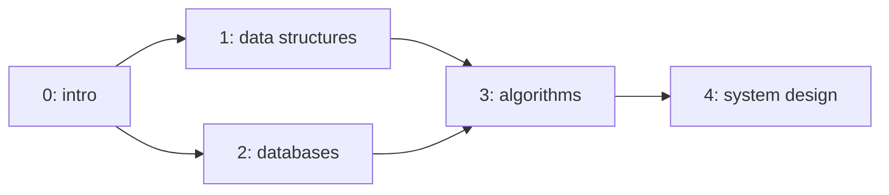

# 21 — Topological Sort

> Graded problems: [easy.md](easy.md) · [medium.md](medium.md) · [hard.md](hard.md)
> **লক্ষ্য:** "কোনটা কোনটার আগে" (dependency) → directed graph-এর এমন ক্রম যেখানে প্রতিটা edge `u → v`-তে `u` আগে। Cycle থাকলে কোনো ক্রম নেই — সেটা ধরতে পারাই অর্ধেক প্রশ্ন।

---

## Theory

Topological order শুধু **DAG**-এ (directed acyclic graph) থাকে। দুটো পদ্ধতি:

| | Kahn's algorithm (BFS) | DFS post-order |
|---|---|---|
| আইডিয়া | in-degree 0-এর node গুলো queue-তে; বের করে তার edge "মুছে" দাও | DFS শেষ হলে node stack-এ; শেষে উল্টো |
| cycle ধরা | শেষে বের হওয়া node < n → cycle | DFS-এ **gray** (চলমান) node আবার দেখলে cycle |
| ইন্টারভিউতে | সহজ, iterative, ব্যাখ্যা করা সহজ — **ডিফল্ট** | recursion; "safe state" ধরনের প্রশ্নে স্বাভাবিক |
| বাড়তি সুবিধা | level ধরে চালালে "কয় সেমিস্টার/ধাপ" পাওয়া যায় | — |

Complexity দুটোরই O(V + E)।

### চেনার সংকেত

- course prerequisites, build order, task dependency, package install order
- "valid ordering আছে কি?" → cycle detection
- "অজানা ভাষার বর্ণমালা ক্রম" (sorted শব্দ থেকে) → জোড়ায় প্রথম ভিন্ন অক্ষর = edge
- DAG-এ longest path / DP → topo order ধরে DP

## Diagram


একটা বৈধ ক্রম: `0, 1, 2, 3, 4` (বা `0, 2, 1, 3, 4`)।

## Templates

**PHP** — Kahn's:
```php
<?php
function topoSort(int $n, array $edges): array      // edges: [u, v] means u before v
{
    $adj = array_fill(0, $n, []);
    $indeg = array_fill(0, $n, 0);
    foreach ($edges as [$u, $v]) { $adj[$u][] = $v; $indeg[$v]++; }
    $q = new SplQueue();
    foreach ($indeg as $v => $d) if ($d === 0) $q->enqueue($v);
    $order = [];
    while (!$q->isEmpty()) {
        $u = $q->dequeue();
        $order[] = $u;
        foreach ($adj[$u] as $v) {
            if (--$indeg[$v] === 0) $q->enqueue($v);   // all prerequisites done
        }
    }
    return count($order) === $n ? $order : [];      // [] => cycle
}

assert(topoSort(5, [[0, 1], [0, 2], [1, 3], [2, 3], [3, 4]]) === [0, 1, 2, 3, 4]);
assert(topoSort(2, [[0, 1], [1, 0]]) === []);
```

**Python** — Kahn's আর DFS (3-colour) দুটোই:
```python
from collections import deque

def topo_kahn(n, edges):
    adj, indeg = [[] for _ in range(n)], [0] * n
    for u, v in edges:
        adj[u].append(v); indeg[v] += 1
    q = deque(v for v in range(n) if indeg[v] == 0)
    order = []
    while q:
        u = q.popleft()
        order.append(u)
        for v in adj[u]:
            indeg[v] -= 1
            if indeg[v] == 0:
                q.append(v)
    return order if len(order) == n else []

def topo_dfs(n, edges):
    adj = [[] for _ in range(n)]
    for u, v in edges:
        adj[u].append(v)
    WHITE, GRAY, BLACK = 0, 1, 2
    color, out = [WHITE] * n, []

    def dfs(u) -> bool:              # returns False if a cycle is found
        color[u] = GRAY
        for v in adj[u]:
            if color[v] == GRAY or (color[v] == WHITE and not dfs(v)):
                return False
        color[u] = BLACK
        out.append(u)                # post-order
        return True

    return out[::-1] if all(color[u] != WHITE or dfs(u) for u in range(n)) else []

edges = [[0, 1], [0, 2], [1, 3], [2, 3], [3, 4]]
assert topo_kahn(5, edges) == [0, 1, 2, 3, 4]
order = topo_dfs(5, edges)
pos = {v: i for i, v in enumerate(order)}
assert all(pos[u] < pos[v] for u, v in edges)
assert topo_kahn(2, [[0, 1], [1, 0]]) == [] and topo_dfs(2, [[0, 1], [1, 0]]) == []
```

## Common traps

- edge-এর দিক উল্টো: `[course, prereq]` মানে `prereq → course`। প্রবলেম পড়ে আগে ঠিক করো।
- DFS-এ শুধু `visited` (২ রং) দিয়ে cycle ধরা যায় না — directed graph-এ **gray** (বর্তমান পথে আছে) আলাদা লাগে।
- Kahn's-এ শুরুতে সব in-degree 0 node queue-তে দেওয়া (শুধু node 0 না)।
- একাধিক বৈধ ক্রম থাকতে পারে — টেস্টে নির্দিষ্ট ক্রম আশা করো না; বৈধতা যাচাই করো।

## Interview Q&A

**Q: Kahn's আর DFS — কোনটা বেছে নেবে?**
🎤 "I default to Kahn's algorithm: it's iterative, detects cycles by simply counting processed nodes, and processing it level by level also gives the minimum number of rounds if the question asks for that."

**Q: Undirected graph-এ topological sort?**
হয় না — undirected edge-এর কোনো দিক নেই। undirected cycle ধরতে DSU বা parent-চেক DFS।

🔗 DistroSaaS: DB migration/seeder-এর ক্রম, queue job-এর dependency, approval workflow-এর ধাপ — **[Komol পূরণ করবে: multi-step approval বা dependent job chain-এর স্টোরি ID]**। Laravel-এর `Bus::chain` একটা linear topo order; জটিল DAG-এ নিজে order বানাতে হয়।
