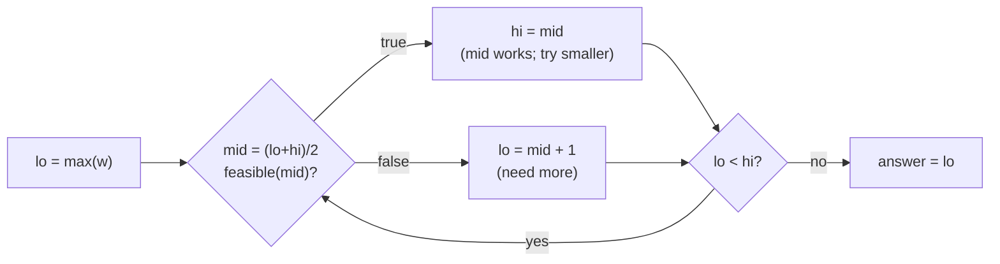

# 22 — Binary Search on Answer

> Graded problems: [easy.md](easy.md) · [medium.md](medium.md) · [hard.md](hard.md)
> **লক্ষ্য:** "সর্বনিম্ন X যাতে কাজটা সম্ভব" বা "সর্বোচ্চ X যাতে শর্ত মানে" — array-তে না, **উত্তরের রেঞ্জে** binary search। পুরো কৌশল দুটো জিনিসে: (১) `feasible(x)` লেখা, (২) সেটা monotonic কি না যাচাই।

---

## Theory

অনেক optimisation প্রশ্নে সরাসরি উত্তর বের করা কঠিন, কিন্তু "উত্তর **x** হলে চলবে?" যাচাই করা সহজ (সাধারণত O(n) greedy)। আর যদি:

```
feasible(x) = false false false TRUE TRUE TRUE ...
```

অর্থাৎ x বাড়ালে একবার true হলে true-ই থাকে (**monotonic**), তাহলে প্রথম true-টা binary search দিয়ে O(n log Range)-এ।

### ৪ ধাপ (মুখে বলো)

1. **উত্তরের রেঞ্জ:** `lo` = সবচেয়ে ছোট সম্ভাব্য, `hi` = নিশ্চিতভাবে যথেষ্ট (যেমন `max(nums)` বা `sum(nums)`)।
2. **feasible(x):** greedy simulation — "x স্পিড/ক্যাপাসিটি/সীমা দিয়ে কাজটা শেষ হয়?"
3. **monotonic কেন:** এক লাইনে বলো ("বেশি ক্যাপাসিটি দিলে কম দিন লাগে, কখনো বেশি না")।
4. **টেমপ্লেট:** minimize → প্রথম true; maximize → শেষ true।

### চেনার সংকেত

- "minimum speed / capacity / time / largest sum যাতে …"
- "maximize the minimum distance" (aggressive cows / magnetic balls)
- "k-th smallest" যেখানে সব উপাদান বানানো ব্যয়বহুল (multiplication table, pair distance)
- constraint-এ মান ১০⁹ পর্যন্ত, কিন্তু n ছোট-মাঝারি → log(10⁹) ≈ 30 রাউন্ড

## Diagram



## Templates

**PHP:**
```php
<?php
// smallest x in [lo, hi] with feasible(x) true (assumes feasible(hi) is true)
function firstTrue(int $lo, int $hi, callable $feasible): int
{
    while ($lo < $hi) {
        $mid = $lo + intdiv($hi - $lo, 2);
        if ($feasible($mid)) $hi = $mid; else $lo = $mid + 1;
    }
    return $lo;
}

// largest x in [lo, hi] with feasible(x) true (assumes feasible(lo) is true)
function lastTrue(int $lo, int $hi, callable $feasible): int
{
    while ($lo < $hi) {
        $mid = $lo + intdiv($hi - $lo + 1, 2);   // upper mid, or lo = mid loops forever
        if ($feasible($mid)) $lo = $mid; else $hi = $mid - 1;
    }
    return $lo;
}

// Koko: smallest speed k so all piles are eaten within h hours
$piles = [3, 6, 7, 11]; $h = 8;
$k = firstTrue(1, max($piles), function (int $k) use ($piles, $h): bool {
    $hours = 0;
    foreach ($piles as $p) $hours += intdiv($p + $k - 1, $k);   // ceil(p / k)
    return $hours <= $h;
});
assert($k === 4);
assert(lastTrue(0, 100, fn($x) => $x * $x <= 50) === 7);
```

**Python:**
```python
def first_true(lo: int, hi: int, feasible) -> int:
    while lo < hi:
        mid = (lo + hi) // 2
        if feasible(mid):
            hi = mid
        else:
            lo = mid + 1
    return lo

def last_true(lo: int, hi: int, feasible) -> int:
    while lo < hi:
        mid = (lo + hi + 1) // 2
        if feasible(mid):
            lo = mid
        else:
            hi = mid - 1
    return lo

piles, h = [3, 6, 7, 11], 8
assert first_true(1, max(piles), lambda k: sum(-(-p // k) for p in piles) <= h) == 4
assert last_true(0, 100, lambda x: x * x <= 50) == 7
```

## Common traps

- **রেঞ্জ ভুল:** `lo` খুব বড় হলে আসল উত্তর বাদ পড়ে (ship capacity-তে `lo = max(weights)`, 1 না — নইলে feasible-এ একটা প্যাকেজ কখনো ধরে না)।
- `lastTrue`-এ `mid` নিচের দিকে গোল → `lo = mid`-এ infinite loop।
- `ceil(p / k)` integer-এ: `intdiv(p + k − 1, k)`; float ব্যবহার করবে না।
- feasible monotonic না হলে (যেমন "ঠিক K") এই কৌশল চলে না → "≤ K" আর "≤ K−1" দুটো আলাদা করে ভাবো।
- overflow: `mid` = `lo + (hi − lo) / 2` অভ্যাস রাখো (PHP/Python-এ সমস্যা কম, Java/C++-এ জরুরি)।

## Interview Q&A

**Q: কীভাবে বুঝলে এটা binary search on answer?**
🎤 "The question asks for the minimum value that makes something possible, checking a candidate is a simple greedy pass, and if a value works then every larger value also works — that monotonicity lets me binary search the answer space."

**Q: Complexity?**
O(n · log(hi − lo)) — প্রতিটা binary search ধাপে একটা O(n) feasibility check, আর ধাপ সংখ্যা রেঞ্জের log।

🔗 DistroSaaS: "সর্বনিম্ন কয়টা queue worker / van লাগবে যাতে X ঘণ্টায় সব অর্ডার শেষ হয়" — capacity planning ঠিক এই আকারের প্রশ্ন — **[Komol পূরণ করবে: worker/capacity sizing-এর স্টোরি ID]**।
