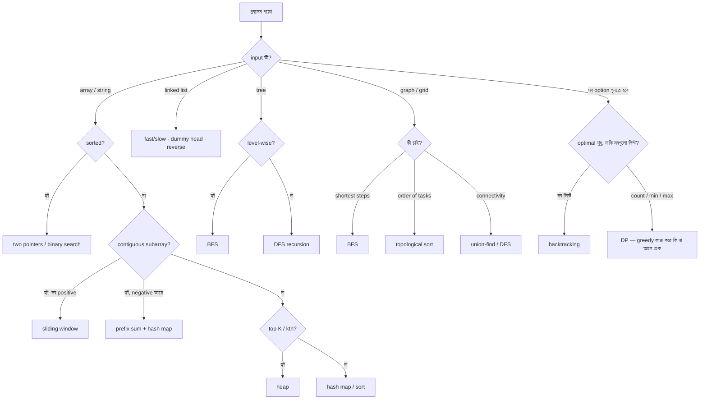

# Which Pattern? — Decision Sheet

প্রবলেম পড়ার পর প্রথম ৬০ সেকেন্ডের কাজ: **input-এর আকার + প্রশ্নের শব্দ** দেখে প্যাটার্ন ঠিক করা। এই শিটটা সেই ৬০ সেকেন্ডের জন্য। লাইভ কোডিং-এর পুরো ধাপগুলো আছে [`live-coding-script.md`](live-coding-script.md)-এ।

---

## ১. Constraint দেখে লক্ষ্য complexity

ইন্টারভিউয়ার যে `n` দেয়, সেটাই বলে দেয় কোন complexity লাগবে (~10⁸ সাধারণ অপারেশন/সেকেন্ড ধরে)।

| `n` কত | লক্ষ্য | সাধারণত কোন প্যাটার্ন |
|---|---|---|
| ≤ 10–12 | O(n!) / O(2ⁿ·n) | backtracking, সব permutation |
| ≤ 20–25 | O(2ⁿ) | subset enumeration, bitmask DP |
| ≤ 500 | O(n³) | 3-loop DP (interval DP), Floyd–Warshall |
| ≤ 5,000 | O(n²) | 2-D DP, প্রতিটা pair |
| ≤ 10⁵–10⁶ | O(n log n) বা O(n) | sort, heap, binary search, two pointers, hash map, sliding window |
| ≤ 10⁹ বা বেশি | O(log n) বা O(1) | binary search on answer, math |

🎤 **Say this:** "n is up to ten to the five, so a quadratic solution would be ten billion steps — I need n log n or better."

---

## ২. প্রশ্নের শব্দ → প্যাটার্ন

| প্রশ্নে কী দেখছো | প্রথমে ভাবো | ফোল্ডার |
|---|---|---|
| "pair / triplet যার যোগফল X", **sorted** array | Two pointers | [04](04-two-pointers-sliding-window/) |
| "pair যার যোগফল X", unsorted | Hash map (দেখা মান → index) | [03](03-hashing/) |
| "contiguous subarray / substring", longest/shortest/at most K | Sliding window | [04](04-two-pointers-sliding-window/) |
| "subarray sum = K" (negative থাকতে পারে) | Prefix sum + hash map | [17](17-prefix-sum/) |
| "range sum" অনেকবার | Prefix sum | [17](17-prefix-sum/) |
| "next greater / smaller", "দিন কতদিন পরে বাড়বে", histogram | Monotonic stack | [18](18-monotonic-stack/) |
| brackets, nested, "undo", expression | Stack | [05](05-stack-queue/) |
| "top K", "Kth largest", "K closest", stream-এর median | Heap | [15](15-heap/) |
| intervals, meetings, overlap, merge | Sort by start (বা end) | [16](16-intervals/) |
| sorted array-তে খোঁজা, "minimum X যাতে শর্ত মেলে" | Binary search (+ on answer) | [08](08-sorting-searching/), [22](22-binary-search-on-answer/) |
| linked list, cycle, middle, "k-th from end" | Fast/slow pointer, dummy head | [06](06-linked-list/) |
| tree, "depth / path / ancestor" | DFS (recursion) | [09](09-trees-bst/) |
| "level by level", "shortest steps" (unweighted) | BFS | [09](09-trees-bst/), [10](10-graphs-bfs-dfs/) |
| grid-এ island / region / flood | DFS/BFS on grid | [10](10-graphs-bfs-dfs/) |
| "connected?", "group", বারবার merge | Union-Find | [20](20-union-find/) |
| dependency, "কোনটা আগে", course order | Topological sort | [21](21-topological-sort/) |
| prefix দিয়ে শব্দ খোঁজা, autocomplete, word search অনেক শব্দ | Trie | [19](19-trie/) |
| "সব combination / permutation / subset" | Backtracking | [07](07-recursion-backtracking/) |
| "কতভাবে", "minimum cost", "max profit", overlapping choices | DP | [12](12-dp/) |
| "প্রতিবার সবচেয়ে ভালোটা নিলেই হয়" (proof সহজ) | Greedy | [11](11-greedy/) |
| bits, XOR, "একটা ছাড়া সব দুবার" | Bit manipulation | [13](13-math-bit-manipulation/) |
| টেবিল, "highest per group", ranking | SQL window function | [14](14-sql/) |

---

## ৩. Decision flow

---

## ৪. "Brute force → optimize" এর ৫টা সাধারণ চাল

| Brute force-এ কী ধীর | কী দিয়ে বদলাও | উদাহরণ |
|---|---|---|
| ভেতরের loop দিয়ে কিছু খোঁজা | Hash map/set (O(1) lookup) | Two Sum O(n²) → O(n) |
| বারবার range-এর যোগফল | Prefix sum | range sum query |
| প্রতিটা window আবার গোনা | Sliding window (ঢোকা − বেরোনো) | max sum of size k |
| বারবার সবচেয়ে বড়/ছোট খোঁজা | Heap | merge k lists |
| একই sub-problem বারবার | Memo / DP টেবিল | fib, coin change |
| linear খোঁজা sorted ডেটায় | Binary search | search insert |
| "উত্তর X হলে চলবে?" — X-এর ওপর linear | Binary search on answer | Koko bananas |

🎤 **Say this:** "The brute force repeats the same lookup inside a loop, so I'll trade memory for time with a hash map."

---

## ৫. ফাঁদ (প্রায়ই ভুল প্যাটার্ন বেছে ফেলি)

- **Sliding window শুধু তখনই** যখন window বড় করলে শর্ত এক দিকে বদলায় (monotonic)। Negative সংখ্যা থাকলে subarray sum-এ sliding window ভাঙে → prefix sum + map।
- **Greedy** মনে হলে একটা counter-example খোঁজো ৩০ সেকেন্ড। Coin change `[1,3,4]`, amount `6` → greedy `4+1+1` (৩টা), সঠিক `3+3` (২টা) → DP।
- **"Subsequence"** (মাঝে ফাঁক চলে) ≠ **"substring/subarray"** (contiguous)। Subsequence প্রায় সবসময় DP।
- **Weighted** shortest path-এ BFS চলে না → Dijkstra (heap)।
- PHP-তে `array_shift` O(n) — BFS-এ বড় input হলে `SplQueue` ব্যবহার করো।

## Related

- [`live-coding-script.md`](live-coding-script.md) — ইন্টারভিউতে কী বলবে, কোন ক্রমে
- [`curated-180.md`](curated-180.md) — সব প্রবলেমের ইনডেক্স
