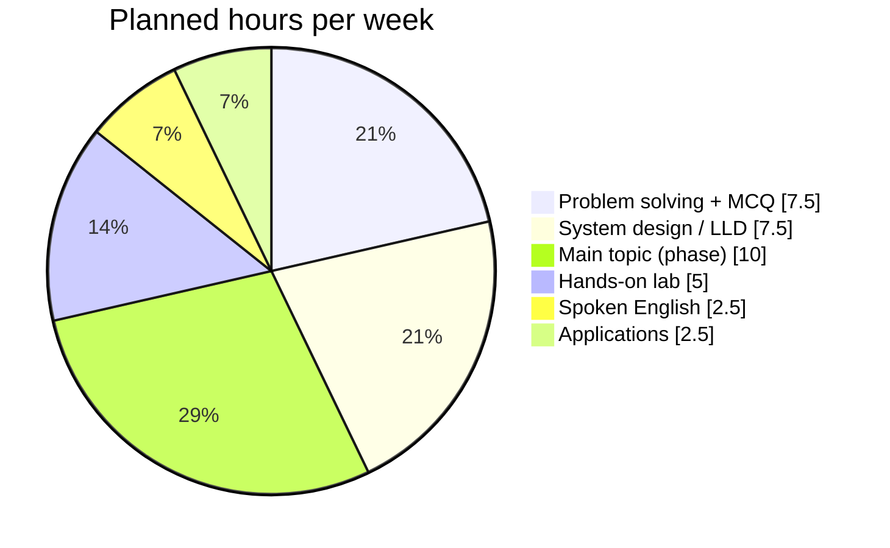
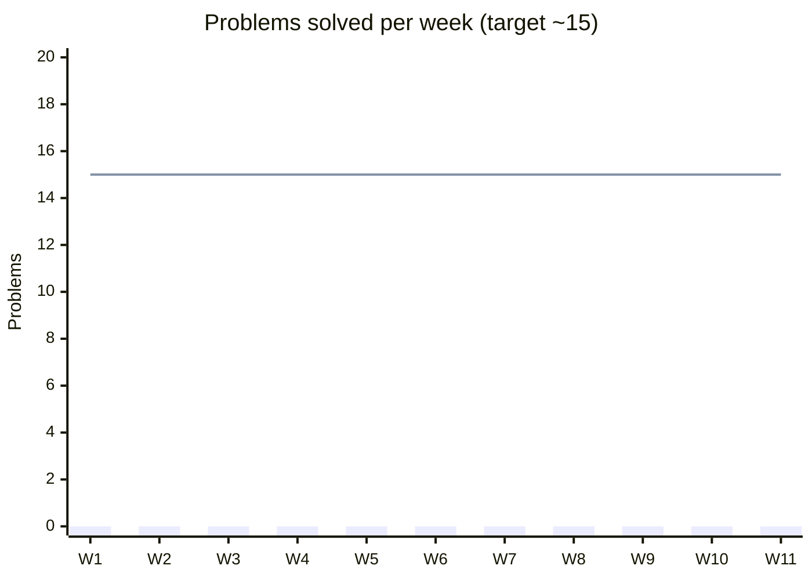
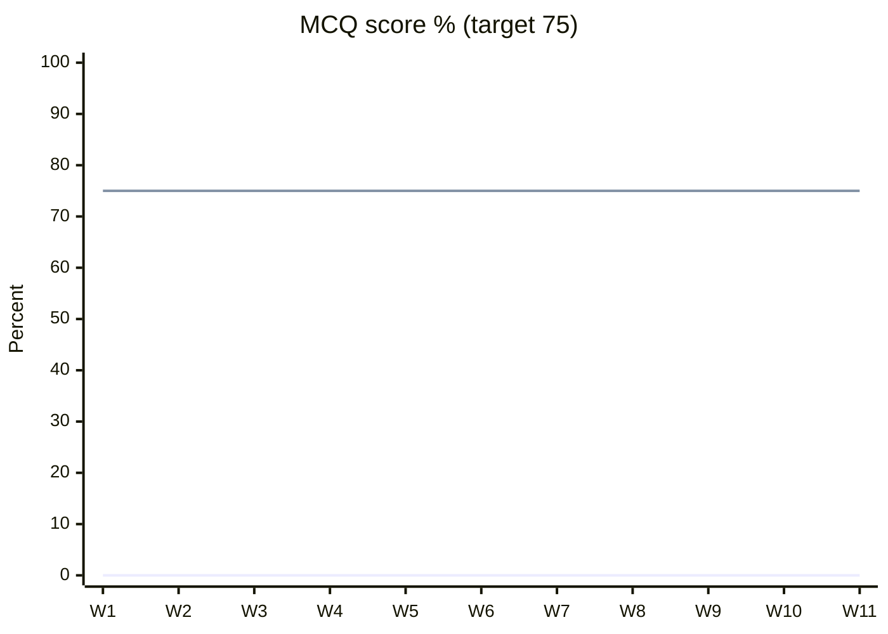
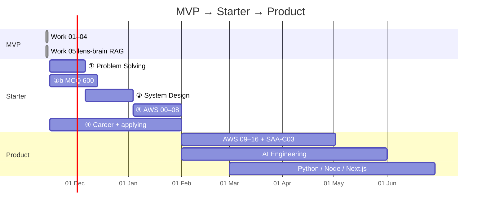

# 📊 Dashboard

> শুরু: ২০২৬-১১-১৪ · **MVP সম্পূর্ণ** · এখন: **Starter ① Problem Solving**, W1 = ২০২৬-১১-১৬
> সংখ্যার উৎস: [`00-start/tracker.md`](00-start/tracker.md) · কনটেন্ট-হেলথ: [`00-start/health-report.md`](00-start/health-report.md) · প্ল্যান: [`00-start/roadmap.md`](00-start/roadmap.md)

## KPI

| 🔥 Streak | 🧩 Problems E/M/H | ✅ MCQ % | 🏗️ SD cases ড্রিল | ☁️ AWS মডিউল | 🤖 AI মডিউল | 📨 আবেদন / ইন্টারভিউ | 🎤 মক |
|:-:|:-:|:-:|:-:|:-:|:-:|:-:|:-:|
| **0** দিন | **0** / 0 / 0 | **—** (0 উত্তর) | **0** | **0** / 9 | **0** | **0** / 0 | **0** |

## টিয়ার

| টিয়ার | অগ্রগতি | % | কী গোনা হয় |
|---|---|--:|---|
| MVP | `██████████` | 100 | Work 01–05 সম্পূর্ণ |
| Starter | `░░░░░░░░░░` | 0 | roadmap §৩-এর লক্ষ্য, W1–W11 |
| Product | `░░░░░░░░░░` | 0 | ফেব্রুয়ারি ২০২৭ থেকে |

## ট্র্যাক (Starter লক্ষ্যের বিপরীতে)

| ট্র্যাক | অগ্রগতি | এখন / লক্ষ্য |
|---|---|---|
| Problem solving | `░░░░░░░░░░` | 0 / 150 সমাধান |
| MCQ | `░░░░░░░░░░` | 0% / ≥ 75% (ব্যাংকে ~100 / 600) |
| System design | `░░░░░░░░░░` | 0 / 11 নতুন case |
| AWS | `░░░░░░░░░░` | 0 / 9 মডিউল (00–08) |
| Career | `░░░░░░░░░░` | 0 / 2 `// BUILD` প্রজেক্ট · 0 আবেদন |
| AI engineering | `░░░░░░░░░░` | Product টিয়ার |

## সময় কোথায় যায় (পরিকল্পিত, সপ্তাহে ৫ দিন × ৭ ঘণ্টা)

## সাপ্তাহিক ট্রেন্ড

## টাইমলাইন

## Weak areas (heat)

[`weak-areas.md`](.claude/memory/weak-areas.md) থেকে। এখন শুধু Claude-এর `Guess`; প্রথম `/study-start`-এ Komol `Now` ভরলে সেটা দিয়ে বদলাবে।
🟥 < ১ · 🟧 ১–১.৪ · 🟨 ১.৫–২.৪ · 🟩 ≥ ২.৫

| গ্রুপ | টপিক | 🔴 এখনই | গড় (Guess) | Now | হিট |
|---|--:|--:|--:|--:|:-:|
| Problem Solving + CS Fundamentals | 18 | 18 | 1.2 | — | 🟧 |
| System Design + LLD | 10 | 7 | 1.2 | — | 🟧 |
| Backend + Data | 9 | 2 | 1.7 | — | 🟨 |
| Cloud + DevOps | 12 | 6 | 0.9 | — | 🟥 |
| AI Engineering | 5 | 0 | 0.8 | — | 🟥 |
| Frontend | 4 | 0 | 1.8 | — | 🟨 |
| Behavioral + Career | 3 | 2 | 1.0 | — | 🟧 |

## Applications pipeline

[`12-career/applications.md`](12-career/applications.md) থেকে (মূল ডেটা MyLens অ্যাপে)।

| Applied | Screening | Technical | Final | Offer | Rejected |
|:-:|:-:|:-:|:-:|:-:|:-:|
| 0 | 0 | 0 | 0 | 0 | 0 |

## Content health

[`00-start/health-report.md`](00-start/health-report.md) থেকে (`python3 scripts/health.py`, ২০২৬-১১-১৪; word count এখন বাংলা শব্দ পুরো গোনে)।
RAG index: 239 ফাইল · 1,037 chunks · 5,757 vectors (`lens stats`)।

| ফোল্ডার | md | words | stubs | leak files |
|---|--:|--:|--:|--:|
| 01-problem-solving | 77 | 14,500 | 37 | 0 |
| 02-cs-fundamentals-mcq | 2 | 1,174 | 0 | 0 |
| 03-system-design | 23 | 23,889 | 0 | 20 |
| 04-design-patterns-lld | 25 | 20,205 | 0 | 23 |
| 05-backend | 61 | 156,930 | 0 | 47 |
| 06-aws-devops | 4 | 3,014 | 0 | 2 |
| 07-ai-engineering | 1 | 42 | 0 | 0 |
| 08-frontend-nextjs | 12 | 6,002 | 0 | 6 |
| 09-real-world-cases | 1 | 46 | 0 | 0 |
| 10-behavioral-leadership | 5 | 3,264 | 0 | 3 |
| 11-mocks | 8 | 18,051 | 2 | 5 |
| 12-career | 6 | 1,155 | 2 | 4 |
| **মোট** (root + 00-start সহ) | **233** | **257,071** | **42** | **110** |

Broken links 0 · missing README 0 · missing frontmatter 0 · paths with spaces 0।
