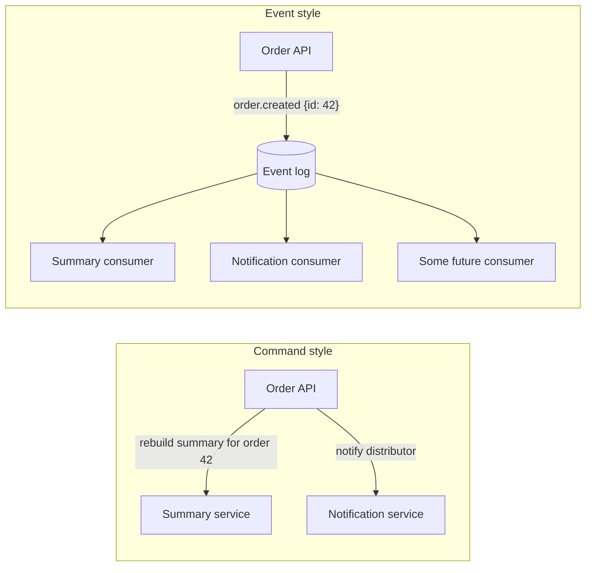
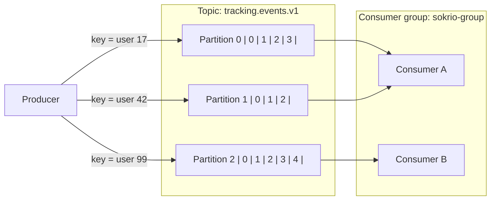

## From Cron Jobs to Events: A Working Engineer's Guide to Event-Driven Systems and Kafka

*Part 1 of 2 — the concepts. Part 2 is the production story of running Kafka inside a multi-tenant Laravel monolith.*

Most business applications start out the same way: a request comes in, you write to the database, you return a response. Anything heavier goes into a scheduled job — "every hour, rebuild the summary table," "every night, recompute the dashboard." That model is simple, debuggable, and gets you a surprisingly long way.

At Sokrio it got us a long way too. Then two kinds of work started to hurt:

1. **High-frequency, low-value-per-event data.** Field reps' phones send GPS breadcrumbs all day. Writing every point into two databases inside the HTTP request makes the mobile app wait on work the user never sees.
2. **Data that's only correct after a batch job runs.** Our primary order summaries — the denormalized, one-row-per-product-line view that reports and dashboards read — are rebuilt by an hourly cron. Place an order at 10:46 and it may not show up correctly until after 11:45.

Both problems have the same shape: *something happened*, and *some slower work should follow from it*, but the two don't need to happen in the same request — or wait for the same clock. That's the problem event-driven architecture solves. This post is the mental model we wish we'd had before writing our first Kafka consumer.

### What "event-driven" actually means

An **event** is a fact, stated in the past tense: `order.created`, `tracking.created`, `delivery.created`. It describes something that already happened. Nobody can reject it — you can only react to it.

That's the key difference from a **command** (`CreateInvoice`, `SendEmail`), which asks a specific receiver to do something and can fail or be refused. A command couples the sender to the receiver: the sender knows who should act and usually waits to hear back. An event inverts that: the producer announces what happened and doesn't know — or care — who's listening.



In the command style, adding a third reaction means editing the Order API. In the event style, you add a consumer and the producer never changes. That decoupling is the whole point — and, as we'll see, also the whole cost.

### Three flavors of event, and why the difference matters

"Event-driven" gets used for three quite different patterns. Knowing which one you're building changes how you design the payload.

| Pattern | Payload carries | Consumer does | Trade-off |
|---|---|---|---|
| **Event notification** ("thin") | Just an ID: `{order_id: 42}` | Calls back to the source of truth to fetch current state | Small messages, one source of mapping logic; costs an extra read per event |
| **Event-carried state transfer** ("fat") | The full state: every field the consumer needs | Writes it directly, never calls back | Self-contained and fast; payload schema becomes a contract you must version |
| **Event sourcing** | Every change, forever | Rebuilds state by replaying the full history | Complete audit trail; a big architectural commitment |

We use both of the first two, deliberately. GPS tracking events are **fat** — a lat/long point is small, fully known at publish time, and the consumer just persists it. The upcoming primary order pipeline will be **thin** — an order has many product lines and ~20 denormalized fields per line, and we already have a tested query that builds that shape. Shipping `{order_id}` and letting the consumer re-run the existing query avoids a second mapping implementation that would slowly drift from the first.

We don't do event sourcing. Most business apps don't need it, and you'll know if yours does.

### Why Kafka is a log, not a queue

If you've used Laravel queues, Sidekiq, or RabbitMQ, your mental model is probably a **queue**: a job goes in, one worker takes it out, and it's gone.

Kafka is a different thing: an **append-only log**. Messages are written to the end and *stay there* for a retention period (days, weeks, or forever), whether or not anyone has read them. Readers don't remove messages; each reader just keeps a bookmark of how far it has read.

That one difference gives you three properties a queue doesn't:

- **Multiple independent readers.** The summary builder and an analytics pipeline can both read every `order.created` event, each at its own pace, without stealing messages from each other.
- **Replay.** Deployed a buggy consumer? Fix it, move its bookmark back, and reprocess. With a queue, those jobs are gone.
- **Buffering against slow consumers.** If the consumer falls behind or goes down for an hour, the events just wait in the log. The producer never notices.

### The five concepts you actually need

**Topic.** A named stream of related events — `tracking.events.v1`. Think "table," not "queue." Put a version in the name; you will change the payload shape one day.

**Partition.** A topic is split into N partitions, each an independent ordered log. Partitions are the unit of parallelism: a topic with 3 partitions can be read by up to 3 consumers in parallel.

**Offset.** Every message in a partition has a sequential position number. A consumer's "bookmark" is the offset it has finished processing — its **committed offset**. On restart, it resumes from there.

**Consumer group.** Consumers that share a `group_id` divide the partitions among themselves: each partition is owned by exactly one member at a time. When a member joins or leaves, Kafka **rebalances** — redistributes partitions. A different group gets its own independent set of offsets and sees every message again.

**Partition key.** When you publish, you pick a key. Kafka hashes the key to choose a partition, so **every message with the same key lands on the same partition, in order.**



That last concept is the one people underestimate. **Kafka only guarantees order within a partition, never across the whole topic.** So the question "what should the key be?" really means "which events must stay in order relative to each other?"

- For GPS breadcrumbs, order matters **per field rep** — a route drawn from out-of-order points is wrong. We key by user.
- For tenant-scoped business events in a multi-tenant system, a sensible default is **per tenant** — key by tenant id and you get per-tenant ordering with no locks anywhere.
- The flip side: a key with too few distinct values (or one huge tenant) concentrates traffic on one partition. Keying by something finer-grained, like user, spreads load better while still preserving the ordering you actually need.

### Delivery semantics: the question you can't skip

A consumer does two things for each message: **process it** (write to the database) and **commit the offset** (move the bookmark). The order you do them in decides what happens when the process crashes in between.

| Approach | Crash between the two steps means | Name |
|---|---|---|
| Commit, then process | Message is skipped forever | **At-most-once** |
| Process, then commit | Message is processed again on restart | **At-least-once** |
| Process and commit atomically | Neither — only possible in specific setups (Kafka transactions, or offsets stored in the same DB transaction as the write) | **Exactly-once** |

In practice almost everyone builds **at-least-once plus idempotent handlers**: process then commit, and write the handler so that running it twice gives the same result as running it once. Upserts keyed on a natural ID (`order_id + product_id`), unique constraints, or a stored `event_id` you check before writing all get you there.

There's a subtler trap too: even with process-then-commit, if your handler *catches* its own failures, logs them, and returns normally, the offset commits and that message is gone. You've built at-most-once for the failure path without meaning to. That isn't always wrong — dropping one GPS ping after three retries is fine; dropping an order is not — but it should be a decision, not an accident. (Part 2 covers how we handle this.)

### Designing the event itself

A few conventions that cost nothing up front and save a lot later:

```json
{
  "event_id": "8f1c2d4e-...-uuid-v4",
  "event_type": "tracking.created",
  "tenant_id": 123,
  "occurred_at": "2026-09-08T10:00:00+00:00",
  "payload": { "lat": 23.81, "lng": 90.41, "user_id": 17 }
}
```

- **An envelope, separate from the payload.** Every event has the same outer shape, so one generic consumer loop can decode, route, and log any topic. Only the handler looks inside `payload`.
- **`event_id`** — a UUID minted at publish time. It's your deduplication key and your log-correlation ID.
- **`occurred_at`** — when it happened, not when it was processed. Consumers that lag behind still know the real time.
- **`tenant_id` in the envelope** if you're multi-tenant. The consumer has no HTTP request, no subdomain, no session — the event is the only place the tenant can come from.
- **Versioned topic names** (`.v1`) so a breaking payload change can go to a new topic while old consumers drain the old one.

### What you give up

Event-driven systems aren't free, and it's worth being honest about the bill before you sign up:

- **Eventual consistency.** The API returns before the work is done. A user who creates an order and immediately opens the report might not see it yet. Your UI and your support team both need to understand that.
- **Harder debugging.** "Why is this row wrong?" used to mean reading one request's stack trace. Now it means tracing an event across a producer, a broker, and a consumer that may have run minutes later, on a different machine.
- **A new thing to operate.** A broker cluster, consumer processes that must stay up, rebalances, lag monitoring, retention policies. That's real operational load.
- **Failure modes you haven't met yet.** Long-running consumer processes fail in ways request/response code never does — memory growth, stale DB connections, signal handling. (Part 2 is mostly a catalogue of these.)

So when is it worth it? Roughly: when the work triggered by an event is **slow, high-volume, or has more than one interested party**, and the user doesn't need the result in the same response. If the work is quick, rare, and has exactly one consumer, a plain queued job is usually the better tool — and it's probably already running in your stack.

### The short version

- An event is a past-tense fact; producers announce, consumers react, neither knows about the other.
- Choose thin vs fat payloads on purpose: thin keeps one source of truth, fat keeps the consumer self-sufficient.
- Kafka is a log, not a queue — messages stay, readers keep bookmarks, and replay is a feature.
- Ordering is per partition only; your partition key *is* your ordering decision.
- Decide your delivery semantics explicitly, and make handlers idempotent.
- Pay the complexity cost only where latency, volume, or fan-out justify it.

---

*Next in this series: [Kafka in a Multi-Tenant Laravel Monolith](04-kafka-in-production-multi-tenant-laravel.md) — two reverts, one profiler bug, and the rules we kept.*
