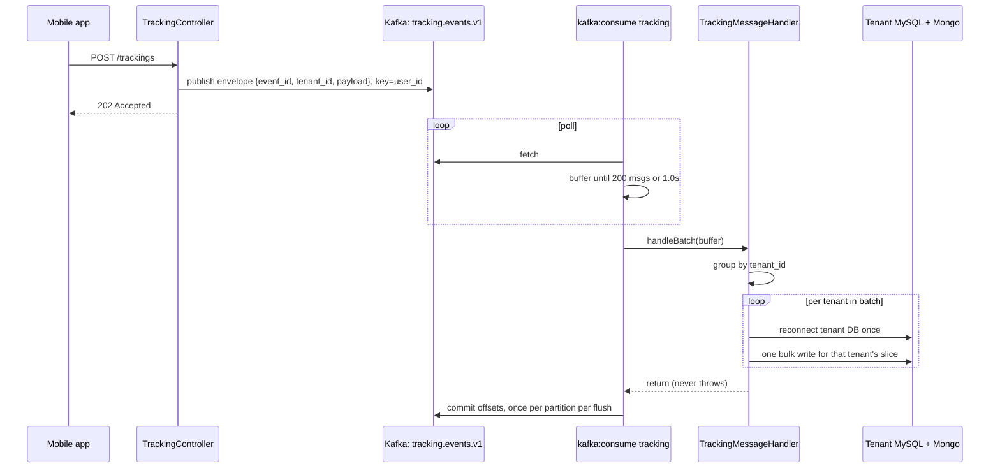

## Kafka in a Multi-Tenant Laravel Monolith: Two Reverts, One Profiler Bug, and the Rules We Kept

*Part 2 of 2 — the production story. [Part 1](03-event-driven-systems-and-kafka.md) covers the event-driven concepts this builds on.*

Most Kafka write-ups assume a JVM service, a mature client library, and a team whose whole job is streaming. Ours didn't look like that. `sokrio-server` is a multi-tenant Laravel monolith — one database per tenant, connections switched per request by middleware (covered in [post 01](01-multi-tenant-saas-architecture.md)). Our Kafka client is `longlang/phpkafka`, a pure-PHP implementation. Our consumers are `php artisan` commands kept alive by Supervisor.

None of that is unusual on its own. Put together, it produced a set of failure modes we couldn't find written down anywhere. This post covers the design we ended up with, how we rolled it out without trusting it, and the incidents that turned "it works on my machine" into "it runs unsupervised in production."

### The first workload: GPS tracking

We chose our first Kafka pipeline on purpose. Field reps' phones post GPS breadcrumbs all day — high volume, low value per event, and losing one point is a minor blemish on a route map, not a lost order. It's the ideal place to learn how a new pipeline breaks.

Before Kafka, every tracking POST wrote synchronously to MySQL and to a MongoDB report collection, and the phone waited for both. Today, the request does this:

```php
// A null return means the event never reached the broker (every failure
// mode is swallowed in KafkaProducer::publish), so the consumer will never
// see this sample — write it synchronously to the same two stores instead.
$eventId = $this->producer->publish(
    $topic,
    TopicRegistry::TRACKING_CREATED,
    $tenantId,
    $validated,
    (string) $user->id   // partition key: per-rep ordering
);

if ($eventId === null) {
    (new WriteTrackingActions())($validated);
}

return response()->jsonAs('tracking', $validated, Response::HTTP_ACCEPTED);
```

Three decisions are in those few lines:

- **`202 Accepted`, not `201 Created`.** On the happy path the consumer owns persistence. The API is honest that the write hasn't happened yet.
- **The broker being down is not an outage.** If publishing fails, the request falls back to the old synchronous write. The mobile app never sees Kafka's health.
- **Keyed by user, not tenant.** Breadcrumbs have to stay in order per rep. Keying by tenant would also keep that order, but it would push a large tenant's entire fleet through a single partition.

### The shape of the pipeline



Every event uses the envelope from Part 1, so `tenant_id` arrives with the message. This matters more in a multi-tenant system than anywhere else. **A consumer process has no tenant.** It has no subdomain and no request for middleware to inspect. One `kafka:consume` process handles every tenant's events on the partitions it owns, so the handler has to resolve the tenant itself, reconnect `TenantManager`, and only then write.

That makes "one reconnect per message" the obvious mistake. The handler groups each batch by `tenant_id` first. Each tenant then gets one reconnect and one bulk write per flush, regardless of how many of its messages were in the batch.

### Rolling out something you don't trust yet

Kafka took three attempts to land in our codebase. The first merged pipeline, for order summaries, was reverted. The next one, a from-scratch tracking pipeline, was reverted too before it was re-merged and finally stuck. Two reverts sound bad, but they were cheap because of one rule we set early: **the old write path never goes away until the new one has proven itself.**

The rollout went in three stages:

1. **Parallel signal.** The request kept its synchronous writes *and* published to Kafka. The consumer ran, but nothing depended on it. Reverting meant removing one publish call.
2. **Shadow collection.** The consumer wrote to `tracking_reports_new`, a temporary collection with the same shape as the real one. We diffed the two to confirm the async path produced identical data.
3. **Cutover.** We deleted the shadow model, pointed the consumer at the real stores, switched the endpoint to `202 Accepted`, and demoted the synchronous write to a fallback for when the broker is unreachable.

If you take one thing from this post, take this: **give a new async write path a shadow table and a validation window before it touches real data.** Even a short validation window turns "we think it's right" into "we diffed it."

### The incidents

These are the problems that shaped the current code, in roughly the order we hit them. Most of them never reproduced locally.

#### 1. The profiler that broke our sockets

In production, publishes started failing at random with `ErrorException`, and the consumer crashed mid-poll with `Could not read N bytes from stream (not readable)`. It looked like flaky networking, but nothing was wrong with the network.

The cause was **Datadog's continuous profiler**. It samples the call stack by sending the process timer signals roughly 100 times a second. When a signal arrives during a blocking syscall such as `stream_select()` or `stream_socket_client()`, the syscall returns `EINTR` ("interrupted, try again"). A C client would retry transparently. The pure-PHP Kafka client didn't, so it surfaced every interruption as a hard failure.

We fixed it in two places:

- An `InterruptResilientStreamSocket` that retries an `EINTR`-interrupted select/connect against a monotonic deadline. Both producer and consumer use it.
- Profiling and CLI tracing are turned off **only on the consumer's Supervisor program**, not container-wide. A process that runs forever and spends most of its time in a poll loop gets very little out of being profiled.

**Lesson:** if a "network error" shows up only under production load, check what is sending signals to your process before you blame the network.

#### 2. `null` doesn't mean "off"

Kafka's static group membership (KIP-345) lets a consumer survive a quick restart without triggering a rebalance. We wanted it disabled, so we set `groupInstanceId` to `null`. The join-group handshake crashed, because in this client version the parameter is a non-nullable `string`. The fix was to set it to an empty string, `''`, which the library treats as dynamic membership.

In the same change we started treating broker-side coordination errors, such as `FENCED_INSTANCE_ID`, as transient. The consumer now retries the handshake instead of exiting.

**Lesson:** read the client's real type signatures, not just the protocol spec. And a long-running consumer should expect group-coordination errors as routine.

#### 3. A shutdown signal that corrupted the next query

Supervisor sends `SIGTERM` on every deploy. When that signal landed in the middle of a blocking MySQL read, the read was abandoned with unread bytes still on the wire. The connection's protocol state was now corrupt. Nothing failed at that point. Instead, the *next* query on that connection failed with "Packets out of order," and that query was often an unrelated landlord lookup.

The fix was to block shutdown signals around the critical section:

```php
pcntl_sigprocmask(SIG_BLOCK, [SIGTERM, SIGINT]);
try {
    $handler->handleBatch($buffer);
} finally {
    pcntl_sigprocmask(SIG_UNBLOCK, [SIGTERM, SIGINT]);
}
```

The signal is held until the batch finishes, and the consumer then shuts down cleanly. As a second layer of defence, the handler's tenant lookup catches a broken landlord connection, purges it, reconnects, and retries once.

**Lesson:** handling `SIGTERM` to stop the loop isn't enough. A signal delivered *inside* a DB call can break the connection in a way that only shows up one query later.

#### 4. A cache blip shouldn't be a Kafka outage

The producer caches "does this topic exist?" in Redis so it doesn't ask the broker on every publish. When Redis had a hiccup, that cache check threw, and publishing failed with it. We changed it so a cache *failure* is handled like a cache *miss*: the producer checks the broker directly. The tenant lookup (`Org::findById`) got the same treatment and falls back to a direct DB query if Redis throws.

**Lesson:** when a secondary dependency fails, the primary path should get slower, not go down.

#### 5. One message at a time doesn't scale

The first consumer processed each message on its own: one tenant reconnect, one write, and one offset commit per message. We rewrote it to buffer messages and flush on **200 messages or 1 second, whichever comes first**. Each flush hands the whole batch to `handleBatch()` and commits **once per partition**. The single-message `handle()` method still exists, but it's marked deprecated.

The batch path still needs a way around a bad message. If a tenant's bulk write fails three times (with linear backoff), the handler switches to writing that tenant's points one at a time. That way one bad sample can't take the rest of the tenant's batch down with it.

#### 6. Recycling on purpose

A PHP process that runs for days slowly accumulates memory. The consumer now exits cleanly after a configurable maximum runtime, and Supervisor starts a fresh one. We began at 1 hour. Each recycle triggers a consumer-group rebalance, and that cost wasn't worth paying every hour, so we raised it to 6. A `clean shutdown` line in the log every six hours is expected behaviour, not an incident.

### Being honest about delivery semantics

Part 1 warned about this trap, and our tracking pipeline falls into it deliberately. The handler **never throws out of `handleBatch()`**. If a write still fails after the retries and the per-point fallback, the handler logs it and returns, and the batch's offsets get committed. For that small failing subset, delivery is **at-most-once**, even though we commit offsets manually after processing.

We accept that for GPS points, where the alternative is worse. A handler that throws on a poison message would block its partition indefinitely, and every rep keyed to that partition would stop updating. There is **no dead-letter topic** yet. Order data is more valuable than a GPS ping, so before order events go through this pipeline we need either a dead-letter topic or an idempotent at-least-once handler. That's on the list below.

### Running it: a microservice that lives in the monolith's repo

The consumers aren't queue workers and they aren't request-driven. We deploy them like small, single-purpose services, even though the code lives in `sokrio-server`:

```ini
[program:sokrio-kafka-consumer-tracking]
command=php /var/www/html/artisan kafka:consume tracking
autostart=true
autorestart=true
numprocs=1
stopsignal=TERM
; must exceed the consumer session timeout (30s) so SIGTERM has time
; to leave the group cleanly before Supervisor sends SIGKILL
stopwaitsecs=35
environment=DD_PROFILING_ENABLED="false",DD_TRACE_CLI_ENABLED="false"
```

Each line in that block came from an incident or a near miss:

- **`stopwaitsecs` is longer than the session timeout.** If it isn't, every deploy kills the consumer before it can leave the group, and Kafka has to wait out the timeout before it rebalances.
- **One program per topic**, plus an explicit `HANDLERS` map in the console command. Nothing is auto-discovered. A reflection test checks that every registered handler implements the interface.
- **`ext-pcntl` is a hard requirement** for signal handling. It's only available in the CLI SAPI, so we check every image that runs a consumer.
- **Kafka logs go to their own channel**, not to Sentry or Slack. Retries, reconnects and the six-hourly recycle are normal background noise and shouldn't page anyone. Unexpected errors are still explicitly `report()`ed.
- **Producer and consumer use opposite timeouts.** The producer runs inside an HTTP request, so it fails fast at 1 second. The consumer runs in the background and can wait 3–5 seconds for a slow coordinator round-trip.

### The rules we kept

The incidents above boiled down to these rules, which every new topic now follows:

1. **A Kafka failure never breaks a request.** Short timeouts, a publish that returns `null` instead of throwing, and a synchronous fallback where the data matters.
2. **A handler failure never stops the consumer.** Catch, log and move on, and decide deliberately what happens to the message you're skipping.
3. **Choose the partition key for the ordering you need.** Tenant by default, something finer-grained when one tenant would become a hot partition.
4. **Group by tenant inside the handler.** One reconnect and one bulk write per tenant per flush.
5. **Block signals around critical DB sections**, not just around the poll loop.
6. **When a secondary dependency fails, the primary path gets slower, not broken.**
7. **Shadow first, cut over later.** The old path stays until the new one has been compared against it.

### What's next: order summaries in near real time

The second pipeline goes back to the problem that started all this: primary order summaries that are only correct after an hourly cron runs.

The plan reuses the same producer, consumer and handler framework. Model observers on primary orders, deliveries and status changes publish a **thin** event, essentially `{order_id}`. The consumer then runs the *same* summary query the hourly job already uses, scoped to that one order, and upserts the result. Reusing that query means only one piece of code maps an order into the summary format, so it can't drift from a second copy.

The hourly cron also stays. It moves from being *the pipeline* to being *the safety net*, the same role the nightly full resync already plays for it today. We'll only reduce its frequency once the Kafka path has proven itself over time. That's the same rule as the shadow collection, applied one level up.

---

*The underlying principle matches the rest of this series: **a failure in the new path should degrade gracefully, never take down the old one.** Kafka gave us a durable buffer between "something happened" and "do the slow part." Most of the work was making sure that buffer could fail without breaking anything the user sees.*
