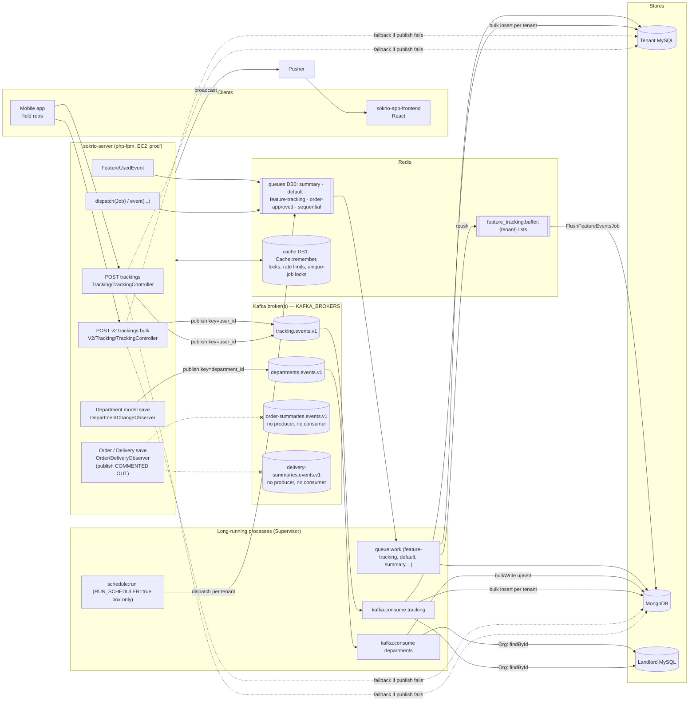

# 00 · Inventory — Every Messaging Moving Part in Sokrio

> **Snapshot:** `sokrio-server` @ `master` · HEAD `d14c0ebb2` (PR #5654) · surveyed 2026-10-26.
> All paths are relative to `sokrio-server/` unless prefixed with another repo.
> **Master drift (T12, 2026-10-29):** `master` is now `75c787a2c`. No Kafka file changed. Line refs still match the snapshot, but **F13 is fixed** and **F12 is partly mitigated** on master. See §0.14.
> Tags: `[CODE]` verified in code · `[NOTES]` from my blog/PR notes only · `[GENERAL]` industry knowledge · `[ASSUMPTION]` best guess + how to verify.

---

## 0.1 The one-paragraph answer

`[CODE]` Sokrio uses three messaging mechanisms, and **no RabbitMQ**:

1. **Kafka**, via the pure-PHP client `longlang/phpkafka` v1.2.5. Two topics have live producer → consumer pipelines: `tracking` (GPS breadcrumbs) and `departments` (outlet master-data sync to Mongo). Two more (`order_summaries`, `delivery_summaries`) are registered, but their publish calls are commented out and they have no consumer.
2. **Laravel queues on Redis.** This is the workhorse: 127 queued Jobs, 19 queued Listeners and 13 queued Mailables, spread over the `summary`, `default`, `feature-tracking`, `order-approved` and `sequential` queues. They are fed largely by the ~40-entry scheduler in `app/Console/Kernel.php`.
3. **Redis as a primitive.** It serves as the cache (255 `Cache::*` call sites), distributed locks (`Cache::lock`, 8 sites), rate limiters, a hand-rolled list-based event buffer (feature tracking), a broadcast transport option, and the Pusher-backed realtime channel for the app frontend.

Deployment is plain EC2 VMs. GitHub Actions SSHes in and runs a server-side `pipeline.sh`, and processes are managed by Supervisor. No infra-as-code is in the repos.

---

## 0.2 Landscape diagram

---

## 0.3 Packages & runtime (composer.json / composer.lock)

| Package | Constraint | Locked | Role | Ref |
|---|---|---|---|---|
| `laravel/framework` | `^9.0` | **v9.52.22** | Queue, cache, broadcast, scheduler | `composer.json:22` |
| `longlang/phpkafka` | `^1.2.5` | v1.2.5 | **Pure-PHP** Kafka client (no librdkafka) | `composer.json:28` |
| `predis/predis` | `^1.1` | v1.1.10 | Pure-PHP Redis client | `composer.json:31` |
| `pusher/pusher-php-server` | `^7.2` | — | Broadcast driver | `composer.json:33` |
| `aws/aws-sdk-php` | `^3.166` | 3.395.1 | S3 only (via Flysystem); **no SQS/SNS/MSK use** | `composer.json:15` |
| `laravel/telescope` | `^4.9` | — | Dev-only job/queue inspection | `composer.json:25` |
| `ext-pcntl` | `*` | — | Required for consumer signal handling | `composer.json:13` |
| `php` | `^8.0` | CI runs 8.3 | — | `composer.json:11`, `.github/workflows/tests.yml:23` |

`[CODE]` Not present: `laravel/horizon`, `laravel/octane`, `php-amqplib`, `vladimir-yuldashev/laravel-queue-rabbitmq`, `mateusjunges/laravel-kafka`, `ext-rdkafka`.

`[CODE]` Frontend: `sokrio-app-frontend` depends on `laravel-echo ^1.17.1` and `pusher-js ^8.4.0-rc2`, with the client in `sokrio-app-frontend/src/lib/echo.ts`. `sokrio-admin-frontend` has no realtime client.

> ⚠️ **Notes vs code:** the workspace `.claude/CLAUDE.md` says "Laravel 10". The lock file says **9.52.22**, and `sokrio-server/CLAUDE.md` correctly says Laravel 9.

---

## 0.4 Kafka — producers

| # | Producer (call site) | Topic key → topic name | Event type | Partition key | Payload | Failure behaviour | Ref |
|---|---|---|---|---|---|---|---|
| P1 | `Tracking\TrackingController::store()` single point | `tracking` → `tracking.events.v1` | `tracking.created` | **`user_id`** | fat: lat, long, address, battery_percent, created_at, user_id, user{…} | `publish()` returns `null` → synchronous `WriteTrackingActions`. If that fails too: **503 + Retry-After: 5** | `app/Http/Controllers/Tracking/TrackingController.php:62-81` |
| P2 | `V2\Tracking\TrackingController::store()` bulk | same | same | **`user_id`** | N fat payloads, one message per point, one `sendBatch()` | `publishBatch()` returns `null` → `WriteBulkTrackingActions` (MySQL txn + best-effort Mongo). If that fails: 503 | `app/Http/Controllers/V2/Tracking/TrackingController.php:52-76` |
| P3 | `DepartmentChangeObserver::created/updated` | `departments` → `departments.events.v1` | `department.created` / `department.updated` | **`department_id`** | fat: `MongodbDepartment::transformDepartmentData()` with 8 relations eager-loaded | Swallowed and logged on the `kafka` channel. **No fallback.** Skipped in the `testing` env | `app/Observers/DepartmentChangeObserver.php:26-46,104-145` |
| P4 | `OrderObserver::updated` | `order_summaries` → `order-summaries.events.v1` | `order-summary.updated` | `order_id` | thin: order_id, order_date | **Call is commented out** | `app/Observers/OrderObserver.php:21-24` |
| P5 | `DeliveryObserver::created` | `delivery_summaries` → `delivery-summaries.events.v1` | `delivery-summary.updated` | `delivery_id` | thin: delivery_id, delivery_date | **Call is commented out** | `app/Observers/DeliveryObserver.php:21-24` |

The producer engine is `app/Services/Kafka/KafkaProducer.php`:

- `[CODE]` Envelope: `{event_id: uuid4, event_type, tenant_id, occurred_at: ISO8601, payload}` (`:93-102`).
- `[CODE]` The default key is `(string) $tenantId` (`:58`, `:76`), **but every live caller overrides it**: tracking uses `user_id`, departments use `department_id`.
- `[CODE]` It retries up to 3 times (`MAX_PUBLISH_ATTEMPTS`, `:26`) on Socket/Connection/NoAliveBroker errors, tearing the socket down between attempts with a 0.25s sleep (`:113-155`). Redis errors (`:156`) and any other `Throwable` (`:170`) return `false` with no retry.
- `[CODE]` It calls `TopicProvisioner::ensureTopicExists()` on every attempt. The result is Redis-cached for 1 day under `kafka_topic_verified_{topic}` (`app/Services/Kafka/TopicProvisioner.php:23,114`).
- `[CODE]` No acks, idempotence or compression settings are configured. Only timeouts and retry counts are set (`:38-51`), so the `longlang/phpkafka` defaults apply. `[ASSUMPTION]` That client defaults `acks` to `0` or `1`, not `all`. Verify in `vendor/longlang/phpkafka/src/Producer/ProducerConfig.php` (we confirm this in Phase 2).
- `[CODE]` It is bound as a **singleton** (`app/Providers/KafkaServiceProvider.php:26`), so one socket is reused within a php-fpm worker's request lifecycle.

## 0.5 Kafka — consumers

| # | Command | Handler | Group id | Persists to | Run by | Ref |
|---|---|---|---|---|---|---|
| C1 | `php artisan kafka:consume tracking` | `TrackingMessageHandler` | `KAFKA_GROUP` (bare, "grandfathered") | tenant MySQL `trackings` + Mongo `TrackingReport` | Supervisor `sokrio-kafka-consumer-tracking`, numprocs=1 | `app/Console/Commands/Kafka/ConsumeCommand.php:27-30`, `app/Services/Kafka/Handlers/TrackingMessageHandler.php` |
| C2 | `php artisan kafka:consume departments` | `DepartmentMessageHandler` | `{KAFKA_GROUP}-departments` | Mongo `departments` (bulkWrite upsert on `department_id`) | Supervisor `sokrio-kafka-consumer-departments`, numprocs=1 | `app/Services/Kafka/Handlers/DepartmentMessageHandler.php:66-122` |

The consumer engine is `app/Services/Kafka/KafkaConsumer.php`:

- `[CODE]` **Manual commit.** `setAutoCommit(false)` (`:69`). The local cursor is advanced per message (`:279-294`), and offsets are committed **once per partition per flush**, *after* the handler returns (`:301-339`).
- `[CODE]` **Batching.** It flushes at 200 messages or 1.0s, whichever comes first (`:251-259`), and also flushes on an empty poll (`:221-224`).
- `[CODE]` **Signals.** `pcntl_async_signals` with SIGTERM/SIGINT setting `ShutdownFlag` (`:125-144`). SIGTERM/SIGINT are **blocked while the handler runs** (`:314-319`).
- `[CODE]` **Static membership with an empty instance id.** `setGroupInstanceId('')` (`:95`). See the notes conflict below.
- `[CODE]` **Self-healing.** It retries the join 5 times (`:27`, `:404-432`). Each mid-poll error triggers a reconnect with linear backoff capped at 30s (`:189`). After 10 consecutive failures it exits for a Supervisor restart (`:371-393`).
- `[CODE]` **Recycle.** It exits cleanly after `KAFKA_CONSUMER_MAX_RUNTIME`, which is 21600s (6h) in config (`config/kafka.php:70`). ⚠️ The command's own fallback default is **3600** (`ConsumeCommand.php:72`). That only applies if the config key is missing, so it is harmless, but it is a drift.
- `[CODE]` **Poison handling.** A malformed envelope is logged and skipped, and its offset still advances (`:347-365`). There is **no DLQ / retry topic** anywhere.

## 0.6 Kafka — topics

| Key (`TopicRegistry`) | Topic name (prod) | Non-prod name | Producer live? | Consumer live? | Ref |
|---|---|---|---|---|---|
| `tracking` | `tracking.events.v1` | `tracking.events.v1.{APP_ENV}` | ✅ | ✅ | `app/Services/Kafka/TopicRegistry.php:15,22` |
| `departments` | `departments.events.v1` | `departments.events.v1.{env}` | ✅ | ✅ | `:12,19` |
| `order_summaries` | `order-summaries.events.v1` | … | ❌ commented | ❌ no handler | `:13,20` |
| `delivery_summaries` | `delivery-summaries.events.v1` | … | ❌ commented | ❌ no handler | `:14,21` |

- `[CODE]` The environment suffix is applied outside `production` (`TopicRegistry.php:51-58`).
- `[CODE]` Missing topics are **auto-created by the app** with `partitions = KAFKA_AUTO_CREATE_PARTITIONS` (default 3) and `replication.factor = KAFKA_AUTO_CREATE_REPLICATION_FACTOR` (**default 1**) (`TopicProvisioner.php:52-81`, `config/kafka.php:74-75`).
- `[ASSUMPTION]` The production topics were created either by this code path (RF=1!) or by hand. Verify with `kafka-topics.sh --describe --topic tracking.events.v1` on the broker. This is a top risk (see Phase 7).
- `[CODE]` Retention and compaction are **not set anywhere in code**. They come from broker defaults (`[GENERAL]` 7 days, delete policy).

## 0.7 Laravel queues (Redis driver)

**Connections** (`config/queue.php`):

- `[CODE]` default is `QUEUE_CONNECTION`, falling back to `sync` (`:16`). `[ASSUMPTION]` Production `.env` sets `redis`. Verify with `php artisan tinker --execute="echo config('queue.default');"` on the prod box.
- `[CODE]` `redis` uses Redis connection `default` (DB `REDIS_DB` = 0), with **`retry_after` = 9000s (2.5h)** and `block_for` = null (`:62-67`).
- `[CODE]` `database` and `beanstalkd` have `retry_after` 90 (`:41,48`). `sqs` is configured with placeholder values only and is unused.
- `[CODE]` Failed jobs go to the `failed_jobs` table on the `DB_CONNECTION` database (`:82-86`).

**Queue names actually used:**

| Queue | Who dispatches to it | Count | Ref (examples) |
|---|---|---|---|
| `summary` | Summary/report jobs (constructor sets `$this->queue = 'summary'`) | 20 jobs | `app/Jobs/PrimaryOrderSummaryMongoDBJob.php:44`, `app/Jobs/KPISummary.php:67` |
| `feature-tracking` | `BufferFeatureUsageListener`, `FlushFeatureEventsJob` | 2 | `app/Listeners/Analytics/BufferFeatureUsageListener.php:13`, `app/Jobs/Analytics/FlushFeatureEventsJob.php:39` |
| `order-approved` | `ApproveOrder` (delayed N minutes) | 1 | `app/Models/Order/Order.php:243` |
| `sequential` | `SequentialJobDispatcher` (deferred report exports, one-at-a-time) | 13 export types | `config/deferred-jobs.php:19`, `app/Support/Dispatcher/SequentialJobDispatcher.php:15,56` |
| `default` | everything else (mail, listeners, misc jobs) | many | `app/Jobs/MongoDB/AllowanceMongoSync.php:45` |

**Job tuning found** (`public $timeout/$tries`):

| Value | Jobs | Note |
|---|---|---|
| `$timeout = 0` (no limit) | `GenerateAdvanceInvoicePDF`, `GenerateVisitTargetReport`, `StockReport`, `GenerateTrackingReport`, `GenerateOrderProductSummery` | Can exceed `retry_after` = 9000s → **re-reserved → runs twice** `[GENERAL]` |
| `$timeout = 3600` | `PerformanceBoardReportJob`, `DailyCallReportJob` | Below 9000, so OK |
| `$timeout = 600` | `MigrateNewOrg`, `ProvisionVanSalesDatabase`, `ProvisionTaskManagerModuleDatabase`, `PrimaryOrderSummaryMongoDBJob`, … | OK |
| `$timeout = 240`, `$uniqueFor = 300` | `FlushFeatureEventsJob` | Deliberately kept below `uniqueFor` (`:24-28`) ✅ |

- `[CODE]` ⚠️ Two job properties that **Laravel ignores**:
  - `ApproveOrder::$retry_after = 600` (`app/Jobs/ApproveOrder.php:26`). `retry_after` is a *connection* setting, not a job property.
  - `PrimaryOrderSummaryMongoDBJob::$retries = 3` (`app/Jobs/PrimaryOrderSummaryMongoDBJob.php:32`). The real property is `$tries`.

  `[GENERAL]` Both are silently no-ops.
- `[CODE]` `ShouldBeUnique` is used on 25+ jobs (KPISummary, SecondaryOrderSummaryJob, UserSalesSummaryJob, ApproveOrder imports it, …). The unique locks live in the cache store.
- `[CODE]` **No** `afterCommit`, `ShouldBeEncrypted`, `WithoutOverlapping` job middleware, `RateLimited`, `ThrottlesExceptions`, `Bus::batch` or `Bus::chain` anywhere in `app/` or `config/`.
- `[CODE]` 55 classes define a `failed()` method.

**How tenant context travels in jobs:** `[CODE]` The `Org` model is passed into the constructor and serialised (`SerializesModels`). `handle()` then calls `TenantManager::tenant($this->org)->reconnect()` first. Examples: `app/Jobs/ApproveOrder.php:37-53` and `app/Jobs/PrimaryOrderSummaryMongoDBJob.php:42-60`.

**Scheduler** (`app/Console/Kernel.php:111-190`):

- `[CODE]` It is gated by `RUN_SCHEDULER` (`config/others.php:13`, `Kernel.php:113-117`), so only the "all task" prod box runs it, not the report server.
- `[CODE]` It has about 40 entries (43 `$schedule->` lines, 2 of them commented), all `withoutOverlapping()->runInBackground()`. **None use `onOneServer()`.**
- `[CODE]` Hourly summary jobs run at :05/:08/:15/:45/:55. Daily resyncs run at 06:10–06:40. Nightly summaries run 00:01–07:20. `sequential:jobs` runs every 4h. Feature rollups run every 10 min. `FlushFeatureEventsJob` runs every 15 min (`Kernel.php:180-181`).

## 0.8 Redis — every role

| Role | Where | Key pattern | Ref |
|---|---|---|---|
| Queue backend | `config/queue.php:62` → Redis conn `default`, DB 0 | `queues:{name}`, `queues:{name}:reserved`, `queues:{name}:delayed` `[GENERAL]` | `config/database.php:202-210` |
| Cache store | `CACHE_DRIVER` (default `file`!), `redis` store → conn `cache`, DB 1 | prefix `{APP_NAME}_cache` + `:tenant_{id}` / `:landlord` per request | `config/cache.php:21,75-76,101`, `config/database.php:212-219` |
| Tenant cache scoping | `ScopeCacheToTenant` middleware rewrites the cache/session prefix per Host | `…_cache:tenant_{id}:` | `app/Http/Middleware/ScopeCacheToTenant.php:37-69` |
| Tenant lookup cache | `Org::findById` 7 days, falls back to DB on a Redis error | `org_by_id_{id}`, `org_by_domain_{d}` | `app/Models/Core/Org.php:67-90` |
| Kafka topic memo | `TopicProvisioner` 1 day, cache errors treated as a miss | `kafka_topic_verified_{topic}` | `app/Services/Kafka/TopicProvisioner.php:23,94-124` |
| Distributed locks | `Cache::lock` | `kpi_summary_lock:{db}`, `{domain}_stock_update_{challan}`, `sms-resend:{tenant}:claim`, `custom-jobs:one-at-a-time`, `lock:{pgmKey}`, `van_settlement_resolve_{id}`, `van_load_out_confirm_{id}` | `app/Jobs/KPISummary.php:88`, `app/Http/Controllers/Guest/StockUpdateController.php:115,152`, `app/Services/SMS/MessageResendService.php:153`, `app/Support/Dispatcher/SequentialJobDispatcher.php:15`, `app/Services/Report/ProductGeographyMatrix/MatrixAggregator.php:170`, `app/Services/VanSales/VanSettlementService.php:331`, `app/Services/VanSales/VanLoadOutStockService.php:22`, `app/Services/SMS/SmsResendRun.php:59` |
| Rate limiting | `RateLimiter::for` api/auth/otp/otp-verify/bulk + retailer login/OTP | Laravel limiter keys | `app/Providers/RouteServiceProvider.php:70-158`, `config/rate_limiting.php`, `app/Services/Retail/RetailerLoginThrottle.php:18-32`, `app/Services/Retail/RetailerOtpService.php:31-56` |
| Event buffer (hand-rolled stream) | Feature usage: `RPUSH` + `LTRIM 5000` + `EXPIRE 1800`, flush at 100 or every 15 min, claimed with an atomic `RENAME` | `feature_tracking:buffer:{tenant}`, `feature_tracking:flushing:{tenant}`, `feature_tracking:pending_count` | `app/Listeners/Analytics/BufferFeatureUsageListener.php:16-46`, `app/Jobs/Analytics/FlushFeatureEventsJob.php:47-127` |
| Idempotency keys | Task Manager `Idempotency-Key` header → cached response for 24h | `md5("task-manager:idem:{db}:{scope}:{key}")` | `app/Support/Concerns/HandlesIdempotency.php` |
| Broadcast | `BROADCAST_DRIVER` default `null`. Pusher and Redis drivers are configured. 17 `ShouldBroadcast` events (OrderApproved, ReportProgressUpdated, …) | — | `config/broadcasting.php:18,33,45`, `app/Events/*` |

- `[CODE]` Client: `REDIS_CLIENT`, defaulting to `phpredis` (`config/database.php:195`). The Kafka code catches **both** `Predis\PredisException` and `\RedisException`. `[ASSUMPTION]` Production uses `predis`: the `TopicProvisioner.php:86-92` docblock talks about Predis `ServerException` `-OOM` replies seen in practice. Verify `REDIS_CLIENT` in the prod `.env` (value names only).
- `[CODE]` Not used: Redis Pub/Sub (`Redis::publish/subscribe`), Redis Streams (`XADD`), `Redis::funnel/throttle`.

## 0.9 Config files and env var **names** (no values)

| Config | Env vars |
|---|---|
| `config/kafka.php` | `KAFKA_BROKERS`, `KAFKA_GROUP`, `KAFKA_GROUP_LEGACY_TOPICS`, `KAFKA_PRODUCER_CLIENT_ID`, `KAFKA_CONSUMER_CLIENT_ID`, `KAFKA_PRODUCER_CONNECT_TIMEOUT`, `KAFKA_PRODUCER_SEND_TIMEOUT`, `KAFKA_PRODUCER_RECV_TIMEOUT`, `KAFKA_PRODUCE_RETRY`, `KAFKA_PRODUCE_RETRY_SLEEP`, `KAFKA_MAX_WRITE_ATTEMPTS`, `KAFKA_PUBLISH_RETRY_SLEEP`, `KAFKA_CONSUMER_CONNECT_TIMEOUT`, `KAFKA_CONSUMER_SEND_TIMEOUT`, `KAFKA_CONSUMER_RECV_TIMEOUT`, `KAFKA_POLL_INTERVAL`, `KAFKA_CONSUMER_SESSION_TIMEOUT`, `KAFKA_CONSUMER_REBALANCE_TIMEOUT`, `KAFKA_CONSUMER_HEARTBEAT`, `KAFKA_CONSUMER_MAX_CONSECUTIVE_FAILURES`, `KAFKA_CONSUMER_RECONNECT_BACKOFF_CAP`, `KAFKA_CONSUMER_BATCH_SIZE`, `KAFKA_CONSUMER_BATCH_INTERVAL`, `KAFKA_CONSUMER_MAX_RUNTIME`, `KAFKA_AUTO_CREATE_PARTITIONS`, `KAFKA_AUTO_CREATE_REPLICATION_FACTOR`, `KAFKA_REPORT_UNEXPECTED_PUBLISH_ERRORS` |
| `config/logging.php` (kafka channel `:54-68`) | `KAFKA_LOG_LEVEL` |
| `config/queue.php` | `QUEUE_CONNECTION`, `REDIS_QUEUE`, `QUEUE_FAILED_DRIVER`, `SQS_PREFIX`, `SQS_QUEUE`, `AWS_*` |
| `config/database.php` (redis) | `REDIS_CLIENT`, `REDIS_CLUSTER`, `REDIS_PREFIX`, `REDIS_URL`, `REDIS_HOST`, `REDIS_PASSWORD`, `REDIS_PORT`, `REDIS_DB`, `REDIS_CACHE_DB`, `REDIS_PERSISTENT` |
| `config/cache.php` | `CACHE_DRIVER`, `CACHE_PREFIX` |
| `config/session.php` | `SESSION_DRIVER` (default `file`) |
| `config/broadcasting.php` | `BROADCAST_DRIVER`, `PUSHER_APP_ID`, `PUSHER_APP_KEY`, `PUSHER_APP_SECRET`, `PUSHER_APP_CLUSTER` |
| `config/rate_limiting.php` | `RATE_LIMITING_ENABLED`, `RATE_LIMIT_*` |
| `config/feature-tracking.php` | `FEATURE_TRACKING_ENABLED` |
| `config/others.php` | `RUN_SCHEDULER` |
| Supervisor (README) | `DD_PROFILING_ENABLED`, `DD_TRACE_CLI_ENABLED` (consumer program only) |

## 0.10 Infra & deployment surface

| Thing | Found | Ref |
|---|---|---|
| CI tests | GitHub Actions, PHP 8.3 + mongo:6 service, ParaTest. **No Kafka or Redis service in CI** (tests fake them) | `.github/workflows/tests.yml` |
| Prod app deploy | push `master` → SSH (`AWS_VM_HOST` secret) → `/home/sokrio/sokrio-prod/post-deploy/pipeline.sh` | `.github/workflows/ci-cd.yml` |
| Queue worker box | push `prod-queue` → SSH (`AWS_QUEUE_VM_*`) → `/home/sokrio/sokrio-queue/post-deploy/pipeline.sh` | `.github/workflows/queue-worker-deploy.yml` |
| Report server | push `prod-report` → SSH (`AWS_REPORT_VM_*`) | `.github/workflows/prod-report-deploy.yml` |
| PVM tenant box | push `pvm/master` | `.github/workflows/pvm-ci-cd.yml` |
| Staging | push `staging` → SSH (`AWS_DEV_*`) | `.github/workflows/stg.yml` |
| Supervisor configs | **Only documented in `README.md:178-212`**. Not in any repo | `README.md` |
| Docker (server) | `.docker/php/` only (image bits). No compose file in `sokrio-server` | — |
| IaC (Terraform/CFN/CDK/Helm/K8s/ECS) | **Not found** | — |
| Monitoring | Sentry (`SENTRY_LARAVEL_DSN`), Datadog APM + profiler (README), Telescope (dev), Slack log channels | `config/logging.php`, `README.md:214-238` |

`[ASSUMPTION]` Kafka and Redis are self-managed on EC2, or on a Docker host next to the app, rather than MSK/ElastiCache:

- No MSK IAM auth, SASL or TLS settings exist in `config/kafka.php`. MSK would normally need at least TLS.
- There is a single `REDIS_HOST` with no TLS scheme or cluster mode.

Verify by checking the host names behind `KAFKA_BROKERS` and `REDIS_HOST` in the prod `.env`: `*.kafka.*.amazonaws.com` means MSK, and `*.cache.amazonaws.com` means ElastiCache.

## 0.11 Tests touching messaging

| Test | What it guards |
|---|---|
| `tests/Unit/Kafka/KafkaProducerTest.php` | publish/publishBatch, retry on socket errors, null on failure |
| `tests/Unit/Kafka/KafkaConsumerBatchTest.php` | buffer + flush + per-partition commit |
| `tests/Unit/Kafka/KafkaConsumerReconnectTest.php` | mid-poll error → reconnect, exit after N failures |
| `tests/Unit/Kafka/InterruptResilientStreamSocketTest.php` | EINTR retry |
| `tests/Unit/Kafka/TopicProvisionerRedisFailureTest.php` | Redis failure ≠ Kafka failure |
| `tests/Unit/Kafka/KafkaLogsNeverAtErrorLevelTest.php` | Kafka never logs at `error` (keeps Sentry quiet) |
| `tests/Unit/Kafka/TopicRegistryTest.php` | env suffix, unknown key throws |
| `tests/Unit/Console/Kafka/ConsumeCommandHandlersTest.php` | every HANDLERS entry implements the interface |
| `tests/Feature/Console/Kafka/ConsumeCommandTest.php` | unmapped topic fails without touching the consumer |
| `tests/Feature/Kafka/TrackingMessageHandlerTest.php` | unknown tenant, persist, retry, then per-point fallback |
| `tests/Unit/Observers/Concerns/PublishesKafkaMessageTest.php` | trait swallows `\Error` too |
| `tests/Feature/Tracking/TrackingTest.php`, `BulkTrackingTest.php` | endpoint 202 + fallback path |

`[CODE]` **No test exists for `DepartmentMessageHandler`.** That is a gap.

## 0.12 Notes vs code — discrepancies found in Phase 0

| # | My notes say | Code says (truth) | Ref |
|---|---|---|---|
| D1 | `group.instance.id = ''` means **dynamic** membership (study guide §4.4, blog 04 incident 2) | `''` is **static** membership under instance id `""`. Only `null` would be dynamic, and `null` is a TypeError in this client. That is why each topic now needs its own group | `app/Services/Kafka/KafkaConsumer.php:79-95` |
| D2 | All consumers share `KAFKA_GROUP` (study guide §2, §7.3) | One group per topic, `{KAFKA_GROUP}-{topic}`. Only `tracking` keeps the bare id (legacy offsets). Fixed in `9d902b7e8` | `app/Console/Commands/Kafka/ConsumeCommand.php:97-107`, `config/kafka.php:9-16` |
| D3 | Tracking is "the one live handler" (study guide §1, §3; PR-5094) | **Departments** is also live (handler + Supervisor program), added in `94791dabd` | `ConsumeCommand.php:27-30`, `README.md:202-211` |
| D4 | Partition key = `tenant_id`, "always" (study guide §2, §5.4) | Default only. All live producers override it: `user_id` (tracking), `department_id` (departments) | `Tracking/TrackingController.php:67`, `DepartmentChangeObserver.php:135` |
| D5 | The request writes MySQL + Mongo synchronously **and** publishes (study guide §3 flow, PR-5094) | The synchronous write is **only a fallback** when publish returns null. The consumer owns persistence and the API returns 202. Cut over in `59922533e` / `3af8daa1f` | `Tracking/TrackingController.php:57-83` |
| D6 | Department publish calls "already commented out" (PR-5094 §3) | **Enabled**. It is the Mongo `syncWithMongoDB` call that is commented out instead | `DepartmentChangeObserver.php:28-29,44-45` |
| D7 | Workspace CLAUDE.md: "Laravel 10" | Laravel **9.52.22** | `composer.lock` |
| D8 | PR-5094: consumer `autoCommit = true` | `autoCommit = false`, manual per-flush commit (changed in `a7e63f4bb`) | `KafkaConsumer.php:69` |

## 0.13 Not found (searched and absent)

| Searched for | Result |
|---|---|
| `rdkafka`, `RdKafka`, `librdkafka`, `mateusjunges/laravel-kafka` | Not found in `composer.json` or `app/`. The client is `longlang/phpkafka` |
| `acks`, `enable.idempotence`, `compression`, `linger`, `transactional` in Kafka code | Not configured. Library defaults apply |
| `auto.offset.reset` | Not set in code. Library default (see Phase 2) |
| `amqp`, `php-amqplib`, `rabbitmq`, `exchange`, `basic_publish`, `x-dead-letter-exchange` | **Not found anywhere**. No RabbitMQ in Sokrio |
| `horizon`, `config/horizon.php` | Not found. Plain `queue:work` under Supervisor |
| `Redis::publish`, `Redis::subscribe`, `xadd`, `XREADGROUP` | Not found |
| `afterCommit`, `after_commit` | Not found (risk: jobs dispatched inside transactions) |
| `Bus::batch`, `Bus::chain`, `Batchable`, `job_batches` | Not found |
| `outbox`, `processed_messages`, consumer-side `event_id` dedup | Not found. `event_id` is generated but never checked |
| DLQ / retry topics (`.dlq`, `.retry`) | Not found |
| MSK / Amazon MQ / ElastiCache / MemoryDB / SQS / SNS / EventBridge / Kinesis usage | Not found in code (only S3 via Flysystem; `sqs` connection stub unused) |
| Terraform / CloudFormation / CDK / Helm / K8s / ECS task defs | Not found in any repo under `/home/kiri2ka/code/sokrio/` |
| Supervisor `.conf` files | Not in any repo. Only README examples. Live configs are on the servers |
| `docker-compose` for `sokrio-server` | Not found (only for `sokrio-benchmark*`) |
| Redis/Kafka in `sokrio-benchmark-python` requirements | Not found in requirements |
| Kafka/Redis services in CI | Not found. Tests fake them |

## 0.14 Master drift since the snapshot (T12 check, 2026-10-29)

`master` moved from `d14c0ebb2` to `75c787a2c`. Every `file:line` ref in this knowledge base still points at **`d14c0ebb2`**, and T12 checked all 1,038 of them there. 1,037 were in range. One off-by-one was fixed (`SecondaryOrderSummaryJob.php:52-85`, §1). 10 random refs were checked by eye and matched.

- **Kafka files are unchanged**: `app/Services/Kafka`, `app/Console/Commands/Kafka`, `app/Observers` and `config/kafka.php`. F1–F9 and D1–D11 still hold on master.
- **39 refs into 8 changed files have moved on master.** Read them at the snapshot (`git show d14c0ebb2:<path>`). What changed and how it affects the findings:

| File (master) | Change | Effect on findings | Commit |
|---|---|---|---|
| `Guest/StockUpdateController.php` | Per-stock Redis lock removed. Now uses `DB::transaction(…, 3)` + `LockOrCreateStock` (`lockForUpdate` row lock) + `adjust()` | **F13 fixed on master.** This is the fix §4.10 #4 recommended (row lock inside the txn). The challan lock (`:117`, 30 s) is still there | `e39909947`, `428b098ec` |
| `BatchTransferJob.php`, `PreInventoryTransferJob.php` | `lockForUpdate` on stock rows, deadlock retry, Mongo writes moved after the MySQL statements | R31 / F16 **still live**: the constructor still takes `User $user` | `e39909947`, `428b098ec` |
| `Middleware/ScopeCacheToTenant.php` | New `tenantPrefix(int $orgId)`. `Module::forgetAllModulesCache` uses it to forget `{domain}.module.all` from landlord code | **F12 partly mitigated** (one key). Workers, the scheduler and consumers still use the bare prefix. R35 still stands | `9d3d42cd6` |
| `Jobs/PrimaryOrder/ApproveOrder.php` | Wraps `approve()` in `Cache::lock(statusLockKey, 60)->block(30)`, `release(30)` on timeout | **F10 still holds**: no `onQueue`, `$timeout = 0`. The `pending()` guard is now at `:58` | `d3fd1f69e` |
| `Models/MongoDB/PrimaryOrder/PrimaryOrder.php` | Layered approval + SAP fields. `approveAfter` is now at `:234-238` | None (still no `onQueue`) | — |
| `Console/Kernel.php` | +2 commands, +1 schedule line (`tenant:prune_day_in_images`) | Lines shift by +2 to +4. No messaging change | — |
| `Requests/PrimaryOrder/OrderRequest.php` | Indent type, discount rules, `withValidator` | Still dispatches `approveAfter` with no txn (§5 afterCommit table) | — |
| New: `Jobs/PrimaryOrder/SyncPrimaryOrderToSap.php`, `config/sap.php` | SAP sync job | Not reviewed in this knowledge base. Check its queue and `afterCommit` if it matters | — |

Re-check command: `git -C sokrio-server diff --stat d14c0ebb2 master -- app/Services/Kafka app/Console/Commands/Kafka app/Observers config app/Jobs app/Http/Middleware app/Support/Tenant`.

---

### ✅ Phase 0 quality check
- [x] Every Sokrio claim has a `file:line` or a tag
- [x] No secrets: env var names only, IPs/hosts not copied
- [x] Landscape Mermaid diagram
- [x] "Not found" list with what was searched
- [x] Notes-vs-code conflicts listed (D1–D8)
