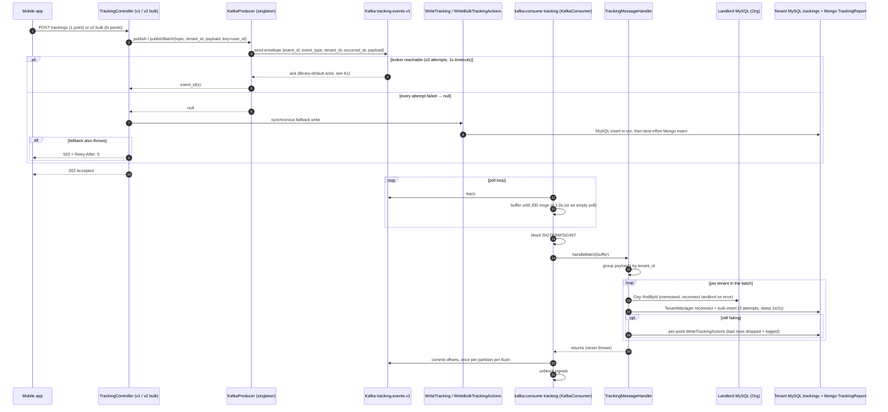
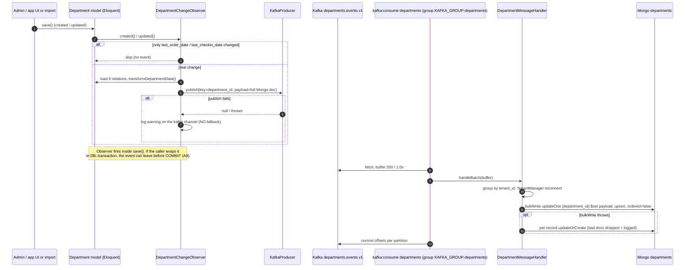
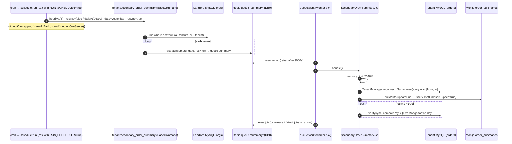

# 01 · Architecture Overview — Why Sokrio Needs Messaging

> **Snapshot:** `sokrio-server` @ `master` · HEAD `d14c0ebb2` · written 2026-10-26.
> Paths are relative to `sokrio-server/`. Tags: `[CODE]` verified in code · `[NOTES]` from my blog/PR notes · `[GENERAL]` industry knowledge · `[ASSUMPTION]` best guess plus how to verify.
> Builds on `00-inventory.md`. Facts already proven there are reused, not re-proven.

---

## 1.1 The one-paragraph answer

`[CODE]` Sokrio is a multi-tenant Laravel 9 monolith. Most work happens inside a request or in a scheduled batch. Messaging appears wherever one of three pressures shows up:

1. **Volume.** GPS pings arrive all day from every field rep.
2. **Latency.** The mobile app or the web UI must not wait for slow work, such as report exports, summaries or PDFs.
3. **Time.** Some work has to happen later (delayed order approval) or on a schedule (hourly and nightly summaries).

Kafka handles the two **event streams** (tracking, departments). Laravel queues on Redis handle **work items** (summaries, exports, mail, approvals). Redis lists are used as a cheap **buffer** for analytics events. Pusher pushes **notifications** back to the browser.

`[GENERAL]` In one line: Kafka is used where we need a durable, replayable, ordered *log of facts*, and Redis queues are used where we need *a job done once*.

---

## 1.2 Business problems solved with messaging

| # | Business problem | Mechanism | Why async at all | Entry point → worker | Tag |
|---|---|---|---|---|---|
| B1 | **GPS tracking**: field reps' phones post breadcrumbs all day | Kafka `tracking.events.v1`, key `user_id` | High volume, low value per event. The phone should not wait for MySQL and Mongo writes | `Tracking/TrackingController.php:62-83`, `V2/Tracking/TrackingController.php:52-78` → `kafka:consume tracking` → `TrackingMessageHandler.php:50-116` | `[CODE]` |
| B2 | **Outlet (department) master data → Mongo**: reports read a denormalised department document | Kafka `departments.events.v1`, key `department_id` | It keeps the 8-relation transform and the Mongo write out of the save path. It replaced a synchronous `syncWithMongoDB` call, which is now commented out | `DepartmentChangeObserver.php:26-46,104-145` → `kafka:consume departments` → `DepartmentMessageHandler.php:66-122` | `[CODE]` |
| B3 | **Sales summaries / KPI reports**: dashboards read pre-aggregated Mongo collections | Scheduler → one Redis-queue job per tenant on queue `summary` → Mongo `bulkWrite` upserts | Aggregating every tenant's orders is too heavy for a request. It is a periodic batch by nature | `Kernel.php:111-190` → `BaseCommand.php:50-70` → e.g. `SecondaryOrderSummaryJob.php:52-85` | `[CODE]` |
| B4 | **Feature-usage analytics**: which tenant uses which screen | Queued listener → Redis list buffer → `FlushFeatureEventsJob` → Mongo | Analytics must never slow down or break the user's request | `BufferFeatureUsageListener.php:16-46`, `FlushFeatureEventsJob.php:18-127`, `Kernel.php:180-181` | `[CODE]` |
| B5 | **Realtime notifications**: export ready, report progress, order and payment approved | Laravel broadcasting → Pusher → `laravel-echo` in `sokrio-app-frontend` | Tells the UI about work finished in the background, without polling | `app/Events/*` (17 `ShouldBroadcast*`), `ReportProgress.php:12`, `NotifyUserOfCompleteExport.php:69`, `sokrio-app-frontend/src/lib/echo.ts` | `[CODE]` |
| B6 | **Deferred report exports**: big Excel/PDF exports | DB table `sequential_jobs` + a `Cache::lock` → queue `sequential`, one at a time | Exports can take minutes. Running them one at a time protects the report DB | `SequentialJob.php:32-44`, `SequentialJobDispatcher.php:13-68`, `config/deferred-jobs.php:19` | `[CODE]` |
| B7 | **Delayed order approval**: auto-approve an order N minutes after placement | Redis delayed job on queue `order-approved` | Native "run later" support. No cron polling needed | `Order.php:240-243` → `ApproveOrder.php:20-53` | `[CODE]` |
| B8 | (Planned) **near-real-time order/delivery summaries** | Kafka `order-summaries.events.v1` / `delivery-summaries.events.v1` | Hourly summaries are up to ~1h stale | Publish calls commented out (`OrderObserver.php:21-24`, `DeliveryObserver.php:21-24`); plan in `old-resource/primary-order-delivery-kafka-plan.md` | `[CODE]` + `[NOTES]` |

`[CODE]` For B3 the staleness is real. `primary_order_summary_mongodb` runs `hourlyAt(45)` over the *previous* hour (`Kernel.php:152`, `SecondaryOrderSummaryJob.php:61-62` uses the same pattern). An order placed at 10:46 is therefore summarised at 11:45. That matches the blog's example (`old-resource/03-…md:10`) `[NOTES]`.

---

## 1.3 Why each technology fits its job

### Decision matrix

| Need | Kafka | Laravel queue (Redis) | Redis list buffer | Pusher broadcast |
|---|---|---|---|---|
| Survives a consumer outage for days | ✅ retention (broker default) `[GENERAL]` | ⚠️ while Redis has memory and persistence | ❌ TTL 1800s (`BufferFeatureUsageListener.php:21`) | ❌ fire-and-forget |
| Replay / reprocess history | ✅ reset offsets | ❌ a job is gone once it is done | ❌ | ❌ |
| Several independent readers | ✅ one group per reader | ❌ one worker takes each job | ❌ | ✅ fan-out to browsers |
| Per-key ordering | ✅ per partition | ❌ none across workers | ✅ per tenant list (FIFO) | ❌ |
| Delayed / scheduled execution | ❌ | ✅ `->delay()` | ❌ | ❌ |
| Per-job retries + `failed_jobs` | ❌ hand-rolled (`TrackingMessageHandler.php:85-116`) | ✅ built in (`config/queue.php:82-86`) | ❌ | ❌ |
| Ops cost in this stack | High: a separate broker, a pure-PHP client, Supervisor programs | Low: Redis is already there for cache | Near zero | SaaS |
| Throughput fit | Many tiny events per second | Tens to thousands of heavy jobs | Small events, batched | Low |

### Per-job verdict

- **B1 Tracking → Kafka. Right choice.** `[CODE]` + `[GENERAL]` It is the only true high-volume *stream*. It needs per-rep ordering (key `user_id`, `Tracking/TrackingController.php:67`), batching (200 msgs / 1.0s, `KafkaConsumer.php:251-259`) and a buffer that survives consumer deploys. A Redis queue would put one job per GPS point into Redis, the same Redis that holds the cache and other queues. Commit `37840a3b5` ("Redis-OOM hardening") shows Redis memory is already a pressure point `[CODE]`.
- **B2 Departments → Kafka. Defensible, but heavier than needed today.** `[GENERAL]` Volume is low (master data edits). The real benefits are per-department ordering, key `department_id` (`DepartmentChangeObserver.php:135`), and **replay** for rebuilding the Mongo copy. *Should-have-been note:* with one consumer and no replay tooling, a queued listener with `afterCommit` plus an idempotent upsert would give the same result with less infrastructure. Kafka pays off once a second reader appears (search index, ERP sync, analytics).
- **B3 Summaries → scheduler + Redis queue. Right choice for a batch.** `[CODE]` Work is per tenant and time-windowed, and it is recomputed from MySQL each time (`SummariesQuery` builds `updateOne … upsert` ops, `app/Models/MongoDB/SummariesQuery.php:229-238`). That makes it idempotent by design, so a queue's at-least-once delivery is fine. *Should-have-been note:* it is batch only because nobody publishes order events yet (B8).
- **B4 Feature analytics → Redis list. Right choice.** `[CODE]` It is loss-tolerant (`LTRIM 5000`, TTL 1800s), needs batching (100-event threshold or every 15 min), and needs zero new infrastructure. `[GENERAL]` Redis Streams (`XADD`/`XREADGROUP`) would add consumer groups and acks with no new infrastructure. `RENAME`-to-claim (`FlushFeatureEventsJob.php:47-127`) is a hand-built version of that.
- **B5 Notifications → Pusher. Right choice.** `[CODE]` The browser needs a push channel. Pusher is managed, and Echo is already wired in the app frontend. `[CODE]` `ReportProgressUpdated` is `ShouldBroadcastNow` (`app/Events/ReportProgressUpdated.php:11`). It calls Pusher **synchronously inside the export job**, so a slow Pusher slows the job. `ReportNotification` is `ShouldBroadcast` (`app/Events/ReportNotification.php:11`), so it is queued as its own job. `[CODE]` `BROADCAST_DRIVER` defaults to `null` (`config/broadcasting.php:18`). `[ASSUMPTION]` Production sets `pusher`. Verify the `.env` value name only.
- **B6 Exports → DB table + lock + queue. Right choice.** `[CODE]` A DB row gives a visible, auditable backlog (`SequentialJob::create`, `SequentialJob.php:35`). The cache lock `custom-jobs:one-at-a-time` (`SequentialJobDispatcher.php:15`) plus `lockForUpdate` (`:31`) ensures only one export runs at a time. Kafka would add nothing here.
- **B7 Delayed approval → Redis delayed job. Right choice.** `[CODE]` `->onQueue('order-approved')->delay(now()->addMinutes($delay))` (`Order.php:243`). Kafka has no native delay. RabbitMQ would need TTL+DLX or a plugin (see T3).
- **RabbitMQ → not used.** `[CODE]` Not found. Searched: `amqp`, `php-amqplib`, `rabbitmq`, `x-dead-letter-exchange` (`00-inventory.md` §0.13). Where it *would* fit is covered in T3.

---

## 1.4 Flow A — GPS tracking: publish → consumer → MySQL + Mongo (with fallback)

**Proof points**

- `[CODE]` The fallback runs only when publish returns `null` (`Tracking/TrackingController.php:62-81`; v2 at `V2/Tracking/TrackingController.php:52-76`). The 503 comes from the `catch` around the fallback.
- `[CODE]` The v2 fallback runs MySQL in a transaction and then Mongo best-effort: `DB::transaction` (`app/Actions/Tracking/WriteBulkTrackingActions.php:67-69`) and the Mongo `insert` in a swallowing `try` (`:75-82`). A Mongo failure does **not** return 503, so a client retry cannot duplicate committed MySQL rows (comment at `V2/Tracking/TrackingController.php:63-68`).
- `[CODE]` The handler resolves the tenant itself: a consumer has no request and no subdomain, so it uses `Org::findById` with a landlord self-heal (`TrackingMessageHandler.php:160-186`).
- `[CODE]` Retry then degrade: `MAX_ATTEMPTS = 3` with `sleep($attempt)` (`:23`, `:85-116`), then per-point (`:125-158`).

**What could go wrong** (detail in T2/T7)

- `[CODE]` A lost ack produces a duplicate: the broker stored the message but the producer timed out, so the API also writes the fallback. Accepted on purpose (`WriteTrackingActions.php:26-28`).
- `[CODE]` A handler failure is swallowed, so offsets are committed anyway. This path is at-most-once, and there is no DLQ (`TrackingMessageHandler.php:50-71`).
- `[GENERAL]` `sleep()` inside the handler lengthens poll gaps. Retries of 1s+2s fit inside the 30s session timeout (`config/kafka.php:50`), so this is fine today.

---

## 1.5 Flow B — Department save → Kafka → Mongo upsert

**Proof points**

- `[CODE]` The ignored-fields guard is `DepartmentChangeObserver.php:35-46,51-71`. Publishing is skipped in `testing` (`:106-108`). The fat payload is built from 8 eager-loaded relations (`:111-126`).
- `[CODE]` The trait swallows every `Throwable` (`app/Observers/Concerns/PublishesKafkaMessage.php:19-25`), and the observer adds its own catch (`DepartmentChangeObserver.php:139-144`). **A broker outage loses department events silently**, because there is no fallback write.
- `[CODE]` The consumer is idempotent: it upserts the full document keyed on `department_id` (`DepartmentMessageHandler.php:87-100`), so a replay is harmless.

**What could go wrong: two new findings from T1**

- `[CODE]` 🆕 **There is no automatic safety net.** `DepartmentSync`, the full-resync job the handler comment points to (`DepartmentMessageHandler.php:109`), is dispatched only by the manual command `tenant:department_sync_with_mongodb` (`app/Console/Commands/DepartmentSyncWithMongoDB.php:15,31`). It is **not** in the scheduler (`Kernel.php:111-190`). Lost events stay lost until someone runs it by hand. This corrects MEMORY risk #2, which guessed a nightly sync.
- `[CODE]` 🆕 **Writes that bypass the observer.** `DepartmentErpCodeSyncJob` updates `erp_code` through `Department::upsert(...)` (`app/Jobs/DepartmentErpCodeSyncJob.php:71`). That is a query-builder bulk write, and `[GENERAL]` Eloquent fires no model events for it. `erp_code` is part of the Mongo document (`app/Models/MongoDB/Department.php:71,213`), so **ERP codes synced at 06:00 daily (`Kernel.php:147`) never reach Mongo through Kafka.** Other `Department::where()->update()` calls (`VanSystemController.php:98,138,152`) also bypass the observer, but they change `van_sales_enabled`, which is not in the Mongo transform, so they are harmless.

---

## 1.6 Flow C — Scheduler → summary job per tenant → Mongo bulkWrite

**Proof points**

- `[CODE]` The scheduler is gated by `RUN_SCHEDULER` (`Kernel.php:113-117`). The hourly run is `hourlyAt(5)` (`:149`), and the daily resync is `dailyAt("06:10")` (`:155`).
- `[CODE]` Fan-out: `BaseCommand` loads `Org` with `active = 1` (`app/Console/Commands/BaseCommand.php:12,50-54`) and calls `dispatchJob` per tenant (`:67-70`). That method is `SecondaryOrderSummaryJob::dispatch($tenant, $date, $resync)` (`app/Console/Commands/SecondaryOrderSummary.php:33-36`).
- `[CODE]` Job: queue `summary` (`SecondaryOrderSummaryJob.php:37`), `$timeout = 900` (`:25`), tenant reconnect (`:55`), the window is the previous hour or a whole day (`:57-63`), `bulkWrite` (`:68-71`), and the optional `verifySync` (`:73-84`).
- `[CODE]` The upserts make re-runs safe: `$set` plus `$setOnInsert created_at` with `upsert: true` (`app/Models/MongoDB/SummariesQuery.php:229-238`).

**What could go wrong**

- `[CODE]` 🆕 **`ShouldBeUnique` is defeated.** `uniqueId()` returns `database_date . rand(1000, 9999)` (`SecondaryOrderSummaryJob.php:40-43`), so every dispatch gets a different lock key. Two overlapping runs for the same tenant and hour can both be queued. The upserts keep the data correct, but the work doubles. This is the only job in `app/Jobs` with this pattern (grep: `rand(` inside `uniqueId`).
- `[CODE]` `bulkWrite` here uses the default `ordered: true`, while the department consumer passes `ordered: false` (`DepartmentMessageHandler.php:111`). `[GENERAL]` With `ordered: true`, the first failing op stops the rest of the batch. The next hourly or daily run repairs the gap.
- `[CODE]` No `onOneServer()` (`00-inventory.md` §0.7). This is safe only while exactly one box has `RUN_SCHEDULER=true`.
- `[CODE]` `retry_after` 9000s vs `$timeout = 900`: fine for this job. The `$timeout = 0` jobs are the duplicate-run risk (T4).

---

## 1.7 Notes vs code (the code wins)

| # | Notes say | Code says | Ref | Source of the note |
|---|---|---|---|---|
| D1 | `group.instance.id = ''` means dynamic membership | `''` is **static** membership under id `""` | `KafkaConsumer.php:79-95` | study guide §4.4, blog 04 incident 2 |
| D2 | One shared `KAFKA_GROUP` | One group per topic. `tracking` keeps the bare legacy id | `ConsumeCommand.php:97-107` | study guide §2, §7.3 |
| D3 | Tracking is the only live pipeline | Departments is live too | `ConsumeCommand.php:27-30` | study guide §1, PR-5094 |
| D4 | Key is always `tenant_id` | Default only. Live producers use `user_id` / `department_id` | `Tracking/TrackingController.php:67`, `DepartmentChangeObserver.php:135` | study guide §2, §5.4 |
| D5 | Sync write + publish (shadow) | The sync write is a fallback only. The API returns 202 | `Tracking/TrackingController.php:57-83` | study guide §3, PR-5094 |
| D6 | Department publish is commented out | Enabled. The `syncWithMongoDB` call is what's commented out | `DepartmentChangeObserver.php:28-29,44-45` | PR-5094 §3 |
| D7 | Laravel 10 | Laravel 9.52.22 | `composer.lock` | workspace `.claude/CLAUDE.md` |
| D8 | Consumer `autoCommit = true` | `autoCommit = false`, manual per-flush commit | `KafkaConsumer.php:69` | PR-5094 |
| 🆕 D9 | Blog snippet: on `null`, call `WriteTrackingActions` and return 202 | It is also wrapped in `try/catch`, returning **503 + `Retry-After: 5`** if the fallback throws | `Tracking/TrackingController.php:70-81` | blog 04 "The first workload" |
| 🆕 D10 | A nightly full resync is the department safety net (MEMORY risk #2, hedged) | `DepartmentSync` is **manual only**, not scheduled | `DepartmentSyncWithMongoDB.php:15,31`, `Kernel.php:111-190` | `_plan/MEMORY.md` §4 |
| 🆕 D11 | Blog rule 1: "a Kafka failure never breaks a request … synchronous fallback where the data matters" | True for tracking. Departments have **no** fallback, and observer-bypassing writes (`Department::upsert`) never publish at all | `DepartmentChangeObserver.php:139-144`, `DepartmentErpCodeSyncJob.php:71` | blog 04 "The rules we kept" |

Claims checked and confirmed `[CODE]`:

- Producer timeouts are 1s and consumer timeouts are 3–5s (`config/kafka.php:25-27,42-44`), as the blog says.
- A 10:46 order shows up after 11:45, as blog 03 says.
- Kafka logs go to their own channel (`config/logging.php:54-68`).

---

## 1.8 Takeaways for interviews

- `[GENERAL]` "We chose the tool per job." Kafka handles streams of facts that need ordering and replay. Redis queues handle units of work that need retries and delays. Redis lists handle loss-tolerant buffering. Pusher handles fan-out to browsers.
- `[CODE]` "We decoupled latency first." Tracking returns 202 and the consumer owns persistence. The synchronous path survives as a fallback, so a broker outage is not a user-facing outage.
- `[CODE]` "Honest gaps": the department pipeline has no fallback, no scheduled resync and an observer blind spot (D10, D11). There is no DLQ anywhere, and one job's `ShouldBeUnique` is a no-op. These are good material for "what would you improve?"

---

### ✅ Quality check
- [x] Every Sokrio claim has a `file:line` or a tag
- [x] No secrets: env var names only, no hosts or IPs
- [x] 3 Mermaid sequence diagrams (tracking, department, scheduler → summary)
- [x] Business problems B1–B8 mapped to mechanisms, with a "should have been" note where the choice is undocumented
- [x] Notes-vs-code table: D1–D8 reused, D9–D11 added
- [x] New findings logged for MEMORY (DepartmentSync manual, ERP `upsert` bypass, `rand()` uniqueId, `ShouldBroadcastNow` in jobs)
