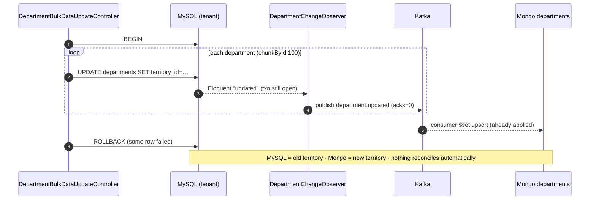
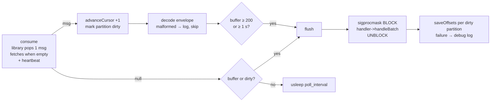

# 02 · Kafka in Sokrio — Deep Dive

> **Snapshot:** `sokrio-server` @ `master` · HEAD `d14c0ebb2` · written 2026-10-26.
> Paths are relative to `sokrio-server/`. Library paths are shortened to `phpkafka/…` = `vendor/longlang/phpkafka/src/…` (v1.2.5).
> Tags: `[CODE]` verified in app code · `[LIB]` verified in the vendored client · `[NOTES]` from my blog/PR notes · `[GENERAL]` industry knowledge · `[INFERENCE]` reasoned from code + Kafka protocol, needs a lab to prove · `[ASSUMPTION]` best guess plus how to verify.
> Builds on `00-inventory.md` and `01-architecture-overview.md`. Facts proven there are reused, not re-proven.

---

## 2.0 What changed our understanding (read this first)

T2 started by settling A1/A2 in the client library. The answers changed several earlier claims.

| # | Finding | Proof | Impact |
|---|---|---|---|
| F5 | **The producer runs with `acks = 0`.** Sokrio never calls `setAcks()`, and the library default is 0. With acks=0 the client writes to the socket and **does not wait for any broker response** | `phpkafka/Producer/ProducerConfig.php:36`; `phpkafka/Producer/Producer.php:159-163`; `grep setAcks app config` → no hits | "Publish succeeded" only means "bytes left our socket". A broker-side rejection (not leader, topic missing, message too large, disk full) is invisible. The 202 can be returned for an event that never landed. The tracking fallback only covers *transport* failures |
| F6 | **No `auto.offset.reset` setting exists.** A group with no committed offset starts at offset **0** (effectively *earliest*). An out-of-range offset (data aged out by retention) jumps to **latest − 1** | `phpkafka/Consumer/OffsetManager.php:107` (`max(committed, 0)`), `:140,150` (ListOffsets timestamp −1 → `offset - 1`); `phpkafka/Consumer/Consumer.php:345,364` | A renamed group replays the whole topic (that is why `tracking` is grandfathered, `config/kafka.php:9-16`). A consumer that is down longer than retention silently skips everything it missed |
| F7 | **The client counts messages instead of reading record offsets.** `RecordBatch::$baseOffset` is never read by the consumer; the cursor is `+1` per delivered message | `phpkafka/Consumer/Consumer.php:321,351-353`; `app/Services/Kafka/KafkaConsumer.php:282` | `[INFERENCE]` A Kafka broker returns *whole* record batches. If the committed offset lands mid-batch (a v2 bulk publish is one batch, see §2.1), a restart re-delivers the head of that batch **and** over-advances the cursor, skipping the same number of later records. Needs a lab (T9) |
| F8 | **A8 confirmed: Department events fire inside an open transaction.** `DepartmentBulkDataUpdateController` updates each department with `->update()` between `DB::beginTransaction()` and `DB::commit()` | `app/Http/Controllers/DepartmentBulkDataUpdateController.php:41-52` | On rollback, Mongo already received `territory_id`/`supplier_id` changes that never happened. While the broker is down, each row also pays the publish retry budget (§2.2) inside the request |
| F9 | **Heartbeats are piggy-backed on fetches.** Outside Swoole the timer is a no-op, so a heartbeat is only sent from `fetchMessages()` | `phpkafka/Util/KafkaUtil.php:45-53`, `phpkafka/Timer/NoopTimer.php`, `phpkafka/Consumer/Consumer.php:292-294,421-427` | A flush that takes longer than `session_timeout` (30 s, `config/kafka.php:50`) gets the member evicted. The offset commit then fails (swallowed at `KafkaConsumer.php:329-335`) and the batch is replayed |

> These replace the open items A1, A2 and A8 in MEMORY.md. Partitioner = `crc32(key) % partitions` (`phpkafka/Producer/Partitioner/DefaultPartitioner.php:48-53`). Compression = none (no compression attribute is set anywhere in `Producer.php`).

---

## 2.1 Producer: config, keys, envelope, retry and fallback

### Config actually in force

| Setting | Value | Source | Comment |
|---|---|---|---|
| `acks` | **0** (library default) | `ProducerConfig.php:36` | F5. Not configured anywhere in Sokrio |
| connect / send / recv timeout | 1.0 s each | `config/kafka.php:25-27`, set at `KafkaProducer.php:41-43` | Short on purpose: the publish runs inside the HTTP request |
| library `produceRetry` | 0 | `config/kafka.php:28` | The library's own retry is off; Sokrio retries itself |
| library `maxWriteAttempts` | 1 | `config/kafka.php:30` | |
| Sokrio publish attempts | 3, with 0.25 s sleep and a socket reset between them | `KafkaProducer.php:26,115-142`, `config/kafka.php:36` | Only on `SocketException`/`ConnectionException`/`NoAliveBrokerException` |
| partitioner | `crc32(key) % N` | `DefaultPartitioner.php:48-53` | Keyless messages would be round-robin; Sokrio always sets a key |
| compression | none | `Producer.php` (no attributes set) | `[GENERAL]` GPS JSON compresses ~5–10×; worth it at volume |
| idempotent producer / transactions | none (`producerId = -1`) | `ProducerConfig.php:41-46` | No broker-side dedup |
| socket | `InterruptResilientStreamSocket` | `KafkaProducer.php:51`, `Socket/InterruptResilientStreamSocket.php:36-83` | Retries `stream_select()` on EINTR from Datadog's profiler signals |

### Key choice

| Stream | Key | Proof | Why it's right | What breaks it |
|---|---|---|---|---|
| Tracking v1 | `user_id` | `Tracking/TrackingController.php:62-68` | Breadcrumbs are ordered per rep; one rep never spans partitions | Adding partitions remaps `crc32 % N`, so in-flight keys move (§2.5) |
| Tracking v2 (bulk) | `user_id`, all points in **one** `sendBatch` | `V2/Tracking/TrackingController.php:52-58`, `KafkaProducer.php:70-91` | One request = one partition = one record batch (`Producer.php` builds one `RecordBatch` per partition) | F7: the one-batch shape is what makes mid-batch commits possible |
| Departments | `department_id` | `DepartmentChangeObserver.php:131-138` | Last-write-wins per outlet only needs per-outlet order | A hot tenant cannot hot-spot a partition, which is good |
| Default | `tenant_id` | `KafkaProducer.php:58,76` | Fallback only | `[GENERAL]` Keying by tenant would make one big tenant a hot partition. Sokrio's overrides avoid that (D4) |

### Envelope

`KafkaProducer.php:93-102` → `{event_id (uuid v4), event_type, tenant_id, occurred_at (ISO-8601), payload}`.

- `[CODE]` The consumer only reads `tenant_id`, `event_type` and `payload` (`KafkaConsumer.php:351-364`). **`event_id` and `occurred_at` are dropped on decode**, so nothing downstream can deduplicate or reorder by them.
- `[GENERAL]` Missing pieces versus a production envelope: `schema_version`, `producer` (service/host), `trace_id`. `event_type` carries the meaning; the `.v1` suffix in the topic name is the only versioning (`TopicRegistry.php:18-24`).

### Retry + fallback, end to end

```php
// KafkaProducer::sendWithRetry() — KafkaProducer.php:115-121 (trimmed)
for ($attempt = 1; $attempt <= self::MAX_PUBLISH_ATTEMPTS; $attempt++) {
    try {
        $this->topicProvisioner->ensureTopicExists($this->config, $topic);
        $this->ensureConnection();
        $this->producer->sendBatch($messages);   // acks=0 → returns after the socket write
        return true;
    } catch (SocketException | ConnectionException | NoAliveBrokerException $e) { /* reset, sleep, retry */ }
      catch (\Predis\PredisException | \RedisException $e) { return false; }  // Redis OOM ≠ Kafka failure
      catch (\Throwable $e) { return false; }   // logged on the kafka channel only
}
```

- `[CODE]` Every failure becomes `false` → `null`. Tracking turns `null` into a synchronous write (`Tracking/TrackingController.php:70-81`, v2 `:60-76`); if that also fails the client gets **503 + `Retry-After: 5`**.
- `[CODE]` Departments have **no** fallback. The trait swallows and logs (`Observers/Concerns/PublishesKafkaMessage.php:19-25`).
- `[CODE]` Worst-case added latency with the broker down: 3 × (1 s connect + 0.25 s sleep) ≈ **3.75 s per publish**, plus the topic check in `ensureTopicExists` when the Redis "verified" flag is missing (`TopicProvisioner.php:23,52-81`).

**What could go wrong**
- F5 (acks=0): leader moves, the broker is out of disk, or the payload exceeds `message.max.bytes` → silent loss with a 202. The comment about a "rare lost-ack" duplicate (`app/Actions/Tracking/WriteTrackingActions.php:26-28`) describes an acks≥1 world. With acks=0 the dominant risk is the opposite: **loss, not duplication**.
- A v2 batch of N points is one produce request, so it lands entirely or fails entirely, and the client retries the whole batch. That is fine with the fallback; without acks it may "succeed" and vanish as a unit.
- Fix (cheap): `setAcks(1)` costs one broker round-trip (~1–3 ms on a LAN) and turns broker errors into exceptions the existing fallback already handles. `acks=-1` (all) only matters once RF > 1 (§2.5).

---

## 2.2 The dual-write problem

`[GENERAL]` A dual write = one business action writes to **two systems** (MySQL + Kafka) with no shared transaction. Any crash or failure between the two leaves them disagreeing.

| Path | Write 1 | Write 2 | Failure window | Result | Proof |
|---|---|---|---|---|---|
| Tracking v1/v2 | Kafka publish | (consumer) MySQL + Mongo | Publish "succeeds" but the broker drops it (F5) | Point lost, client saw 202 | `TrackingController.php:62-83` |
| Tracking fallback | MySQL txn | Mongo `insert` | Mongo fails after the MySQL commit | MySQL has the row, Mongo report does not; `report()` only | `app/Actions/Tracking/WriteBulkTrackingActions.php:67-82` |
| Department save | MySQL row (maybe inside an open txn) | Kafka publish from the `updated` observer | (a) txn rolls back after publish → **phantom event** (F8); (b) broker down → event lost, no fallback | Mongo ≠ MySQL until the manual `tenant:department_sync_with_mongodb` (F1) | `DepartmentChangeObserver.php:35-46`, `DepartmentBulkDataUpdateController.php:41-52` |
| Department bulk writes | `Department::upsert()` / query `->update()` | none (observers bypassed) | always | ERP codes never reach Mongo (F2) | `app/Jobs/DepartmentErpCodeSyncJob.php:71` |



### Proposal: transactional outbox (sized for Sokrio)

1. New tenant table `outbox_events(id, topic, key, event_type, payload JSON, created_at, published_at NULL)`, index `(published_at, id)`.
2. The observer writes an outbox row **in the same DB transaction** as the department save (`DB::afterCommit` is not needed, because the row commits or rolls back with the save). `Department::upsert` callers write outbox rows explicitly, which also closes F2.
3. A relay (`kafka:relay-outbox`, under Supervisor) per tenant: `SELECT … WHERE published_at IS NULL ORDER BY id LIMIT 500 FOR UPDATE SKIP LOCKED` → `publishBatch` with **acks=1** → `UPDATE published_at`.
4. Delivery becomes at-least-once from the producer side; the consumer is already idempotent for departments (§2.7).

- Cheaper alternative today: `Department::observe(...)` with `$afterCommit = true` on the observer (`[GENERAL]` Laravel 9 supports `public $afterCommit = true;` on observers). This kills phantom events (F8) but not lost events.
- `[GENERAL]` A CDC tool (Debezium on the MySQL binlog) is the "zero app change" version, but one binlog per tenant DB makes it heavy for Sokrio's DB-per-tenant model.

---

## 2.3 Consumer: process model, groups, commits, batching

### Process model

| Aspect | How | Proof |
|---|---|---|
| Entry | `php artisan kafka:consume {tracking|departments}` | `Console/Commands/Kafka/ConsumeCommand.php:18,27-30` |
| Supervisor | `sokrio-kafka-consumer-tracking`, `-departments`; numprocs=1, stopwaitsecs=35, `DD_PROFILING_ENABLED=false`/`DD_TRACE_CLI_ENABLED=false` | `README.md:178-212` |
| Group id | tracking → bare `KAFKA_GROUP` (legacy); others → `{KAFKA_GROUP}-{topic}` | `ConsumeCommand.php:97-107`, `config/kafka.php:16` |
| Membership | **static**, `group.instance.id = ""` (D1) | `KafkaConsumer.php:79-95` |
| Assignment | `RangeAssignor` (library default) | `phpkafka/Consumer/ConsumerConfig.php:115` |
| Recycle | flush, commit and exit 0 after 6 h | `config/kafka.php:70`, `KafkaConsumer.php:123,229-231,256-258` |
| No time limit | `set_time_limit(0)` | `ConsumeCommand.php:45-46` |

`[CODE]` With numprocs=1 and 3 partitions, **one PHP process owns all three partitions** of its topic. Scaling out means numprocs=2–3. With static membership, each process then needs a **distinct** `group.instance.id` (for example `%(process_num)s`), which Sokrio can't do today because the id is hard-coded to `""`. Two processes with `""` fence each other (the FENCED_INSTANCE_ID ping-pong in the comment at `KafkaConsumer.php:92-94`).

### The poll loop



- `[CODE]` Commits are **manual and per flush**: `autoCommit=false` (`KafkaConsumer.php:69`), the cursor advances as each message is pulled (`:236-241,279-294`), and `saveOffsets` runs only after the handler returns (`:326-336`). That is "process, then commit", i.e. at-least-once (§2.6).
- `[CODE]` Signals are blocked during the persist step so a SIGTERM can't tear a MySQL read in half ("Packets out of order") (`KafkaConsumer.php:309-319`). Shutdown between polls flushes first (`:262-266`). `stopwaitsecs=35` must exceed the longest flush, or Supervisor SIGKILLs mid-batch and the batch is replayed.
- `[CODE]` Reconnect: transport/Kafka errors close the consumer, back off `min(failures, 30)` s and rejoin from the last committed offset; 10 in a row → exit for Supervisor (`KafkaConsumer.php:155-190,371-393`, `config/kafka.php:56-57`). The join handshake is retried 5× (`:404-432`).
- `[CODE]` Tenant switching happens **inside the handler**, per tenant slice of the batch: group by `tenant_id` → `Org::findById` (in-process cache) → `TenantManager::tenant($org)->reconnect()` (`TrackingMessageHandler.php:50-87`, `DepartmentMessageHandler.php:40-76`). There is no switch back to landlord, but each slice reconnects explicitly, so the next tenant can't inherit the wrong DB.
- `[CODE]` Memory: the in-process `$orgs` cache never evicts (`TrackingMessageHandler.php:33`), which is bounded by tenant count. The 6 h recycle bounds everything else.
- `[LIB]` `[INFERENCE]` Per-partition fetch `maxBytes` is left at **0** (`phpkafka/Protocol/Fetch/FetchPartition.php:45`). Brokers still return the first batch so the consumer makes progress (KIP-74), but each fetch likely carries ~one record batch. For v1 tracking (one message per produce) that means roughly one fetch round-trip per GPS point. Batching at 200 still helps the *write* side, not the *read* side. Measure with `kafka-consumer-groups --describe` lag during a backlog.

**What could go wrong**
- F9: a slow flush (tracking retries sleep 1 s + 2 s, `TrackingMessageHandler.php:114`, then per-point fallback for up to 200 points) can exceed 30 s with no heartbeat → eviction → commit lost → the whole batch is replayed → duplicate tracking rows.
- A handler exception that escapes `handleBatch` is impossible by design (both handlers catch `\Throwable` per tenant, `TrackingMessageHandler.php:57-70`, `DepartmentMessageHandler.php:47-60`). But an error from `pcntl_sigprocmask` or the decode step would crash the process, and Supervisor restarts it from the last commit.
- F6: if the consumer is stopped longer than topic retention (broker default 7 days, `[ASSUMPTION]` not overridden), the restart hits OFFSET_OUT_OF_RANGE and **jumps to the end**. The gap is silently skipped.

---

## 2.4 PR-5094 walkthrough → today

`[NOTES]` PR #5094 (Aug 2026, `59f4f047a` + `fc2d46905`) shipped the generic plumbing plus a **shadow** tracking pilot. Here is each decision and what happened to it.

| PR-5094 decision | Why it was reasonable | What could go wrong | Today | Commit |
|---|---|---|---|---|
| Consumer `autoCommit = true` via `Consumer::start()` | Simplest correct-looking loop | Commit per message (slow) **and** the ack happens even when the handler gave up → at-most-once | Own poll loop, manual commit per flush | `a7e63f4bb` (D8) |
| Handler writes to shadow `TrackingNew`; request still writes MySQL+Mongo synchronously **and** publishes | Compare both paths before trusting Kafka | Double latency; it proves nothing about ordering under load | Shadow removed; the consumer owns persistence; the sync write is a fallback only; 202 | `d32d99105`, `59922533e`, `3af8daa1f` (D5) |
| Retry 3× with `sleep($attempt)` then drop | Bounded effort, no poison-pill block | Silent drop, no DLQ | Same 3× retry, then **per-point fallback**, then drop + `report()` | `TrackingMessageHandler.php:85-158` |
| One `KAFKA_GROUP` for all topics | Fewer knobs | Two topics under one static id → FENCED_INSTANCE_ID | One group per topic; tracking grandfathered | `9d902b7e8` (D2) |
| Join retried 5× on transport errors | The library doesn't retry the handshake | — | Kept, plus `KafkaErrorException` (FENCED, UNKNOWN_MEMBER…) | `de9b53f38`, `d1cbf7c54` |
| Order/Delivery publish commented out | De-risk the stakes: pilot on tracking first | — | **Still** commented out (`OrderObserver.php:23`, `DeliveryObserver.php:23`) | — |
| Departments topic had no handler | Not in scope | — | `DepartmentMessageHandler` live; observer publishes (D3, D6) | `94791dabd` |
| Logs | — | Transport noise in Sentry/Slack | Isolated `kafka` channel, never at error level (test `KafkaLogsNeverAtErrorLevelTest`) | `config/logging.php:54-68` |
| Not addressed in the PR or since | — | `acks`, outbox, DLQ, `event_id` dedup, RF | **Open**: F5, §2.2, §2.9, §2.7, §2.5 | — |

`[CODE]` What the evolution shows: each fix followed a production symptom. EINTR → `InterruptResilientStreamSocket`; Redis OOM → `37840a3b5`; dead sockets → `ce3a7aaab`; fenced members → `9d902b7e8`. That is good material for an interview story (T8e STAR).

---

## 2.5 Topic design

| Topic (prod name) | Non-prod name | Partitions | RF | Retention | Proof |
|---|---|---|---|---|---|
| `tracking.events.v1` | `tracking.events.v1.{APP_ENV}` | 3 | 1 | broker default | `TopicRegistry.php:18-24,51-58`, `config/kafka.php:74-75` |
| `departments.events.v1` | `…{APP_ENV}` | 3 | 1 | broker default | same |
| `order-summaries.events.v1`, `delivery-summaries.events.v1` | `…{APP_ENV}` | created on first publish (none today) | 1 | — | same |

- `[CODE]` Topics are created by the app at runtime (`TopicProvisioner.php:52-81`), memoized in cache for a day (`:114`). The library's `autoCreateTopic = true` (`ProducerConfig.php:56`, `ConsumerConfig.php:110`) is a second path to the broker's own defaults.
- `[CODE]` A creation failure other than TOPIC_ALREADY_EXISTS is only a warning (`TopicProvisioner.php:69-80`). Combined with acks=0, a publish to a non-existent topic can "succeed".
- `[ASSUMPTION]` A3: production topics have RF=1. Verify with `kafka-topics.sh --describe --topic tracking.events.v1` (look at `ReplicationFactor` and `Isr`).

**What could go wrong**
- RF=1: one broker disk loss = all unconsumed events gone; one broker restart = a produce/consume outage (tracking falls back, departments lose events).
- Partition count is the **ceiling on consumer parallelism** (3). Raising it later remaps `crc32(key) % N`, so a user's new points can land on a different partition than the old, still-unconsumed ones. Order across that boundary is not guaranteed until the backlog drains.
- `[GENERAL]` Recommended: create topics with IaC/ops scripts (not from the app), RF=3, `min.insync.replicas=2`, producer acks=all, explicit `retention.ms` (tracking: 3–7 d; departments: consider `cleanup.policy=compact`, since the payload is a full snapshot keyed by `department_id`, so a compacted topic *is* the department table).

---

## 2.6 Delivery guarantee — proved hop by hop

| Hop | Guarantee | Proof |
|---|---|---|
| App → broker (tracking) | **At-most-once for broker-side errors** (acks=0), with a sync **fallback for transport errors** | F5; `Producer.php:159-163`; `TrackingController.php:70-81` |
| App → broker (departments) | **At-most-once**: no acks, no fallback, swallowed | F5; `PublishesKafkaMessage.php:19-25` |
| Broker storage | Lost on single-broker disk loss (RF=1) | §2.5, A3 |
| Broker → handler | **At-least-once**: commit happens after `handleBatch` returns; a crash, SIGKILL or eviction before the commit replays the batch | `KafkaConsumer.php:308-336` |
| Handler → stores | **At-most-once on the give-up path**: after 3 tries + per-point fallback, failures are logged and the offset is still committed | `TrackingMessageHandler.php:96-106,141-157`; `KafkaConsumer.php:326-336` |
| Library offset arithmetic | Possible duplicate + skip on restart mid-batch | F7 `[INFERENCE]` |

> **One-line answer:** the consumer is at-least-once, but the pipeline as a whole is *best-effort*. acks=0 and swallowed handler failures make the ends at-most-once. "Exactly-once" is nowhere. Only the **effect** is exactly-once, and only for departments, through idempotent upserts.

---

## 2.7 Idempotency

| Stream | Write | Idempotent? | Why | Proof |
|---|---|---|---|---|
| Tracking | MySQL `Tracking::insert($rows)` + Mongo `TrackingReport::insert` | **No** | Plain inserts; no unique key on `(user_id, created_at)` (only plain indexes) | `WriteBulkTrackingActions.php:67-78`; `database/migrations/2020_08_18_074138_create_trackings_table.php:18,24` |
| Departments | Mongo `updateOne({department_id}, {$set: payload}, upsert)` | **Yes** | Same snapshot applied twice = same document | `DepartmentMessageHandler.php:87-112`; fallback `updateOrCreate` `:139-142` |

- Replay sources for tracking: eviction (F9), SIGKILL past `stopwaitsecs`, a crash between the handler and `saveOffsets`, a client retrying after a 503 that actually committed MySQL (v2 comment explains why the action rolls back first, `V2/Tracking/TrackingController.php:63-69`), and F7.
- **Fix options** (cheapest first):
  1. Unique index on `trackings(user_id, created_at)` + `insertOrIgnore`. A phone never produces two fixes in the same second for the same user. Mongo: unique index on `{user_id, created_at}` + `ordered:false` insert, ignoring E11000.
  2. Carry `event_id` through decode and store it with a unique index (`KafkaConsumer.php:360-364` currently drops it).
  3. `[GENERAL]` A processed-ids table with a TTL is the general pattern, but it is overkill for breadcrumbs.

---

## 2.8 Ordering

- `[CODE]` Guarantee: **per key, per partition**. Tracking: per `user_id`; departments: per `department_id`. One process reads partitions sequentially, so messages for one key reach the handler in log order.
- `[CODE]` Inside a flush, the handler **groups by tenant** (`TrackingMessageHandler.php:52-55`). Relative order between tenants changes, but order within a key is preserved because `array` grouping keeps insertion order.

| Where order breaks | Stream | Matters? | Proof |
|---|---|---|---|
| Request-path fallback writes directly while earlier points for the same user are still in Kafka | Tracking | **No**: reports sort by the device's `created_at`, not insert order | `TrackingController.php:70-71` |
| Per-point degraded path after a failed bulk write | Tracking | No (same reason) | `TrackingMessageHandler.php:142-149` |
| Replay after eviction/restart re-applies an older batch | Departments | **No**: the replay contains the newer events too, in order, and the final `$set` wins | `KafkaConsumer.php:326-336` |
| Phantom event from a rolled-back txn (F8) | Departments | **Yes**: Mongo keeps a state that MySQL never committed | §2.2 |
| Partition count change remaps keys | Both | Yes for departments while a backlog exists | §2.5 |
| The snapshot is built at **publish** time by `load()`-ing 8 relations | Departments | Two saves of related rows (e.g. territory renamed) don't re-publish the department, so Mongo shows stale nested names | `DepartmentChangeObserver.php:111-125` |

- `[GENERAL]` The retry `sleep()` in the handler doesn't reorder anything (one process, synchronous), but it **does** pause every partition, so all users' tracking lags during a DB blip.

---

## 2.9 Retry and DLQ — none today, here's a proposal

**Today** `[CODE]`: producer retry 3× (transport only) → fallback (tracking) or drop (departments). Consumer: 3× bulk retry with linear sleep → per-record fallback → drop + `report()` + commit. Malformed envelopes: warn, skip, commit (`KafkaConsumer.php:347-358`). **No dead-letter topic, no parking lot, no replay tool.** The only recovery for departments is the manual full resync (F1).

**Proposal**, in order of value:

1. **DLQ topic per stream**: `tracking.events.v1.dlq`, `departments.events.v1.dlq`. In `persistPerPoint`/`persistPerRecord`, publish each failed payload (with `error`, `attempts`, `original_partition/offset` when available, and `failed_at`) with **acks=1**. Commit only after the DLQ publish succeeds; if the DLQ is down too, *don't commit*. Let the consumer crash-loop rather than lose data (departments) or accept the loss (tracking, documented).
2. **Classify errors before retrying.** Transient (connection, deadlock, Mongo `NotPrimary`) → retry with backoff. Permanent (validation, unknown tenant, `TypeError`) → straight to the DLQ, with no 3 s sleep that starves heartbeats (F9).
3. **Replay command**: `kafka:replay-dlq {topic} --since=` re-publishes DLQ messages to the main topic after a fix. Idempotency (§2.7) makes this safe.
4. **Alerting**: DLQ depth > 0 → Slack (via a scheduled check, keeping the `kafka` log channel quiet as designed).
5. **Schedule `DepartmentSync`** nightly as a safety net until the outbox exists (closes F1), with `->onOneServer()`.

`[GENERAL]` Retry topics with delays (`.retry.5m`, `.retry.1h`) are the "Uber pattern". They are overkill at Sokrio's volume; a single DLQ + manual replay covers it.

---

## 2.10 Takeaways for interviews

- "Our consumer is **at-least-once** because we commit after processing, per flush, with signals blocked during the write. The weak spot was the producer: we were effectively fire-and-forget (`acks=0`), so I'd move to acks=1 now and acks=all with RF=3."
- "Departments are idempotent (full-snapshot `$set` upserts, keyed by id), so replays are harmless. Tracking is not, and the fix is a natural unique key `(user_id, created_at)` rather than a dedup store."
- "We have a classic **dual-write** bug: observers publish inside open transactions. The fix is an outbox table written in the same transaction, plus a relay. `afterCommit` observers are the 10-minute stopgap."
- "Pure-PHP Kafka has sharp edges: no heartbeat thread (heartbeats ride on fetches), message counting instead of offset tracking, no idempotent producer. If the volume grows, `ext-rdkafka` fixes all three."

---

### ✅ Quality check
- [x] A1, A2, A8 resolved with `[LIB]`/`[CODE]` proofs (F5, F6, F8); partitioner + compression recorded
- [x] All 9 subsections from the T2 card covered, each with a code proof and a "what could go wrong" note
- [x] F2 reused in the dual-write table; F1 reused in the retry/DLQ section
- [x] 2 Mermaid diagrams (phantom-event sequence, poll-loop flowchart)
- [x] `[INFERENCE]` items (F7, fetch maxBytes 0) flagged for a T9 lab instead of stated as fact
- [x] No secrets: env var names only, no hosts or IPs
