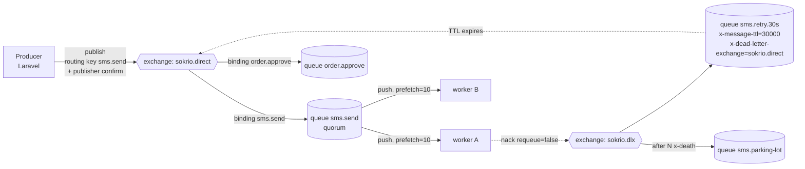

# 03 · RabbitMQ in Sokrio — Not Used, and Where It Would Fit

> **Snapshot:** `sokrio-server` @ `master` · HEAD `d14c0ebb2` · written 2026-10-26.
> Paths are relative to `sokrio-server/`. Tags: `[CODE]` verified in app code · `[GENERAL]` industry knowledge · `[ASSUMPTION]` best guess plus how to verify.
> Question bank links: Q29–Q36 (RabbitMQ), Q48 (Kafka vs RabbitMQ), Q80 (blocked producers).

## 3.0 Verdict (read this first)

- `[CODE]` **Sokrio does not use RabbitMQ.** There is no client library, no config, no connection and no AMQP code (§3.1).
- `[GENERAL]` Four jobs in Sokrio have the *shape* of a RabbitMQ problem: delayed order approval, SMS retries, per-tenant priority, and request/reply with the ERP (§3.3).
- **My recommendation: don't add it.** In three of the four cases the current stack (Laravel queues on Redis, plus Kafka) can do the same job with a few lines of config. The only case where a broker would add real value is the ERP integration, and that depends on the ERP side, not on us.
- The useful output of this section is the fixes that fell out of the comparison: **F10** (primary-order delayed approval runs on `default` with `$timeout = 0`) and a Laravel `backoff` design for SMS.

---

## 3.1 Proof: not used

Re-run on HEAD `d14c0ebb2`, extending the T0 search (`00-inventory.md` §0.3 packages and §0.13 "Not found").

| Searched for | Where | Result |
|---|---|---|
| `amqp`, `rabbitmq`, `basic_publish`, `basic_consume`, `x-dead-letter`, `php-amqplib` | `*.php`, `*.json`, `*.yml`, `*.yaml`, `.env.example`, excluding `vendor/` | **Not found** |
| `php-amqplib`, `vladimir-yuldashev/laravel-queue-rabbitmq`, `enqueue/amqp-*`, `bunny/bunny` | `composer.json` / `composer.lock` / `vendor/` | **Not found** |
| A `rabbitmq` connection | `config/queue.php:30-72` | Only `sync`, `database`, `beanstalkd`, `sqs` (stub), `redis` |
| Amazon MQ | Code, CI workflows, deploy scripts | **Not found** (T0) |

`[CODE]` So every "queue" in Sokrio is a **Laravel queue on Redis** (`config/queue.php:65`, `retry_after = 9000`), and every "stream" is Kafka (T2).

---

## 3.2 The AMQP model in five minutes `[GENERAL]`

The key difference from Kafka is that **a producer never writes to a queue directly**. It publishes to an *exchange* with a *routing key*. *Bindings* decide which queues get a copy. The broker tracks each message per queue and **deletes it once a consumer acks it**. There is no log to replay (Q29).

| Concept | What it means | Kafka equivalent (T2) |
|---|---|---|
| Exchange (`direct`, `topic`, `fanout`, `headers`) | Routing table: the routing key and bindings choose the target queues | None. The producer picks the topic and the partition (`crc32(key) % N`) |
| Queue | The unit of storage and delivery. Deleted per message on ack | Topic partition, which keeps messages until retention expires |
| Ack / nack / requeue | Per-message settlement. Nack with `requeue=false` sends the message to the DLX | Commit an offset per partition. Nothing is per message |
| Prefetch (`basic.qos`) | Cap on unacked messages per consumer, which is the backpressure (Q5) | `max.poll.records` / fetch size. Sokrio flushes at 200 |
| Publisher confirms | The broker acks each publish once it is stored (Q33) | `acks`. Sokrio runs **acks=0** (F5) |
| `mandatory` flag | Returns an unroutable message to the producer instead of dropping it | None. A topic always exists (auto-create) |
| Quorum queue | Raft-replicated queue over 3+ nodes, the durable default | RF=3 + `min.insync.replicas=2`. Sokrio is likely RF=1 (A3) |
| DLX + TTL | Dead-letter routing and per-queue or per-message expiry. Together they make delayed retries (Q34) | A DLQ topic plus a retry consumer (T2 §2.9) |
| Streams | An append-only log with replay, RabbitMQ's answer to Kafka (Q35) | A topic |

**The one-line difference** (Q48): Kafka is a **log you read from**, so consumers own their position and can replay. RabbitMQ is a **broker that hands out work**, so it owns the delivery state and gives you routing, per-message acks, delays and priorities out of the box.

---

## 3.3 Where it would fit — four candidates

Each candidate follows the same pattern: what happens today, where it hurts, the RabbitMQ design, the cheaper option in the current stack, and a verdict.

### 3.3.1 Delayed order approval

**Today** `[CODE]`
- Secondary orders: `Order::approveAfter` dispatches `ApproveOrder` on queue `order-approved` with `->delay(now()->addMinutes($delay))` (`app/Models/Order/Order.php:240-243`). The delay comes from a tenant setting (`app/Http/Requests/OrderRequest.php:200-205`), and the import path uses it too (`app/Jobs/ImportSecondaryOrderJob.php:260`).
- The job has `tries = 3` and `timeout = 300`. Its `$retry_after = 600` is ignored by Laravel (`app/Jobs/ApproveOrder.php:24-26`, MEMORY risk 7). It is safe to repeat, because `Order::pending()->find(...)?->approve()` does nothing once the order has left pending (`:53`).
- **F10, new:** primary orders use a *different* job. `PrimaryOrder::approveAfter` dispatches `App\Jobs\PrimaryOrder\ApproveOrder` **with no `onQueue`**, so it lands on `default` (`app/Models/MongoDB/PrimaryOrder/PrimaryOrder.php:199-203`), and that job has `$timeout = 0` (`app/Jobs/PrimaryOrder/ApproveOrder.php:20`). It joins the `$timeout = 0` vs `retry_after = 9000` double-run family (MEMORY risk 3). The double run is harmless here only because `pending()` guards it (`:47`).
- `[GENERAL]` Laravel's Redis driver keeps delayed jobs in a sorted set (`queues:order-approved:delayed`). A worker polling that queue moves due jobs onto the ready list. So the delay is only accurate while a worker listens to that queue. `[ASSUMPTION]` One does on the queue-worker box, but the only Supervisor programs in the repo are the three in `README.md:178-212`. Verify on the box with `supervisorctl status`.

**Where it hurts**
- A worker that dies mid-approval holds the job until `retry_after` (9000 s, **2.5 h**) runs out, so the approval happens 2.5 h late.
- When `order-approved` has no worker, approvals silently never happen. There is no alert.

**RabbitMQ design** `[GENERAL]`
- Option A, the `rabbitmq_delayed_message_exchange` plugin: publish with header `x-delay: <ms>`. Caveats: it is a community plugin, delayed messages sit in a **single node's Mnesia table (not replicated)**, and it is not built for millions of pending delays.
- Option B, a TTL queue + DLX per delay value (`order.approve.wait.15m` → DLX → `order.approve`). Caveat: per-message TTL only expires **at the head of the queue**, so mixing delays in one queue blocks the short ones behind the long ones. Since each tenant chooses its own delay, you need one queue per distinct delay.
- Either way, the redelivery-after-crash problem goes away: an unacked message comes back as soon as the consumer's channel closes, not 2.5 h later.

**The cheaper option** `[CODE]`-anchored
1. Put primary orders on `order-approved` and give the job a real `$timeout`, which fixes F10.
2. Set `retry_after` per connection: add a second Redis connection, `redis-short`, with `retry_after = 360`, and route `order-approved` to it. That turns 2.5 h into 6 min.
3. Add a scheduled check that alerts when `queues:order-approved:delayed` holds jobs more than 10 min past due.

**Verdict:** Redis delayed jobs are the right tool. Fix F10 and `retry_after`. RabbitMQ would add a broker to solve a configuration bug.

### 3.3.2 SMS retries with DLX + TTL

**Today** `[CODE]`
- A failed SMS becomes a `messages` row with status `failed`. **Nothing retries it automatically.** A user picks failed rows in the UI, and `MessageResendService::startResend` claims them (failed → pending under `Cache::lock` + `lockForUpdate`, `app/Services/SMS/MessageResendService.php:111-198`). It then dispatches `ResendFailedSmsBatch` in chunks of `batch_size = 100` to the **`default` queue** (`:233-257`, `config/sms.php:14`).
- The batch job has `tries = 1` on purpose ("the retry limit is ours", `app/Jobs/SMS/ResendFailedSmsBatch.php:37-41`). `messages.retry_count` caps resends at `max_retry = 5` (`config/sms.php:15`).
- The design separates two errors carefully. `ProviderUnavailableException` means nothing was sent. `SmsDeliveryUnknownException` means the provider got the request but never answered, so the SMS *may* have gone out (`app/Services/SMSSender.php:12-19`). After the first failure, the rest of the batch is skipped (`ResendFailedSmsBatch.php:66-68,87-92`).

**RabbitMQ design** `[GENERAL]`. This is the textbook case (Q34):
- `sms.send` (quorum) → on failure `nack(requeue=false)` → DLX → `sms.retry.30s` / `.5m` / `.30m` (TTL queues that dead-letter back to `sms.send`) → after 3 attempts, counted from the `x-death` header → `sms.parking-lot`, which a human reviews (today's resend screen).
- Publisher confirms on enqueue, and `prefetch` sized to the provider's rate limit.

**Where the textbook breaks for Sokrio**
- Retrying `SmsDeliveryUnknownException` automatically can **send the SMS twice and charge the tenant twice**. Only `ProviderUnavailableException` is safe to retry automatically. Today's code already makes that distinction, and any broker design must keep it.
- The balance reservation (`reservedSms`, `MessageResendService.php:215-219`) lives in MySQL. Messages waiting in a broker's TTL queue are invisible to it unless the row stays `pending`.

**The cheaper option:** a dedicated `SendSmsJob` on its own `sms` queue with `$tries = 4` and `public function backoff() { return [30, 300, 1800]; }`. It calls `$this->release()` only for `ProviderUnavailableException`, and `failed()` marks the row `failed` so the existing resend screen becomes the parking lot. Laravel's `backoff` uses the same delayed set as §3.3.1.

**Verdict:** this is the most natural RabbitMQ fit, but Laravel `backoff` covers it at Sokrio's volume. Build the retry ladder in Laravel, and keep "delivery unknown" out of automatic retries.

### 3.3.3 Per-tenant priority and fairness

**Today** `[CODE]`
- `BaseCommand` loops over all active tenants and dispatches one job per tenant (`app/Console/Commands/BaseCommand.php:50-70`). The 20 summary jobs share one FIFO `summary` queue, and the hourly runs are scheduled at `app/Console/Kernel.php:149,152`.
- A large tenant's 900 s job (`SecondaryOrderSummaryJob` timeout 900) holds a worker while small tenants queue up behind it. There is no notion of tier or priority.

**RabbitMQ design** `[GENERAL]`
- Priority queues: `x-max-priority` on classic queues, where 1–5 levels is practical. Quorum queues support only two levels (normal and high, RabbitMQ 4.0+). Caveat: priority only matters when messages are **waiting**. With `prefetch` > 1, a consumer has already taken low-priority work.
- Fairness: `prefetch = 1` per consumer gives fair dispatch. Per-tier queues (`summary.enterprise`, `summary.standard`) with dedicated consumers isolate the tiers.

**The cheaper option:** Laravel already does strict priority across queues. `queue:work --queue=summary-high,summary` drains `summary-high` first. Add a tier flag on `Org` and choose the queue in `dispatchJob`. A second worker on `summary` alone keeps the low tier from starving.

**Verdict:** Laravel's multi-queue priority is enough. RabbitMQ adds nothing here that Sokrio needs.

### 3.3.4 Request/reply with the ERP (IFS)

**Today** `[CODE]`: a **shared-database** integration.
- Sokrio reads `{org.ifs_database}.customer_responses WHERE fetch = 0`, writes `erp_code` with `Department::upsert` (which bypasses the observer, so Mongo never hears about it, F2), then sets `fetch = 1` (`app/Jobs/DepartmentErpCodeSyncJob.php:44-73`). This runs **once a day at 06:00** (`app/Console/Kernel.php:147`).
- The product-price sync works the same way on `{ifs_database}.sales_part` with a `FetchCount` flag, daily at 05:40 (`app/Jobs/IFS/SalePartProductPriceSyncJob.php:51-55,133`; `Kernel.php:143`). Guest SellScope controllers read `ifs_database` tables directly as well (`app/Http/Controllers/Guest/SellScope/InvoiceDeliveryController.php:47`).
- The `fetch` flag is a home-made **inbox table**. The upsert and the flag update are not in one transaction, but a crash between them only re-reads rows, and the upsert is idempotent. That part is safe.

**Where it hurts**
- An outlet created in Sokrio waits **up to 24 h** for its ERP code.
- Sokrio is coupled to the ERP's table layout and needs cross-database credentials.
- Mongo never gets `erp_code` (F2).

**RabbitMQ design** `[GENERAL]`: async request/reply (RPC).
- Sokrio publishes `erp.customer.create` with `reply_to = erp.replies.sokrio` and `correlation_id = department_id`.
- An IFS-side adapter creates the customer and replies with `{correlation_id, DealerNo}`.
- A Sokrio consumer updates the department **through Eloquent `save()`**, so the observer fires and Mongo gets the code. That closes F2 for this path.
- Fallback: keep the 06:00 poll as a nightly reconciliation.

**Caveats** `[ASSUMPTION]`: this needs an adapter on the ERP side, which Sokrio does not own. The same pattern also works on Kafka (a request topic plus a reply topic keyed by `department_id`), and Sokrio already runs Kafka.

**Verdict:** this has the highest business value (24 h → seconds), but it is a cross-team decision. If the ERP team can only speak a message broker, RabbitMQ's built-in `reply_to` / `correlation_id` makes it the easier choice. If they can call HTTP, a webhook is simpler than either broker.

---

## 3.4 The T2 DLQ proposal, translated to RabbitMQ

| Concern | Kafka (T2 §2.9 proposal) | RabbitMQ equivalent | Note |
|---|---|---|---|
| Dead-letter target | `<topic>.dlq` topic, published by the consumer | DLX bound to a `.dlq` queue. The broker routes it on `nack(requeue=false)`, TTL expiry or length overflow | RabbitMQ does it **without consumer code** |
| Metadata | `error`, `attempts`, `original_partition/offset` added by hand | `x-death` header (queue, reason, count, time) added by the broker | |
| Delayed retry | Separate retry topics + a sleeping consumer ("Uber pattern"), overkill here | TTL queue + DLX (§3.3.2) | The thing RabbitMQ does best |
| Replay after a fix | Re-publish from the DLQ topic. The main topic still holds history until retention | Shovel or move messages from `.dlq` back to the work queue. **There is no history**: acked messages are gone | Kafka wins for "replay last Tuesday" |
| Poison message | Commit past it and log it (today: swallowed) | `x-delivery-limit` on quorum queues dead-letters it after N redeliveries | |

---

## 3.5 If Sokrio ever did add RabbitMQ

- `[GENERAL]` **Laravel driver:** `vladimir-yuldashev/laravel-queue-rabbitmq` makes it one more `config/queue.php` connection, so jobs keep `dispatch()->onConnection('rabbitmq')`. Retry, `backoff` and `failed_jobs` keep working, but Laravel re-implements delays its own way, so check that the driver maps them to the delayed-exchange plugin and not to ad-hoc TTL queues.
- `[GENERAL]` **Ops cost on EC2** (no IaC, Supervisor, T6): quorum queues need **3 nodes**. You also need to plan for memory and disk alarms that block publishers (Q80), partition handling (Q36, `pause_minority`), and upgrades. That is a third stateful cluster next to Kafka and Redis, for a small team.
- `[ASSUMPTION]` **Amazon MQ for RabbitMQ** removes most of that (a managed 3-node cluster) at a fixed hourly cost. Compare it in T6 with SQS, which covers the delay, DLQ and visibility-timeout needs of §3.3.1–3.3.2 natively and with no cluster to run.
- **Decision rule:** add a broker only when you need **routing** (one event, many differently-filtered consumers), **per-message priority/TTL at scale**, or **RPC with a partner that speaks AMQP**. None of these is true in Sokrio today.

---

## 3.6 Takeaways for interviews

- "We don't run RabbitMQ, and I can show why. Our work-queue needs (delays, retries, priority) are covered by Laravel queues on Redis, and our stream needs by Kafka. Adding a third stateful system for a small team needs a use case neither covers."
- "Where I *would* reach for it is partner integration with request/reply. Our ERP sync is a once-a-day shared-database poll with a `fetch` flag, basically a home-made inbox. `reply_to` plus `correlation_id` makes that seconds instead of a day."
- "DLX + TTL is the cleanest delayed-retry design I know, but retries need to know about side effects. For SMS, 'provider down' is safe to retry and 'delivery unknown' is not, because it can double-send and double-charge."
- "Kafka vs RabbitMQ in one line: a log you read from vs a broker that hands out work. Pick Kafka when you need replay and many independent readers, and RabbitMQ when you need routing and per-message settlement."

---

### ✅ Quality check
- [x] "Not used" proved with an explicit search table, re-run on HEAD `d14c0ebb2` (§3.1)
- [x] All four task-card candidates covered (delayed approval, SMS DLX+TTL, per-tenant priority, ERP request/reply), each with today's code (`file:line`), a RabbitMQ design, a cheaper option and a verdict
- [x] AMQP model diagram (Mermaid) including DLX + TTL retry and the parking lot
- [x] T2 hooks reused: F2 (ERP upsert bypass), F5 (acks=0 vs confirms), §2.9 DLQ translated (§3.4)
- [x] New finding F10 recorded (primary-order delayed approval on `default`, `$timeout = 0`)
- [x] Every statement tagged; `[GENERAL]` used for anything not in Sokrio's code
- [x] No secrets: env var names only, no hosts or IPs
