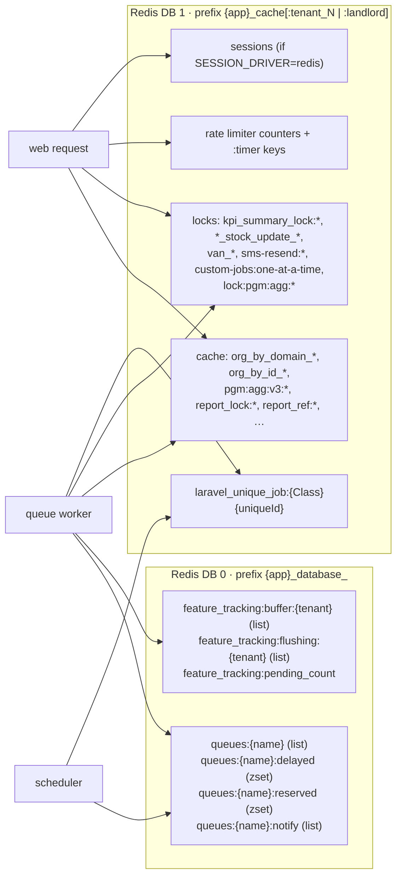
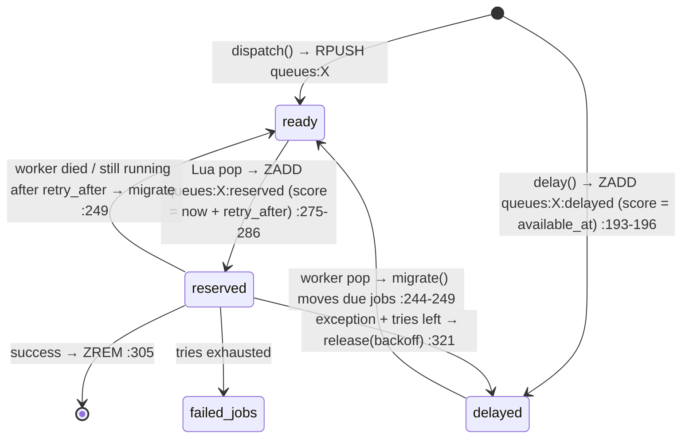
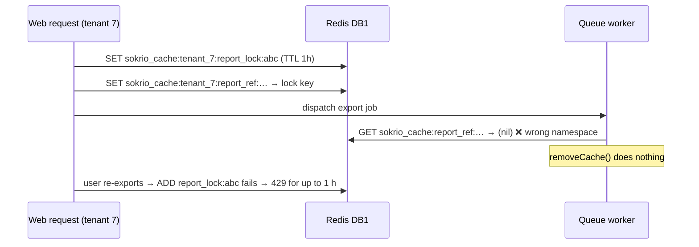
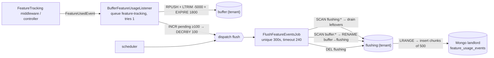

# 04 · Redis in Sokrio — Queues, Cache, Locks, Limiters, Buffer

> **Snapshot:** `sokrio-server` @ `master` · HEAD `d14c0ebb2` · written 2026-10-26.
> Paths are relative to `sokrio-server/`. Tags: `[CODE]` verified in app code · `[LIB]` verified in `vendor/` · `[LAB]` reproduced on a throwaway local Redis · `[GENERAL]` industry knowledge · `[INFERENCE]` follows from code but not observed in prod · `[ASSUMPTION]` best guess plus how to verify.
> Question bank links: Q38–Q47 (Redis), Q49 (Redis vs Kafka), Q60 (distributed locks), Q64 (cache stampede), Q71 (Laravel queues).

## 4.0 What changed our understanding (read this first)

Redis does seven jobs in Sokrio: the Laravel queue, the cache, distributed locks, unique-job locks, rate limiters, the feature-usage buffer, and the session store. All seven share **one Redis server** (two logical DBs). Five new findings came out of this pass:

| # | Finding | Severity | Proof |
|---|---|---|---|
| **F11** | Bulk stock import chunks are **silently dropped**. `Stock\BulkStockImportJob` is `ShouldBeUnique` with no `uniqueId` and no `uniqueFor`, so every chunk of every tenant shares one lock that never expires | 🔴 | §4.3, `[LAB]` |
| **F12** | **Prefix-split family.** Web requests write cache keys under `…:tenant_{id}:`, but workers use the base prefix. Anything written in one context and cleared in the other leaks: report-export guards (1 h), Org cache invalidation (up to ~2.8 h, including the `active` flag), the sequential-export lock, and unique locks taken in a request | 🟡 | §4.4, `[LAB]` |
| **F13** | `StockUpdateController` releases its per-stock Redis lock **before the DB transaction commits**, so two challans for the same stock row can lose an update | 🟡 | §4.5 |
| **F14** | The feature-tracking flusher finds **zero keys under phpredis** (Laravel's default client). Its variadic `SCAN` call only works on predis. If prod runs phpredis, all feature analytics expire unflushed | 🔴 if phpredis | §4.7, `[LAB]` |
| **F15** | `SequentialJobDispatcher` calls `$candidate->lockForUpdate()` on a model instance. That builds a query and never runs it, so the DB row lock is a no-op | 🟢 | §4.5 |

- `[CODE]` The code is written to survive both clients (it catches `Predis\…` and `\RedisException` side by side, `app/Models/Core/Org.php:21-22,58`, `app/Services/Kafka/TopicProvisioner.php:88-98`), so the code alone can't settle **A7 (predis vs phpredis)**. F14 makes A7 urgent.
- `[INFERENCE]` **A6 is now very likely true** (prod `CACHE_DRIVER=redis`). `ScopeCacheToTenant` only works on stores with `setPrefix()`, and the file store has none (`app/Http/Middleware/ScopeCacheToTenant.php:71-76`). The comments in `SmsResendRun.php:197-201` and `FlushFeatureEventsJob.php:21-23` assume Redis DB 1, and there is a test for the Redis OOM error (`tests/Unit/Kafka/KafkaProducerTest.php:231`).

---

## 4.1 One Redis, many jobs — the map

### Config facts
| Setting | Value | Ref |
|---|---|---|
| Client | `env('REDIS_CLIENT', 'phpredis')`. `predis/predis ^1.1` is also in composer | `config/database.php:195`, `composer.json:31` |
| DB 0 (`default` connection) | queues, feature buffer, `Redis::` facade calls, Redis broadcaster (unused) | `config/database.php:202-210` |
| DB 1 (`cache` connection) | cache store, locks, unique locks, rate limiters, sessions (if `SESSION_DRIVER=redis`) | `config/database.php:212-220`, `config/cache.php:74-77` |
| Key prefix (client level) | `REDIS_PREFIX`, default `{app}_database_` | `config/database.php:199` |
| Cache prefix (store level) | `CACHE_PREFIX`, default `{app}_cache`, re-pointed per request (§4.4) | `config/cache.php:101` |
| `read_write_timeout` | 180 s on both connections | `config/database.php:208,218` |
| Code defaults | cache `file`, session `file`, queue `sync`, broadcast `null` | `config/cache.php:21`, `config/session.php:21`, `config/queue.php:16`, `config/broadcasting.php:18` |
| `.env.example` | `CACHE_DRIVER=file`, `QUEUE_CONNECTION=sync`, `REDIS_CLIENT=` (empty) | `.env.example:23-26,51` |
| Tests | cache `array`, queue `sync`, session `array` | `phpunit.xml:35-38` |

- `[LIB]` An **empty** `REDIS_CLIENT=` is not the same as an unset one. `env()` returns `''`, and `RedisManager::connector()` returns `null` for an unknown driver (`vendor/laravel/framework/src/Illuminate/Redis/RedisManager.php:171-175`), so the first Redis call fails. Prod must set it explicitly or remove the line. If it's removed, the client is phpredis.
- `[ASSUMPTION]` One Redis instance, self-hosted (A5). Both connections read the same `REDIS_HOST`/`REDIS_PORT`, so `maxmemory` and eviction are **shared** by queues and cache (§4.9).

### Key families


---

## 4.2 The queue driver

### How a Laravel Redis queue really works `[LIB]`
A job isn't "in a queue". It moves between four keys (`vendor/laravel/framework/src/Illuminate/Queue/RedisQueue.php`):



- `[LIB]` **`retry_after` is not a timeout.** It's the moment Redis assumes the worker is dead and hands the job to someone else. If the first worker is still running, you get two copies running at once.
- `[CODE]` Sokrio uses **`retry_after = 9000`** (2.5 h) for every queue on the one `redis` connection (`config/queue.php:65`). That's large enough for the slowest report, but it means a crashed job comes back **2.5 h later**.
- `[CODE]` `block_for = null` (`config/queue.php:66`), so workers poll: an empty pop sleeps `--sleep` seconds (README uses `--sleep=1`, `README.md:173`). No `BLPOP` on `:notify`.

### Queues in use
| Queue | Producers | Notes |
|---|---|---|
| `summary` | ~20 summary jobs from `BaseCommand` fan-out, `KPISummary` (`app/Jobs/KPISummary.php:67`) | Hourly/daily, per tenant (T1) |
| `default` | Anything without `onQueue`: primary-order delayed approval (F10), `ResendFailedSmsBatch`, queued broadcasts (§4.8), most jobs | Shared catch-all |
| `feature-tracking` | `BufferFeatureUsageListener` (`:13`), `FlushFeatureEventsJob` (`:39`) | §4.7 |
| `order-approved` | Secondary `ApproveOrder` delayed by N minutes (`app/Models/Order/Order.php:240-243`) | Delayed zset |
| `sequential` | `SequentialJobDispatcher` exports (`config/deferred-jobs.php:19`) | One-at-a-time (§4.5) |

### `retry_after` vs job timeouts
| Job class | `$timeout` | vs `retry_after` 9000 | Risk |
|---|---|---|---|
| GenerateAdvanceInvoicePDF, GenerateVisitTargetReport, StockReport, GenerateTrackingReport, GenerateOrderProductSummery, `PrimaryOrder\ApproveOrder` (F10) | **0** (no alarm) | A run over 2.5 h is redelivered while still running | Double run (T7 risk 3) |
| `KPISummary` | 1800 | OK | Blocks a worker up to 1740 s waiting for its lock (§4.5) |
| `SecondaryOrderSummaryJob` | 900 | OK | — |
| `FlushFeatureEventsJob` | 240 | OK | — |
| Jobs with no `$timeout` | worker `--timeout` (default 60) | OK | Killed at 60 s if the worker CLI doesn't raise it |

- `[LIB]` `$timeout = 0` disables the alarm: `Worker::timeoutForJob()` returns 0 and `pcntl_alarm(0)` cancels it (`vendor/…/Queue/Worker.php:229-254`).
- `[CODE]` **Ignored properties:** `ApproveOrder::$retry_after = 600` (`app/Jobs/ApproveOrder.php:26`) and `PrimaryOrderSummaryMongoDBJob::$retries`. Laravel reads `retry_after` only from the connection config and `$tries` (not `$retries`) from the job.
- `[CODE]` **Workers:** the only documented Supervisor program is `sokrio-feature-tracking`: `queue:work --queue=feature-tracking,default --sleep=1 --tries=3 --max-jobs=1000` (`README.md:179`). The comma list is a **strict priority**: `default` only gets served when `feature-tracking` is empty. Programs for `summary`, `order-approved` and `sequential` are not in the repo (open question from T3).
- `[CODE]` No Horizon (T0). So there are no queue metrics, no per-queue autoscaling and no wait-time alerts. `failed_jobs` in MySQL is the only failure record (`config/queue.php:82-86`).

**What could go wrong**
- `[INFERENCE]` A worker OOM-killed or SIGKILLed mid-job (deploy without `queue:restart`, Supervisor `stopwaitsecs` too short) leaves the job in `:reserved`. It reappears 2.5 h later, so a delayed approval that should have run at 10:05 runs at 12:35.
- `[INFERENCE]` A Redis restart without persistence wipes `:delayed`. **Pending delayed approvals disappear**, and the orders stay pending forever. There is no DB-side sweeper (§4.9).
- `[GENERAL]` Fix pattern: a second connection `redis-short` with `retry_after = 360` for short jobs (approvals, flush, SMS), and keep `redis` at 9000 only for long reports. Give every job a real `$timeout < retry_after`.

---

## 4.3 Unique jobs (`ShouldBeUnique`)

### Mechanism `[LIB]`
`PendingDispatch::__destruct()` calls `shouldDispatch()` → `UniqueLock::acquire()` (`vendor/…/Foundation/Bus/PendingDispatch.php:157-165,186-195`):
- key = `laravel_unique_job:` + class + `uniqueId()` (`Bus/UniqueLock.php:67-73`)
- TTL = `uniqueFor` (0 means **no expiry**: `SETNX` instead of `SET … EX`, `Cache/RedisLock.php:38-40`)
- store = the **default cache store** unless the job defines `uniqueVia()` (`UniqueLock.php:39-41`)
- If the lock is taken, the dispatch is **silently skipped**: no exception, no log.
- The worker force-releases it after the job finishes or fails for good (`Queue/CallQueuedHandler.php:202-205`).

### The five implementers
| Job | `uniqueId` | `uniqueFor` | Verdict |
|---|---|---|---|
| `KPISummary` | `{db}_{type}_{date}` (`:42-45`) | 86400 (`:55-58`) | ✅ intentional day-long window |
| `UserSalesSummaryJob` | yes | method | ✅ |
| `FlushFeatureEventsJob` | `flush-feature-events` (`:42-45`) | 300 > `$timeout` 240 (`:24-28`) | ✅ textbook: the lock outlives the run |
| `SecondaryOrderSummaryJob` | appends `rand(1000,9999)` (`:40-43`) | — | 🟡 F3: uniqueness is a no-op |
| `Stock\BulkStockImportJob` | **none** | **none** | 🔴 **F11** |

### F11 — bulk stock import chunks dropped
- `[CODE]` `app/Jobs/Stock/BulkStockImportJob.php:30` implements `ShouldBeUnique` with no `uniqueId`/`uniqueFor`. Its constructor takes `path, rows, startingRowNumber, org, …` (`:62-71`), so the author clearly meant one job **per chunk**.
- `[CODE]` `BulkStockBatchImportJob` splits the CSV into 30 000-row chunks (`app/Jobs/Stock/BulkStockBatchImportJob.php:20`) and calls `dispatch($job)` for each in a loop (`:104-107`).
- `[LAB]` Reproduced with Laravel's own `UniqueLock` on a throwaway Redis:
  ```
  dispatch beol chunk 1 -> queued
  dispatch beol chunk 2 -> DROPPED
  dispatch pvm chunk 1 -> DROPPED
  TTL of lock key: -1  (-1 = never expires)
  ```
- **Impact.** Files over 30 000 rows lose every row after the first chunk, and the last chunk (which deletes the upload, `:74-79,169`) never runs. While any tenant's chunk is queued or running (up to `$timeout` 600 s), **every other tenant's stock import is dropped**. If a worker dies holding that job, the lock lives until the job is redelivered 2.5 h later. If the job is lost entirely (Redis flush), the lock is permanent and nobody can import until someone deletes the key. Users see "upload accepted", and nothing happens.
- `[CODE]` A one-off repair command for duplicate bulk-stock rows exists (`app/Console/Commands/CleanupDuplicateBulkStockImport.php:16`). That suggests `ShouldBeUnique` was added to stop duplicates (git: `b6b46e155`). The real fix is `uniqueId() = "{$this->org->id}:{$this->uploadId}:{$this->startingRowNumber}"` plus `uniqueFor = 3600`.

---

## 4.4 Cache

### Tenant scoping: `ScopeCacheToTenant` `[CODE]`
A global middleware (`app/Http/Kernel.php:19`) reads the subdomain and re-points the **already-built** cache store's prefix (and the session handler's) in place (`app/Http/Middleware/ScopeCacheToTenant.php:37-69`):
- reserved subdomain → `{CACHE_PREFIX}:landlord`
- tenant → `{CACHE_PREFIX}:tenant_{id}`
- `[CODE]` It only works on stores with `setPrefix()` (`:71-76`). The file store has none. That's why the rate limiter adds its own tenant scope to its keys (`app/Providers/RouteServiceProvider.php:44-61,253-270`).
- `[CODE]` **Workers, the scheduler and Kafka consumers never pass through middleware**, so they always use the bare `{CACHE_PREFIX}:`. Added 2026-08-10 (`ff97230d4`).

### F12 — the prefix-split family
> **Update (T12, 2026-10-29):** on `master`, `ScopeCacheToTenant::tenantPrefix($orgId)` lets landlord code forget one tenant key (`{domain}.module.all`, `9d3d42cd6`). Every other cross-context key below still leaks.



| Site | Written in | Cleared in | Effect | Ref |
|---|---|---|---|---|
| `ReportCacheMacro` export guard | 16 report controllers (`setCache`) | 17 export jobs (`removeCache`) | Same export blocked with 429 until the TTL (default 3600 s) instead of on completion | `app/Support/Macros/ReportCacheMacro.php:24-57` |
| Unique locks from a request | `PendingDispatch` in HTTP | `CallQueuedHandler` in worker | Lock lives for its full `uniqueFor`; **forever** if 0. Today only `KPISummary` via the admin daily report (`Admin/DailyReportController.php:81`), so 24 h, which is benign | `[LAB]` "DROPPED (stale tenant-prefixed lock)" |
| `custom-jobs:one-at-a-time` | `SequentialJob::put` (HTTP) | export jobs' `dispatchNext` (worker) | Two different locks, so "one at a time" isn't enforced across request vs worker, or across tenants | `app/Support/Dispatcher/SequentialJobDispatcher.php:15` |
| Org lookup cache | everywhere | `Org::updated` hook, in the admin request's namespace only | Other copies stay up to **~2.8 h** (see below) | `app/Models/Core/Org.php:45-48,57,72` |

- `[CODE]` **The one correct site is `SmsResendRun`.** It clones the store and pins a fixed prefix `sms-resend-run:`, so the request and the worker see the same key, and it puts the org id in the key (`app/Services/SMS/SmsResendRun.php:24-25,192-214`). **That's the template for the fix:** a `Cache::cross()` helper (or a second `redis-shared` store) for every key that crosses the request/worker boundary.

### Org lookups: `findByDomain` / `findById`
- `[CODE]` `Cache::remember(…, 60*24*7)` with a DB fallback when Redis is down (`app/Models/Core/Org.php:51-80`). Good resilience: tenant resolution keeps working through a Redis outage.
- `[LIB]` **The TTL is 10 080 s ≈ 2.8 h, not a week.** Since Laravel 5.8 an integer TTL is in seconds, and `60*24*7` is minutes-per-week arithmetic. The code comments believe it's a week (`app/Services/Kafka/Handlers/TrackingMessageHandler.php:27`, "Redis-cached for a week"). That's conflict **D12**. It's harmless (a shorter TTL means fresher data and only a few more DB lookups), but if a week was intended, use `now()->addWeek()`.
- `[CODE]` The same org is cached under several namespaces:
  - `{p}:org_by_domain_*`: `ScopeCacheToTenant` itself (before it sets the prefix, `:43`) and `AuthServiceProvider:65`
  - `{p}:tenant_N:org_by_domain_*`: `EnsureTenantAccess:24`, which **checks `active`** (`:26-29`)
  - `{p}:org_by_id_*`: Kafka handlers (`TrackingMessageHandler.php:167`, `DepartmentMessageHandler.php:165`)
- `[INFERENCE]` `OrgController::update` (deactivate) forgets only its own namespace. So **a deactivated tenant keeps passing `EnsureTenantAccess` for up to ~2.8 h**. Its tokens are truncated at deactivation (`Admin/OrgController.php:37-40`), but a fresh login goes through cached checks. Verify on staging: deactivate a tenant, then call any tenant API with a new token. Fix: forget all namespaces in `Org::updated`, or put org keys on the fixed-prefix store.

### Stampede protection
- `[CODE]` **`MatrixAggregator` is the model to copy** (`app/Services/Report/ProductGeographyMatrix/MatrixAggregator.php:162-174`): it checks the cache, then takes `lock:{key}` (90 s), waits up to 60 s, and calls `Cache::remember` again inside the lock (double-checked). The query is capped at 60 s (`MAX_TIME_MS`, `:26`) so it ends before the lock (90 s, `:27`) expires. A versioned key (`pgm:agg:v3:{db}:t{version}:…`) means invalidation never needs a `DEL`.
- `[CODE]` The other **~192** `remember()` sites have no lock. On a cold key (deploy, eviction, Redis restart) every concurrent request runs the query. That's fine for cheap lookups and risky for heavy report aggregations.
- `[CODE]` 9 `rememberForever` keys (`setUpRun`, module status, admin permissions, settings) rely on explicit `forget` calls. They're also prefix-sensitive (F12).
- `[CODE]` No `Cache::tags` anywhere. Tags aren't supported on file/database stores anyway.

---

## 4.5 Distributed locks — every site

`[LIB]` `Cache::lock()` on Redis is `SET key owner EX n NX` (`Cache/RedisLock.php:38`), and release is a Lua compare-and-delete on the owner. It's a **single-instance lease, not Redlock**. If it expires mid-work, someone else can get in. With `CACHE_DRIVER=file`, locks are per box (`flock`), so with two web boxes they don't exclude each other at all.

| Site | Key | TTL / wait | Protects | If the lease expires or the lock fails | Verdict |
|---|---|---|---|---|---|
| `KPISummary.php:88-89` | `kpi_summary_lock:{db}` | 1800 / 1740 | order + delivery KPI rows of one tenant | Waiter throws `LockTimeoutException` → retry (tries 3). The waiting job **occupies a `summary` worker** for up to 29 min | 🟡 head-of-line blocking |
| `Guest/StockUpdateController.php:115` | `{domain}_stock_update_{challan}` | 30 / none | duplicate challan | A request over 30 s → the same challan can be applied twice | 🟡 |
| `Guest/StockUpdateController.php:152-166` | `{domain}_stock_{dept}_{bp}_{batch}_{product}` | 10 / 5 | read-modify-write of `stocks.qty` | **F13**, see below | 🔴 |
| `VanSettlementService.php:331` | `van_settlement_resolve_{id}` | 30 / none | settle/reject once | Status re-check inside (`fresh()` + `STATUS_PENDING`) but not under a row lock → a run over 30 s can double-apply | 🟡 |
| `VanLoadOutStockService.php:22` | `van_load_out_confirm_{id}` | 30 / none | confirm once | `confirmed_at` re-check + `StockHistory` challan-exists guard → mostly idempotent | 🟢 |
| `SequentialJobDispatcher.php:15` | `custom-jobs:one-at-a-time` | 10 / none | one export at a time | F12 split + **F15** | 🟡 |
| `MessageResendService.php:153` | `sms-resend:{org}:claim` | 30 / 10 | balance check + claim | The real guard is the DB txn + `lockForUpdate()` on rows; the lock just serialises the balance read | 🟢 good |
| `MatrixAggregator.php:170` | `lock:pgm:agg:…` | 90 / 60 | stampede | Query capped at 60 s < 90 s | 🟢 good |
| `SmsResendRun.php:59` | `{org}:{run}:lock` (fixed prefix) | 10 / 10 | read-modify-write of run tally | Short critical section, idempotent per batch number | 🟢 good |

(`RetailerConnectionService::lock()` is a DB `lockForUpdate`, not a cache lock, `app/Services/Retail/RetailerConnectionService.php:221-228`.)

### F13 — lock released before commit
> **Update (T12, 2026-10-29): fixed on `master` `75c787a2c`** (`e39909947`, `428b098ec`). The per-stock Redis lock is gone. Stock rows are now locked with `lockForUpdate` inside `DB::transaction(…, 3)` (`LockOrCreateStock`). The code below is the `d14c0ebb2` snapshot. Keep it as the interview story.

```php
DB::beginTransaction();                                   // :125
…
$stockLock = Cache::lock($stockLockKey, 10); $stockLock->block(5);   // :152-153
try {
    $stock = Stock::firstOrCreate([...]);                 // plain SELECT: snapshot read
    $stock->update(['qty' => $stock->qty + $qty]);        // read-modify-write in PHP
} finally { $stockLock->release(); }                      // :166 ← lock gone…
…
DB::commit();                                             // :263 ← …long before this
```
- `[INFERENCE]` Request A updates the row and releases the lock, but hasn't committed. Request B (different challan, same stock row) takes the lock and reads `qty` **without A's change** (InnoDB consistent read). Its `UPDATE` waits on A's row lock, then writes `old + qtyB`. **A's increment is lost.**
- `[CODE]` The atomic version is already in the code, commented out: `// $stock->increment('qty', …)` (`:163`). Fix: use `increment()` (or `lockForUpdate()` on the select) and keep the Redis lock only for the challan dedupe.
- `[GENERAL]` Interview line: "A distributed lock around a DB write is only as good as its scope. If you release it before the commit, you've protected nothing."

### F15 — `lockForUpdate()` on an instance
- `[CODE]` `$candidate->lockForUpdate();` (`SequentialJobDispatcher.php:31`) goes through `Model::__call` → `newQuery()->lockForUpdate()`, which returns a Builder that is never executed. The `status !== PENDING` check on the next line reads the copy already in memory. Combined with F12 (two lock namespaces), a request and a finishing worker can both dispatch the same pending export. The impact is a duplicate export, which is low.
- Fix: `SequentialJob::whereKey($candidate->id)->lockForUpdate()->first()` inside the transaction.

---

## 4.6 Rate limiters
- `[CODE]` Five named limiters (`api`, `auth`, `otp`, `otp-verify`, `bulk`) in `app/Providers/RouteServiceProvider.php:66-150`. Values come from `config/rate_limiting.php` (api 600/min `:34`, auth 8/min per identifier and 25/min per IP `:49-50`, OTP send 2/min and 6/h `:68-69`, bulk 3/min and 20/h `:84-85`), with a master switch (`:16`).
- `[CODE]` They use the plain `ThrottleRequests` (`app/Http/Kernel.php:136`), so the counters live in the **default cache store** (DB 1). They don't use `ThrottleRequestsWithRedis` (a Lua sliding window). They run **after auth** on purpose, keyed by user (`:53-61`). It caps authenticated abuse; it is not a DDoS shield.
- `[CODE]` Keys carry their own tenant scope (`scopedKey`, `:253-256`), so they're correct even on the file store. On file they're **per box**, so N web boxes give N× the limit.
- `[GENERAL]` A Redis restart resets every window, which is harmless. With `noeviction` + OOM, every throttled route throws on `INCR`, so the limiter becomes an outage multiplier (§4.9).

---

## 4.7 The feature-tracking buffer — a "poor man's stream"



- `[CODE]` Listener: `app/Listeners/Analytics/BufferFeatureUsageListener.php:28-54`. It swallows every Redis error (`:47-53`), so analytics never breaks a request.
- `[CODE]` Flusher: `app/Jobs/Analytics/FlushFeatureEventsJob.php:47-127`. Claiming with `RENAME` is atomic, so the listener's `LTRIM` can never cut into a list that's being drained (`:87-95`). Orphaned `flushing:*` lists are re-drained first (`:49-51`). A partial chunk failure re-inserts on retry: at-least-once, and duplicates are accepted for analytics (`:118-121`).
- `[GENERAL]` What it reinvents: a Redis **List as a queue** with a claim-by-rename "ack". Compare **Redis Streams** (`XADD` + consumer group + `XACK` + `XAUTOCLAIM` for orphans), which gives per-message acks, a pending list and trimming (`MAXLEN ~ 5000`) for free. Kafka would be overkill at this volume. Losses: `LTRIM` drops the oldest events past 5000 per tenant, `EXPIRE 1800` drops everything if no flush runs for 30 min, and a Redis restart drops the buffer. All are fine for usage analytics.

### F14 — the flusher is blind under phpredis
- `[CODE]` `Redis::scan($cursor, 'MATCH', $match, 'COUNT', 50)` (`FlushFeatureEventsJob.php:68`, and the same call in `PurgeFeatureTrackingLeaderboards.php:38`).
- `[LIB]` On **predis**, Laravel forwards the variadic args and predis passes raw args through (`vendor/predis/predis/src/Command/KeyScan.php:32-40`), so it works. On **phpredis**, Laravel's wrapper is `scan($cursor, $options = [])` (`vendor/…/Redis/Connections/PhpRedisConnection.php:314-326`): `'MATCH'` lands in `$options` and the pattern is lost. phpredis also treats the string cursor `'0'` as "already finished".
- `[LAB]` Same loop, same throwaway Redis, one buffer key present:
  ```
  predis    keys seen: ["sokrio_database_feature_tracking:buffer:7"]  iterations: 1
  phpredis  keys seen: []  iterations: 1
  ```
- **Impact if prod is phpredis:** every flush is a silent no-op. Buffers fill to 5000, then expire after 30 min, and `feature_usage_events` stays empty. **Check:** is anything in Mongo `feature_usage_events` from the last day? If yes, prod is predis and F14 is latent. Fix: pick the start cursor by client (`null` on phpredis, `'0'` on predis) and pass options as an array, `Redis::scan($cursor, ['match' => $match, 'count' => 50])`. Each half was `[LAB]`-tested at 120/120 keys. The options array alone isn't enough: phpredis with a `'0'` start still found 0/120. *(Corrected in T9, D21: an earlier version said a `null` start works on both, but predis rejects it with `ERR invalid cursor`. See 09 §9.3 L9.)*

---

## 4.8 Broadcast / Pusher
- `[CODE]` The broadcaster is Pusher (`config/broadcasting.php:33-41`). The `redis` broadcaster exists in config (`:44-47`) but there's no Socket.IO/Echo server for it, so it's unused. Redis is **not** a pub/sub bus in Sokrio. No `PUBLISH`/`SUBSCRIBE` anywhere.
- `[CODE]` Queued broadcasts (`ShouldBroadcast`): `ReportNotification`, `UserMessageNotification`, `PasswordChanged`, `VanAlertSummaryChanged`, `OrderApproved`, `PaymentApproved/Rejected`, `WalletCollection`. They go to the `default` queue on Redis. Under the README worker, they're served only when `feature-tracking` is empty.
- `[CODE]` Inline (`ShouldBroadcastNow`): `ReportProgressUpdated` (F4) and `SmsResendFinished`. The latter is wrapped in a try/catch (`SmsResendRun.php:135-148`).

---

## 4.9 Persistence, memory and eviction — what a restart costs
`[ASSUMPTION]` No `redis.conf`, `maxmemory` or `appendonly` setting exists anywhere in the monorepo, so the server config is unknown. One clue: the code is hardened against `OOM command not allowed when used memory > maxmemory` (`tests/Unit/Kafka/KafkaProducerTest.php:231`; commit `37840a3b5` "Harden feature tracking… treat Redis/Predis cache failures as transport noise"). That error only happens with `maxmemory` set **and** `maxmemory-policy noeviction`, so prod has probably hit its memory ceiling at least once.

| Lost on restart / flush (no AOF) | Impact | Recovery |
|---|---|---|
| `queues:*` ready jobs | Summaries, exports, SMS batches, broadcasts gone | Summaries self-heal on the next schedule (idempotent upserts, T1). Exports stay "processing" in `sequential_jobs` |
| `queues:*:delayed` | **Delayed order approvals gone**, orders stay pending | ❌ none. Needs a sweeper: "pending and `approve_at` < now" |
| `queues:*:reserved` | Jobs mid-run are not retried | Same as above |
| Unique locks | Freed (good, clears the F11 jam) | — |
| Cache | Stampede on cold keys; Org lookups fall back to DB | Self-heals |
| Sessions (if Redis) | Web users logged out (Sanctum tokens live in MySQL) | Re-login |
| Feature buffer | ≤ 30 min of analytics | Accepted |
| `SmsResendRun` tallies | No "resend finished" notification | Message rows are still the truth |
| `TopicProvisioner` cache | Re-checks broker topics | Self-heals |

- `[GENERAL]` **Eviction policy matters more than size.** With `allkeys-lru`, Redis may evict a *queue list* or a *lock* under pressure: lost jobs, or two holders of one lock. With `volatile-lru`, only keys with a TTL are evicted. Queues and `uniqueFor=0` locks have no TTL, so they're safe, but `rememberForever` keys are also safe and can't be evicted either. With `noeviction` (the likely prod setting), writes fail loudly, and dispatches throw inside requests.
- **Recommendation:** split into **two instances** (or at least two `maxmemory` budgets): *queue+locks* with `noeviction` + AOF `everysec`, and *cache+sessions+limiters* with `allkeys-lru`, no persistence. On AWS that's two small ElastiCache nodes, or one with Valkey/Redis 7 ACL-separated DBs. Compare in T6.

---

## 4.10 Fix list (priority order)
1. **F11** Add `uniqueId()` (org + upload + startingRow) and `uniqueFor` to `Stock\BulkStockImportJob`, or drop `ShouldBeUnique`. Delete the stale `laravel_unique_job:App\Jobs\Stock\BulkStockImportJob` key once. 🔴
2. **F14** Check A7. Switch both `Redis::scan` calls to a `null` start cursor plus the options-array form. 🔴 if phpredis
3. **F12** Add a shared fixed-prefix store for cross-context keys (the `SmsResendRun` pattern). Make `Org::updated` forget every namespace. 🟡 (tenant deactivation lags up to ~2.8 h)
4. **F13** Use `increment()`, or `lockForUpdate()` inside the transaction. 🟡
5. Delayed approvals: put them on `order-approved` (F10), add a `redis-short` connection, add a "stale pending approval" sweeper. 🟡
6. Redis topology: separate queue and cache budgets, `noeviction` + AOF for queues. 🟡
7. **F15** and the `rand()` unique id (F3). 🟢

---

## 4.11 Takeaways for interviews
- "Redis wears seven hats for us: queue, cache, locks, unique-job locks, rate limits, an analytics buffer and sessions. The most important design decision isn't any one of them. It's that they share one `maxmemory`, and a queue must never be evicted to make room for cache."
- "`retry_after` is a lease, not a timeout. Ours is 2.5 h so long reports don't double-run, which means a crashed short job also waits 2.5 h. The fix is two connections, not one magic number."
- "`ShouldBeUnique` without a `uniqueId` is a global mutex for that class, and a dropped dispatch is silent. I found chunk jobs dropping each other's work that way."
- "Tenant-prefixing the cache in middleware is great for isolation, but workers don't run middleware. Anything that crosses the request/worker boundary needs a fixed namespace. Otherwise locks and invalidations miss."
- "A lock is only correct if its scope covers the commit. Releasing a Redis lock before `COMMIT` gives you a lost update with extra steps."
- "For stampedes we use lock + wait + double-checked `remember`, with the query capped below the lock TTL, and versioned keys so invalidation is a counter bump, not a `DEL`."

---

### ✅ Quality check
- [x] Must-checks answered: `redis` cache store → connection `cache`/DB 1 (`config/cache.php:74-77`); session driver default `file`, Redis-aware via `CacheBasedSessionHandler` (`ScopeCacheToTenant.php:62-68`); `ShouldBeUnique` lock store = default cache store (`UniqueLock.php:39-41`); phpredis vs predis: code supports both, config default phpredis, prod unknown (A7), and F14 makes it matter
- [x] Task-card items covered: queue driver (§4.2), retry_after vs `$timeout=0` (§4.2), ignored properties (§4.2), no Horizon (§4.2), `ScopeCacheToTenant` + `Org::findById` (§4.4), stampede + `MatrixAggregator` (§4.4), all lock sites + expiry (§4.5), rate limiters (§4.6), RPUSH/RENAME buffer (§4.7), broadcast (§4.8), persistence/eviction (§4.9)
- [x] T3 hooks reused: delayed zset, `retry_after=9000` vs approvals and F10, SMS claim lock
- [x] New findings F11–F15, three of them reproduced with `[LAB]` (throwaway `redis-server` on a spare port, no app code touched)
- [x] Mermaid for the key map, job lifecycle, prefix split and feature buffer
- [x] Every statement tagged; `[INFERENCE]` used where prod behaviour isn't observed
- [x] No secrets: env var names only, no hosts or IPs
