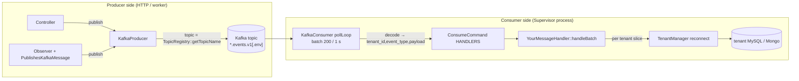
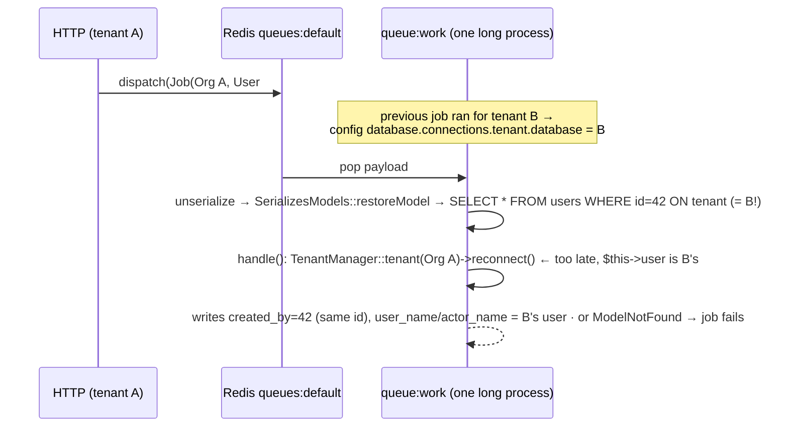
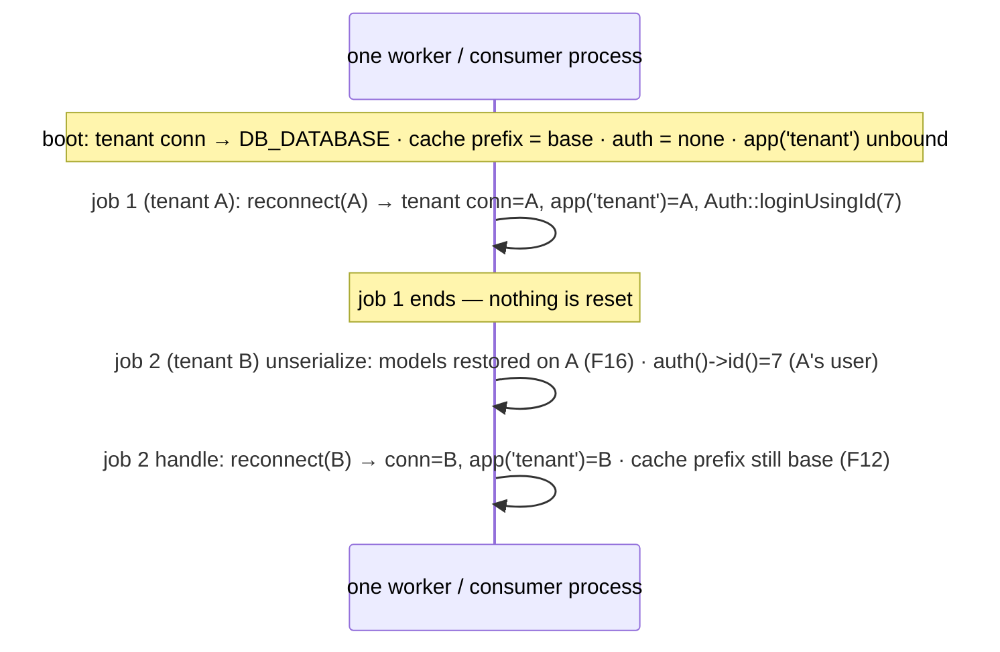

# 05 · The Laravel Implementation Layer — Building It the Sokrio Way

> **Snapshot:** `sokrio-server` @ `master` · HEAD `d14c0ebb2` · written 2026-10-26. `master` is now `bf223a126` (2 commits ahead, neither touches a messaging file), so every ref below is still valid on `master`. The local working tree had been switched to `survey-question-image-stg`, so the code was read from `git archive d14c0ebb2`, not from the checkout.
> Paths are relative to `sokrio-server/`. Tags: `[CODE]` verified in app code · `[LIB]` verified in `vendor/` (Laravel 9.52.22) · `[LAB]` reproduced in a throwaway sandbox · `[GENERAL]` industry knowledge · `[INFERENCE]` follows from code but not observed in prod · `[ASSUMPTION]` best guess plus how to verify.
> Question bank links: Q8 (idempotent consumer), Q10 (dual write / outbox), Q11 (poison message), Q63 (multi-tenancy), Q64–Q65 (Laravel queues, `retry_after`), Q67 (PHP Kafka consumer), Q68 (`afterCommit`), Q77 (duplicate emails).

## 5.0 What changed our understanding (read this first)

This section is the practical "how do I build the next one" guide. Writing the recipes meant tracing a job from `dispatch()` to `handle()` in a real worker, and that surfaced three new findings and four corrections.

| # | Finding | Severity | Proof |
|---|---|---|---|
| **F16** | **Tenant models in a job's constructor are re-loaded from the wrong tenant DB.** `SerializesModels` re-fetches each model by id **before** `handle()` runs, on the `tenant` connection. In a worker, that connection still points at whichever tenant the *previous* job reconnected to. Four live jobs take a tenant `User` this way. They stamp another tenant's user name or code into audit columns, fail with `ModelNotFoundException`, or (in one job) send a failure email to a user in another tenant | 🔴 | §5.3, `[LAB]` |
| **F17** | **The `tenant_id` added to every job payload is never read in workers.** `EnsureTenantAccess` adds `tenant_id` to every job payload, but registers the `JobProcessing` listener that would use it only inside the HTTP process. It looks like a safety net, but it does nothing in workers. Moving it to a service provider is the root fix for F16 | 🟢 (but it is the F16 fix) | §5.5 |
| **F18** | Both Kafka handlers cache `Org` **for the life of the process** (up to `max_runtime` = 6 h). The code comments say this "does not change freshness", but it does: a deactivated or moved tenant keeps being consumed until the next restart | 🟢 | §5.5 |

| # | Was | Now (code wins) |
|---|---|---|
| D13 | MEMORY: "No `afterCommit` anywhere" | One site: `app/Services/Notification/ApprovalNotifier.php:67` (`->afterCommit()`, added `91d04f736`, 2026-10-06) |
| D14 | Handler comments: the in-process Org cache "does not change freshness" (`TrackingMessageHandler.php:27-28`, `DepartmentMessageHandler.php:17-19`) | The process cache outlives the 2.8 h Redis TTL (D12) by up to 6 h (F18) |
| D15 | README: local Docker via `./dev` and `.docker/` (`README.md:63-118`); devops skill: `containerization/docker-compose.yml` | Server Docker files were removed in `557e63d68` (2024-01-02), and `containerization/` doesn't exist. **No compose file in the monorepo provides Kafka** |
| D16 | Study guide §7.4/§7.5: logs go to `storage/logs/kafka.log` | `kafka_file` uses the `daily` driver (`config/logging.php:60-64`), so the file is `kafka-YYYY-MM-DD.log`, kept 7 days |

- `[CODE]` **A7 hint (affects F14).** The README tells developers to set `REDIS_CLIENT=phpredis` in both setup paths (`README.md:43,85`). If prod was set up from the README, it runs phpredis, and F14 (feature analytics never flushed) is live. Mongo `feature_usage_events` row counts are still the cheapest way to confirm.

---

## 5.1 The extension points — where new code plugs in

Everything Kafka-related is behind six interfaces in `app/Contracts/Kafka/`, bound as singletons in `KafkaServiceProvider` (`app/Providers/KafkaServiceProvider.php:23-35`). A new pipeline needs **no new infrastructure classes**: you add a constant, a handler class and one array entry.

| Piece | File | What you touch for a new topic |
|---|---|---|
| Topic + event names | `app/Services/Kafka/TopicRegistry.php:12-31` | Add a key constant, a `TOPICS` mapping and event-type constants |
| Env suffix | `TopicRegistry.php:51-58` | Nothing. Non-prod gets `.{APP_ENV}` appended (e.g. `….v1.staging`) |
| Producer | `app/Services/Kafka/KafkaProducer.php:54-68` (`publish`), envelope `:93-102` | Nothing. Call it from your controller or observer |
| Observer helper | `app/Observers/Concerns/PublishesKafkaMessage.php:11-26` | `use` it. It swallows `\Throwable` and logs a warning |
| Handler contract | `app/Contracts/Kafka/KafkaMessageHandlerInterface.php:15,25` | Implement `handleBatch()` (and the deprecated `handle()` as a one-line wrapper) |
| Command wiring | `app/Console/Commands/Kafka/ConsumeCommand.php:27-30` | Add one `HANDLERS` entry |
| Group id | `ConsumeCommand.php:97-107` | Nothing. You get `{KAFKA_GROUP}-{topicKey}` automatically |
| Process | `README.md:187-212` (Supervisor) | One new `[program:…]` block |



---

## 5.2 Recipe A — add a new topic + consumer (corrected checklist)

This is the study guide §8 checklist with corrections from T2–T5 applied. Each step lists what to do and why.

**Step 1 — Register the topic.** `[CODE]`
```php
// app/Services/Kafka/TopicRegistry.php
public const PRIMARY_ORDERS = 'primary_orders';
private const TOPICS = [ /* … */ self::PRIMARY_ORDERS => 'primary-orders.events.v1' ];
public const PRIMARY_ORDER_APPROVED = 'primary-order.approved';
```
- `[CODE]` Version the name (`.v1`), following the existing four. A breaking payload change gets a new `.v2` topic, not an in-place change.

**Step 2 — Pre-create the topic; don't rely on auto-create.** `[CODE]` `TopicProvisioner` creates missing topics with P=3, RF=1 (`config/kafka.php:74-75`, `TopicProvisioner.php:52-81`). RF=1 means one broker loss loses the topic (risk #1). Create it with ops-owned values, and set the partition count to at least the number of consumer processes you will ever run.

**Step 3 — Pick the producer site and the key.**
- `[CODE]` From a **controller**, follow `Tracking/TrackingController.php:62-83`: publish, and if it returns `null`, fall back to a sync write. Return 202, or 503 + `Retry-After` if the fallback fails too.
- `[CODE]` From an **observer**, follow `DepartmentChangeObserver.php:104-145`: `use PublishesKafkaMessage`, skip in `testing` (`:106-108`), and pass an explicit partition key.
- **Correction to the guide's "key = tenant_id unless…":** both live producers override the key, with `user_id` (tracking) and `department_id` (departments) (D4). Use the **entity id** whenever per-entity order matters. A tenant_id key puts a big tenant on one partition, which becomes a hot partition, and buys ordering you usually don't need.
- **New (fixes F8):** add `public $afterCommit = true;` to the observer. `[LIB]` Laravel 9 honours it for model observers (`vendor/…/Events/Dispatcher.php:526-548`) and runs it immediately when no transaction is open (`Database/DatabaseTransactionsManager.php:90-97`), so the change is safe everywhere. See §5.4.
- `[CODE]` **Remember acks=0 (F5).** A non-null return only means the bytes left the socket. If losing an event matters, you need a fallback (tracking) or a resync job (departments has only a manual one, F1). Better: an outbox (T2 §2).

**Step 4 — Know what the consumer receives.** `[CODE]` The envelope has `event_id`, `event_type`, `tenant_id`, `occurred_at`, `payload` (`KafkaProducer.php:93-102`), but `decode()` hands the handler only `tenant_id`, `event_type`, `payload` (`KafkaConsumer.php:360-364`). If your handler must deduplicate, change `decode()` to pass `event_id` through. Otherwise the write must be idempotent on a natural key.

**Step 5 — Write the handler.** Use **`DepartmentMessageHandler` as the template**, not tracking. It writes idempotently (upsert by `department_id`), while tracking appends and is not idempotent.
```php
final class PrimaryOrderMessageHandler implements KafkaMessageHandlerInterface
{
    private array $orgs = [];                       // see F18: bound it, or re-check `active`
    public function handle(int $t, string $e, array $p): void { $this->handleBatch([['tenant_id'=>$t,'event_type'=>$e,'payload'=>$p]]); }
    public function handleBatch(array $messages): void
    {
        foreach (collect($messages)->groupBy('tenant_id') as $tenantId => $slice) {
            try { $this->persistForTenant((int) $tenantId, $slice->pluck('payload')->all()); }
            catch (\Throwable $e) { Log::channel('kafka')->warning('…unhandled', ['tenant_id'=>$tenantId,'error'=>$e->getMessage()]); report($e); }
        }
    }
    // persistForTenant: resolveOrg (landlord self-heal) → TenantManager::tenant($org)->reconnect()
    //                   → ONE bulk upsert keyed on a natural id → per-record fallback on failure
}
```
Rules the two existing handlers follow, with refs:
- `[CODE]` Group by tenant, then one reconnect and one bulk write per tenant slice (`DepartmentMessageHandler.php:42-49,76,110-112`).
- `[CODE]` **Never let an exception escape `handleBatch()`.** If one does, the poll loop crash-loops on the same batch (`:50-59`).
- `[CODE]` If the landlord lookup fails, purge and reconnect `landlord`, then retry once (`:164-176`).
- `[CODE]` Degraded path: per-record writes, so one bad document only drops itself (`:130-156`).
- `[CODE]` Log on the `kafka` channel at `warning` or below. `KafkaLogsNeverAtErrorLevelTest` enforces this, but only for the files listed in its provider (`tests/Unit/Kafka/KafkaLogsNeverAtErrorLevelTest.php:21-28`). **`DepartmentMessageHandler` isn't listed**, so add your handler to that list yourself.
- `[CODE]` Keep a flush well under `session_timeout` 30 s. Heartbeats are only sent on fetch (F9), so a slow flush gets the consumer evicted and the batch replayed.

**Step 6 — Wire it.** `[CODE]` Add `TopicRegistry::PRIMARY_ORDERS => PrimaryOrderMessageHandler::class` to `ConsumeCommand::HANDLERS` (`:27-30`). The command checks the interface at runtime (`:65-68`), and `ConsumeCommandHandlersTest` checks it in CI (§5.6). **Don't** add the key to `KAFKA_GROUP_LEGACY_TOPICS` (`config/kafka.php:16`); that list exists only so `tracking` keeps its old offsets.

**Step 7 — Run it under Supervisor.** `[CODE]` Copy a block from `README.md:189-212`:
- `command=php artisan kafka:consume primary_orders`
- `numprocs=1`. The static `group.instance.id=""` makes a second process fence the first (MEMORY T2).
- `stopwaitsecs=35`, which is more than the 30 s session timeout.
- `DD_PROFILING_ENABLED=false`, `DD_TRACE_CLI_ENABLED=false` on this program only.
- `ext-pcntl` on the box.

**Step 8 — Give it a safety net.** `[CODE]` Departments has no fallback, no DLQ and only a manual resync (F1). For a new stream, ship at least one of these: a *scheduled* resync command, a DLQ topic for the swallowed-failure path, or an outbox.

**Step 9 — Tests.** See §5.6 for the minimum set. Note that the department handler currently has **none** (risk 8).

### What the old checklist got wrong
| Study guide §8 said | Correction |
|---|---|
| "Partition key = tenant_id unless you have a reason" | Both live topics use entity ids (D4). Default to the entity id |
| (silent on transactions) | Add `$afterCommit = true` to the observer (F8) |
| "`TopicProvisioner` auto-creates, fine for local" | Fine locally, but it creates P=3 / RF=1 in **any** env that lacks the topic. Pre-create in staging and prod |
| `handleBatch()` only, bounded retry | Plus: idempotent write or `event_id` passthrough (Step 4); flush < 30 s (F9); add the handler to the log-level test |
| "numprocs=1 today, scaling not exercised" | Scaling is **blocked**, not just untested: static `""` instance id → `FENCED_INSTANCE_ID` |

---

## 5.3 Recipe B — add a queued job the Sokrio way

### The house idiom (what 119 of 127 jobs do)
- `[CODE]` 127 classes in `app/Jobs` implement `ShouldQueue`. 119 call `TenantManager::tenant(...)`, and 77 hold an `Org` property. The pattern is: **constructor takes the landlord `Org` plus plain ids and arrays; the first line of `handle()` reconnects.** `Org` is safe to serialize because its connection is fixed to `landlord` (`app/Models/Core/Org.php:29`).
- `[CODE]` The best template is the newest job, `app/Jobs/Notification/SendApprovalNotificationJob.php:34-68`:
  - `Org` + arrays in the constructor
  - reconnect first (`:45`)
  - every side effect in its own `try` (`:47-67`), so a retry doesn't duplicate the steps that already succeeded (`:22-23`)
  - dispatched with `->afterCommit()` (`ApprovalNotifier.php:67`)
- `[CODE]` The delayed-and-idempotent template is `app/Jobs/ApproveOrder.php:37-54`: `Org` + `orderId` + `authUserId`, `onQueue('order-approved')` (`Order.php:243`), and a `pending()` guard that makes a re-run a no-op (`:53`).

```php
class RecalculateCreditLimitJob implements ShouldQueue            // skeleton, not app code
{
    use Dispatchable, InteractsWithQueue, Queueable, SerializesModels;
    public int $tries = 3;
    public int $timeout = 300;                                    // < retry_after 9000, never 0
    public function __construct(public Org $org, public int $departmentId, public int $actorId) {}
    public function handle(): void
    {
        TenantManager::tenant($this->org)->reconnect();           // first line, always
        $dept = Department::find($this->departmentId);            // load tenant models AFTER reconnect
        if (! $dept || $dept->credit_recalculated_at?->isToday()) return;   // idempotency guard
        // … work …
    }
}
// RecalculateCreditLimitJob::dispatch(app('tenant'), $dept->id, auth()->id())->onQueue('summary')->afterCommit();
```

### F16 — what goes wrong when you pass a tenant model instead



- `[LIB]` A model is stored as `{class, id, connection}` and restored with `(new $class)->setConnection($value->connection)` → `firstOrFail()` (`vendor/…/Queue/SerializesAndRestoresModelIdentifiers.php:104-108`). This happens in `__unserialize` (`Queue/SerializesModels.php:62-88`), which `CallQueuedHandler` calls (`Queue/CallQueuedHandler.php:60,97`) **before** `handle()`.
- `[CODE]` `TenantManager::reconnect()` changes the shared `tenant` connection config with `Config::set` (`app/Support/Tenant/TenantManager.php:96-99`). That setting survives across jobs in a long-lived worker (`--max-jobs=1000`, `README.md:173`).
- `[LAB]` Throwaway sandbox using the real Laravel 9.52.22 `SerializesModels` and two SQLite DBs, each with a user #42. The job was dispatched holding *"Alice (tenant A)"*; after the connection was re-pointed to B, it restored *"Bob (tenant B) <b@…>"*. No app code was touched; the script lived in the session scratchpad.
- `[CODE]` **Live affected jobs** (all take `User $user` next to an `Org`):

| Job | Dispatched from | What breaks |
|---|---|---|
| `BatchTransferJob.php:35` | `Inventory/BatchTransferStockController.php:60` | `user_name`/`user_code` of the wrong person in transfer logs (`:316-318`) |
| `PreInventoryTransferJob.php:34` | `Inventory/PreInventoryTransferController.php:64` | Same (`:319-321`) |
| `BulkPrimaryPaymentActions.php:30` | `V3/Order/PrimaryInvoicePaymentController.php:114` | `actor_name` of the wrong person on payment actions (`:48-57`) |
| `BulkProductBatchImportJob.php:34` | `Inventory/BulkProductBatchUploadController.php:42` | `Mail::to($this->user)` (`:142`) emails the skipped/failed lot list **to a user in another tenant** |

  - If the id doesn't exist in the other tenant, the job fails with `ModelNotFoundException` and the whole bulk operation is silently lost.
  - `created_by = $this->user->id` stays correct, because the id is the same. `[INFERENCE]` That is probably why nobody has noticed.
- `[CODE]` **Latent (no live dispatch):**
  - `GenerateSurveyReport.php:32` would be the worst case. `User::getOrg()` is *static* and asks the **current** tenant DB for its owner (`app/Models/Acl/User.php:248-253`), so it would reconnect to the wrong tenant and email tenant B's survey data to tenant A's recipient (`:41-45`).
  - `SendAnnouncementNotify.php:24`: its dispatch is commented out at `AnnouncementController.php:136`.
- `[CODE]` **Why tests don't catch it:** in tests, landlord and tenant are separate `:memory:` SQLite DBs with a single tenant (`tests/TestCase.php:41-49`). `reconnect()` is a no-op in `testing` (`TenantManager.php:94`), and the queue is `sync` (`phpunit.xml:37`). `SyncQueue` does round-trip the payload (`vendor/…/Queue/SyncQueue.php:38`), but always within the same tenant.
- **Fixes**, smallest first:
  1. Pass `int $userId` and load the user after reconnect.
  2. Root fix: register a `JobProcessing` listener in a service provider that reconnects from `payload()['tenant_id']`. `[LIB]` The worker raises `JobProcessing` (`Queue/Worker.php:412`) before it fires and unserializes the job (`:425`, `CallQueuedHandler.php:60`), so models would be restored on the right tenant. Also move the `createPayloadUsing` stamp to the provider, so jobs dispatched *from* workers get it too (F17).

### Rules (T4 + T5)
| # | Rule | Why / ref |
|---|---|---|
| 1 | Constructor: `Org` + ids/arrays. **No tenant models** | F16 |
| 2 | First line of `handle()`: `TenantManager::tenant($this->org)->reconnect()`. Don't chain on it: it returns `null` in `testing` (`TenantManager.php:92-106`) | `[CODE]` |
| 3 | Choose the queue explicitly (`onQueue` or `public $queue`). Time-sensitive work never goes on `default` | F10: primary approvals sit on `default` |
| 4 | `$timeout` < `retry_after` (9000), and never `0` | T4 §4.2, Q65 |
| 5 | `$tries` + an idempotency guard. Don't rely on `$retry_after`/`$retries` properties: Laravel ignores them | T4, `ApproveOrder.php:26` |
| 6 | `ShouldBeUnique` ⇒ always `uniqueId()` (no `rand()`) + `uniqueFor` | F11, F3 |
| 7 | A cache key crossing request ↔ worker uses a fixed-prefix store | F12, `SmsResendRun.php:24-25,197-214` |
| 8 | A lock must cover the commit; `Redis::scan` with a `null` cursor + options array | F13, F14 |
| 9 | Dispatch with `->afterCommit()` whenever a transaction might be open | §5.4 |
| 10 | Don't read `auth()` in a job. Pass the actor id. Worker auth is process-global and never reset; only two jobs log in (`ApproveOrder.php:52`, `PrimaryOrder/ApproveOrder.php:46`) | `[LIB]` no auth reset in `Queue/Worker.php`; `DepartmentBulkUpdateJob` reads `auth()` (latent, dispatch commented at `DepartmentBulkDataUpdateController.php:33`) |
| 11 | A `failed()` hook that reports and cleans up (export guards, `SequentialJob` status) | `GenerateSurveyReport.php:56-59`, `tests/Unit/Jobs/ReportJobFailedCleanupTest.php` |

---

## 5.4 Where `afterCommit` is missing (and where it isn't needed)

**The mechanics.** `[LIB]` Laravel 9.52.22 offers three switches:
- per dispatch, `->afterCommit()` or a public `$afterCommit` property (`Queue/Queue.php:326-337`)
- per observer or listener, `public $afterCommit = true` (`Events/Dispatcher.php:526-548`)
- per connection, `'after_commit' => true`

`[CODE]` `config/queue.php:30-72` sets the per-connection switch nowhere. The callback is queued on the innermost open transaction and runs right away when none is open (`Database/DatabaseTransactionsManager.php:90-97`). Manual `DB::beginTransaction()` counts too.

| Site | In a txn? | Risk today | Verdict |
|---|---|---|---|
| `DepartmentChangeObserver` publish, during `DepartmentBulkDataUpdateController.php:41-52` | Yes | Rollback → phantom Kafka event already in Mongo (F8) | 🔴 Add `public $afterCommit = true` to the observer |
| `SequentialJobDispatcher.php:30-56` dispatch inside `DB::transaction` | Yes | `[INFERENCE]` A fast job waits on the InnoDB row lock from the `UPDATE` (`:37-40`) until commit, so it's mostly safe. If the commit fails, the row stays `pending` and is picked again, so the export runs twice | 🟢 `->afterCommit()` |
| `ImportSecondaryOrderJob.php:99-279`, `approveAfter` at `:260` | Yes | A delay of N minutes, plus `pending()->find()` returning null after a rollback (`ApproveOrder.php:53`) | ✅ safe by design |
| `OrderRequest.php:205` / `PrimaryOrder/OrderRequest.php:168` `approveAfter` | **No** txn at all (`Order/OrderController.php:44` calls `save()` bare) | Not an `afterCommit` issue. The real smell is that a FormRequest dispatches jobs | ✅ for afterCommit |
| `PromotionAction.php` `scheduleNotification` | Called after `DB::commit()` (`:35→37`, `:132→134`) | — | ✅ correct manual pattern |
| `MessageResendService` | Claim txn `:153`, dispatch afterwards `:233-257` | — | ✅ |
| `ApprovalNotifier.php:67` | Maybe | — | ✅ the only explicit `afterCommit` (D13) |

- `[GENERAL]` `afterCommit` fixes "published but rolled back". It does **not** fix "committed but never published": a crash between `COMMIT` and the publish still loses the event. Only an outbox table, written in the same transaction and relayed afterwards, closes both gaps (Q10).
- `[INFERENCE]` Should we flip `'after_commit' => true` on the `redis` connection? It changes timing for all 127 jobs at once. `Bus::fake`/`Queue::fake` ignore it (no `afterCommit` handling in `Support/Testing/Fakes/{Bus,Queue}Fake.php`), so the suite wouldn't notice a regression. Prefer the per-site switches above, plus a review rule.

---

## 5.5 Tenant context in jobs and consumers



| Context | Who sets the tenant | Cache prefix | Leftover state | Ref |
|---|---|---|---|---|
| HTTP request | `EnsureTenantAccess` (`:24-35`) → `TenantManager` + `ScopeCacheToTenant` | `…:tenant_{id}:` | None (fresh per request) | `[CODE]` |
| HTTP → payload | `createPayloadUsing(['tenant_id'=>…])` (`EnsureTenantAccess.php:56-58`) | — | — | `[CODE]` |
| Queue worker | Each job's own `handle()` | Base prefix | Tenant conn, `app('tenant')`, auth, **all persist** across jobs | `TenantManager.php:33-34,96-99` |
| Worker `JobProcessing` | **Nobody.** The listener is registered only in the HTTP process (`EnsureTenantAccess.php:60-64`), and it reconnects to the captured `$tenant`, not the payload's | — | — | F17 |
| Kafka consumer | Handler, once per tenant slice per flush | Base prefix | Stays on the last tenant; `Org` cached for the process life | `DepartmentMessageHandler.php:23,76,158-183` |
| Scheduler fan-out | `BaseCommand` loops active orgs → `dispatchJob` per tenant | Base prefix | — | `BaseCommand.php:12,50-70` (T1) |

- `[CODE]` **F17.** The only listener that reads the payload's `tenant_id` is the closure registered inside `EnsureTenantAccess`. `queue:work` never runs HTTP middleware, so in workers the stamp is dead data. Even in HTTP (sync queue) the closure reconnects to the request's own `$tenant`, ignoring the payload's id (`:60-64`). Jobs dispatched *from* a worker or the scheduler don't get the stamp at all.
- `[CODE]` **F18.** `private array $orgs` caches positive lookups for the life of the consumer (`TrackingMessageHandler.php:33,162`, `DepartmentMessageHandler.php:23,160-180`). The life is `KAFKA_CONSUMER_MAX_RUNTIME` = 21600 s (`config/kafka.php:70`). Unlike HTTP, the handlers never check `$org->active` (compare `EnsureTenantAccess.php:26`). A deactivated tenant's events keep being written until the next recycle, even though the Redis copy expires after ~2.8 h (D12). Fix: a TTL on the in-process cache, or `active` checks on the cached entry.
- `[GENERAL]` **The rule:** a long-lived PHP process is closer to Octane than to FPM. Anything a job sets globally (DB config, container bindings, `Auth`, cache prefix, `Carbon::setTestNow`, locale) leaks into the next job unless something resets it.

---

## 5.6 Testing patterns — the 13 Kafka-related test files

| File | Lines | Technique |
|---|---|---|
| `tests/Unit/Kafka/KafkaProducerTest.php` | 313 | Mockery `Producer`; subclass `KafkaProducer` to inject it (`:61`); fake provisioner (`:32-43`); `ExceptionHandler` mock for `report()` (`:79-82`) |
| `tests/Unit/Kafka/KafkaConsumerBatchTest.php` | 160 | Anonymous `ConsumerFactoryInterface` returning a Mockery `Consumer` (`:144-160`); scripted `consume()` queue + `ShutdownFlag::request()` to end the loop (`:49-93`); `OffsetManager` mock to assert commits |
| `tests/Unit/Kafka/KafkaConsumerReconnectTest.php` | 290 | Same factory trick with a list of behaviours per connect (`:60-90`); asserts reconnect, exit after N failures, signal-stop |
| `tests/Feature/Console/Kafka/ConsumeCommandTest.php` | 172 | Recorder `MessageConsumerInterface` bound with `$this->app->instance` (`:128,162`) to assert group ids per topic |
| `tests/Feature/Kafka/TrackingMessageHandlerTest.php` | 194 | Real SQLite + Mongo; call `handleBatch()` with envelope triples (`:35-42`); count inserts with `DB::listen` (`:88-97`); `DB::shouldReceive('transaction')->times(3)->andThrow` (`:115-117`); `Cache::shouldReceive('remember')` to fake a landlord packet error (`:144-152`) |
| `tests/Unit/Kafka/TopicProvisionerRedisFailureTest.php` | 93 | Data provider of Predis and phpredis exceptions (`:39`) |
| `tests/Unit/Kafka/InterruptResilientStreamSocketTest.php` | 177 | Reflection into the socket; signal during `select` (`:88-116`) |
| `tests/Unit/Kafka/TopicRegistryTest.php` | 35 | `$this->app['env'] = 'production'` to test the suffix (`:20`) |
| `tests/Unit/Kafka/KafkaLogsNeverAtErrorLevelTest.php` | 44 | Source regex over a hard-coded path list (`:21-41`) |
| `tests/Unit/Console/Kafka/ConsumeCommandHandlersTest.php` | 25 | Reflection on `HANDLERS` → every class implements the interface (`:14-23`) |
| `tests/Unit/Observers/Concerns/PublishesKafkaMessageTest.php` | 57 | Anonymous producer that throws `\TypeError` (proves `catch (\Throwable)`), log-channel spy (`:14-55`) |
| `tests/Feature/Tracking/TrackingTest.php` / `BulkTrackingTest.php` | 126 / 170 | Bind a `MessageProducerInterface` mock (`TrackingTest.php:57-59`, `BulkTrackingTest.php:29-30`); `alias:` mocks of Eloquent statics in `@runInSeparateProcess` tests (`BulkTrackingTest.php:82-94,104-116`) |

- `[CODE]` **Log assertions** follow one idiom: `Log::shouldReceive('channel')->with('kafka')->andReturn($spy)`, then `$spy->shouldHaveReceived('warning')->once()->with(...)`, plus `Log::shouldNotHaveReceived('error')` (`TrackingMessageHandlerTest.php:46-55`).
- `[CODE]` **Queue tests elsewhere:**
  - `Queue::fake` in 7 files
  - `Bus::fake` in 11 files
  - call `->handle()` on a hand-built job (`tests/Unit/Jobs/Stock/BulkStockImportJobLeadingZeroTest.php:36`)
  - `Bus::fake([Job::class])`, then inspect the dispatched job's public props (`tests/Unit/Services/Notification/ApprovalNotifierTest.php:23,57-61`)
- **Minimum for a new handler** (copy `TrackingMessageHandlerTest`): unknown tenant → one warning, no error; known tenant → persisted; a batch → one bulk write per tenant; bulk failure → per-record fallback; a re-delivered batch → no duplicate (idempotency); the handler added to `KafkaLogsNeverAtErrorLevelTest`.

### Blind spots (what the suite cannot see)
1. `[CODE]` **Cross-tenant bugs.** There's one tenant, `reconnect()` is a no-op, and the queue is `sync` (`TestCase.php:41-49,77`, `TenantManager.php:94`, `phpunit.xml:37`). F16 and F12 can't fail a test. A fix needs a test that sets up two tenants and asserts on the restored model.
2. `[CODE]` **Facade mocks encode client assumptions.** `FlushFeatureEventsJobTest` mocks `Redis::scan('0','MATCH',…,'COUNT',50)` (`tests/Unit/Jobs/FlushFeatureEventsJobTest.php:46-48`), the predis call shape. That's why F14 is green in CI. Integration-test Redis calls against a real server under the prod client.
3. `[LIB]` **`afterCommit` is invisible to fakes.** The fakes record at call time. Assert `$job->afterCommit === true` on the recorded job instead `[INFERENCE]`.
4. `[CODE]` **No test exercises `DepartmentMessageHandler`, and the observer publish is skipped in `testing`** (`DepartmentChangeObserver.php:106-108`, risk 8).
5. `[CODE]` **No Kafka or Redis in CI** (MEMORY Infra), so every broker interaction is mocked.

---

## 5.7 Local development

**What exists.** `[CODE]` Nothing in the monorepo starts Kafka. The server's Docker files were removed (D15). The only compose files belong to the Python benchmark projects, and they start Mongo and Redis only. A messaging change needs MySQL/MariaDB (landlord + tenant DBs), MongoDB, Redis, and Kafka only if you touch Kafka, plus `ext-pcntl` and either phpredis or `predis/predis`.

**Env names** (values `<redacted>`; `.env.example:23-26,48-80,103-106`):
- Drivers: `QUEUE_CONNECTION`, `CACHE_DRIVER`, `SESSION_DRIVER`, `BROADCAST_DRIVER`
- Redis: `REDIS_HOST`, `REDIS_PORT`, `REDIS_PASSWORD`, `REDIS_CLIENT` (must be set, or the line removed; empty crashes, T4)
- Kafka: `KAFKA_BROKERS`, `KAFKA_GROUP`, `KAFKA_GROUP_LEGACY_TOPICS`, `KAFKA_CONSUMER_BATCH_SIZE`, `KAFKA_CONSUMER_BATCH_INTERVAL`, `KAFKA_CONSUMER_MAX_RUNTIME`, `KAFKA_LOG_LEVEL`, `KAFKA_AUTO_CREATE_PARTITIONS`, `KAFKA_AUTO_CREATE_REPLICATION_FACTOR`, plus the `KAFKA_PRODUCER_*` / `KAFKA_CONSUMER_*` timeouts
- Pusher: `PUSHER_APP_*`

**A minimal sandbox** `[GENERAL]`. This is a proposal, not repo code. Keep it outside `sokrio-server`, e.g. in the T9 lab folder:
```yaml
services:
  kafka:
    image: apache/kafka:3.7.0          # KRaft single node, no ZooKeeper
    ports: ["9092:9092"]
  redis:
    image: redis:7.2-alpine
    command: ["redis-server", "--appendonly", "yes", "--maxmemory-policy", "noeviction"]
    ports: ["6380:6379"]               # spare port; don't collide with other local Redis containers
```

**Run and watch** `[CODE]` + `[GENERAL]`:
```bash
php artisan kafka:consume departments --max-runtime=0            # ConsumeCommand.php:18-19
php artisan queue:work redis --queue=order-approved,summary,sequential,feature-tracking,default --timeout=900
tail -f storage/logs/kafka-$(date +%F).log                       # daily driver (D16)
redis-cli -n 0 LLEN "${REDIS_PREFIX}queues:default"              # list; also :delayed / :reserved zsets
kafka-consumer-groups.sh --bootstrap-server localhost:9092 --describe --group "${KAFKA_GROUP}-departments"
```
- `[LIB]` Queue keys are `queues:{name}` plus `:delayed`/`:reserved` (`Queue/RedisQueue.php:358-361`), under the client prefix `REDIS_PREFIX` (T4 §4.1).

**Local gotchas:**
- `[CODE]` The code defaults (`QUEUE_CONNECTION=sync`, `CACHE_DRIVER=file`) hide three bug classes. Jobs run inline in the request's tenant, which hides F16. The file cache has no `setPrefix()`, so `ScopeCacheToTenant` does nothing and F12 can't reproduce. And there's no real `retry_after`. Test messaging work with `QUEUE_CONNECTION=redis` + `CACHE_DRIVER=redis` and **two** tenants.
- `[CODE]` Local topics are `….v1.local` (`TopicRegistry.php:57`). The provisioner auto-creates them on first publish, and `DepartmentChangeObserver` publishes for real outside `testing`.
- `[INFERENCE]` If Redis or Kafka is down locally, the producer's retries add ~3.75 s per department save (F8 path), which feels like a slow API rather than an error.

---

## 5.8 Fix list (priority order)
1. **F16** 🔴. Replace `User $user` with `int $userId` in the 4 live jobs, and load the user after reconnect. Then the root fix: a provider-level `JobProcessing` listener that reconnects from `payload()['tenant_id']`, with the `createPayloadUsing` stamp moved to the same provider (closes F17). Add a two-tenant regression test.
2. **F8**. Add `public $afterCommit = true;` to `DepartmentChangeObserver` (one line). Plan an outbox for the commit-then-crash gap.
3. **Review rule for new jobs**: rules 1–11 in §5.3, as a PR checklist item (no tenant models, explicit queue, `$timeout < retry_after`, `uniqueId`, `afterCommit`).
4. **Testing**: a `DepartmentMessageHandler` test; add it to `KafkaLogsNeverAtErrorLevelTest`; one real-Redis integration test per client for `FlushFeatureEventsJob` (F14).
5. **F18**: TTL or an `active` check on the handlers' in-process Org cache.
6. **Docs**: fix the README Docker section (D15) and the log file name (D16); add a sandbox compose for messaging work.

---

## 5.9 Takeaways for interviews
- "Our multi-tenant rule for jobs is: serialize the landlord `Org` and ids, never tenant models. `SerializesModels` re-fetches models *before* `handle()` runs, and in a long-lived worker the tenant connection still points at the last job's tenant. I proved it with a two-database repro: same id, different person."
- "The right place to restore tenant context is `JobProcessing`, registered in a service provider. It fires before the payload is unserialized. We already add `tenant_id` to every payload; we just only listened for it inside the HTTP process."
- "A queue worker is a long-lived process like Octane. DB config, container bindings and the authenticated user all leak from one job to the next unless you reset them."
- "`afterCommit` fixes 'published but rolled back'. It doesn't fix 'committed but never published'. That's what an outbox is for. Outside a transaction `afterCommit` runs immediately, so it's safe to add everywhere."
- "Adding a Kafka pipeline here is three edits: a registry constant, a handler that implements `handleBatch()` and never throws, and one entry in the command's handler map. Most of the effort goes into choosing the partition key, making the write idempotent, and giving the stream a safety net."
- "Tests can lie by construction. Our Redis facade mock encodes the predis call shape, so a bug that only exists under phpredis stays green. A single-tenant test DB can't catch cross-tenant bugs."

---

### ✅ Quality check
- [x] Task-card items covered:
  - add topic + consumer, using real classes, corrected checklist (§5.1–5.2)
  - queued job the Sokrio way (§5.3)
  - where `afterCommit` is missing (§5.4)
  - tenant context in jobs and consumers (§5.5)
  - testing patterns from the Kafka test files (§5.6: 13, not 12; 11 core + 2 tracking feature tests)
  - local dev: services, env names, running consumers (§5.7)
- [x] T4 reuse: `uniqueId` (F11), fixed-prefix store (F12), lock covers commit (F13), `scan` form (F14), `$timeout < retry_after`
- [x] HANDOFF hooks: F8 + both FormRequest `approveAfter` sites assessed (the FormRequest is not in a txn, so not an afterCommit issue)
- [x] New findings F16 (`[LAB]`), F17, F18 and corrections D13–D16 recorded
- [x] Mermaid for the extension points, the F16 restore sequence and worker state leakage
- [x] Code snippets ≤ 15 lines; skeletons are marked "not app code"
- [x] Every statement tagged; `[INFERENCE]` used where prod behaviour isn't observed
- [x] No secrets: env var names only, no hosts or IPs; the sandbox compose uses public images and local ports only
