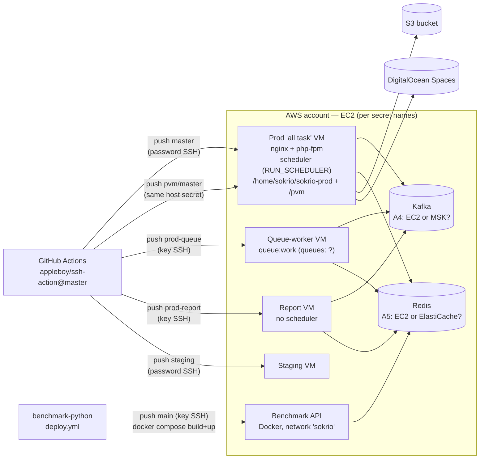
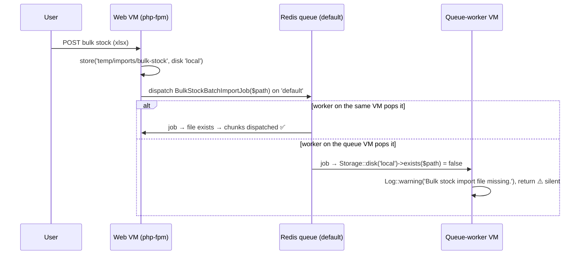
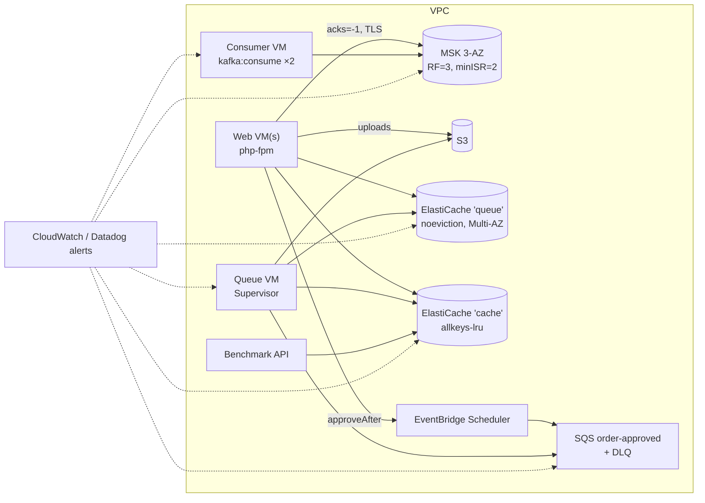

# 06 · AWS Infrastructure — What Runs Where, and What AWS Would Manage

> **Snapshot:** `sokrio-server` @ `master` · HEAD `d14c0ebb2` · written 2026-10-26. `master` is now `bf223a126`, and its 2 new commits touch no file under `.github/`, `config/`, the Kafka code, the jobs or `README.md`, so every ref below still holds. The working tree is on `survey-question-image-stg-new` (switched outside this session). Code was read from `git archive d14c0ebb2`, and vendor code from the installed `vendor/` (Laravel 9.52.22, `longlang/phpkafka` 1.2.5, `aws/aws-sdk-php` 3.394.3).
> Paths are relative to `sokrio-server/` unless prefixed. Tags: `[CODE]` app code or repo files · `[LIB]` vendor code · `[HIST]` git history (deleted files) · `[NOTES]` project docs and skills · `[GENERAL]` AWS and industry knowledge · `[INFERENCE]` follows from code, not observed in prod · `[ASSUMPTION]` best guess plus how to verify.
> **Big caveat:** prod `.env` and the server-side `pipeline.sh` scripts can't be read from here. A3–A5 are still open, so every "today" statement about Kafka and Redis hosting is evidence-weighted, not confirmed.
> Question bank links: Q20–Q23 (Kafka ops, replication), Q38–Q42 (Redis persistence/HA), Q46–Q50 (Kafka vs SQS/Kinesis), Q58 (queue at scale), Q72–Q76 (design on AWS), Q79 (AZ failure).

## 6.0 What changed our understanding (read this first)

The task card said: "EC2 VMs deployed by GitHub Actions over SSH. Unknown: MSK vs self-hosted Kafka, ElastiCache vs self-hosted Redis." That is still the frame, but checking how Sokrio's code would run on each AWS service turned up five new findings and two corrections.

| # | Finding | Severity | Proof |
|---|---|---|---|
| **F19** | **The upload → job handoff uses the local disk.** `BulkStockController` stores the upload on the `local` disk of the box that served the request, and `BulkStockBatchImportJob` reads it from the `local` disk of the box that runs the job. With a separate queue-worker VM that only works if both boxes share storage, or if the web box's own worker picks up the job. Otherwise the job logs a warning and returns: a silent no-op | 🟡 `[INFERENCE]` | §6.6 |
| **F20** | **The Python benchmark service shares Redis DB 0 with Laravel's queues.** Its `REDIS_URL` points at DB `/0`, the same DB that holds `queues:*`. Its cache therefore shares `maxmemory` and the eviction policy with the queue. A cache-heavy benchmark run can trigger OOM errors on `dispatch()` under `noeviction`, or evict queued jobs under any `*-lru` policy | 🟡 | §6.5 |
| **F21** | **The Kafka client rules out most MSK auth modes.** `longlang/phpkafka` supports TLS and SASL **PLAIN** only. MSK offers IAM, SCRAM, mTLS or unauthenticated access. IAM (the only option on MSK Serverless) and SCRAM are impossible without a client change. Sokrio configures neither TLS nor SASL today | 🟢 (a constraint) | §6.4 |
| **F22** | **Moving the `order-approved` queue to SQS breaks it.** Approval delays are validated up to **60 minutes**, but SQS `DelaySeconds` is capped at **900 s** (15 min). Laravel passes the delay straight through, so `sendMessage` throws inside the order request. Laravel's SQS driver also ignores `retry_after` and short-polls | 🟡 (migration blocker) | §6.8 |
| **F23** | **Deploy pipeline hygiene.** The deploy workflows use `appleboy/ssh-action@master` (an unpinned third-party action that receives SSH credentials), log in with **password** SSH on prod/PVM/staging, and run `sudo bash pipeline.sh`. PVM deploys to the **same host secret** as prod | 🟡 | §6.1 |

| # | Was | Now (code wins) |
|---|---|---|
| D17 | Devops skill: `containerization/docker-compose.prod.yml` is an "AWS overlay (ECR images, RDS/ElastiCache)" (`.claude/skills/sokrio-devops/SKILL.md:42`) | No such file exists anywhere under `~/code` (searched `find -name docker-compose.prod.yml`, and `containerization/` doesn't exist, see D15). There is **no evidence of ECR, RDS or ElastiCache** in any repo |
| D18 | Inventory §0.10: "`.docker/php/` only (image bits)" | `.docker/php/` is an **empty, untracked** folder in the local working tree. Git at `d14c0ebb2` has no `.docker/`; the real Docker files were deleted in `557e63d68` (2024-01-02) |

---

## 6.1 What we actually run — the topology

| Box | Trigger | Auth | Server-side script | Ref |
|---|---|---|---|---|
| Prod ("all task" server) | push `master` | **password** (`AWS_VM_HOST`/`_USERNAME`/`_PASSWORD`) | `/home/sokrio/sokrio-prod/post-deploy/pipeline.sh` | `[CODE]` `.github/workflows/ci-cd.yml:5-6,17-23` |
| PVM tenant app | push `pvm/master` | **same `AWS_VM_HOST` secret as prod** | `/home/sokrio/pvm/post-deploy/pipeline.sh` | `[CODE]` `.github/workflows/pvm-ci-cd.yml:6,19-23` |
| Queue worker | push `prod-queue` | SSH key (`AWS_QUEUE_VM_*`) | `/home/sokrio/sokrio-queue/post-deploy/pipeline.sh` | `[CODE]` `.github/workflows/queue-worker-deploy.yml:6,20-26` |
| Report server | push `prod-report` | SSH key (`AWS_REPORT_VM_*`) | `/home/sokrio/sokrio-report/post-deploy/pipeline.sh` | `[CODE]` `.github/workflows/prod-report-deploy.yml:6,20-26` |
| Staging | push `staging` | **password** (`AWS_DEV_*`) | a pipeline under a personal home dir | `[CODE]` `.github/workflows/stg.yml:6,19-23` |
| Benchmark API (Python) | push `main` | SSH key (`EC2_*`) | inline: `git pull` → `docker compose build --pull` → `up -d --no-deps` → import check → `.env` drift warning | `[CODE]` `sokrio-benchmark-python/.github/workflows/deploy.yml:15-67` |

What this tells us:
- `[CODE]` **It's EC2 VMs, deployed by SSH.** There's no ECS, EKS, Lambda, Beanstalk, CodeDeploy, ECR, Terraform, CloudFormation or CDK in any repo (inventory §0.13 search, re-run across all five repos for `docker-compose`, `Dockerfile`, `*.tf`, `cdk.json`, `serverless.yml`, `k8s`, `helm`, `ecs`, `task-def`).
- `[CODE]` **The scheduler runs on exactly one box.** `Kernel.php:113-117`: "Only run the scheduler on the 'all task' production server, not on the report server", gated by `RUN_SCHEDULER`. That's a manual singleton, which is why no `onOneServer()` is needed today (T4 risk 6).
- `[INFERENCE]` **PVM shares the prod VM.** Both workflows SSH into `secrets.AWS_VM_HOST` and run a different directory's `pipeline.sh`. A noisy-neighbour or reboot event on that VM takes down both.
- `[INFERENCE]` **PHP probably runs in Docker on the VMs.** The README's Supervisor programs use `/var/www/html/artisan` (`README.md:179,190,203`), the official-image path, and its Datadog note says to set the env "*not* container-wide" (`README.md:224`). The benchmark compose joins an **external** Docker network called `sokrio` (`sokrio-benchmark-python/docker-compose.yml:14-19`), which something else on that host must create. `.env.example:143-148` carries `HTTP_PORT`, `HTTPS_PORT`, `SSL_*` and `NGINX_CONF_PATH`, which are compose-style knobs.
- `[CODE]` **No GitHub Actions concurrency guard** on the five server workflows. Two quick pushes run two `pipeline.sh` at once. The Python deploy has one (`deploy.yml:7-9`).
- `[CODE]` **F23 hygiene.** `appleboy/ssh-action@master` (`ci-cd.yml:17` and the other four) runs whatever is on that action's `master` branch with our SSH secrets. Pin it to a commit SHA. Password SSH plus `sudo` on prod is the weakest link; the queue and report boxes already use keys.

---

## 6.2 Where do Kafka and Redis live? (A4 / A5 evidence)

Nothing in the repos says "MSK" or "ElastiCache". So we weigh the evidence.

| Evidence | Points to | Tag |
|---|---|---|
| `config/kafka.php:5` has one `KAFKA_BROKERS` string, with no TLS or SASL keys anywhere in `config/kafka.php` or `app/Services/Kafka` | Plaintext listener. Self-hosted, or MSK with an unauthenticated plaintext listener (allowed, but not the default) | `[CODE]` |
| Topics auto-created with RF from `KAFKA_AUTO_CREATE_REPLICATION_FACTOR`, default **1** (`config/kafka.php:74-75`) | A single-broker dev-style cluster. On a 3-broker MSK cluster you'd normally set 3 | `[CODE]` |
| No Kafka in any compose file, now or in history; the deleted 2024 prod compose had only `redis`, `mariadb`, `nginx`, `certbot`, `app`, `worker`, `cron` | Kafka was added after Docker files were removed (`dcc8984e8`). So it's either a hand-installed broker or a managed service | `[HIST]` `557e63d68^:docker-compose.prod.yml` |
| The deleted 2024 prod compose ran `redis:alpine` as container `sokrio-redis` with a `./data/redis` volume and `${REDIS_PORT}:6379` published | Redis was self-hosted next to the app, at least until 2024 | `[HIST]` |
| `config/database.php:193-220`: no `scheme`/TLS option, no `clusters` block; `REDIS_URL` (`:203`) exists but isn't in `.env.example` | Plain TCP to one node. ElastiCache with in-transit encryption would need `tls://` (possible via `REDIS_URL`, so not conclusive) | `[CODE]` |
| The 2024 worker image ran `pecl install redis` (the phpredis extension) | A7 history: the old prod worker used **phpredis** (adds weight to F14) | `[HIST]` `557e63d68^:.docker/php-fpm/worker.dockerfile` |
| Python's `REDIS_URL=redis://<redacted>/0` (no `rediss://`) | Plain TCP, same Redis | `[CODE]` `sokrio-benchmark-python/.env.example` |

**Verdict.** `[ASSUMPTION]` Both are most likely **self-hosted on EC2**: Redis as a container or package on one of the VMs, Kafka as a single broker. Confidence is medium for Redis and medium-low for Kafka. **Verify** (names only, no values pasted anywhere):
- Host pattern behind `KAFKA_BROKERS`: `b-N.<cluster>.….kafka.<region>.amazonaws.com` means MSK. `aws kafka list-clusters-v2` with an empty list means not MSK.
- Host pattern behind `REDIS_HOST`: `….cache.amazonaws.com` means ElastiCache. Or run `aws elasticache describe-replication-groups`.
- On the VMs: `docker ps --format '{{.Names}} {{.Image}}'`, `systemctl status redis* kafka*`.
- A3 (RF): `kafka-topics.sh --describe --topic <tracking topic>`, or `kafka-log-dirs.sh`.

---

## 6.3 The concern table (README_2 Phase 6)

| Concern | Today (best evidence) | AWS-managed option | Fit for Sokrio |
|---|---|---|---|
| **Kafka** | `[ASSUMPTION]` One self-hosted broker; topics P=3 / RF=1, auto-created by `TopicProvisioner`; plaintext; acks=0 (F5) | **MSK provisioned** (2–3 AZ, managed brokers, storage scaling, MSK Connect). MSK Serverless needs IAM auth, so it's ruled out by F21 | Good, if TLS-only or mTLS is acceptable (§6.4). Biggest gain: RF=3 across AZs |
| **RabbitMQ** | `[CODE]` Not used (T3) | Amazon MQ for RabbitMQ (single-instance or 3-node cluster) | Not needed (T3 verdict). SQS covers the use cases |
| **Redis** | `[ASSUMPTION]` One self-hosted node; DB0 = queues + Python cache (F20), DB1 = cache; persistence and eviction unknown (A9) | **ElastiCache** (Valkey/Redis OSS; Multi-AZ replica + auto-failover, snapshots) or **MemoryDB** (durable multi-AZ log) | ElastiCache with **cluster mode disabled**. Ideally split into a queue node (`noeviction`) and a cache node (`allkeys-lru`) (§6.5) |
| **Workers** | `[CODE]`+`[NOTES]` EC2 + Supervisor; `queue:work` and `kafka:consume` programs; `pipeline.sh` per box | ECS on EC2/Fargate, EKS, Lambda | Stay on EC2 + Supervisor for now. ECS's 120 s stop timeout clashes with `$timeout = 0` jobs (§6.7) |
| **Monitoring** | `[CODE]`+`[NOTES]` Sentry, Datadog APM + profiler, Slack log channels; Kafka logs isolated to files | CloudWatch metrics for MSK/ElastiCache/SQS; Datadog AWS integration | Missing: consumer lag, queue depth/age, failed_jobs, Redis memory/evictions, broker disk (§6.9) |
| **Alternatives** | — | SQS, SNS, EventBridge (+ Scheduler), Kinesis | Per use case (§6.8): EventBridge Scheduler for delayed approvals, SQS for ERP request/reply, keep Kafka for tracking |

`[CODE]` AWS services actually used today: **S3** via `league/flysystem-aws-s3-v3` (`composer.json:27`; disk `s3`, `config/filesystems.php:58-65`; `cloud` disk default `s3`, `:29`). A second S3-compatible disk, `spaces`, points at **DigitalOcean Spaces** (`:67-75`, `DO_SPACES_*`). The `sqs` queue connection (`config/queue.php:52-59`), `dynamodb` cache store (`config/cache.php:79-86`) and `ses` mail block (`config/services.php:27-30`) are untouched Laravel defaults: no `SQS_*` or `DYNAMODB_*` names in `.env.example`.

---

## 6.4 Kafka: self-hosted vs Amazon MSK

### What AWS manages vs what we still own `[GENERAL]`

| Layer | Self-hosted on EC2 (today, `[ASSUMPTION]`) | MSK provisioned |
|---|---|---|
| Broker processes, OS, JVM, patching | **Us** | AWS |
| Controller quorum (ZooKeeper/KRaft) | **Us** | AWS |
| Failed broker replacement | **Us** (by hand) | AWS (automatic, same broker id and storage) |
| AZ spread | **Us** (today: one broker, so one AZ) | AWS places brokers across 2 or 3 AZs. **We** must still set RF=3 / `min.insync.replicas=2` |
| Storage | **Us** (EBS size, alerts) | AWS (EBS, optional auto-scaling). **We** pick retention |
| Encryption at rest | **Us** | AWS (KMS, always on) |
| Topic design, partitions, RF, retention | Us | **Still us** |
| Producer `acks`, idempotence, consumer commits, lag | Us | **Still us**: F5–F9 don't go away on MSK |
| Version upgrades | Us | AWS runs them; **we** choose when and test the client |
| Metrics | Us (JMX exporter or nothing) | CloudWatch per-broker/topic metrics + optional open monitoring (Prometheus) |

### Would Sokrio's code run on MSK as-is?

| Check | Sokrio today | On MSK | Ref |
|---|---|---|---|
| Auth | None configured | Must enable an **unauthenticated** listener (plaintext 9092 or TLS 9094), or mTLS (9094 + client cert). **IAM (9098) and SCRAM (9096) can't be used**: the client only implements `PLAIN` | `[LIB]` `Sasl/PlainSasl.php:27`, `Client/SyncClient.php:203-211` (F21) |
| TLS | Not set | Supported by the library: `setSsl()` → `ssl://` stream. Sokrio's `InterruptResilientStreamSocket` delegates to `parent::connect()`, so TLS would still work | `[LIB]` `Config/CommonConfig.php:197-216`, `Socket/StreamSocket.php:270,277-279`; `[CODE]` `InterruptResilientStreamSocket.php:85-116` |
| MSK Serverless | — | **Not possible** (IAM only) | `[GENERAL]` + F21 |
| Topic creation | `TopicProvisioner` calls CreateTopics explicitly | Works even though MSK's default `auto.create.topics.enable=false`. But it passes **RF=1** explicitly, which overrides MSK's `default.replication.factor`. Set `KAFKA_AUTO_CREATE_REPLICATION_FACTOR=3` | `[CODE]` `config/kafka.php:74-75`, `TopicProvisioner.php:52-81` |
| Durability | acks=0 (F5) | MSK replication doesn't help a producer that never waits for an ack. Fix F5 first (`setAcks(-1)` with RF=3, min ISR=2) | `[LIB]` `ProducerConfig.php:36` |
| Static membership, rebalances | `group.instance.id = ""` per group (D1) | Unchanged. MSK broker **rolling patches** restart brokers one at a time, so each consumer sees a coordinator move. Our reconnect loop handles it (T2 §2.3), but expect brief lag spikes in the maintenance window | `[CODE]` `KafkaConsumer.php:79-95,404-432` |
| Broker list | One host:port string | MSK gives 2–3 bootstrap brokers; `KAFKA_BROKERS` already takes a comma list | `[CODE]` `config/kafka.php:5` |

### Sizing for Sokrio `[INFERENCE]`
Two topics (tracking, departments) × 3 partitions, one consumer process each (numprocs=1), and modest volume (field-force GPS pings, batched 200 per flush). That's tiny for Kafka. The smallest 3-broker, 3-AZ MSK cluster (`kafka.t3.small`/`m7g.large` class) is far more than enough. The real choice is **operational**: is "nobody owns the broker" worse than the MSK bill? With RF=1 on one self-hosted broker (A3), one disk or instance failure loses the topics. That is the strongest argument for MSK, or for a 3-broker KRaft cluster on EC2 if the cost matters more.

### Migration outline (if chosen)
1. Fix F5 (acks) and F6 (offset reset policy) in code first: they matter on any cluster.
2. Create the MSK cluster (3 AZ), with a TLS-only unauthenticated listener inside the VPC, plus a security group that allows only the app/worker/consumer SGs. Pre-create both topics with RF=3, `min.insync.replicas=2`.
3. Cut over the producers (`KAFKA_BROKERS`), let the old broker drain, then move the consumers. New groups start at offset 0 on MSK (F6), which is correct here. Tracking writes aren't idempotent (T2 §2.7), so don't replay the old topic into the new one.

---

## 6.5 Redis: self-hosted vs ElastiCache vs MemoryDB

### What Sokrio puts in Redis (from T4)
| DB | Contents | Loss on restart hurts? | Eviction OK? |
|---|---|---|---|
| 0 | Laravel queues (`queues:*`, `:delayed`, `:reserved`), the feature-tracking buffer, `TopicProvisioner` keys go to the cache store (DB1), **plus the Python benchmark cache (F20)** | **Yes**: delayed approvals in `:delayed` have no sweeper (T4 §4.9) | **No** for queues, yes for the Python cache |
| 1 | Laravel cache: reports, `Org` lookups, unique-job locks, `Cache::lock`, rate limiters | Mostly no (recomputed), but lost locks allow duplicate runs | Yes, except locks |

`[CODE]` F20 proof: `sokrio-benchmark-python/app/config.py:20` defaults `REDIS_URL` to DB `/0`; `.env.example` sets DB `/0`; it's the "same Redis" per `.claude/_architecture/system-overview.md:14,189` `[NOTES]`. Laravel queues use connection `default` = `REDIS_DB` 0 (`config/database.php:202-210`, `config/queue.php:61-67`). A Redis DB index is only a key namespace: memory, `maxmemory-policy` and CPU are shared across all DBs `[GENERAL]`.

### What AWS manages vs what we still own `[GENERAL]`

| Layer | Self-hosted (today, `[ASSUMPTION]`) | ElastiCache (Valkey / Redis OSS) | MemoryDB |
|---|---|---|---|
| Node patching, replacement | **Us** | AWS | AWS |
| Replica + automatic failover | **Us** (probably none) | AWS, with Multi-AZ on (primary fails → replica promoted, DNS endpoint follows) | AWS |
| Durability | **Us**: RDB/AOF settings (A9) | Daily snapshots + replicas. **No AOF**, so writes since the last snapshot are lost if all nodes fail | Multi-AZ transaction log: an acknowledged write survives |
| `maxmemory-policy` | **Us** (A9) | Parameter group. The default is **`volatile-lru`**, so we must set it | Parameter group (`noeviction` default) |
| TLS, AUTH/RBAC | **Us** | Optional in-transit TLS, AUTH token or RBAC users | TLS always on, ACL users |
| Key design, TTLs, memory budget | Us | **Still us** | **Still us** |

### Compatibility checks for Sokrio's code

| Check | Result | Ref |
|---|---|---|
| **Cluster mode enabled?** | **No, keep it disabled.** Laravel's queue Lua scripts touch `queue`, `queue:reserved` and `queue:delayed` in one call, and `FlushFeatureEventsJob` does `RENAME` from the buffer key to a claim key. In cluster mode these are cross-slot (`CROSSSLOT` error) unless every queue name uses a `{hash tag}`. `SCAN` would also only see one shard | `[LIB]` `RedisQueue.php:275-286`, `[CODE]` `FlushFeatureEventsJob.php:18-127`, `[GENERAL]` |
| `CONFIG`, `SAVE`, `BGSAVE`, `DEBUG` (restricted on ElastiCache) | Not called by app code. The OOM test simulates the error and doesn't call `CONFIG` | `[CODE]` search `Redis::config` / `->config(` in `app/`: not found |
| TLS | Needs `scheme => 'tls'` or a `tls://` `REDIS_URL`; both clients support it. Not set today | `[CODE]` `config/database.php:193-220` |
| Client (A7, F14) | Either client works on ElastiCache. F14 (`SCAN` call shape) is a code bug, independent of hosting | T4 §4.7 |
| `SELECT` DB 0/1 | Supported with cluster mode disabled; not in cluster mode | `[GENERAL]` |
| Failover behaviour | During a Multi-AZ failover (often tens of seconds), connections drop. Workers crash or retry; `Cache::lock` holders may lose locks; `retry_after=9000` means a job reserved at that moment can wait 2.5 h if the worker dies (T4 risk 14) | `[INFERENCE]` |

### Recommendation `[INFERENCE]`
1. **Split the roles** (this matters more than "managed vs not"):
   - **Queue Redis**: `noeviction`, a replica, persistence. Queues are data, not cache.
   - **Cache Redis**: `allkeys-lru` (or `volatile-lru` if every key gets a TTL). Losing it is cheap.
   - **Python cache**: move it off DB 0, ideally onto the cache node (closes F20).
2. On ElastiCache, that's two replication groups, cluster mode disabled, Multi-AZ on, the smallest node classes, and parameter groups for each policy.
3. Delayed approvals are the one durable-delay use case. Either accept ElastiCache's snapshot window, use **MemoryDB** for the queue node, or (cheaper and cleaner) move approvals off Redis entirely with **EventBridge Scheduler** (§6.8).

---

## 6.6 F19 — the local-disk handoff between boxes

- `[CODE]` Upload stored on the request box: `app/Http/Controllers/Inventory/BulkStockController.php:58-62` (and `:88` for "update").
- `[CODE]` Job reads the worker box's disk: `app/Jobs/Stock/BulkStockBatchImportJob.php:23,36-38`, with no `onQueue`, so it goes to `default`.
- `[NOTES]` The README's feature-tracking worker consumes `--queue=feature-tracking,default` from `/var/www/html` (`README.md:173,179`). If that program runs on the web box and the queue VM also serves `default`, the import randomly works or silently does nothing, depending on which box pops it.
- `[HIST]` In 2024 the worker container mounted the same code dir as the app (`.:/var/www/html`, same host), so the local disk was shared. Splitting into separate VMs breaks that assumption silently.
- `[INFERENCE]` It works today only if (a) the queue VM doesn't consume `default`, (b) storage is shared (EFS/NFS), or (c) the queue VM *is* the web VM. **Ask Komol** (A10).
- **Fix** `[GENERAL]`: hand off through S3 (`Storage::disk('s3')->putFile`, pass the key, delete after), or pin such jobs to a queue that only the web box consumes. S3 is also the prerequisite for any container or autoscaling move.
- The 7 `Process*ExportJob`s write local temp files and read them back **inside the same job**, so they're safe (`app/Jobs/Reports/ProcessStockDetailsExportJob.php:124-150`).

---

## 6.7 Workers: EC2 + Supervisor today, and what the alternatives would change

| Topic | Today | Ref |
|---|---|---|
| Kafka consumers | 2 Supervisor programs, `numprocs=1`, `stopsignal=TERM`, `stopwaitsecs=35` > `session_timeout` 30 | `[NOTES]` `README.md:189-211` |
| Feature-tracking worker | `queue:work --queue=feature-tracking,default --sleep=1 --tries=3 --max-jobs=1000`, `numprocs=1` | `[NOTES]` `README.md:173-185` |
| `summary`, `order-approved`, `sequential` workers | **Not documented anywhere.** They must exist on the queue VM, since the jobs run | Not found. Searched `README.md`, `.github/`, `docs/`, `.claude/` for `--queue=summary`, `order-approved` |
| 2024 worker | `queue:work redis --sleep=3 --tries=3 --max-time=3600`, **no `--queue`** (so `default` only), `numprocs=8`, `stopwaitsecs=3600` | `[HIST]` `557e63d68^:.docker/php-fpm/laravel-worker.conf` |
| Scheduler | One box, `RUN_SCHEDULER` | `[CODE]` `Kernel.php:113-117` |
| Deploy restart | Unknown: `pipeline.sh` lives on the servers. It **must** call `php artisan queue:restart` (or `supervisorctl restart`), or workers keep running the old code until `--max-jobs`/crash | `[ASSUMPTION]` ask Komol (A11) |

### Graceful shutdown is the hard part

| Platform | Stop behaviour `[GENERAL]` | Impact on Sokrio |
|---|---|---|
| **EC2 + Supervisor** | `stopsignal` → wait `stopwaitsecs` (we choose) → SIGKILL | Fine. Kafka consumers flush + commit + `leaveGroup` within 35 s. `queue:work` finishes the current job if `stopwaitsecs` covers it |
| **ECS (EC2 or Fargate)** | SIGTERM → `stopTimeout` (**max 120 s**) → SIGKILL | The `$timeout = 0` report jobs (T4 list) and `KPISummary` can run much longer than 120 s. Each deploy kills them mid-run; they reappear after `retry_after = 9000` s (2.5 h). Needs job timeouts < 120 s or chunked/resumable jobs first |
| **EKS** | `terminationGracePeriodSeconds` (configurable) | Works technically, but heavy ops for a team without IaC |
| **Lambda** | 15 min max, event-driven | Wrong shape for long PHP workers and Kafka group membership. Possible only for small SQS-triggered tasks via Bref. Not worth it here |

**Verdict** `[INFERENCE]`: stay on EC2 + Supervisor. The next wins are (1) checking the Supervisor configs into the repo (they live only in the README today), (2) an Auto Scaling group or at least an AMI for the queue VM, and (3) **S3 handoff (F19)** before any horizontal scaling. Kafka consumer scaling is blocked by the static `group.instance.id = ""` (T2), not by AWS.

---

## 6.8 Alternatives: SQS, SNS, EventBridge, Kinesis — per Sokrio use case

### The quick map

| Sokrio use case | Today | Best AWS fit | Why / trade-off |
|---|---|---|---|
| GPS tracking stream (high volume, replayable, per-user order) | Kafka `tracking` | **Keep Kafka** (MSK if managed). Kinesis is the AWS-native alternative | Kinesis: per-shard ordering by partition key, 24 h–365 d retention, but **no first-class PHP consumer** (KCL is Java; the multi-lang daemon is awkward) and per-shard throughput limits |
| Department change → Mongo | Kafka `departments` | Kafka, or **SNS → SQS FIFO** (group id = department_id) | Low volume. SQS FIFO gives per-department order + DLQ for free, but loses replay. Either way, add an outbox (T2) |
| Laravel jobs (`summary`, `default`, …) | Redis queues | Stay on Redis, or **SQS** for durability | SQS is durable and Multi-AZ by default with native DLQs, but see the gotchas below |
| Delayed order approval (0–60 min) | `order-approved` delayed Redis job | **EventBridge Scheduler** one-time schedule → SQS or HTTP target | Durable delay of any length, no Redis `:delayed` loss. SQS alone can't (F22) |
| ERP (IFS) request/reply | Shared-DB polling, daily (T3) | **SQS** request + reply queues (or a webhook) | The only "real broker" case from T3; cross-team, so it needs IFS-side work |
| Notifications fan-out (SMS, email, push) | Jobs on `default`, no auto-retry (T3) | **SNS** topic → per-channel SQS queues with DLQs | Retries per channel, isolated failures. But `SmsDeliveryUnknownException` still forbids blind retries (T3) |
| Cross-service events (benchmark, analytics, future microservices) | None | **EventBridge** bus with rules | Content-based routing and an archive/replay. Higher latency than SQS/Kafka |
| Realtime UI (report progress) | Pusher | Keep Pusher, or API Gateway WebSockets | Not a messaging-backbone question |

### SQS as a Laravel queue driver: the gotchas `[LIB]`+`[GENERAL]`
- **Delay cap (F22).** `SqsQueue::later()` sends `DelaySeconds = secondsUntil($delay)` (`vendor/…/Queue/SqsQueue.php:127-142`, `:138`). SQS rejects values over 900. Approval delays go up to 60 min (`app/Http/Requests/SettingRequest.php:39,45`, minutes per `database/migrations/2020_10_09_074826_create_settings_table.php:19,21`) via `Order::approveAfter` (`app/Models/Order/Order.php:243`) and `PrimaryOrder::approveAfter` (`app/Models/MongoDB/PrimaryOrder/PrimaryOrder.php:201`). The exception would surface in the order request (`app/Http/Requests/OrderRequest.php:205`). Workarounds: EventBridge Scheduler, or a "re-release until due" job wrapper.
- **`retry_after` is ignored.** `pop()` calls `receiveMessage` with no `VisibilityTimeout` (`SqsQueue.php:169-182`). The queue's own visibility timeout (default 30 s, max 12 h) plays the `retry_after` role. It must exceed the longest job, or long reports run twice (the T4 risk, in a new form).
- **Short polling.** No `WaitTimeSeconds` in `pop()`. Every empty poll is a billed request, and worker `--sleep` adds latency. A queue-level `ReceiveMessageWaitTimeSeconds = 20` fixes it without code.
- **Attempts and DLQ.** `SqsJob::attempts()` reads `ApproximateReceiveCount` (`vendor/…/Queue/Jobs/SqsJob.php:82`); `release()` = `changeMessageVisibility` (`:50-58`). Use a redrive policy (`maxReceiveCount`) as a DLQ next to Laravel's `failed_jobs`.
- **Payload size.** SQS caps the message size (256 KB for most of its history; check the current quota). Sokrio jobs pass ids, paths and `Org` (T5 rule 2), so they're fine. Don't start passing row arrays.
- **Tenant context.** Moving to SQS changes nothing about F16/F17: tenant restore is app-level (T5).
- **No `ShouldBeUnique` change.** Unique locks still live in the cache store (Redis), not SQS.
- **Ordering.** Standard SQS has no ordering. FIFO queues give per-`MessageGroupId` order, but Laravel 9's stock SQS driver doesn't set a group id (no FIFO support until later Laravel versions) `[GENERAL]`.

### Kafka vs Kinesis vs SQS for the tracking stream `[GENERAL]`
| | Kafka (MSK) | Kinesis Data Streams | SQS |
|---|---|---|---|
| Replay | Yes (retention) | Yes (24 h–365 d) | No (consumed = gone) |
| Ordering | Per partition (key = user_id) | Per shard (partition key) | FIFO per group only |
| Consumer model | Groups, offsets (pull) | Shards, KCL leases or Lambda | Competing consumers, visibility timeout |
| PHP support | Pure-PHP client in use (limits: F5, F7, F21) | AWS SDK `GetRecords` only, so we'd hand-roll checkpointing | First-class Laravel driver |
| Ops | Partitions, brokers (managed on MSK) | Shard count (or on-demand mode) | None |
| Fit | ✅ current | ⚠️ works, high rewrite cost | ❌ loses replay, which the tracking reports rely on for reprocessing |

---

## 6.9 Monitoring: what exists and what's missing

| Signal | Exists? | Ref |
|---|---|---|
| App exceptions | ✅ Sentry (`sentry/sentry-laravel`, `SENTRY_LARAVEL_DSN`) | `[CODE]` `composer.json:34`, `config/sentry.php`, `.env.example:128-130` |
| APM traces + profiler | ✅ Datadog (README; per-program `DD_*` off for consumers) | `[NOTES]` `README.md:214-226`. No `DD_*` names in `.env.example`, so the agent is configured on the host |
| Log alerts | ✅ `stack` → `single` + Slack critical/error/warning + `sentry_logs` | `[CODE]` `config/logging.php:38-41,77-108` |
| Kafka errors | ⚠️ **Files only.** The `kafka` channel = daily file + stderr, deliberately kept out of Slack and Sentry. Nobody is paged if the consumer stalls | `[CODE]` `config/logging.php:54-68`; T2 |
| Kafka consumer lag | ❌ Not found | Searched `lag`, `consumer-groups`, `EstimatedMaxTimeLag` |
| Queue depth / oldest job age | ❌ No Horizon, no metric | Searched `Queue::size`, `horizon`, `queue:monitor` |
| `failed_jobs` growth | ❌ No alert or scheduled check | Searched `queue:failed`, `failed_jobs` in `Kernel.php` |
| Redis memory, evictions, OOM | ❌ Not found | — |
| Broker disk / under-replicated partitions | ❌ Not found (and RF=1 can't under-replicate; it just goes offline) | — |
| Scheduler heartbeat | ❌ No `->pingOnSuccess` / dead-man switch | `[CODE]` `Kernel.php` |

### The minimum alert set to add `[GENERAL]` (CloudWatch name / Datadog equivalent)
1. **Consumer lag**: MSK `SumOffsetLag` / `EstimatedMaxTimeLag` per group, or `kafka.consumer_lag` via the Datadog Kafka check (self-hosted). Alert at > 5 min of time lag.
2. **Queue health**: Laravel `queue:monitor redis:summary,redis:default,redis:order-approved --max=N` on the scheduler (Laravel 9 has it, and it fires `QueueBusy`), or SQS `ApproximateAgeOfOldestMessage`.
3. **Failed jobs**: a scheduled count of `failed_jobs` in the last hour → Slack.
4. **Redis**: ElastiCache `DatabaseMemoryUsagePercentage` > 80%, `Evictions` > 0 on the queue node, `CurrConnections`; or `redis.mem.used` / `redis.keys.evicted` in Datadog.
5. **Broker**: MSK `KafkaDataLogsDiskUsed` > 80%, `OfflinePartitionsCount` > 0, `UnderReplicatedPartitions` > 0.
6. **Process liveness**: Supervisor program state (Datadog `supervisord` check) for both consumers and every worker.
7. **Scheduler heartbeat**: `->thenPing()` to a dead-man's-switch URL on one cheap, every-minute task.

---

## 6.10 Target picture and phased plan `[INFERENCE]`

| Phase | Change | Why first | Effort |
|---|---|---|---|
| 0 | Answer A3–A5, A7, A9–A11 (§6.11) | Everything else depends on it | 1 h with server access |
| 1 | Alerts §6.9 items 1–3 + 6; pin `ssh-action` to a SHA; key-only SSH (F23); check Supervisor configs into the repo | Cheap and makes every later change observable | 1–2 days |
| 2 | Move the Python cache off DB 0 (F20); set `maxmemory-policy noeviction` on the queue Redis; S3 handoff for imports (F19) | Removes silent failures without new infra | 1–2 days |
| 3 | Code: acks (F5), offset reset (F6), RF env = 3 | Pre-req for MSK being worth it | 1 day + tests |
| 4 | Managed Redis: two ElastiCache groups (queue/cache), cluster mode **disabled**, TLS via `REDIS_URL` | Removes the single-node Redis risk | 2–3 days incl. cutover |
| 5 | MSK 3-AZ (TLS, unauthenticated in VPC, or mTLS) and cutover per §6.4 | Removes the RF=1 single-broker risk | 3–5 days |
| 6 | Delayed approvals via EventBridge Scheduler → SQS (+ DLQ) | Durable delays; frees Redis from the one truly durable job | 2–3 days |

---

## 6.11 Questions for Komol (names and yes/no only, no values)
| ID | Question | Unblocks |
|---|---|---|
| A3 | Replication factor of the tracking and departments topics (`kafka-topics.sh --describe`) | §6.4 risk |
| A4 | Is `KAFKA_BROKERS` an `*.amazonaws.com` MSK host? How many brokers? | §6.2 verdict |
| A5 | Is `REDIS_HOST` an `*.cache.amazonaws.com` ElastiCache host, or a container/package on a VM? | §6.2, §6.5 |
| A7 | `REDIS_CLIENT` on prod (F14), or Mongo `feature_usage_events` rows in the last 24 h | T4 F14 |
| A9 | `redis-cli CONFIG GET maxmemory*` and `CONFIG GET appendonly` | §6.5 |
| **A10 (new)** | Which boxes run `queue:work`, and with which `--queue` lists? Is `storage/app` shared between the web and queue VMs? | F19 |
| **A11 (new)** | Does each `pipeline.sh` run `queue:restart` / `supervisorctl restart`, and does it stop the Kafka consumers gracefully? | §6.7 |

---

## 6.12 Takeaways for interviews
- "We run on plain EC2 with GitHub Actions SSH deploys and Supervisor. There's no IaC and no containers orchestrator. That's honest for a small team, but it means the broker and Redis are *our* problem, not AWS's."
- "Managed services move node ops to AWS, not correctness. On MSK we'd still own RF, `min.insync.replicas`, producer acks and consumer lag. Our producer runs acks=0, so MSK replication alone wouldn't save a single message."
- "Client capability decides your managed options. Our pure-PHP Kafka client only speaks SASL PLAIN, so MSK IAM and MSK Serverless are off the table. We'd use a TLS listener inside the VPC with security groups, or mTLS."
- "On ElastiCache I'd keep cluster mode disabled: Laravel's queue Lua scripts and our `RENAME` claim are multi-key, so cluster mode means hash-tagging every queue. I'd split queue and cache into two groups with different eviction policies, because a DB index isn't an isolation boundary."
- "SQS isn't a drop-in for Redis queues: the 15-minute delay cap breaks our 60-minute approval delays, Laravel's driver ignores `retry_after` in favour of the visibility timeout, and it short-polls by default. For durable delays I'd use EventBridge Scheduler."
- "When you split one box into web + worker VMs, anything that passes a local file path through a queue breaks silently. Uploads have to go through S3 before you scale horizontally."
- "ECS caps the stop timeout at 120 seconds, so long-running PHP jobs with `$timeout = 0` must be chunked before you containerize workers; otherwise every deploy kills them and `retry_after` brings them back hours later."

---

### ✅ Quality check
- [x] Task-card items covered:
  - the README_2 concern table (§6.3)
  - what AWS manages vs what we own, for Kafka (§6.4) and Redis (§6.5)
  - alternatives SQS/SNS/EventBridge/Kinesis with Sokrio trade-offs (§6.8)
  - workers and graceful shutdown (§6.7)
  - monitoring present vs missing (§6.9)
- [x] HANDOFF hooks:
  - SQS changes nothing for F16/F17 (§6.8)
  - `retry_after` ↔ visibility timeout (§6.8)
  - the 15-min delay cap checked against `Setting` values: up to 60 min → F22
  - ERP request/reply → SQS (§6.8)
- [x] A3–A5 remain `[ASSUMPTION]`, with evidence weighed (§6.2) and exact verify commands
- [x] New findings F19–F23 and corrections D17–D18 recorded
- [x] Mermaid diagrams for the topology, the F19 handoff and the target picture
- [x] Every statement tagged; `[HIST]` used for deleted Docker files, `[GENERAL]` for AWS facts
- [x] No secrets, hosts or IPs: secret names only, the `REDIS_URL` host redacted, the staging home dir not named
- [x] Never invented an AWS service in use: only S3 is evidenced (plus DigitalOcean Spaces); SQS/DynamoDB/SES blocks are marked as unused defaults
