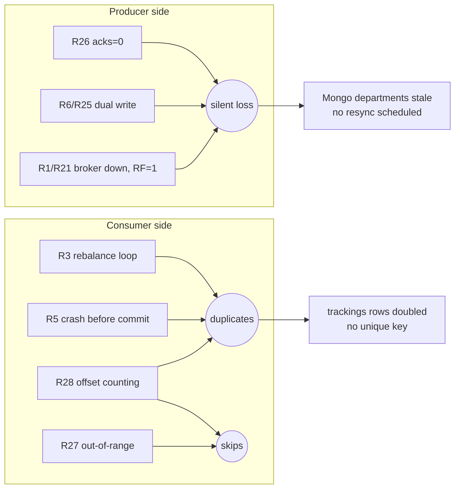

# 07a · Failure Modes & Runbooks — Kafka

> **Snapshot:** `sokrio-server` @ `master` · HEAD `d14c0ebb2` · written 2026-10-26. `master` is now `bf223a126` (+2 commits, no messaging, config, job or README changes), so every ref holds. Code read from `git archive d14c0ebb2`. Vendor = installed `vendor/` (Laravel 9.52.22, `longlang/phpkafka` 1.2.5).
> Paths are relative to `sokrio-server/`. Tags: `[CODE]` app code · `[LIB]` vendor · `[NOTES]` README/docs · `[GENERAL]` industry knowledge · `[INFERENCE]` follows from code, not seen in prod · `[ASSUMPTION]` best guess + how to verify.
> This file covers README_2 failures **1–10** plus the Kafka-specific Sokrio entries **R21–R28**. Redis, queues, AWS and the **Top 5 risks** are in `07b-failure-modes-queues-redis.md`.
> Question bank links: Q11–Q19 (guarantees, ordering, idempotency), Q20–Q30 (Kafka ops), Q77–Q81 (incidents).

## 7.0 How to read these runbooks

Every entry uses the exact 8-field template from README_2 Phase 7. Two conventions:

- **Detection** refers to the alert set from T6 §6.9 by number, because almost none of it exists yet. **AL1** consumer lag · **AL2** queue depth/age (`queue:monitor`) · **AL3** `failed_jobs` count · **AL4** Redis memory/evictions · **AL5** broker disk/offline partitions · **AL6** Supervisor process state · **AL7** scheduler heartbeat. "Today" means what we can actually see without those alerts.
- Severity chips: 🔴 can lose or corrupt data silently today · 🟡 degrades or duplicates, recoverable · 🟢 latent / design note.

### Quick index

| # | Failure | Sev | Live in Sokrio? |
|---|---|---|---|
| R1 | Broker down, leader election, acks | 🔴 | Yes: RF=1 + acks=0 |
| R2 | Lag on one partition (hot key) | 🟢 | Unlikely; one process owns all 3 partitions |
| R3 | Rebalance loop from slow processing | 🟡 | Yes, via heartbeat-on-fetch (F9) |
| R4 | Poison message blocks a partition | 🟢 | No: skipped/dropped, never blocks |
| R5 | Duplicate after crash before commit | 🟡 | Yes: tracking is not idempotent |
| R6 | Dual write lost (DB commit vs publish) | 🔴 | Yes: departments, no outbox |
| R7 | Out-of-order events for one entity | 🟢 | Mostly safe (per-entity keys) |
| R8 | Consumer memory leak / silent death | 🟡 | Bounded by 6 h recycle; death is silent |
| R9 | Deploy restarts consumers mid-message | 🟡 | Graceful if Supervisor restarts; A11 unknown |
| R10 | Payload change breaks old consumers | 🟡 | No version field, no contract test |
| R21 | RF=1 auto-created topic | 🔴 | Yes (A3) |
| R22 | `FENCED_INSTANCE_ID` group sharing | 🟡 | Blocks scaling; bit prod once |
| R23 | EINTR from Datadog profiler signals | 🟢 | Fixed; regression risk only |
| R24 | Signal arrives mid-DB-read | 🟢 | Fixed (sigprocmask) |
| R25 | Department publish lost, no fallback | 🔴 | Yes (F1, F2, F8) |
| R26 | acks=0 silent producer loss | 🔴 | Yes (F5) |
| R27 | Out-of-range offset → jump to latest | 🔴 | Yes (F6), after a long outage |
| R28 | Offset counting vs batch base | 🟡 | `[INFERENCE]` (F7), needs a lab |

---

## 7.1 README_2 failures 1–10

### R1 · Kafka broker goes down; leader election; producer with `acks=1` vs `acks=all`
- **What happens:** `[GENERAL]` With RF≥2, the controller elects a new leader from the ISR in seconds. Producers with `acks=all` + `min.insync.replicas=2` lose nothing. `acks=1` can lose the writes the old leader acked but hadn't replicated yet. `acks=0` loses anything in flight and never knows. **In Sokrio** `[CODE]` there is nothing to fail over to: topics are auto-created with RF=1 (`config/kafka.php:74-75`, A3), and the producer runs with acks=0 (F5). Losing the broker = every partition offline.
- **Where in Sokrio code this can happen:** `app/Services/Kafka/KafkaProducer.php:113-192` (`sendWithRetry`, 3 attempts at `:26`), `[LIB]` `ProducerConfig.php:36` (acks default 0), `Producer.php:159-163` (no response read). Fallbacks: `Tracking/TrackingController.php:62-83` (v1), `V2/Tracking/TrackingController.php:52-78` (v2). Departments have none (`DepartmentChangeObserver.php:26-46`).
- **Symptoms / how we detect it:** Today: `kafka-YYYY-MM-DD.log` fills with publish-retry warnings, tracking requests slow down by ~3.75 s of retries and then succeed through the sync fallback (or return 503 + `Retry-After: 5`). Consumers log "mid-poll error, reconnecting" and exit after 10 failures. Nobody is paged: the `kafka` channel is file + stderr only (`config/logging.php:54-68`). With alerts: **AL5** `OfflinePartitionsCount > 0`, **AL6** consumer restarts, **AL1** lag flat-lining.
- **Business impact (which clients/reports/orders are affected):** Tracking (all tenants): slower API, but rows still land through the fallback. Department edits (all tenants): **lost from Mongo** (R25), so Mongo-based reports and territory filters show stale departments. If the broker's disk is lost (RF=1), every unconsumed event is gone.
- **Immediate fix (stop the bleeding):** Restart the broker or VM. Check `kafka-topics.sh --describe` for offline partitions. Once it's back, run `php artisan tenant:department_sync_with_mongodb` (F1, manual only) to resync departments. Tracking needs nothing: the fallback wrote straight to MySQL and Mongo.
- **Root-cause fix (code or config change):** (1) `setAcks(1)` in the producer config now (one line, F5). (2) 3 brokers, RF=3, `min.insync.replicas=2`, then `acks=-1` (all). (3) Pre-create topics with explicit RF and set `KAFKA_AUTO_CREATE_REPLICATION_FACTOR` (R21).
- **How to prevent it:** Alerts AL5 + AL6. Schedule `DepartmentSync` nightly as a safety net. Run a game day: kill the broker in the T9 lab and check that both fallbacks behave.
- **Interview angle (how to talk about it):** "acks and RF only matter together. We had acks=0 *and* RF=1, so there was neither replication nor confirmation. The cheap first step is acks=1, which at least turns broker-side rejections into errors our fallback can catch. The real fix is RF=3 / min.insync=2 / acks=all, which survives one broker loss with zero data loss."

### R2 · Consumer lag growing on one partition only (hot tenant / hot key)
- **What happens:** `[GENERAL]` One key carries most of the traffic, so its partition falls behind while the others are idle. Adding consumers doesn't help, because one partition = at most one consumer. `[CODE]` Sokrio keys tracking by **user_id** (v1 `Tracking/TrackingController.php:62-83`, v2 `V2/…:52-58`) and departments by **department_id**, not by tenant (D4). The partitioner is `crc32(key) % 3` (`[LIB]` `DefaultPartitioner.php:48-53`). A big tenant's users spread across all 3 partitions, so per-partition skew needs one *user* sending far more than the others (e.g. a device stuck in a retry loop with v2 bulk batches).
- **Where in Sokrio code this can happen:** keys at `KafkaProducer.php:58,76`; topic size P=3 at `config/kafka.php:74`; one process owns all 3 partitions (`numprocs=1`, `README.md:189-211`).
- **Symptoms / how we detect it:** `kafka-consumer-groups.sh --describe --group <group>` shows LAG high on one partition only. Today nothing alerts. With **AL1**, alert per partition, not just on the group total. Mongo `tracking` for one user_id growing abnormally fast is the tell.
- **Business impact (which clients/reports/orders are affected):** Live map / field-force tracking delayed for users on that partition (≈ ⅓ of all users across all tenants). MySQL `trackings` rows still arrive, just late.
- **Immediate fix (stop the bleeding):** Find the hot key (count keys in a sample: `kafka-console-consumer --property print.key=true | sort | uniq -c`). If it's a misbehaving device, rate-limit that user at the API (the `api` limiter exists, `RouteServiceProvider.php:66-150`).
- **Root-cause fix (code or config change):** Because one process owns everything, a "single hot partition" really means the whole consumer is slow (see R3/R8 for throughput). If skew is real: more partitions (6–12) **plus** per-process `group.instance.id` (R22) so numprocs can grow. Don't change the key: user_id gives per-user ordering (R7).
- **How to prevent it:** AL1 per partition; a per-user rate limit on the bulk endpoint; a payload-size cap on v2 batches.
- **Interview angle (how to talk about it):** "Our key is user_id, not tenant_id. We changed it on purpose so a big tenant can't create a hot partition. The trade-off is that per-tenant ordering is gone, which tracking doesn't need. Lag on one partition is a key-design problem. Adding consumers doesn't fix it."

### R3 · Consumer rebalance loop (`max.poll.interval.ms` exceeded by slow PHP processing)
- **What happens:** `[LIB]` phpkafka has no `max.poll.interval`. Liveness = `session_timeout` 30 s, and outside Swoole **heartbeats are only sent during fetch** (F9: `KafkaUtil.php:45-53` → `NoopTimer`, `Consumer.php:292-294,421-427`). A flush that takes > 30 s → coordinator evicts the member → `saveOffsets` fails and is swallowed at debug level (`KafkaConsumer.php:329-335`) → rejoin from the last commit → the same batch is replayed → if the flush is slow again, it loops.
- **Where in Sokrio code this can happen:** Tracking flush: 3 bulk attempts with `sleep(1)` + `sleep(2)` (`TrackingMessageHandler.php:85-116`), then per-point fallback for up to 200 points (`:125-158`). Department flush: `bulkWrite` + per-record fallback (`DepartmentMessageHandler.php:110-156`). Batch size 200 / 1 s (`config/kafka.php:62-63`). Timeouts `:49-51`.
- **Symptoms / how we detect it:** `kafka-*.log`: repeating "rejoined" / UNKNOWN_MEMBER_ID / REBALANCE_IN_PROGRESS lines; lag doesn't drop although the process is busy; MySQL `trackings` gets duplicate `(user_id, created_at)` pairs. Check: `SELECT user_id, created_at, COUNT(*) c FROM trackings GROUP BY 1,2 HAVING c>1 ORDER BY created_at DESC LIMIT 20`.
- **Business impact (which clients/reports/orders are affected):** Duplicate tracking rows inflate distance, visit and time-on-route numbers in tracking reports (`GenerateTrackingReport`) for the affected tenants. Live position lags.
- **Immediate fix (stop the bleeding):** Lower `KAFKA_CONSUMER_BATCH_SIZE` (e.g. 50) and restart the consumer, so each flush fits in 30 s. Find what's slow: MySQL locks, the tenant DB host, or Mongo. Raise `KAFKA_CONSUMER_SESSION_TIMEOUT` to 60 and `stopwaitsecs` to 65 together.
- **Root-cause fix (code or config change):** Cap the flush by time: bail out of the per-point fallback once ~20 s have passed, commit what's done, and re-queue the rest to a retry topic (T2 §2.9). Make tracking idempotent with a unique `(user_id, created_at)` index + `insertOrIgnore` (T2 §2.7) so a replay is harmless. Longer term, the Swoole timer or an rdkafka client (background heartbeat thread).
- **How to prevent it:** Flush-duration histogram in the log (p99 > 15 s → warn); AL1 lag; the T9 lab "slow flush → eviction".
- **Interview angle (how to talk about it):** "In Java you'd tune `max.poll.interval.ms`. Our PHP client heartbeats only on fetch, so *any* slow write is a liveness failure. I explain it as: the processing budget per batch must be less than the session timeout, and idempotent writes make the inevitable replay safe."

### R4 · Poison message blocks a partition
- **What happens:** `[GENERAL]` A message that always throws gets retried forever, and since offsets are sequential, everything behind it in that partition waits. `[CODE]` **Sokrio never blocks, it drops.** Malformed envelopes are logged and skipped, with the offset still advancing (`KafkaConsumer.php:341-365`). A payload missing a required field (`user_id`, `lat`, `long`, `address`, `created_at`; `WriteBulkTrackingActions.php:56-61`) throws → 3 bulk attempts → per-point fallback → only the bad point fails (`report($e)`) → offset committed. Departments without `department_id` are skipped silently (`DepartmentMessageHandler.php:88-90`).
- **Where in Sokrio code this can happen:** `KafkaConsumer.php:347-365` (decode), `TrackingMessageHandler.php:57-70` (catch per tenant), `:144-150` (per-point catch), `DepartmentMessageHandler.php:47-60,130-156`.
- **Symptoms / how we detect it:** Today: `kafka` log "malformed message" (with the raw value) or "failed to persist message `failed: n of m`". Per-point failures also go to Sentry via `report()`. The cost: each poison batch adds ~3 s of retry sleeps, which feeds R3.
- **Business impact (which clients/reports/orders are affected):** The bad point/department is lost (no DLQ). One tenant's slice of the batch is slowed; other tenants in the same batch keep going.
- **Immediate fix (stop the bleeding):** Nothing blocks, so nothing needs to be unblocked. To recover the lost data, grep the raw value from the log and replay it through `WriteTrackingActions` in tinker (print the tenant DB host first).
- **Root-cause fix (code or config change):** A DLQ topic per stream (`sokrio.<env>.tracking.dlq`) with the raw message, error and attempt count, plus a small replay command (T2 §2.9). Validate the payload *before* the bulk insert so a known-bad point skips the 3 s retry ladder.
- **How to prevent it:** Validate at the producer (the API request validation already covers v1/v2); a contract test (R10); DLQ depth alert.
- **Interview angle (how to talk about it):** "We chose availability over completeness: skip and log rather than block. That's right for GPS points, wrong for anything financial. The missing piece is a DLQ, so 'skip' becomes 'park and replay'."

### R5 · Duplicate processing (crash after processing, before offset commit)
- **What happens:** `[CODE]` Process-then-commit = at-least-once. The handler writes MySQL + Mongo, then `saveOffsets` runs (`KafkaConsumer.php:301-339`). A crash, SIGKILL, eviction (R3) or swallowed commit failure in between means the next owner re-reads from the last commit and writes the batch again. The envelope's `event_id` is dropped at decode (`:360-364`), and `trackings` has no unique key (`2020_08_18_074138_create_trackings_table.php:18,24`), so nothing can dedupe it.
- **Where in Sokrio code this can happen:** `KafkaConsumer.php:309-336` (flush → commit), `:329-335` (commit failure → debug log). Departments are naturally idempotent (`updateOne` + `$set` + upsert keyed by `department_id`, `DepartmentMessageHandler.php:92-99`). Tracking is not.
- **Symptoms / how we detect it:** The duplicate query from R3. A SIGKILL line in `supervisord.log` (stop took > `stopwaitsecs`) followed by a burst of writes.
- **Business impact (which clients/reports/orders are affected):** Tracking distance/time totals inflated for the users in the replayed batch (≤ 200 points). Departments: none.
- **Immediate fix (stop the bleeding):** Delete the duplicates in MySQL for the affected window (keep `MIN(id)` per `(user_id, created_at)`), and do the same in Mongo. Re-run the affected tracking report exports.
- **Root-cause fix (code or config change):** Keep `event_id` through decode; add a unique `(user_id, created_at)` index (a migration, so check existing duplicates first) and `insertOrIgnore` in `WriteBulkTrackingActions`. The same unique key in Mongo `tracking` with `ordered:false` inserts.
- **How to prevent it:** Idempotent consumers are the only real fix; exactly-once isn't available with this client (no idempotent producer, `producerId=-1`, no transactions).
- **Interview angle (how to talk about it):** "At-least-once plus an idempotent write *is* effectively-once. Our department consumer already does it with upserts. Tracking doesn't, and the fix is a natural key, not Kafka transactions."

### R6 · Event lost between DB commit and Kafka publish (dual write)
- **What happens:** `[CODE]` The observer publishes in the model's `created`/`updated` events (`DepartmentChangeObserver.php:26,35`) while the outer transaction may still be open, and there is no outbox. Two failure shapes: (a) **publish fails** after the commit (broker down, or silently with acks=0) → MySQL has the change, Mongo never does; (b) **commit fails** after the publish → Mongo has a change that never happened (phantom, F8).
- **Where in Sokrio code this can happen:** `app/Observers/DepartmentChangeObserver.php:26-46,104-145` (publish), `app/Observers/Concerns/PublishesKafkaMessage.php:11-26` (swallow + log), `DepartmentBulkDataUpdateController.php:41-52` (per-row `->update()` inside `DB::beginTransaction()`, F8). Bypasses that never publish at all: `DepartmentErpCodeSyncJob.php:71` `Department::upsert()` (F2). Order/Delivery publishing is commented out (`OrderObserver.php:23`, `DeliveryObserver.php:23`), so they're not exposed today.
- **Symptoms / how we detect it:** None automatic. Detect by diffing: MySQL `departments.updated_at` vs Mongo `departments` (count + max `updated_at` per tenant). Log line "Kafka publish failed" in `kafka-*.log`.
- **Business impact (which clients/reports/orders are affected):** Department name/hierarchy/ERP code wrong in Mongo-backed reports and territory filters for the affected tenant until someone runs a manual resync. ERP codes **never** reach Mongo via Kafka (F2).
- **Immediate fix (stop the bleeding):** `php artisan tenant:department_sync_with_mongodb` for the tenant (F1).
- **Root-cause fix (code or config change):** Stopgap: `public $afterCommit = true;` on `DepartmentChangeObserver` (Laravel 9 supports it, `Events/Dispatcher.php:526-548`), which kills phantoms (b). Real fix: a transactional outbox: insert an `outbox` row in the same transaction, and a relay command publishes and marks it sent (T2 §2.2). Make the ERP sync use per-row saves or publish explicitly after `upsert`.
- **How to prevent it:** Schedule `DepartmentSync` nightly (`Kernel.php`) as reconciliation; a lint rule or code review against `upsert()`/`query()->update()` on observed models.
- **Interview angle (how to talk about it):** "Any 'write DB, then publish' without an outbox has two failure windows. `afterCommit` closes one of them for free, and the outbox closes both. Reconciliation is the safety net, and ours wasn't scheduled."

### R7 · Out-of-order events for the same order
- **What happens:** `[GENERAL]` Kafka orders within a partition only. If events for one entity land in different partitions (wrong key, partition count changed) or are retried out of order, a consumer can apply "approved" before "created". `[CODE]` Sokrio doesn't stream orders (publishing commented out, `OrderObserver.php:23`). For live streams the key is the entity: user_id (tracking), department_id (departments), so per-entity order holds **within Kafka**.
- **Where in Sokrio code this can happen:** (1) The tracking **fallback path** writes synchronously while earlier points may still be in Kafka (`Tracking/TrackingController.php:70-81`), so MySQL insert order ≠ GPS order. Harmless, because reports sort by `created_at`. (2) Departments: a manual `DepartmentSync` running concurrently with live events can overwrite a newer event with an older snapshot (`$set` of the full payload, `DepartmentMessageHandler.php:94-96`, no version check). (3) Raising the partition count remaps `crc32(key) % N` (`DefaultPartitioner.php:48-53`), so for a short while old and new events for one key sit in different partitions.
- **Symptoms / how we detect it:** A department shows an old name in Mongo although MySQL is newer, right after a resync. Hard to detect otherwise.
- **Business impact (which clients/reports/orders are affected):** Low today: a stale department until the next edit or resync.
- **Immediate fix (stop the bleeding):** Re-run the resync after stopping the department consumer (or when the topic is quiet).
- **Root-cause fix (code or config change):** Carry a version (`updated_at` or a counter) in the payload and apply it conditionally: `updateOne({department_id, $or:[{v:{$lt:new}},{v:{$exists:false}}]}, …)`. For a future order stream: key = order_id, payload carries `status_version`, and the consumer ignores stale versions.
- **How to prevent it:** Never change the partition count of a keyed topic without draining it; document "key = aggregate id" in the topic checklist (T5 §5.2).
- **Interview angle (how to talk about it):** "Ordering is per partition, so the key decides it. I'd still never rely on it alone: a version check in the consumer makes ordering bugs, replays and resync races all harmless."

### R8 · PHP consumer memory leak / long-running process dies silently
- **What happens:** `[CODE]` PHP isn't built for 24/7 processes, so memory creeps up (static caches, the Eloquent query log if enabled, library buffers). Sokrio bounds this by **recycling every 6 h**: flush, commit, exit 0 (`config/kafka.php:70`, `KafkaConsumer.php:229-231,256-258`), and Supervisor restarts it (`autorestart=true`, `README.md:189-211`). The in-process `$orgs` cache never evicts but is bounded by tenant count (`TrackingMessageHandler.php:33`). The "dies silently" part is the real risk: after 10 consecutive failures the process exits (`KafkaConsumer.php:371-393`). If it then fails fast at boot (bad deploy, missing `ext-pcntl`, broken `.env`), Supervisor stops trying after `startretries` (default 3) and marks it **FATAL** `[GENERAL]`, and nothing alerts.
- **Where in Sokrio code this can happen:** `KafkaConsumer.php:109-191` (consume loop), `:371-393` (exit), `ConsumeCommand.php:45-46,70-73` (no time limit, runtime fallback).
- **Symptoms / how we detect it:** `supervisorctl status` shows FATAL/BACKOFF; `kafka-*.log` stops getting new lines; lag (AL1) grows linearly. Memory: `ps -o rss -p <pid>` sampled over hours. **AL6** catches the FATAL state.
- **Business impact (which clients/reports/orders are affected):** Tracking: the API keeps returning 202 and Kafka keeps the events until retention (7 days `[ASSUMPTION]`), so the live map freezes but nothing is lost **unless** the outage outlasts retention (then R27). Departments: Mongo stale.
- **Immediate fix (stop the bleeding):** `supervisorctl start sokrio-kafka-consumer-tracking` (and departments); read the last lines of `kafka-consumer-*.log` for the boot error. It will catch up from the committed offset.
- **Root-cause fix (code or config change):** Add `startretries=10` + `startsecs=5` to the programs; log `memory_get_usage(true)` in the recycle line; consider `max_runtime` 3600 if RSS grows.
- **How to prevent it:** AL6 (Datadog `supervisord` check), AL1 lag, and a heartbeat log line every N minutes ("alive, lag=?") that a log monitor can watch for absence.
- **Interview angle (how to talk about it):** "Long-running PHP needs two guards: periodic recycling for memory, and an *external* liveness check, because a dead consumer doesn't log that it's dead. Lag is the best liveness metric: it rises whether the process leaks, hangs or is gone."

### R9 · Deploy restarts consumers mid-message (no graceful shutdown)
- **What happens:** `[CODE]` Shutdown **is** graceful if the process gets SIGTERM: the handler sets `ShutdownFlag` and stops the poll (`KafkaConsumer.php:125-144`), signals are blocked during the persist step (`:309-319`), and the consumer flushes, commits and leaves the group. Supervisor waits `stopwaitsecs=35` before SIGKILL (`README.md:200,211`). Two gaps: (1) we don't know whether `pipeline.sh` restarts the consumers at all (A11). If it doesn't, they keep running **old code** for up to 6 h after a deploy. (2) A flush longer than 35 s (R3) is SIGKILLed mid-batch → replay → duplicates (R5).
- **Where in Sokrio code this can happen:** `KafkaConsumer.php:125-144,262-266,301-339`; Supervisor config only in `README.md:178-212` (not checked in as files); deploy workflows `ci-cd.yml`, `queue-worker-deploy.yml` → server-side `pipeline.sh` (unreadable from here).
- **Symptoms / how we detect it:** `supervisord.log` "waiting for … to stop" → "killed by SIGKILL"; new behaviour not visible after a deploy (old code); duplicates after the deploy window.
- **Business impact (which clients/reports/orders are affected):** At most one batch (≤ 200 points) duplicated per SIGKILL. Old code running after a payload change → R10.
- **Immediate fix (stop the bleeding):** `supervisorctl restart sokrio-kafka-consumer-tracking sokrio-kafka-consumer-departments` after every deploy; clean duplicates per R5.
- **Root-cause fix (code or config change):** Check the Supervisor programs into the repo; have `pipeline.sh` run `supervisorctl restart` for both consumers and `php artisan queue:restart` for workers; keep `stopwaitsecs` > the longest possible flush (or cap the flush, R3).
- **How to prevent it:** A deploy checklist (`/engineering:deploy-checklist`) step: "consumers restarted? recycle line seen?"; the idempotent tracking write (R5) makes the leftover risk harmless.
- **Interview angle (how to talk about it):** "Graceful shutdown is three things: catch SIGTERM, finish and commit the in-flight batch, and leave the group so the rebalance is instant. The orchestrator's grace period has to be longer than your worst batch. We had the code right, and the open question was the deploy script."

### R10 · Schema/payload change breaks old consumers
- **What happens:** `[CODE]` The envelope is `{event_id, event_type, tenant_id, occurred_at, payload}` with **no schema version** (`KafkaProducer.php:93-102`). Consumers ignore `event_type` (they branch on topic only) and read payload keys directly. Effects: a **renamed or removed** required tracking key → exception → per-point fallback → every point dropped + reported (R4). A **new** field: tracking ignores it, but departments `$set` the whole payload (`DepartmentMessageHandler.php:94-96`), so new fields appear in Mongo immediately and **renamed** ones leave the old field behind, stale forever.
- **Where in Sokrio code this can happen:** `KafkaProducer.php:93-102` (envelope), `KafkaConsumer.php:347-365` (decode needs `tenant_id`/`event_type`/`payload`), `WriteBulkTrackingActions.php:56-62` (required keys), `DepartmentChangeObserver.php:104-145` (payload shape), `DepartmentMessageHandler.php:87-100`.
- **Symptoms / how we detect it:** Right after a deploy, a spike of "failed to persist message" warnings + Sentry `Undefined array key` errors from the consumer; Mongo departments with both old and new field names.
- **Business impact (which clients/reports/orders are affected):** Tracking points dropped for **all tenants** until the consumer is fixed (no DLQ to replay from). Department reports show stale or duplicated fields.
- **Immediate fix (stop the bleeding):** Roll back the producer (web) deploy, or hot-fix the consumer to accept both shapes. Points produced in the bad window are gone unless the raw values are still in the log.
- **Root-cause fix (code or config change):** Add `schema_version` to the envelope; consumers branch on it. Follow expand/contract: deploy the consumer that reads old + new first, then the producer, then remove the old field. Unset removed department fields explicitly (`$unset`).
- **How to prevent it:** A contract test: a fixture envelope per event type that the producer must produce and the consumer must accept (fits next to `tests/Unit/Kafka/`). No schema registry is needed at this size.
- **Interview angle (how to talk about it):** "Producers and consumers deploy separately, so every change must be backward *and* forward compatible for one deploy window. Version the envelope, deploy consumers first, and test the contract. A schema registry is the scaled-up form of the same rule."

---

## 7.2 Sokrio-specific Kafka failures

### R21 · RF=1 auto-created topic
- **What happens:** `[CODE]` `TopicProvisioner` creates missing topics with P=3, **RF=1** (`config/kafka.php:74-75`, `TopicProvisioner.php:52-81`), and the library also auto-creates on first produce/consume (`autoCreateTopic=true`, `[LIB]`). With RF=1 each partition lives on exactly one broker disk: a broker restart = that partition is offline; a disk loss = its data is gone. Provisioning failure is a warning only (`:69-80`), and the success is cached for a day (`:114`).
- **Where in Sokrio code this can happen:** `app/Services/Kafka/TopicProvisioner.php:23,52-81,94-124`; `config/kafka.php:74-75`; topic names `TopicRegistry.php:18-24,51-58`.
- **Symptoms / how we detect it:** `kafka-topics.sh --describe --topic <name>` shows `ReplicationFactor: 1`; during a broker restart, produce errors and `LEADER_NOT_AVAILABLE`. **AL5** `OfflinePartitionsCount`. Under-replication alerts can never fire with RF=1: the partition just goes offline.
- **Business impact (which clients/reports/orders are affected):** Same as R1. Every unconsumed tracking/department event is at risk on disk loss.
- **Immediate fix (stop the bleeding):** Nothing short of adding brokers. Make sure consumers stay caught up (AL1), since consumed events are already in MySQL/Mongo.
- **Root-cause fix (code or config change):** 3 brokers; `kafka-reassign-partitions.sh` to raise RF to 3 on existing topics; `KAFKA_AUTO_CREATE_REPLICATION_FACTOR=3`; broker `auto.create.topics.enable=false` and `default.replication.factor=3`; then acks=all (R1).
- **How to prevent it:** Create topics in a reviewed script (or IaC), not on first use; a startup check that warns if any topic has RF < 3 in prod.
- **Interview angle (how to talk about it):** "Auto-create is a dev convenience that silently becomes the production topology. RF is decided once at creation, so I'd make topic creation explicit and reviewed."

### R22 · `FENCED_INSTANCE_ID` from group sharing
- **What happens:** `[CODE]` Consumers use **static membership** with `group.instance.id = ""` (D1, `KafkaConsumer.php:79-95`). Two processes with the same group + instance id fence each other: each join kicks the other out → `FENCED_INSTANCE_ID` ping-pong, no progress. This happened in prod when both topics shared one `KAFKA_GROUP` (fixed in `9d902b7e8`, now one group per topic, `ConsumeCommand.php:97-107`). It still blocks scaling: `numprocs=2` on one program would fence again.
- **Where in Sokrio code this can happen:** `KafkaConsumer.php:79-95` (instance id), `:404-432` (join retry catches FENCED), `ConsumeCommand.php:97-107` (group id; tracking = bare `KAFKA_GROUP` for legacy reasons, D2).
- **Symptoms / how we detect it:** `kafka-*.log` alternating "joined" / FENCED_INSTANCE_ID warnings from two PIDs; lag growing while both processes look busy.
- **Business impact (which clients/reports/orders are affected):** That topic stops being consumed (tracking live map frozen or departments stale), all tenants.
- **Immediate fix (stop the bleeding):** `supervisorctl status` → make sure exactly one process per program and no stray manual `kafka:consume` in a tmux session; check that no other environment (staging!) uses the same `KAFKA_GROUP` against the same brokers. Kill the extra.
- **Root-cause fix (code or config change):** Instance id = `{hostname}-{process_num}` from an env var (`KAFKA_GROUP_INSTANCE_ID=%(program_name)s-%(process_num)s` in Supervisor) and fall back to dynamic membership when empty. Then numprocs up to the partition count works.
- **How to prevent it:** Topic names already carry an env suffix (`TopicRegistry.php:51-58`); do the same for group ids. Add a test asserting distinct instance ids per process.
- **Interview angle (how to talk about it):** "Static membership avoids rebalances on restart, but the id must be unique per process. We used one empty id, which works until there are two of anything. It's a nice example of a config that's correct at N=1 and broken at N=2."

### R23 · EINTR from Datadog profiler signals
- **What happens:** `[NOTES]`+`[CODE]` The Datadog continuous profiler raises timer signals (~100 Hz). They interrupt the pure-PHP client's blocking `stream_select()` / `stream_socket_client()` with EINTR, which the stock socket treated as a dead connection → spurious reconnects and failed publishes. `InterruptResilientStreamSocket` retries the interrupted call (`Socket/InterruptResilientStreamSocket.php:36-83,85-116`), wired into producer and consumer (`KafkaProducer.php:51`). The consumers also turn profiling and CLI tracing off (`DD_PROFILING_ENABLED=false`, `DD_TRACE_CLI_ENABLED=false`, `README.md:214-226`).
- **Where in Sokrio code this can happen:** the socket class above; `tests/Unit/Kafka/InterruptResilientStreamSocketTest.php:88-116` covers it.
- **Symptoms / how we detect it:** Publish failures/reconnects that correlate with Datadog being enabled, `stream_select(): Unable to select [4]: Interrupted system call` in logs.
- **Business impact (which clients/reports/orders are affected):** Today none (fixed). A regression would make tracking hit the sync fallback constantly (slow API) and make consumers reconnect-loop.
- **Immediate fix (stop the bleeding):** Set the two `DD_*` vars to false on the affected program and restart it.
- **Root-cause fix (code or config change):** Already done. Keep the socket override when upgrading phpkafka (a library upgrade could replace the socket class), and keep the env **per program**, not container-wide (or scheduled artisan commands lose tracing).
- **How to prevent it:** Keep the unit test; mention it in the upgrade checklist.
- **Interview angle (how to talk about it):** "A good 'weird production bug' story: an observability agent broke the thing it was observing. The fix was to treat EINTR as retryable, which is what C libraries do, and to scope the profiler away from long-running consumers."

### R24 · Signal arrives mid-DB-read
- **What happens:** `[CODE]` With `pcntl_async_signals(true)`, a SIGTERM handler can run in the middle of a MySQL read. If the handler (or the code it triggers) touches the connection, the protocol stream is torn: "Packets out of order" / "MySQL server has gone away", and a half-written batch. Sokrio blocks SIGTERM/SIGINT with `pcntl_sigprocmask(SIG_BLOCK)` around `handleBatch` and unblocks after (`KafkaConsumer.php:309-319`), so the signal is delivered between batches and the shutdown flag is checked there (`:262-266`).
- **Where in Sokrio code this can happen:** `KafkaConsumer.php:125-144` (handlers), `:309-319` (mask). Not applicable to `queue:work`, where Laravel handles signals itself.
- **Symptoms / how we detect it:** "Packets out of order" errors in `kafka-*.log` around deploys/recycles. None expected today.
- **Business impact (which clients/reports/orders are affected):** None today. Without the mask: a crashed batch replayed on restart (duplicates, R5).
- **Immediate fix (stop the bleeding):** N/A (fixed).
- **Root-cause fix (code or config change):** Done. The trade-off to know: while masked, a SIGTERM waits until the flush ends, so a flush longer than `stopwaitsecs` still ends in SIGKILL (R9).
- **How to prevent it:** `KafkaConsumerReconnectTest` covers signal-stop. Keep any new persist step inside the masked section.
- **Interview angle (how to talk about it):** "Async signals in PHP are like interrupts: never do I/O in the handler, just set a flag, and mask signals around critical sections. It's the same idea as a Java consumer's `wakeup()`."

### R25 · Department publish lost with no fallback
- **What happens:** `[CODE]` Unlike tracking, `DepartmentChangeObserver` has **no sync fallback**: on publish failure it logs and returns (`PublishesKafkaMessage.php:11-26`). With acks=0 most failures aren't even detected (F5). The only repair is `DepartmentSync`, which is **manual only** (F1). Add F2 (`Department::upsert()` never fires observers) and F8 (publishes before the commit). Publishing is also skipped in `testing` (`967b4276e`), so tests can't catch it.
- **Where in Sokrio code this can happen:** `DepartmentChangeObserver.php:26-46,104-145`; `PublishesKafkaMessage.php:11-26`; `DepartmentErpCodeSyncJob.php:71` (F2); `DepartmentBulkDataUpdateController.php:41-52` (F8); `DepartmentSyncWithMongoDB.php:15,31` (F1).
- **Symptoms / how we detect it:** Department edits not visible in Mongo-backed screens; "Kafka publish failed" in the log; a MySQL-vs-Mongo count/`updated_at` diff per tenant.
- **Business impact (which clients/reports/orders are affected):** Territory filters, department dropdowns and Mongo summary reports show old names/hierarchy/ERP codes for the edited tenant. Bulk edits (F8) during a broker outage also pay ~3.75 s per row in retries, so the bulk request may time out.
- **Immediate fix (stop the bleeding):** `php artisan tenant:department_sync_with_mongodb` (per tenant or all).
- **Root-cause fix (code or config change):** Schedule the resync nightly (one line in `Kernel.php`, with `onOneServer()` once a cache-lock driver is confirmed); `$afterCommit = true` on the observer; outbox (R6); publish explicitly after the ERP `upsert`.
- **How to prevent it:** A drift check job: count Mongo vs MySQL departments per tenant, alert on a mismatch.
- **Interview angle (how to talk about it):** "Two streams with the same pattern but different safety nets: tracking falls back to a sync write, departments just log. When a pipeline has no fallback, reconciliation has to be automatic, or it's 'eventually never consistent'."

### R26 · acks=0: silent producer loss
- **What happens:** `[LIB]` With acks=0 the producer writes the request to the socket and returns without reading a response (`Producer.php:159-163`; default `ProducerConfig.php:36`, never overridden, F5). Broker-side rejections (topic missing during auto-create, message too large, leader moved, broker disk full) are invisible. `KafkaProducer` reports success, the API returns 202, and the fallback never runs because only transport errors are caught.
- **Where in Sokrio code this can happen:** every publish: `KafkaProducer.php:54-68,113-192`; callers `Tracking/TrackingController.php:62-83`, `V2/Tracking/TrackingController.php:52-78`, `DepartmentChangeObserver.php:104-145`.
- **Symptoms / how we detect it:** None on the producer side. Only the downstream gap: `trackings` count per hour (MySQL) vs expected device pings; the topic end offset growing slower than API 202 counts (compare `kafka-run-class.sh kafka.tools.GetOffsetShell` deltas with nginx 202 counts).
- **Business impact (which clients/reports/orders are affected):** Tracking points and department changes silently missing, for all tenants, exactly when the broker is unhealthy. The `WriteTrackingActions.php:26-28` "lost-ack duplicate" reasoning assumes acks ≥ 1, so the design intent and reality differ.
- **Immediate fix (stop the bleeding):** Set acks=1 (`$config->setAcks(1)` in the producer factory) and deploy. One line.
- **Root-cause fix (code or config change):** acks=1 now, then acks=-1 with RF=3 + `min.insync.replicas=2` (R1). Keep the fallback; with acks ≥ 1 it starts catching real broker errors.
- **How to prevent it:** A unit test asserting the producer config's acks ≥ 1; a T9 lab that sends to a full or missing topic and shows the difference.
- **Interview angle (how to talk about it):** "acks=0 is fire-and-forget. It's fine for metrics, wrong for anything you charge or report on. The surprise was that it was a *library default* nobody had chosen. Always print the effective config of a client."

### R27 · Out-of-range offset → consumer jumps to latest
- **What happens:** `[LIB]` phpkafka has no `auto.offset.reset`. A new group starts at offset 0 (`OffsetManager.php:107`). But when a committed offset has been deleted by retention (consumer down longer than `retention.ms`, 7 days by default `[ASSUMPTION]`), OFFSET_OUT_OF_RANGE makes it list offsets with timestamp −1 → **latest − 1** (`OffsetManager.php:140,150`, `Consumer.php:345,364`, F6). Everything still on disk between the oldest and latest offset is skipped silently.
- **Where in Sokrio code this can happen:** both consumers (library code path); triggered by R8 (silent death) lasting > retention.
- **Symptoms / how we detect it:** After a long outage, lag drops to ~0 instantly on restart instead of draining. A `trackings` gap for the outage window.
- **Business impact (which clients/reports/orders are affected):** Tracking events of the whole outage window lost for all tenants (the API had returned 202). Department changes lost (resync fixes it).
- **Immediate fix (stop the bleeding):** Before restarting a consumer that's been down for days, check `kafka-consumer-groups.sh --describe`; if the committed offset < log-start offset, reset it explicitly to `--to-earliest` (`kafka-consumer-groups.sh --reset-offsets --to-earliest --execute --group <g> --topic <t>`) so it reads everything still retained.
- **Root-cause fix (code or config change):** Wrap the library: on OUT_OF_RANGE, seek to *earliest* and log an error (or make it configurable). Keep consumers alive (R8 alerts), so retention is never reached.
- **How to prevent it:** AL1 lag alert with a time threshold far below retention; topic retention ≥ 7 days.
- **Interview angle (how to talk about it):** "`auto.offset.reset` decides what happens when your position no longer exists. 'Latest' silently skips, 'earliest' replays. For data you report on, I'd pick earliest plus idempotent writes. Our library hard-coded the dangerous one."

### R28 · Offset counting vs batch base offset (F7, unproven)
- **What happens:** `[INFERENCE]` The library counts messages instead of reading each record's offset (`RecordBatch::$baseOffset` unused; `Consumer.php:321,351-353`), and Sokrio's `advanceCursor` adds 1 per message (`KafkaConsumer.php:279-294`). The producer packs one record batch per partition per `sendBatch`, so a v2 bulk publish of N points = one batch. If the consumer commits in the middle of that batch and then restarts, the broker returns the **whole** batch from its base offset: the head of the batch is processed twice, and the same number of later records is skipped, because the counter is now ahead of reality.
- **Where in Sokrio code this can happen:** `KafkaConsumer.php:236-241,279-294` (cursor), `KafkaProducer::publishBatch` (v2 bulk), `[LIB]` `Consumer.php:321,351-353`.
- **Symptoms / how we detect it:** Duplicates *and* a gap of the same size after a restart that happened mid-way through a v2 bulk batch. Very hard to see without the T9 lab.
- **Business impact (which clients/reports/orders are affected):** If real: a few duplicated and skipped tracking points per restart (6-hourly recycle included) for bulk-uploading users.
- **Immediate fix (stop the bleeding):** None needed until proven; recycle (`max_runtime`) happens only between flushes, which narrows the window.
- **Root-cause fix (code or config change):** Prove it in the T9 lab first. If real: compute offsets as `baseOffset + offsetDelta` (patch or fork the library), or flush only at batch boundaries.
- **How to prevent it:** Lab test + idempotent tracking writes (R5) make the duplicate half harmless. The skip half needs the library fix.
- **Interview angle (how to talk about it):** "A good example of 'verify your client library': offsets belong to records, not to how many you've seen. I'd show the lab that proves or kills the hypothesis before changing anything."

---

### ✅ Quality check
- [x] README_2 failures 1–10 each use the exact 8-field template
- [x] Sokrio-specific: RF=1 (R21), FENCED_INSTANCE_ID (R22), EINTR/Datadog (R23), signal mid-DB-read (R24), department publish lost (R25), plus F5 (R26), F6 (R27), F7 (R28)
- [x] Every entry has file:line refs or says "not applicable"; payload keys re-verified (`WriteBulkTrackingActions.php:56-62`, `DepartmentMessageHandler.php:87-100`, decode `KafkaConsumer.php:347-365`)
- [x] Detection mapped to the T6 §6.9 alert set (AL1–AL7)
- [x] F7 kept `[INFERENCE]`; retention 7 days kept `[ASSUMPTION]`; A3/A11 referenced, not asserted
- [x] No secrets, hosts or IPs
- [x] Queue/Redis/AWS failures and the Top 5 risks → `07b`
