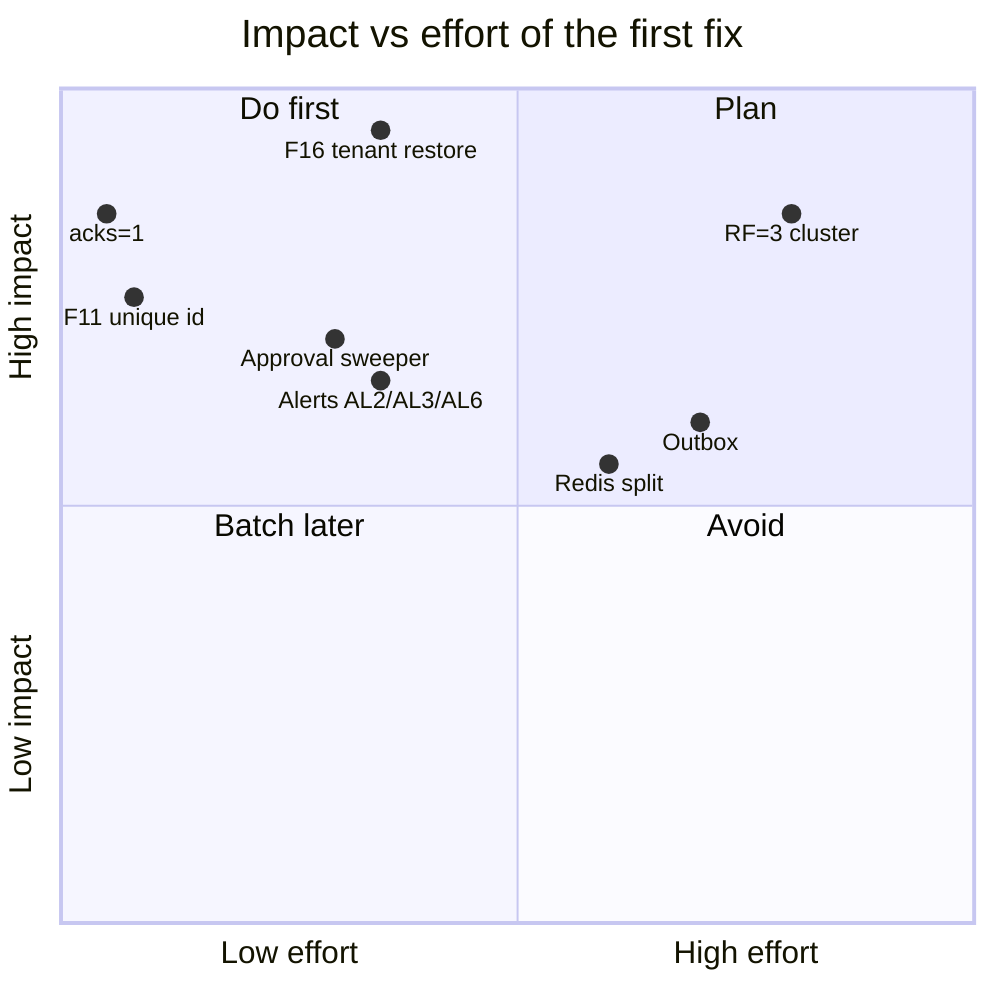

# 07b · Failure Modes & Runbooks — Queues, Redis, AWS + Top 5 Risks

> **Snapshot:** `sokrio-server` @ `master` · HEAD `d14c0ebb2` · written 2026-10-26 (`master` = `bf223a126`, no relevant changes). Code read from `git archive d14c0ebb2`.
> Paths are relative to `sokrio-server/`. Tags and severity chips as in `07a` §7.0. Detection codes **AL1–AL7** = the T6 §6.9 alert set (AL1 consumer lag · AL2 queue depth/age · AL3 `failed_jobs` · AL4 Redis memory/evictions · AL5 broker disk/offline partitions · AL6 Supervisor state · AL7 scheduler heartbeat).
> This file covers README_2 failures **11–20** plus the Sokrio-specific entries **R29–R35**, and ends with the **Top 5 risks**. Kafka entries R1–R10 and R21–R28 are in `07a`.
> Question bank links: Q38–Q45 (Redis), Q58–Q71 (queues, Laravel), Q72–Q81 (AWS design, incidents).

## 7.3 Quick index

| # | Failure | Sev | Live in Sokrio? |
|---|---|---|---|
| R11 | Redis full / eviction removes jobs or keys | 🟡 | `noeviction` likely (A9): dispatches throw |
| R12 | Redis restart: queued + delayed jobs lost | 🔴 | Yes: no AOF evidence, no sweeper |
| R13 | Job runs twice (`timeout ≥ retry_after`, `$timeout = 0`) | 🟡 | Yes: 6 jobs with `$timeout = 0` |
| R14 | Job dispatched before commit ("model not found") | 🟡 | Few sites; 0 jobs set `deleteWhenMissingModels` |
| R15 | `failed_jobs` growing, nobody watching | 🟡 | Yes: no alert, no prune |
| R16 | Cache stampede on a heavy report | 🟡 | Yes: only MatrixAggregator is protected |
| R17 | Lock expires while the job still runs | 🟡 | KPISummary, StockUpdate (F13) |
| R18 | One big tenant floods the queue (noisy neighbor) | 🟡 | Yes: FIFO `summary`, one global export lane (F24) |
| R19 | RabbitMQ memory alarm blocks producers | 🟢 | Not applicable (no RabbitMQ); Redis analog = R11 |
| R20 | Network partition / AZ failure | 🔴 | Single VM/AZ `[ASSUMPTION]` |
| R29 | F11 bulk stock import chunks dropped | 🔴 | Yes, `[LAB]` confirmed |
| R30 | F14 feature-analytics flusher blind on phpredis | 🔴? | If A7 = phpredis |
| R31 | F16 tenant models restored from the wrong tenant | 🔴 | Yes, 4 live jobs |
| R32 | F19 upload on local disk, job on another VM | 🟡 | `[INFERENCE]`, needs A10 |
| R33 | F22 SQS delay cap breaks approvals | 🟢 | Migration blocker only |
| R34 | **F24 (new)** export lane stuck on a dead `processing` row | 🟡 | Yes, `[INFERENCE]` |
| R35 | F12 web ↔ worker cache prefix split | 🟡 | Yes |

---

## 7.4 README_2 failures 11–20

### R11 · Redis full / eviction removes queue jobs or cache keys
- **What happens:** `[GENERAL]` What happens at `maxmemory` depends on the policy. `noeviction`: every write fails with `OOM command not allowed`, so `dispatch()`, `Cache::put` and lock acquisition throw. `allkeys-lru`: Redis evicts *any* key, including a `queues:*` list (jobs gone) or a lock (two holders). `volatile-*`: only TTL keys go, which protects queues but can evict locks with a TTL. `[CODE]` Sokrio puts queues (DB 0) and cache (DB 1) in **one instance** with one `maxmemory` (`config/database.php:202-219`); the Python benchmark cache also writes to DB 0 (F20). The code is hardened against the OOM error (`tests/Unit/Kafka/KafkaProducerTest.php:231`, `37840a3b5`), so prod has very likely hit `noeviction` OOM before (A9).
- **Where in Sokrio code this can happen:** every `dispatch()` (127 jobs), ~192 `Cache::remember`, 9 `Cache::lock` sites, the feature buffer `BufferFeatureUsageListener.php:16-46`, `sokrio-benchmark-python/app/config.py:20`.
- **Symptoms / how we detect it:** Sentry: `OOM command not allowed` from request paths (dispatch inside a controller → 500). `redis-cli INFO memory` (`used_memory` ≈ `maxmemory`), `INFO stats` `evicted_keys` > 0. **AL4**.
- **Business impact (which clients/reports/orders are affected):** Under `noeviction`: order approvals, exports and SMS fail to *enqueue* (user sees an error), report caches stop working (every hit goes to MySQL/Mongo), all tenants. Under an LRU policy: silently lost jobs.
- **Immediate fix (stop the bleeding):** `redis-cli --bigkeys` and `MEMORY USAGE` on the top keys; flush **cache DB 1 only** (`redis-cli -n 1 FLUSHDB`), never DB 0. Check whether a Python benchmark run filled DB 0 (`redis-cli -n 0 --scan --pattern '<python prefix>*' | head`).
- **Root-cause fix (code or config change):** Split the roles (T4 §4.9, T6 §6.5): queue+locks instance with `noeviction` + AOF; cache+sessions instance with `allkeys-lru`. Move the Python cache off DB 0 (F20). Give `rememberForever` keys a TTL.
- **How to prevent it:** AL4 at 80% memory; per-DB key counts in a daily log line; TTLs on every cache key.
- **Interview angle (how to talk about it):** "Redis as a queue and Redis as a cache want opposite eviction policies. Sharing one instance means you either lose jobs or lose writes. The fix is two instances, which is cheap insurance."

### R12 · Redis restart: are queued jobs lost? (incl. lost `:delayed` approvals)
- **What happens:** `[ASSUMPTION]` No `appendonly`/`save` config exists in the monorepo, and the `[HIST]` prod compose ran `redis:alpine` with a data volume but no AOF flag (T6 §6.2), so the default RDB snapshotting applies at best. A restart loses everything written since the last snapshot. `[CODE]` The worst part is `queues:order-approved:delayed` (and `default:delayed` for primary orders, F10): **delayed order approvals vanish** and the orders stay `pending` forever. Nothing re-creates them (no sweeper). `:reserved` jobs mid-run are gone too.
- **Where in Sokrio code this can happen:** `Order::approveAfter` (`app/Models/Order/Order.php:240-243`, queue `order-approved` `:243`), `PrimaryOrder.php:199-203` (no `onQueue` → `default`); `[LIB]` RedisQueue `later` `:193-196`, `migrate` `:244-249`.
- **Symptoms / how we detect it:** `redis-cli INFO server` `uptime_in_seconds` small; `INFO persistence` `rdb_last_save_time`; orders pending well past their approve time: `SELECT COUNT(*) FROM orders WHERE status='pending' AND created_at < NOW() - INTERVAL 2 HOUR` per tenant (the real approve-at column depends on the settings logic, so adapt it). Exports stuck "processing" (R34).
- **Business impact (which clients/reports/orders are affected):** Orders of tenants with auto-approval stay unapproved: distributors don't see them, deliveries aren't planned. Summaries self-heal on the next hourly run (idempotent upserts, T1).
- **Immediate fix (stop the bleeding):** For each tenant with auto-approval: find pending orders older than the delay and re-dispatch `ApproveOrder` for them (the job's `pending()` guard makes this safe, `app/Jobs/ApproveOrder.php:53`; primary orders `PrimaryOrder/ApproveOrder.php:47`). Then kick exports: `php artisan sequential:jobs`.
- **Root-cause fix (code or config change):** A scheduled **sweeper** (`orders:approve-overdue`, every 5 min) that re-dispatches overdue pending approvals. This turns Redis into a cache of intent, and MySQL stays the truth. Then AOF `everysec` on the queue instance.
- **How to prevent it:** Never let a delayed job be the only record of a future action; AL7-style heartbeat on the sweeper; AL4.
- **Interview angle (how to talk about it):** "A delayed job in Redis is a promise stored in RAM. If the business needs it, the database must hold the intent, and a sweeper must enforce it. Then a Redis restart only costs latency, not orders."

### R13 · Laravel job runs twice because `timeout >= retry_after` (incl. the `$timeout = 0` double run)
- **What happens:** `[LIB]` A reserved job is re-released to the queue when `retry_after` passes (`RedisQueue` migrate `:244-249`). If the first run is still going, a second worker runs it in parallel. `[CODE]` Sokrio's `retry_after` is **9000 s** (`config/queue.php:65`). Six jobs set `$timeout = 0`, which disables the worker alarm completely (`Worker.php:229-254`): GenerateAdvanceInvoicePDF, GenerateVisitTargetReport, StockReport, GenerateTrackingReport, GenerateOrderProductSummery and `PrimaryOrder\ApproveOrder` (F10). A run that goes past 2.5 h (a large tenant, a slow Mongo) is duplicated. The flip side: a *crashed* worker's job also waits 2.5 h before anyone retries it. Ignored properties give false comfort: `ApproveOrder::$retry_after` (`app/Jobs/ApproveOrder.php:26`), `PrimaryOrderSummaryMongoDBJob::$retries` (`:32`).
- **Where in Sokrio code this can happen:** the six jobs above; `config/queue.php:65`; workers' `--timeout` (unknown for `summary`/`sequential`, A10).
- **Symptoms / how we detect it:** Two "report started" log lines for the same report id ~2.5 h apart; duplicate export files/notifications; `failed_jobs` with `MaxAttemptsExceededException` (the second pickup exceeds tries). **AL2** oldest-job age.
- **Business impact (which clients/reports/orders are affected):** Big tenants' heavy reports: double load on MySQL/Mongo, two notifications, possibly a half-overwritten file. Approvals: harmless (`pending()` guards). Delayed approvals after a worker crash run **2.5 h late**.
- **Immediate fix (stop the bleeding):** Kill the duplicate worker process (`ps aux | grep queue:work`, find the job in the log); for approvals, nothing.
- **Root-cause fix (code or config change):** Give every job a real `$timeout` below `retry_after` (and below Supervisor `stopwaitsecs`). Add a second connection `redis-long` (`retry_after` 9000) for heavy reports and set the default `redis` to ~360 s for short jobs (approvals, flush, SMS). Remove the ignored properties. Put a `WithoutOverlapping` job middleware (keyed by tenant + report) on heavy reports.
- **How to prevent it:** A test asserting `$timeout > 0 && $timeout < retry_after` for every `ShouldQueue` class (reflection over `app/Jobs`); AL2.
- **Interview angle (how to talk about it):** "`retry_after` is a lease. If the job outlives its lease, someone else gets it. The rule is timeout < retry_after < process grace period, plus idempotency for when it happens anyway."

### R14 · Job dispatched before DB transaction commits ("model not found")
- **What happens:** `[GENERAL]` A job dispatched inside a transaction can be picked up before the commit: `SerializesModels` re-fetches by id → `ModelNotFoundException` (row not visible yet) → the job fails, or it reads old data. `[CODE]` Sokrio has few such sites (T5 §5.4): `SequentialJobDispatcher.php:30-56` dispatches inside its own transaction (🟢, the row already exists), `ImportSecondaryOrderJob.php:260` is inside a transaction but delayed + `pending()` guarded (✅). The Kafka equivalent is F8 (R6). Only `ApprovalNotifier.php:67` uses `->afterCommit()` (D13). **0 of 125** `SerializesModels` jobs set `$deleteWhenMissingModels`, so a model deleted before the job runs → a failed job.
- **Where in Sokrio code this can happen:** the sites above; `config/queue.php` has no `after_commit`; `DepartmentBulkDataUpdateController.php:41-52` (F8).
- **Symptoms / how we detect it:** `failed_jobs.exception` starting with `Illuminate\Database\Eloquent\ModelNotFoundException`; **AL3**.
- **Business impact (which clients/reports/orders are affected):** Low today: an occasional failed notification or summary for the tenant whose row was deleted or not yet committed.
- **Immediate fix (stop the bleeding):** `php artisan queue:retry <uuid>` once the row exists; `queue:forget` if it was deleted on purpose.
- **Root-cause fix (code or config change):** Per-site `->afterCommit()` on dispatches inside transactions (preferred over the global `after_commit` flag, which changes every dispatch at once, T5 decision). `$deleteWhenMissingModels = true` on jobs where a missing row means "nothing to do". Pass ids/arrays, not models (also fixes R31).
- **How to prevent it:** Code-review rule "dispatch inside `DB::transaction` → `afterCommit()`". Note that Bus/Queue fakes ignore `afterCommit`, so tests won't catch it.
- **Interview angle (how to talk about it):** "Queues don't see your transaction. Either dispatch after commit, or use an outbox. The symptom, 'model not found' in a job that works on retry, is a classic interview clue."

### R15 · `failed_jobs` table growing with nobody watching
- **What happens:** `[CODE]` Failed jobs go to MySQL `failed_jobs` (`config/queue.php:82-86`) and stay there. The scheduler has no `queue:prune-failed` and no count check (`Kernel.php`: only `tenant:prune` `:141` and `retail:prune_tokens` `:145`). Exceptions do reach Sentry/Slack through the default handler, but they're mixed with all other errors, and a job that fails silently in `failed()` handlers doesn't page anyone.
- **Where in Sokrio code this can happen:** `config/queue.php:82-86`; README worker `--tries=3` (`README.md:179`); 13 export jobs with `failed()` handlers.
- **Symptoms / how we detect it:** `php artisan queue:failed | wc -l`; `SELECT queue, LEFT(exception,120) e, COUNT(*) FROM failed_jobs WHERE failed_at > NOW() - INTERVAL 1 DAY GROUP BY 1,2 ORDER BY 3 DESC`. **AL3**.
- **Business impact (which clients/reports/orders are affected):** Whatever failed: exports never delivered, summaries missing for a day, SMS batches not resent. The table itself grows without bound (the payload column holds the full serialized job).
- **Immediate fix (stop the bleeding):** Group by exception; fix the cause; `queue:retry` the batch (`queue:retry --queue=summary` in Laravel 9) or `queue:forget` the obsolete ones.
- **Root-cause fix (code or config change):** A scheduled `failed-jobs:report` (count per queue/exception in the last hour → Slack when > 0 for critical queues), and `queue:prune-failed --hours=720` daily.
- **How to prevent it:** AL3; an owner per queue; a weekly review.
- **Interview angle (how to talk about it):** "A DLQ nobody reads is a trash can. Every failure store needs an alert, an owner and a replay path."

### R16 · Cache stampede on a heavy report after cache expiry
- **What happens:** `[GENERAL]` A hot key expires and N concurrent requests all miss and recompute the same heavy query at once, which can take the DB down. `[CODE]` ~192 `Cache::remember` calls, and only **MatrixAggregator** guards against it (lock 90/60 + double-checked remember, query cap 60 s, `MatrixAggregator.php:170`). Report caches have a TTL (`ReportCacheMacro`, 3600). `Org::findByDomain/findById` (TTL ≈ 2.8 h, D12) is on every request, but it's a cheap query.
- **Where in Sokrio code this can happen:** heavy report controllers in `routes/report.php` using `Cache::remember`; `app/Support/Macros/ReportCacheMacro.php:24-57`.
- **Symptoms / how we detect it:** MySQL/Mongo CPU spikes on the hour (aligned TTLs); slow-query log showing the same report query many times concurrently; APM (Datadog) traces with many identical queries.
- **Business impact (which clients/reports/orders are affected):** Dashboards slow or time out for the tenant whose key expired, and because DBs are shared per host, other tenants on the same DB host slow down too.
- **Immediate fix (stop the bleeding):** Kill duplicate long queries (`SHOW PROCESSLIST` → `KILL`); temporarily raise that report's TTL.
- **Root-cause fix (code or config change):** Reuse the MatrixAggregator pattern as a helper (`Cache::lock` + double-checked `remember`); add TTL jitter (±10%); for the heaviest reports, refresh in a job before expiry (stale-while-revalidate).
- **How to prevent it:** Load-test one heavy report with 20 concurrent cold requests in the T9 lab.
- **Interview angle (how to talk about it):** "Three standard cures: a lock so one request recomputes, jitter so keys don't expire together, and early refresh so they never expire hot. We already had the first in one place."

### R17 · Lock expires while the job is still running
- **What happens:** `[LIB]` `RedisLock` is `SET NX EX` with an owner token and a Lua release (`vendor/…/Cache/RedisLock.php:38-40`). When the TTL runs out, a second worker gets the lock while the first is still working, and there is no fencing token, so both write. `[CODE]` Sites (T4 §4.5): KPISummary 1800 s lock / 1740 s wait (blocks a `summary` worker while waiting); MatrixAggregator 90/60 (OK, query cap 60 s); StockUpdate challan 30 s + stock 10/5; VanSettlement 30; VanLoadOut 30; SmsResendRun 10/10. **F13**: the StockUpdate stock lock is released at `:166`, but `DB::commit()` happens at `:263` (`Guest/StockUpdateController.php:125,152-153,163,166,263`). It's a read-modify-write `qty + n`, so two challans lose an update.
- **Where in Sokrio code this can happen:** the sites above; F13 is the live one.
- **Symptoms / how we detect it:** Stock quantity doesn't match the sum of challans; log lines from two processes inside one critical section; for KPISummary, `summary` queue latency during its run.
- **Business impact (which clients/reports/orders are affected):** Stock levels wrong for distributors that receive challans at the same time (stock reports, van load-out decisions).
- **Immediate fix (stop the bleeding):** Recompute stock from the challan history for the affected depot/product.
- **Root-cause fix (code or config change):** F13: hold the lock until after the commit, or better, use atomic SQL (`increment()`, already written and commented out at `:163`) plus a row lock (`SELECT … FOR UPDATE`). General: lock TTL > max work time, and the DB as the real guard (unique keys, conditional updates). Use fencing (version column) where correctness matters.
- **How to prevent it:** A rule: a Redis lock is a performance optimization, never the only correctness guard; a concurrent test on the stock endpoint.
- **Interview angle (how to talk about it):** "A lease-based lock can always expire under a GC pause or a slow query. Kleppmann's point: without a fencing token the storage can't reject the stale holder. So I'd let the database enforce correctness and use Redis only to reduce contention."

### R18 · One big tenant floods the queue and delays all other tenants (noisy neighbor)
- **What happens:** `[CODE]` Queues are shared across tenants and FIFO. (1) **`summary`**: the hourly fan-out dispatches one job per active tenant (`BaseCommand.php:50-70`), and a big tenant's 15-min job holds a worker while the others wait. KPISummary also waits up to 1740 s on its lock inside a worker. (2) **Exports**: `SequentialJob` is a **landlord** table (`app/Models/Core/SequentialJob.php:18`), and `dispatchNext` runs only if *no* row is `processing` (`app/Support/Dispatcher/SequentialJobDispatcher.php:15,21-23`). That's **one export at a time for the whole platform**: a tenant that queues 20 big exports delays every other tenant's download by hours. (3) **Kafka**: one consumer process per topic handles all tenants; a slow tenant DB slows every tenant's slice in that batch (R3). (4) The README worker serves `feature-tracking,default` in strict priority (`README.md:179`).
- **Where in Sokrio code this can happen:** the files above; `config/deferred-jobs.php:19` (queue `sequential`).
- **Symptoms / how we detect it:** `SELECT org_id, status, COUNT(*) FROM sequential_jobs WHERE status IN ('pending','processing') GROUP BY 1,2` (landlord DB); `redis-cli LLEN queues:summary`; **AL2** oldest-job age per queue.
- **Business impact (which clients/reports/orders are affected):** Small tenants wait hours for exports because of one large tenant, and hourly summaries arrive late.
- **Immediate fix (stop the bleeding):** Rows are picked by `orderBy('id')`, so they can't simply be reordered. Cancel the flooding tenant's duplicate pending exports (with their admin's OK), or mark them failed and ask them to re-request off-peak. For `summary`, add a temporary extra worker.
- **Root-cause fix (code or config change):** Fair scheduling for exports: allow up to N `processing` in total and at most 1 per `org_id` (pick the oldest pending row whose org has none running). Separate queues by job weight (`summary-heavy` for the top tenants). A per-tenant concurrency limit with `Redis::funnel` job middleware.
- **How to prevent it:** AL2 per queue; a dashboard of pending per tenant; a per-tenant export cap at the API (e.g. max 3 pending).
- **Interview angle (how to talk about it):** "Multi-tenant queues need fairness, not just throughput: per-tenant concurrency caps, weighted queues, or a round-robin picker. Our export lane was global FIFO with concurrency 1, which is about as unfair as it gets."

### R19 · RabbitMQ memory alarm blocks producers (if RabbitMQ is used)
- **What happens:** `[GENERAL]` When a RabbitMQ node crosses `vm_memory_high_watermark` (default 0.4 of RAM) or the disk free limit, it **blocks all publishing connections** until consumers drain queues: producers hang, not fail. `[CODE]` **Not applicable**: Sokrio doesn't use RabbitMQ (re-checked in T3: no code, no composer package, no queue connection).
- **Where in Sokrio code this can happen:** Not applicable. The Sokrio analog is R11: Redis with `noeviction` at `maxmemory` makes `dispatch()` *throw* (fail fast) instead of blocking.
- **Symptoms / how we detect it:** (RabbitMQ) `rabbitmqctl status` alarms, `connection.blocked` notifications, management UI "blocked" connections; (Redis analog) AL4.
- **Business impact (which clients/reports/orders are affected):** (If it were used) every request that publishes would hang → web workers exhausted → site-wide outage.
- **Immediate fix (stop the bleeding):** (RabbitMQ) scale consumers, purge non-critical queues, add memory; (Redis) R11.
- **Root-cause fix (code or config change):** (RabbitMQ) lazy/quorum queues, consumer capacity planning, publisher timeouts, alerts on queue depth.
- **How to prevent it:** Publishers must time out; never publish synchronously inside a request without a timeout and a fallback, the same rule Sokrio's Kafka producer follows with socket timeouts.
- **Interview angle (how to talk about it):** "RabbitMQ's flow control blocks producers, and Redis `noeviction` fails them. Both are backpressure. The design question is whether your request path should wait, fail, or fall back. We chose fall back for tracking."

### R20 · Network partition / AZ failure on AWS
- **What happens:** `[ASSUMPTION]` Today everything relevant probably lives on one VM or a few VMs in one AZ: self-hosted Kafka (single broker, RF=1) and Redis (single node), with prod and PVM sharing a host (F23, T6 §6.1–6.2). An AZ outage = full outage. A partition between the web VM and the broker/Redis = Kafka publishes fall back (tracking) or are lost (departments), and dispatches fail. `[GENERAL]` On managed services: MSK across 3 AZs with RF=3/min.insync=2 keeps writing with one AZ down; ElastiCache Multi-AZ fails over in ~1 min but **asynchronous replication can drop the last writes**, which means recently queued jobs.
- **Where in Sokrio code this can happen:** Not code-specific: `KAFKA_BROKERS`, `REDIS_HOST` (single hosts; no `clusters`/`scheme` in `config/database.php:193-220`); timeouts `config/kafka.php:24-51`.
- **Symptoms / how we detect it:** Connection timeouts across all services at once; AL5/AL6/AL1 all firing; AWS Health Dashboard.
- **Business impact (which clients/reports/orders are affected):** All tenants: app down or degraded; tracking falls back to sync writes if MySQL is reachable; delayed approvals lost if Redis restarts (R12).
- **Immediate fix (stop the bleeding):** Restore from the most recent AMI/snapshot in another AZ (if they exist, unknown); point DNS at it; run the R12 sweeper and the department resync afterwards.
- **Root-cause fix (code or config change):** T6 §6.10 phased plan: RF=3 brokers across AZs (or MSK with TLS, F21), ElastiCache Multi-AZ for the queue node, two web/worker VMs in different AZs behind the load balancer, and the DB-backed sweepers so a Redis failover costs only latency.
- **How to prevent it:** A written DR runbook with RPO/RTO targets; one game day per quarter.
- **Interview angle (how to talk about it):** "I describe our current state honestly: single-AZ, single-node. Then the order I'd fix it in: data durability first (RF=3, AOF, sweepers), then availability (Multi-AZ), because losing data is worse than being down."

---

## 7.5 Sokrio-specific: queue, Redis and infra findings

### R29 · F11 Bulk stock import chunks silently dropped
- **What happens:** `[CODE]`+`[LAB]` `BulkStockImportJob` is `ShouldBeUnique` with no `uniqueId()` and no `uniqueFor` (`app/Jobs/Stock/BulkStockImportJob.php:30`) → one **global** lock key for the class with **no TTL**. `BulkStockBatchImportJob` dispatches 30k-row chunks in a loop (`:20,104-107`): chunk 1 takes the lock, chunks 2+ are dropped at dispatch time (no error), and so is any other tenant's import until chunk 1 finishes. If the worker dies mid-run, the lock never expires and **every** stock import is dropped until someone deletes the key.
- **Where in Sokrio code this can happen:** the two files above; `[LIB]` `UniqueLock.php:39-41` (default cache store).
- **Symptoms / how we detect it:** Imports of > 30k rows load only the first 30k; other tenants' imports "succeed" with no rows; `redis-cli -n 1 --scan --pattern '*laravel_unique_job*BulkStockImportJob*'` shows a key with TTL −1.
- **Business impact (which clients/reports/orders are affected):** Stock levels wrong after bulk uploads (any tenant using bulk stock import), feeding stock reports, van load-outs and order validation.
- **Immediate fix (stop the bleeding):** Delete the stuck lock key (cache DB 1, exact key from the scan above); ask affected tenants to re-upload, in files under 30k rows.
- **Root-cause fix (code or config change):** `uniqueId()` = org id + upload id + starting row, `uniqueFor = 3600` (tested in the T4 lab). Or drop `ShouldBeUnique` and dedupe by upload id in the DB.
- **How to prevent it:** A test that a 2-chunk import dispatches 2 jobs; a review rule: `ShouldBeUnique` requires `uniqueId` + `uniqueFor`.
- **Interview angle (how to talk about it):** "Uniqueness is a lock, and every lock needs a scope and a TTL. A unique job without them is a global mutex with no expiry, and its failure mode is silent drops, the worst kind."

### R30 · F14 Feature-analytics flusher blind on phpredis
- **What happens:** `[CODE]`+`[LAB]` `FlushFeatureEventsJob` and `PurgeFeatureTrackingLeaderboards` call `Redis::scan($cursor, 'MATCH', …)`, a predis-style signature (`FlushFeatureEventsJob.php:68`, `PurgeFeatureTrackingLeaderboards.php:38`). Under **phpredis** this finds 0 keys, so the buffer is never flushed to Mongo, and the buffer lists simply expire after 1800 s (`BufferFeatureUsageListener.php:16-46`). The test mocks the predis shape, which is why it's green (`FlushFeatureEventsJobTest.php:46-48`).
- **Where in Sokrio code this can happen:** the files above; scheduled every 15 min (`Kernel.php:180-181`). Depends on A7 (README recommends phpredis, `README.md:43,85`; the 2024 worker image installed phpredis).
- **Symptoms / how we detect it:** Mongo `feature_usage_events` has no rows from the last day (this is also the A7 check); the job's log shows "flushed 0".
- **Business impact (which clients/reports/orders are affected):** Feature-usage analytics/leaderboards empty for all tenants. No customer data is lost; the product team is flying blind.
- **Immediate fix (stop the bleeding):** Nothing to recover (the buffered events already expired). Confirm A7 first.
- **Root-cause fix (code or config change):** Client-neutral scan: pick the start cursor by client (`null` on phpredis, `'0'` on predis) and pass options as an array, `Redis::scan($cursor, ['match' => $match, 'count' => 50])`, 120/120 on each client (T9 L9). A `null` start fails on predis with `ERR invalid cursor` (D21).
- **How to prevent it:** Run the test suite against a real Redis with the prod client (CI matrix predis/phpredis); don't mock the Redis driver's method signature.
- **Interview angle (how to talk about it):** "A mocked dependency made a broken feature pass its tests. The lesson is to integration-test the adapter boundary against the real driver you run in prod."

### R31 · F16 Tenant models restored from the wrong tenant
- **What happens:** `[CODE]`+`[LAB]` A job that holds a **tenant** Eloquent model in its constructor is unserialized *before* `handle()` runs, which means before the job's `TenantManager::tenant(...)->reconnect()`. `SerializesModels` re-fetches the model by id on the `tenant` connection, which still points at the **previous job's tenant** (`SerializesAndRestoresModelIdentifiers.php:104-108`, `CallQueuedHandler.php:60`; `TenantManager.php:96-99` persists config). The job then operates on a different tenant's row with the same id, or fails with "not found". In the T5 lab: dispatched Alice (tenant A) → restored Bob (tenant B).
- **Where in Sokrio code this can happen:** Live: `BatchTransferJob.php:35`, `PreInventoryTransferJob.php:34`, `BulkPrimaryPaymentActions.php:30`, `BulkProductBatchImportJob.php:34` (`Mail::to($this->user)` `:142` → **an email to another tenant's user**). Latent: `GenerateSurveyReport.php:32`, `SendAnnouncementNotify`. The intended guard is dead on workers (F17, `EnsureTenantAccess.php:56-64`).
- **Symptoms / how we detect it:** Audit columns showing a user who doesn't belong to the tenant; "No query results for model [User]" in `failed_jobs`; a user receiving an import-result email for an upload they never did.
- **Business impact (which clients/reports/orders are affected):** Cross-tenant data exposure (names/emails) and wrong attribution in batch transfers, pre-inventory transfers, bulk primary payments and product imports. This is a trust and privacy issue, not just a bug.
- **Immediate fix (stop the bleeding):** Change the 4 live jobs to take ids (and the Org) and load the user *after* `reconnect()` in `handle()`. That's small and per file. Until then, run those queues on a worker with `--max-jobs=1`, so each job starts in a fresh process with no previous tenant connection (it then fails "not found" instead of loading the wrong user).
- **Root-cause fix (code or config change):** A provider-level `Queue::before`/`JobProcessing` listener that reads `payload()['tenant_id']` and reconnects **before** unserialization (`Worker.php:412` fires it before `:425`), plus stamping `tenant_id` on worker-dispatched jobs too (fix F17).
- **How to prevent it:** A two-tenant test harness (two SQLite DBs, real serialization), as in the T5 lab; a review rule: jobs take Org + scalars, never tenant models (T5 rules).
- **Interview angle (how to talk about it):** "In a DB-per-tenant system the tenant connection is process-global state, and queue workers reuse processes. Anything that touches the DB before your job sets the tenant, like model rehydration, runs against whoever came before. Set the context from the payload, before deserializing."

### R32 · F19 Upload on the local disk, job on another VM
- **What happens:** `[INFERENCE]` `BulkStockController` stores the uploaded file on the `local` disk of the web box (`BulkStockController.php:58-62,88`), and `BulkStockBatchImportJob` (queue `default`) reads it from the `local` disk of whichever box runs the job (`BulkStockBatchImportJob.php:23,36-38`). If the queue VM doesn't share `storage/app`, the job logs a warning and returns: nothing imported, no failure.
- **Where in Sokrio code this can happen:** the files above. The README feature-tracking worker also consumes `default` (`README.md:173`), so it depends on which box pops the job (A10).
- **Symptoms / how we detect it:** "file not found" warning in the job log; the import shows done but stock didn't change; it happens intermittently (only when the other box picks the job).
- **Business impact (which clients/reports/orders are affected):** Bulk stock uploads silently ignored for any tenant (compounds R29).
- **Immediate fix (stop the bleeding):** Verify A10 (`supervisorctl status` + mounts on both boxes); if needed, run `default` workers only on the web box for now.
- **Root-cause fix (code or config change):** Upload to S3 (already configured, `config/filesystems.php:58-65`) and pass the S3 key to the job; fail loudly (throw) when the file is missing.
- **How to prevent it:** A rule: anything handed from request to job goes through shared storage; the "missing file" path must throw, not return.
- **Interview angle (how to talk about it):** "Workers are cattle and can run anywhere, so the handoff must be through shared storage, never a local path. It works on one box and breaks the day you add a second one."

### R33 · F22 SQS delay cap breaks delayed approvals (migration blocker)
- **What happens:** `[LIB]`+`[GENERAL]` Approval delays are validated up to **60 minutes** (`SettingRequest.php:39,45`), but SQS `DelaySeconds` is capped at **900 s**. Laravel's `SqsQueue::later` passes the delay straight through (`vendor/…/Queue/SqsQueue.php:127-142`), so `sendMessage` throws inside the order request. The SQS driver also ignores `retry_after` (visibility timeout comes from the queue config) and short-polls (`:169-182`).
- **Where in Sokrio code this can happen:** Not live (the `sqs` connection is an untouched default, `config/queue.php:52-59`). It would hit `Order::approveAfter` (`Order.php:240-243`) and `PrimaryOrder.php:199-203`.
- **Symptoms / how we detect it:** (After a migration) `InvalidParameterValue … DelaySeconds` exceptions on order creation for tenants with delays > 15 min.
- **Business impact (which clients/reports/orders are affected):** (Hypothetical) order creation fails for those tenants.
- **Immediate fix (stop the bleeding):** Keep `order-approved` on Redis.
- **Root-cause fix (code or config change):** Store `approve_at` in MySQL and let the R12 sweeper approve (this works on any queue), or EventBridge Scheduler one-off schedules (T6 §6.8).
- **How to prevent it:** A migration checklist item: check every `later()`/`delay()` value against the target's limits.
- **Interview angle (how to talk about it):** "Queue drivers look interchangeable in Laravel, but their limits aren't: SQS caps delays at 15 minutes and owns the visibility timeout. Durable scheduling belongs in the DB or a scheduler, not in a queue delay."

### R34 · F24 (new) Export lane stuck behind a dead `processing` row
- **What happens:** `[CODE]`+`[INFERENCE]` `dispatchNext` returns early whenever **any** `sequential_jobs` row is `processing` (`SequentialJobDispatcher.php:21-23`). The row goes back to done/failed only from the export job itself (`updateSequentialJob`, e.g. `ProcessOrderSummaryExportJob.php:138-149`) or its `failed()` handler (`:125`). If the worker is SIGKILLed, OOM-killed or loses the job in a Redis restart (R12), neither runs. The row stays `processing`, and the 4-hourly `sequential:jobs` kick (`Kernel.php:160`) can't help, because it does the same check. The job's own retry is 2.5 h away (`retry_after`, R13), and with `tries = 1` it then fails and frees the lane, **if** Redis still has it. If not, the lane is blocked for every tenant until someone edits the row.
- **Where in Sokrio code this can happen:** `app/Support/Dispatcher/SequentialJobDispatcher.php:15-56`, `app/Models/Core/SequentialJob.php:18,32-44` (landlord), 13 export jobs under `app/Jobs/Reports/` (timeouts 3600/7200 on some; the rest use the worker default, A10), `config/deferred-jobs.php:19`.
- **Symptoms / how we detect it:** `SELECT id, org_id, type, started_at FROM sequential_jobs WHERE status='processing' AND started_at < NOW() - INTERVAL 3 HOUR` (landlord); users of every tenant report exports "pending" forever.
- **Business impact (which clients/reports/orders are affected):** All tenants' queued exports (order summary, delivery summary, tracking, stock, etc.) blocked: a platform-wide feature outage that looks like "slow exports".
- **Immediate fix (stop the bleeding):** Mark the stale row failed (`UPDATE sequential_jobs SET status='failed', error='stale: worker died', finished_at=NOW() WHERE id=…`; check the real status constant names first), then `php artisan sequential:jobs`.
- **Root-cause fix (code or config change):** In `dispatchNext`, treat `processing` rows older than the job's timeout + margin as dead (mark failed, then continue); run the kick every 5 min, not every 4 h; real `$timeout` on every export job; fairness per R18. Also fix F15 (`lockForUpdate()` on an instance never locks, `:31`): use `SequentialJob::whereKey($id)->lockForUpdate()->first()`.
- **How to prevent it:** An alert on the stale query above (fits AL2); a test that kills a job mid-run and expects the lane to recover.
- **Interview angle (how to talk about it):** "A home-grown 'one at a time' queue is a lease without an expiry. Every 'processing' state needs a heartbeat or a timeout, or one crash blocks everyone."

### R35 · F12 Web ↔ worker cache prefix split
- **What happens:** `[CODE]`+`[LAB]` `ScopeCacheToTenant` re-prefixes the cache per tenant **only in HTTP** (`ScopeCacheToTenant.php:37-76`). Workers, the scheduler and consumers use the bare prefix. So keys written in a request and read/deleted in a job (or the other way round) miss: the report-export guard set in 16 controllers and removed in 17 jobs is never removed → the user gets 429 until the TTL (3600 s) runs out (`ReportCacheMacro.php:24-57`); unique locks taken at dispatch in HTTP are never released by the worker (KPISummary via `Admin/DailyReportController.php:81`, 24 h); `Org::updated` forgets only its own namespace (`Org.php:45-48`), so a deactivated tenant can keep working via a cached `active` for up to the TTL.
- **Where in Sokrio code this can happen:** the files above; correct template `SmsResendRun` (cloned store with a fixed prefix, `:24-25,197-214`).
- **Symptoms / how we detect it:** "Please wait, report is being generated" (429) long after the export finished; KPISummary refusing to run for 24 h after a manual trigger; a deactivated tenant still logging in.
- **Business impact (which clients/reports/orders are affected):** Users blocked from re-exporting for up to an hour (all tenants); tenant deactivation (billing, offboarding) not effective for hours.
- **Immediate fix (stop the bleeding):** Delete the stuck guard/lock key with the HTTP prefix (`redis-cli -n 1 --scan --pattern '*tenant_<id>*'`, then inspect before deleting); for a deactivated tenant, flush its Org cache keys in **both** namespaces.
- **Root-cause fix (code or config change):** Make every cross-process key use an explicit store/prefix (the SmsResendRun pattern); have `Org::updated` forget the key in both the landlord and bare namespaces; apply the tenant prefix in workers from the job payload (combine with the R31 listener).
- **How to prevent it:** A test that writes a key in an HTTP-context test and reads it in a job context.
- **Interview angle (how to talk about it):** "Context-dependent key prefixes are invisible coupling: the same `Cache::get('x')` means different keys in different processes. Cross-process keys must be named explicitly."

---

## 7.6 Top 5 risks in Sokrio today (ranked)

Ranked by **impact × likelihood**, with ties broken by how cheap the first fix is. All five are live today, except where noted.

| Rank | Risk | Why this rank | First fix to propose | Effort |
|---|---|---|---|---|
| **1** | **F16 cross-tenant model restore** (R31) | Multi-tenant trust. Wrong-tenant data and an email to another tenant's user in 4 live jobs. Any multi-tenant SaaS treats this class as severity 1, whatever the volume | Change the 4 jobs to take ids + Org and load models after `reconnect()`. Then the `JobProcessing` tenant listener as the platform guard | S (per job) → M (listener) |
| **2** | **Silent Kafka loss: acks=0 on RF=1, single broker** (R26 + R21 + R1, F6/R27 as the long-outage variant) | Every tracking point and department change passes through it. Loss is silent behind a 202, so nobody notices | `setAcks(1)` (one line), and schedule `DepartmentSync` nightly as a safety net | XS + XS |
| **3** | **Bulk stock import chunks/tenants dropped** (R29, F11; R32/F19 compounds it) | Proven in the lab, silent, corrupts stock that orders and van load-outs depend on, and a dead worker blocks *all* tenants' imports | `uniqueId()` = org + upload + row, `uniqueFor = 3600` | XS |
| **4** | **Delayed approvals lost or 2.5 h late** (R12 + R13, F10) | A Redis restart wipes `:delayed` with no sweeper → orders stuck pending; a worker crash delays them 2.5 h; primary orders run on `default` with `$timeout = 0` | An `orders:approve-overdue` sweeper every 5 min (safe thanks to the `pending()` guards), then `onQueue('order-approved')` + a real timeout + a short-`retry_after` connection | S |
| **5** | **No alerting on any messaging signal** (R8, R15, R34; T6 §6.9) | It turns every other failure from minutes into days: a dead consumer, stuck export lane, `failed_jobs` pile-up or Redis OOM is noticed only when a customer complains | Supervisor state check (AL6) + `queue:monitor` (AL2) + an hourly `failed_jobs` count to Slack (AL3) + the stale-`processing` query (R34) | S |

**Conditional:** if A7 turns out to be **phpredis**, F14 (R30) moves to rank 3 (a one-line-scale fix, already tested, for a feature that's silently dead). Ask Komol first: "Does Mongo `feature_usage_events` have rows from yesterday?"

**What I'd say in an interview:** "I ranked by blast radius first. A cross-tenant leak beats data loss, which beats latency. Then I picked first fixes that are a few lines each: acks=1, a unique-job id, a sweeper, the tenant listener. That way the first week removes most of the risk, and the bigger projects (RF=3, outbox, Redis split, Multi-AZ) can be planned properly."

---

### ✅ Quality check
- [x] README_2 failures 11–20 each use the exact 8-field template (R19 marked "Not applicable" with the Redis analog)
- [x] HANDOFF extras: F11 (R29), F14 (R30), F16 (R31), F19 (R32), F22 (R33), Redis restart losing `:delayed` (folded into R12), `$timeout = 0` double run (folded into R13), plus F12 (R35)
- [x] New finding **F24** (global export lane stuck on a dead `processing` row) verified in code: `SequentialJobDispatcher.php:15-56`, `SequentialJob.php:18`, `Kernel.php:160`, export jobs' `failed()`/`updateSequentialJob`
- [x] Failure #20 reuses T6 §6.1–6.2/§6.10; single-AZ stays `[ASSUMPTION]`
- [x] Detection fields use the T6 §6.9 alert set (AL1–AL7)
- [x] Top 5 ranked, each with a first fix and an effort size; the F14 ranking is conditional on A7
- [x] Runbook SQL is read-only except the explicit, single-row R34 fix; tinker/DB writes need the tenant host printed first (global lesson)
- [x] No secrets, hosts or IPs
