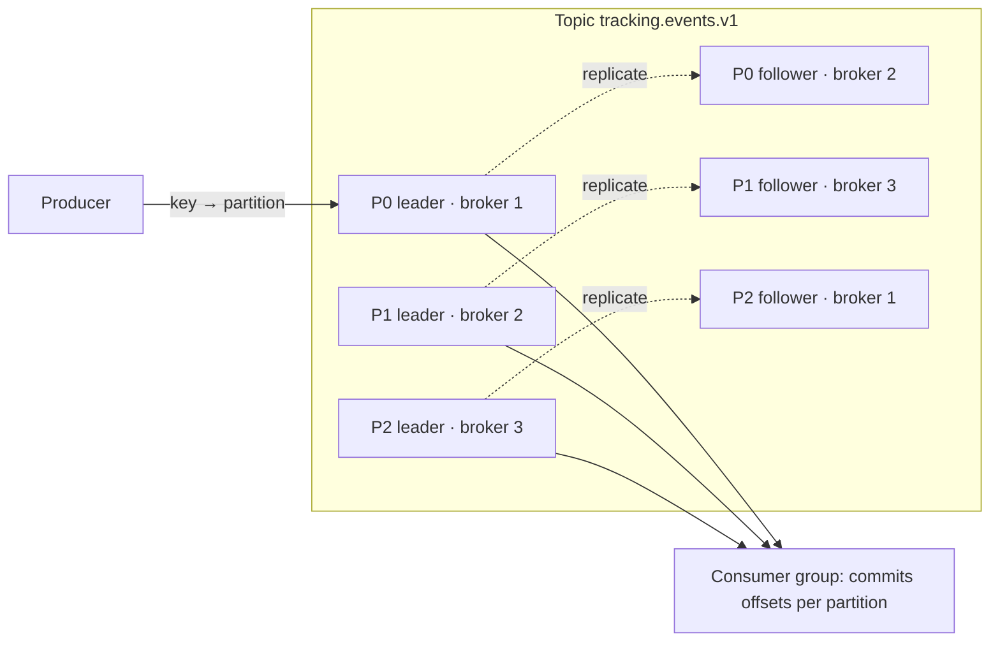

# 08a · Interview Q&A — Foundations, Guarantees, Kafka Internals (Q1–Q19)

> **Snapshot:** `sokrio-server` @ `master` · HEAD `d14c0ebb2` · written 2026-10-26.
> Paths are relative to `sokrio-server/`. Library paths are shortened to `phpkafka/…` = `vendor/longlang/phpkafka/src/…` (v1.2.5).
> Tags: `[CODE]` verified in app code · `[LIB]` verified in the vendored client · `[GENERAL]` industry knowledge · `[INFERENCE]` reasoned, needs a lab · `[ASSUMPTION]` best guess plus how to verify.
> Questions come from `../interview-questions.md` §1–§3 (wording unchanged). Sokrio examples reuse facts proven in sections 00–07; finding ids (F1–F24), conflicts (D1–D18) and runbooks (R1–R35) point back to those sections.

**How to use this file:** say the *Short answer* out loud in under 30 seconds. Then pick **one** Sokrio example and tell it as a story. Interviewers remember a real bug you found far longer than a textbook definition.

---

## 8.1 Foundations of messaging (Q1–Q5)

### Q1. Why use a message queue at all? What problems does it solve, and what new problems does it introduce?

**Short answer (30 seconds):**
A queue puts a buffer between "something happened" and "do the work". That gives you decoupling (the producer doesn't know or wait for consumers), async processing (fast responses), load leveling (absorb spikes and drain at a steady rate), fan-out, and retries. The price is eventual consistency, duplicates, ordering problems, harder debugging, and one more stateful system to run.

**Deep answer:**
- **Decoupling in time:** the producer and consumer don't have to be up at the same time. Decoupling in space: neither needs the other's address or deploy schedule.
- **Load leveling:** the queue soaks up a peak (for example 09:00 when every field rep opens the app), and consumers drain it at the rate the database can take. Without it, the peak goes straight into the DB.
- **Async UX:** return `202 Accepted` now and do the slow part later.
- **Fan-out:** one event, many independent consumers (reporting, notifications, search index).
- **Resilience:** if a downstream system is down, work waits in the queue instead of failing the user request.
- **New problems:**
  1. *Eventual consistency:* the read model lags the write.
  2. *Duplicates:* at-least-once delivery means consumers must be idempotent.
  3. *Ordering:* only within a partition or queue.
  4. *Dual writes:* DB + broker aren't atomic (Q10).
  5. *Poison messages and DLQs* (Q11).
  6. *Observability:* a request now spans processes, so you need correlation ids, lag and queue-age metrics.
  7. *Ops:* brokers need replication, disks, upgrades and alerting.

**Sokrio example:**
- `[CODE]` Tracking v1 publishes the GPS point and returns **202**, so the phone isn't blocked by MySQL + Mongo writes (`app/Http/Controllers/Tracking/TrackingController.php:62-83`). That is async UX plus load leveling.
- `[CODE]` Summary fan-out: the scheduler fires one command per hour (`app/Console/Kernel.php:149`) that dispatches one `SecondaryOrderSummaryJob` per active tenant onto the `summary` queue (`BaseCommand.php:50-70`, `SecondaryOrderSummary.php:33-36`). The queue spreads heavy Mongo rebuilds over workers instead of running them in the scheduler.
- The new problems are real here too: tracking inserts aren't idempotent (`WriteBulkTrackingActions.php:67-78`), observers dual-write inside transactions (F8), and nothing alerts on consumer lag or queue age (T6 §6.9).

**Follow-up questions the interviewer may ask:**
- When would you *not* use a queue? (When the caller needs the result now, e.g. a payment authorization; or when the volume is tiny and a cron + DB table is simpler.)
- How do you tell the user their async work finished? (Polling, WebSocket push, email. Sokrio uses Pusher for export progress.)
- What do you monitor on a queue? (Depth, age of the oldest message, consumer lag, DLQ size, processing time.)

**Common mistakes to avoid:**
- Listing only benefits. The interviewer is waiting for the costs.
- Saying "the queue guarantees delivery". It guarantees nothing you didn't configure (see acks=0, Q14).
- Using a queue to hide a slow DB query that should just be fixed.

---

### Q2. Explain point-to-point (queue) vs publish/subscribe (topic). Give a real use case for each.

**Short answer (30 seconds):**
Point-to-point: each message goes to **one** consumer out of a pool, for work distribution like sending an email or building a report. Pub/sub: each message goes to **every** subscriber, so one `OrderPlaced` event can feed inventory, billing and notifications independently. Kafka does both: consumers in the same group share the work (queue), and different groups each get every message (pub/sub).

**Deep answer:**
- **Queue semantics:** competing consumers; adding workers adds throughput; a message is "done" when one worker acks it.
- **Pub/sub semantics:** each subscriber has its own copy or its own cursor; subscribers are added without touching the producer.
- **RabbitMQ:** the exchange type decides (direct = routed to one queue, fanout = copies to every bound queue). Each bound queue is then point-to-point among its own consumers.
- **Kafka:** one log per topic; each **consumer group** keeps its own offsets, so groups are subscribers; partitions are split among members of a group, so members are competing consumers.
- **Redis:** `PUBLISH`/`SUBSCRIBE` is fire-and-forget pub/sub (no storage); lists (`LPUSH`/`BRPOP`) are a queue; Streams with consumer groups are both.

**Sokrio example:**
- `[CODE]` **Point-to-point:** every Laravel queue (`summary`, `default`, `order-approved`, `sequential`, `feature-tracking`). One `SecondaryOrderSummaryJob` is popped by exactly one worker via the Redis Lua pop (`vendor/…/Queue/RedisQueue.php:275-286`).
- `[CODE]` **Kafka, used as a queue today:** each topic has exactly one consumer group (`ConsumeCommand.php:97-107`: tracking = bare `KAFKA_GROUP`, others `{KAFKA_GROUP}-{topic}`). So `tracking.events.v1` has a single subscriber.
- **Pub/sub done right:** adding a second consumer of `departments.events.v1` (say, a search index) would just need a new group id. The producer (`DepartmentChangeObserver.php:26-46`) doesn't change. That's the main reason to keep departments on Kafka instead of a Laravel job.
- `[CODE]` **Pub/sub to browsers:** Pusher broadcasts (`ReportProgressUpdated`, `ReportNotification`) to the React app via `sokrio-app-frontend/src/lib/echo.ts`.

**Follow-up questions the interviewer may ask:**
- How do you get "each event processed once per service, but load-balanced inside the service"? (One consumer group per service.)
- In RabbitMQ, how do you add a new subscriber without changing the producer? (Bind a new queue to a fanout/topic exchange.)
- What happens to messages published before a subscriber existed? (Kafka: a new group can start from the earliest retained offset. RabbitMQ / Redis Pub/Sub: they're gone.)

**Common mistakes to avoid:**
- Saying "Kafka is pub/sub, RabbitMQ is a queue". Both can do both.
- Forgetting that more consumers than partitions in one Kafka group means idle consumers.

---

### Q3. What is the difference between a message *broker* and an event *log*? Why does that difference matter?

**Short answer (30 seconds):**
A broker (RabbitMQ, SQS, a Redis list) owns delivery state: it hands a message to a consumer and **deletes** it after the ack. A log (Kafka, Kinesis, Redis Streams) is an append-only file kept for a retention period; **consumers own their position** (offset) and can rewind. That matters because a log gives you replay, many independent readers and a history, while a broker gives you per-message routing, acks, priorities and delays.

**Deep answer:**

| | Broker | Log |
|---|---|---|
| After consumption | Deleted (acked) | Kept until retention or compaction |
| Who tracks progress | Broker (per message: unacked, redelivered) | Consumer (one offset per partition) |
| Replay | No (unless you re-publish) | Yes: reset offsets |
| Per-message ack / retry / delay | Yes | No: you commit a position, not a message |
| New reader later | Sees only new messages | Can read history |
| Ordering | Per queue | Per partition |
| Head-of-line blocking | No (other messages flow, one is redelivered) | Yes: one bad record blocks its partition (Q11) |

- Why it matters in design: for **event sourcing, CDC, rebuilding a read model, or adding a new consumer later**, you need a log. For **task distribution with per-task retries and delays**, a broker fits better.
- A log can't "retry just this one message" on its own. You build retry topics. A broker can't "replay last Tuesday" on its own. You build an archive.

**Sokrio example:**
- `[CODE]` Laravel's Redis queue is a broker: the job is deleted on success (`RedisQueue.php:305`), released back on retry (`:321`), and parked in `failed_jobs` (`config/queue.php:82-86`). There is no history once it's gone.
- `[CODE]` Kafka is the log. The consumer commits its own offset after each flush (`KafkaConsumer.php:301-339`, `autoCommit false :69`), so a crash replays the batch.
- Sokrio doesn't use the log's best feature yet. Departments publish full snapshots keyed by `department_id`, so a compacted `departments.events.v1` could rebuild the Mongo collection by replay. Today that job is the manual `tenant:department_sync_with_mongodb` (F1).

**Follow-up questions the interviewer may ask:**
- Is Redis Streams a broker or a log? (A log with consumer groups and a pending-entries list, so it has both a cursor *and* per-message acks.)
- Can you replay from RabbitMQ? (Classic queues no; RabbitMQ Streams yes.)
- What's the storage cost of a log? (Retention × throughput × RF.)

**Common mistakes to avoid:**
- Saying Kafka "deletes messages after they're consumed". It deletes by time/size, regardless of consumers.
- Treating a commit as a per-message ack. Committing offset 100 means "everything below 100 is done".

---

### Q4. Push vs pull consumption models. What are the trade-offs?

**Short answer (30 seconds):**
Push: the broker sends messages to the consumer as they arrive. That gives low latency, but the broker must avoid flooding a slow consumer, so RabbitMQ uses a prefetch window. Pull: the consumer asks for the next batch when it's ready. That gives natural flow control, easy batching and replay, at the cost of polling latency, which long polling mostly removes. Kafka is pull, RabbitMQ is push with prefetch.

**Deep answer:**
- **Push:**
  - (+) lowest latency; the broker can balance across consumers.
  - (−) the broker must track in-flight messages per consumer and apply flow control (`basic.qos` prefetch). A burst can overwhelm a consumer whose prefetch is too high.
- **Pull:**
  - (+) the consumer sets the pace (backpressure comes for free); it can fetch big batches for throughput; replay is just "fetch from offset X".
  - (−) an empty poll wastes a round trip, and naive polling with a sleep adds latency.
  - Kafka fixes this with **long polling**: `fetch.min.bytes` + `fetch.max.wait.ms` make the broker hold the request until data arrives or the wait expires.
- In practice both converge: push systems add credit windows; pull systems add long polls.

**Sokrio example:**
- `[CODE]` Kafka consumers **pull** in a loop (`KafkaConsumer.php:206-267`) and flush in batches. One side effect of pull in this PHP client: heartbeats ride on fetches, so a slow flush means no heartbeat and an eviction (F9, R3).
- `[CODE]` Laravel `queue:work` is also **pull**: it pops with a Lua script (`RedisQueue.php:275-286`), and when the queue is empty it sleeps. The 2024 worker config used `--sleep=3` `[HIST]`, so an idle worker can add up to ~3 s of latency to the first job after a quiet period.
- `[CODE]` Pusher is **push** to the browser (`sokrio-app-frontend/src/lib/echo.ts`), which is why export progress appears instantly without the UI polling.

**Follow-up questions the interviewer may ask:**
- How does Kafka avoid busy-polling? (Long poll with `fetch.max.wait.ms`.)
- How do you get backpressure with push? (Prefetch / credit-based flow control.)
- Why would a pull consumer be kicked out of its group? (It stopped polling for longer than `max.poll.interval.ms`; Q25 in 08b.)

**Common mistakes to avoid:**
- Saying pull is always slower. With long polling the latency is near push.
- Forgetting that push without a prefetch limit can OOM the consumer.

---

### Q5. What is backpressure, and how does each system (Kafka, RabbitMQ, Redis Streams) handle a slow consumer?

**Short answer (30 seconds):**
Backpressure is how a system pushes back when the consumer can't keep up, instead of falling over. Kafka just keeps the data on disk and lag grows; the producer isn't affected until retention deletes unread data. RabbitMQ keeps messages in the queue; when memory or disk hits its alarm, it **blocks publishers**. Redis keeps everything in RAM: a Stream or list grows until `maxmemory`, and then it either evicts or rejects writes. Pub/Sub just disconnects slow subscribers.

**Deep answer:**
- **Kafka:** the log is on disk and consumers pull, so a slow consumer only grows **lag**. Risks: lag passes retention → data deleted before it's read; lag means stale downstream data. Fix: more partitions + consumers, faster processing, or a bigger batch.
- **RabbitMQ:** prefetch caps in-flight messages per consumer. The queue grows; the memory high watermark or the disk free limit triggers an **alarm** that blocks every publishing connection (flow control). The producer feels it as slow or hung publishes. Quorum queues and lazy/stream storage push messages to disk to delay this.
- **Redis Streams:** `XADD` keeps appending in RAM; you cap with `MAXLEN`/`MINID` (which deletes unread data). Consumer groups track pending entries (PEL); a slow consumer grows the PEL.
- **Redis Pub/Sub:** no storage; if a subscriber's output buffer passes `client-output-buffer-limit pubsub`, Redis **disconnects** it and the messages are lost.
- **The design question** for any producer: when the system pushes back, does the request path **wait, fail, or fall back**?

**Sokrio example:**
- `[CODE]` Tracking chose **fall back, then fail fast**: if the publish fails, write synchronously; if that fails too, return **503 + `Retry-After: 5`** so the phone backs off (`TrackingController.php:70-81`, D9). That is backpressure surfaced to the client.
- `[CODE]` Redis OOM was hardened in commit `37840a3b5` and is tested (`tests/Unit/Kafka/KafkaProducerTest.php:231`). With `noeviction` (A9), a full Redis **rejects** `dispatch()` instead of evicting jobs.
- Risk: queues and cache share one Redis (DB0/DB1, `config/database.php:202-219`), so a cache spike can block job dispatch, and the Python benchmark also writes to DB0 (F20).
- `[CODE]` No lag or queue-age alert exists (T6 §6.9), so backpressure is invisible until users complain. This is Top-5 risk #5 (T7 §7.6).

**Follow-up questions the interviewer may ask:**
- What happens to a Kafka producer when the broker is slow? (`buffer.memory` fills, `send()` blocks up to `max.block.ms`, then throws.)
- How do you choose between dropping, blocking and buffering? (By the cost of losing vs delaying that data: GPS points can drop, payments can't.)
- How do you autoscale on backpressure? (Scale on lag or oldest-message age, not CPU.)

**Common mistakes to avoid:**
- Confusing backpressure with rate limiting. Rate limiting is a fixed policy; backpressure reacts to actual downstream capacity.
- Saying Kafka "has no backpressure problem". Lag past retention is silent data loss.

---

## 8.2 Delivery guarantees & correctness (Q6–Q11)

### Q6. Explain at-most-once, at-least-once, and exactly-once delivery. Which one is "default" in practice and why?

**Short answer (30 seconds):**
At-most-once: commit or ack **before** processing, so a crash loses the message but never duplicates it. At-least-once: process **then** commit, so a crash replays it, giving possible duplicates but no loss. Exactly-once: each message affects the outcome once. At-least-once is the practical default because losing data is usually worse than a duplicate, and duplicates can be made harmless with idempotent consumers.

**Deep answer:**
- The guarantee is a property of the **whole pipeline**, not one setting. Evaluate each hop: producer → broker (acks, retries), broker storage (replication), broker → consumer (when you commit), consumer → side effect (idempotency).
- **The weakest hop wins.** An at-least-once consumer behind a fire-and-forget producer is an at-most-once pipeline.
- "Exactly-once" in practice = **at-least-once delivery + idempotent processing** ("effectively-once").

**Sokrio example:** `[CODE]` the hop-by-hop proof from T2 §2.6:

| Hop | Guarantee | Proof |
|---|---|---|
| App → broker | At-most-once for broker-side errors (**acks=0**, F5) | `phpkafka/Producer/ProducerConfig.php:36`, `Producer.php:159-163` |
| Broker → handler | **At-least-once** (commit after `handleBatch`) | `KafkaConsumer.php:308-336` |
| Handler give-up path | At-most-once (log, then commit anyway) | `TrackingMessageHandler.php:96-106,141-157` |
| Departments effect | Effectively-once (idempotent `$set` upsert) | `DepartmentMessageHandler.php:87-112` |

One line for the interview: "Our consumer is at-least-once, but the pipeline was best-effort, because the producer was fire-and-forget by library default."

**Follow-up questions the interviewer may ask:**
- Where exactly do you commit in your consumer? (After the flush, with signals masked during the write: `KafkaConsumer.php:301-339`.)
- When is at-most-once the right choice? (Metrics, telemetry, anything where a gap is cheaper than a duplicate or a delay.)
- How do Laravel queues fit? (At-least-once: a job is retried until `tries`, and `retry_after` re-delivers a job whose worker died.)

**Common mistakes to avoid:**
- Naming one config flag as "the guarantee".
- Claiming exactly-once without explaining how the side effect is deduplicated.

---

### Q7. "Exactly-once delivery is impossible." Is this true? How does Kafka claim exactly-once semantics (EOS)?

**Short answer (30 seconds):**
Exactly-once **delivery** over an unreliable network is impossible: the sender can't tell a lost message from a lost ack (Two Generals). Exactly-once **processing** is achievable. Kafka does it with an idempotent producer (producer id + sequence numbers so the broker drops retried duplicates), transactions (atomic writes across partitions **including the consumer offset commit**), and consumers reading with `isolation.level=read_committed`. It only holds for read-from-Kafka → write-to-Kafka. Side effects outside Kafka still need idempotency.

**Deep answer:**
- **Idempotent producer:** the broker assigns a producer id (PID); each batch carries a per-partition sequence number. A retry with an already-seen sequence is acked but not appended. It covers one producer session, one partition. (Default on since Kafka 3.0.)
- **Transactions:** a `transactional.id` gives a stable identity across restarts (fencing zombie producers via an epoch). `beginTransaction` → produce to N partitions → `sendOffsetsToTransaction` (the consumer's progress) → `commitTransaction`. The transaction coordinator writes commit/abort markers.
- **Consumers** with `read_committed` only see records up to the Last Stable Offset (LSO), so aborted writes are skipped.
- **The boundary:** if your consumer writes to MySQL, Kafka's transaction doesn't include MySQL. Then you need idempotent writes (Q8), or store the offset in the same DB transaction as the result.

**Sokrio example:**
- `[LIB]` Sokrio has **neither** piece. The phpkafka producer sends `producerId = -1` (no idempotent producer), and nothing uses transactions (T2 library facts). The consumer writes to MySQL/Mongo, so Kafka EOS wouldn't cover it anyway.
- `[CODE]` Departments already get effectively-once the cheap way: a full-snapshot `$set` upsert keyed by `department_id` (`DepartmentMessageHandler.php:87-112`). Replays are harmless.
- `[CODE]` Tracking does not: plain inserts, no unique key (`2020_08_18_074138_create_trackings_table.php:18,24`). The fix is a natural key `(user_id, created_at)` + `insertOrIgnore`, **not** Kafka transactions (R5 interview angle).
- `[CODE]` The decoder drops `event_id` (`KafkaConsumer.php:360-364`), so even a dedup table would have nothing to key on today.

**Follow-up questions the interviewer may ask:**
- What does `isolation.level=read_uncommitted` show you? (Records of open or aborted transactions too.)
- What is a zombie producer and how is it fenced? (An old instance with the same `transactional.id`; the coordinator bumps the epoch and rejects the old one.)
- Cost of transactions? (Extra round trips, latency of commit markers, `read_committed` consumers wait on the LSO.)

**Common mistakes to avoid:**
- Saying "turn on `enable.idempotence` and you have exactly-once". It only dedups producer retries.
- Claiming EOS covers a database write or an HTTP call.

---

### Q8. What is an idempotent consumer? Show 3 ways to implement one.

**Short answer (30 seconds):**
An idempotent consumer gives the same result whether it processes a message once or five times. Three ways: (1) a dedup table with a unique `message_id`, inserted in the **same DB transaction** as the business change; (2) natural idempotency: write absolute state (`SET status='paid'`, upsert a snapshot) instead of deltas (`balance = balance + 100`); (3) conditional or versioned updates (`UPDATE … WHERE version = ?` or `WHERE status = 'pending'`).

**Deep answer:**
1. **Dedup / inbox table:** `processed_messages(message_id PK)`. In one transaction, `INSERT` the id (a duplicate-key error means "already done, skip") and apply the change. Needs a stable id from the producer, and a TTL or cleanup.
2. **Natural idempotency / upsert:** make the write a function of the message alone, e.g. `INSERT … ON DUPLICATE KEY UPDATE`, Mongo `updateOne(…, upsert)`, or a unique business key + `INSERT IGNORE`.
3. **Optimistic version / state guard:** only apply if the current state is the expected "before" state. It also protects against out-of-order delivery (an older version can't overwrite a newer one).
- Bonus: **store the offset with the result** (same DB transaction), then on restart seek to the stored offset. That's exactly-once into that DB.

**Sokrio example:** Sokrio has one of each pattern, plus one gap:
- `[CODE]` **Upsert (natural):** departments `$set` a full snapshot with `upsert` (`DepartmentMessageHandler.php:87-112`). Summaries use `updateOne` + `$set`/`$setOnInsert` + upsert (`app/Models/MongoDB/SummariesQuery.php:229-238`), so hourly re-runs are safe.
- `[CODE]` **State guard:** delayed `ApproveOrder` only acts on `pending()` orders (`app/Jobs/ApproveOrder.php:53`; primary `app/Jobs/PrimaryOrder/ApproveOrder.php:47`), so a double run after a `retry_after` re-delivery is harmless.
- `[CODE]` **Dedup key:** the Task Manager uses `Idempotency-Key` headers (`app/Support/Concerns/HandlesIdempotency.php`), the HTTP version of the inbox table.
- **Gap:** tracking inserts are not idempotent (Q7). Fix (T2 §2.7): unique `trackings(user_id, created_at)` + `insertOrIgnore`; in Mongo, a unique index + `ordered:false` insert that ignores E11000.

**Follow-up questions the interviewer may ask:**
- Why must the dedup insert be in the same transaction as the change? (Otherwise a crash between them either skips or double-applies.)
- How long do you keep dedup ids? (Longer than the max replay window: retention + redelivery time.)
- How do you make an email send idempotent? (Record "sent" before or atomically with the send, accept a rare duplicate, or use the provider's idempotency key.)

**Common mistakes to avoid:**
- Checking "does it exist?" then inserting, without a unique constraint. That's a race.
- Keying dedup on the Kafka offset. It changes if the message is re-published (a DLQ replay).

---

### Q9. How do you guarantee message ordering? Where does ordering break?

**Short answer (30 seconds):**
Kafka orders only **within a partition**, so you pick a key (say `order_id`) that sends all related events to the same partition, and process each partition with one thread. Ordering breaks with multiple partitions without a key, producer retries with `max.in.flight > 1` and no idempotence, parallel processing inside a consumer, DLQ or retry topics, partition-count changes, and side paths that bypass the log. RabbitMQ orders per queue with a single consumer; multiple consumers, requeues and prefetch break it.

**Deep answer:**
- **Producer side:** a retry of batch 1 after batch 2 succeeded swaps them. The idempotent producer fixes this (sequence numbers allow up to 5 in-flight safely); otherwise `max.in.flight.requests.per.connection=1`.
- **Partitioning:** `hash(key) % N`. Changing N remaps keys, so old and new events of one key live on different partitions until the backlog drains.
- **Consumer side:** a thread pool per partition, or async handlers, destroy order. Rebalances can replay a batch on a new owner.
- **Retry/DLQ:** a message parked in a retry topic is overtaken by later ones.
- **Defense in depth:** don't rely on order alone. Put a version or timestamp in the event and make the consumer reject stale updates (Q8, method 3).

**Sokrio example:** `[CODE]` from T2 §2.8:
- Keys: tracking = `user_id` (`TrackingController.php:62-83`), departments = `department_id` (`DepartmentChangeObserver.php:104-145`). The default would be tenant id (`KafkaProducer.php:58,76`, D4). It was overridden so one big tenant can't make a hot partition (R2 angle).
- Inside a flush, the handler groups by tenant (`TrackingMessageHandler.php:50-71`). Order between tenants changes, order within a key is kept.
- Where it breaks and doesn't matter: the tracking fallback writes directly while older points sit in Kafka (`TrackingController.php:70-71`). Reports sort by the device's `created_at`, so it's harmless.
- Where it breaks and **does** matter: the phantom event from a rolled-back transaction (F8). It isn't reordering, but Mongo keeps a state MySQL never committed.
- `[LIB]` The partitioner is `crc32(key) % N` (`phpkafka/Producer/Partitioner/DefaultPartitioner.php:48-53`), so going from 3 partitions to more remaps keys (§2.5).

**Follow-up questions the interviewer may ask:**
- Total order across all events? (One partition: kills parallelism. Usually you only need per-entity order.)
- How do you keep order but still retry? (Block the partition and retry in place, or send the entity's later events to the retry topic too.)
- Does a rebalance break order? (Not within a partition, but a batch may be processed twice, so you need idempotency.)

**Common mistakes to avoid:**
- Saying "Kafka guarantees order". Only per partition, and only if the producer and consumer don't break it.
- Using a random or null key and then expecting per-entity order.

---

### Q10. Explain the dual-write problem. Why is "save to DB then publish to Kafka" dangerous, and how does the Transactional Outbox pattern fix it?

**Short answer (30 seconds):**
A dual write updates two systems, the DB and the broker, with no shared transaction. If the app crashes after the commit but before the publish, the event is lost. If you publish inside the transaction and it rolls back, consumers see an event for a change that never happened. The outbox fixes it: write the event as a row in an `outbox` table **in the same transaction** as the business change, then a separate relay (a poller, or CDC like Debezium) publishes it and marks it sent. The relay is at-least-once, so consumers still need idempotency.

**Deep answer:**
- Two failure windows:
  - (a) publish **after** commit → crash or broker down in between → **lost event**;
  - (b) publish **before/inside** commit → rollback → **phantom event**.
- **Outbox:** one ACID transaction contains both facts. The relay reads unpublished rows in id order (`FOR UPDATE SKIP LOCKED` for parallel relays), publishes with acks, then sets `published_at`. A crash between publish and update gives a duplicate, never a loss.
- **CDC variant:** Debezium tails the binlog and publishes outbox inserts. No polling, no app code, but more infrastructure.
- **Cheaper partial fixes:**
  - `afterCommit` hooks close window (b) only.
  - A nightly reconciliation catches anything that slipped through.
- **Alternatives:**
  - Event sourcing (the log *is* the DB).
  - "Listen to yourself": publish first, and have the service update its own DB from the topic.

**Sokrio example:**
- `[CODE]` **Window (b) is live (F8):** `DepartmentBulkDataUpdateController.php:41-52` runs `->update()` per department inside `DB::beginTransaction()`. The `updated` observer publishes immediately (`DepartmentChangeObserver.php:35-46`). A rollback leaves Mongo with a territory MySQL never committed.
- `[CODE]` **Window (a) is live too:** with the broker down, the department publish is swallowed and logged (`app/Observers/Concerns/PublishesKafkaMessage.php:11-26`). There's no fallback, and the full resync is manual only (F1).
- `[CODE]` **A third form:** `Department::upsert()` bypasses observers entirely, so ERP codes never reach Mongo (F2, `DepartmentErpCodeSyncJob.php:71`).
- **Fix ladder** (T2 §2.2):
  1. `public $afterCommit = true` on the observer, a 10-minute change that kills phantoms.
  2. Schedule `DepartmentSync` nightly.
  3. A per-tenant `outbox_events` table + a `kafka:relay-outbox` relay with acks=1.
- Debezium is heavy here because every tenant has its own DB and binlog.

**Follow-up questions the interviewer may ask:**
- How do you keep the outbox table small? (Delete or partition published rows after N days.)
- Ordering with multiple relay workers? (Partition the relay by aggregate id, or use one relay per key range.)
- Does Laravel's `afterCommit` fix dual writes? (Only the phantom half; a crash after commit still loses the event.)

**Common mistakes to avoid:**
- Wrapping the publish in the DB transaction and calling it atomic.
- Forgetting that the relay can double-publish.
- Proposing 2PC/XA with Kafka. Kafka doesn't take part in XA.

---

### Q11. What is a poison message? How do you handle it without blocking the whole queue/partition?

**Short answer (30 seconds):**
A poison message fails every time, e.g. bad JSON, a missing field, or a bug in the handler. Retried forever, it blocks the queue, or in Kafka the whole partition, because offsets only move forward. Handle it with bounded retries and backoff, then move it to a dead-letter queue, alert, and replay after a fix. In Kafka you often add retry topics with delays (`orders.retry.5m` → `orders.dlq`) so the main partition keeps flowing.

**Deep answer:**
- **Classify errors first.** Transient errors (timeout, deadlock, broker not leader) → retry with exponential backoff and jitter. Permanent errors (validation, schema, unknown tenant, `TypeError`) → straight to the DLQ; retrying wastes time.
- **DLQ record:** the original payload + error, attempt count, source topic/partition/offset, timestamp, so it's replayable and debuggable.
- **Kafka specifics:** you can't "skip one and come back" inside a partition, so either block (strict order) or park it (order relaxed for that key).
- **RabbitMQ:** `x-dead-letter-exchange` + `x-delivery-limit` on quorum queues.
- **Laravel:** `$tries`/`$backoff`/`failed_jobs` + `queue:retry`.
- A DLQ is useless without an **alert, an owner and a replay tool** (R15 angle).

**Sokrio example:**
- `[CODE]` **Malformed envelopes:** warn, skip, commit (`KafkaConsumer.php:347-365`). The partition isn't blocked, but the message is gone.
- `[CODE]` **Handler failures:** 3 bulk retries with a linear sleep (`TrackingMessageHandler.php:85-116`) → per-point fallback (`:125-158`) → drop + `report()` + commit. A missing required key (`user_id, lat, long, address, created_at`, `WriteBulkTrackingActions.php:56-61`) costs ~3 s of sleeps and then a drop. Those sleeps also starve heartbeats (F9).
- **No DLQ topic exists.** The T2 §2.9 proposal: `tracking.events.v1.dlq` / `departments.events.v1.dlq` with acks=1, commit only after the DLQ write succeeds, classify errors before retrying, a `kafka:replay-dlq` command, and a "DLQ depth > 0" Slack alert.
- `[CODE]` **Laravel side:** `failed_jobs` exists (`config/queue.php:82-86`), but nothing alerts on it and `queue:prune-failed` isn't scheduled (T7). It's a DLQ nobody reads.

**Follow-up questions the interviewer may ask:**
- Retry topics vs blocking retries: when do you choose each? (Order matters per key → block; throughput matters → retry topics.)
- How do you avoid a retry storm when a downstream is down? (Backoff + circuit breaker; pause the consumer instead of DLQ-ing everything.)
- How do you replay the DLQ safely? (Idempotent consumers; replay in small batches; a fixed version of the code.)

**Common mistakes to avoid:**
- Sending transient errors to the DLQ (you'll DLQ everything during an outage).
- Committing the offset before the DLQ write is confirmed.
- Unbounded retries in the consumer loop.

---

## 8.3 Apache Kafka internals (Q12–Q19)

### Q12. Explain the Kafka architecture: broker, topic, partition, segment, offset, replica, leader, follower.

**Short answer (30 seconds):**
A **broker** is a Kafka server; a cluster is several. A **topic** is a named stream, split into **partitions**, which are ordered append-only logs and the unit of parallelism. Each partition is stored as **segment** files on disk. Every record has an **offset**, its position in the partition. Each partition has N **replicas** on different brokers: one **leader** takes all reads and writes, and **followers** copy from it and can take over if it fails.

**Deep answer:**

- **Segment:** a partition directory holds `0000…00.log` + `.index` (offset → byte position) + `.timeindex`. Only the **active** segment is written; old segments are deleted or compacted as whole files (Q18).
- **Offset:** a monotonically increasing 64-bit number per partition. Consumers commit "next offset to read" to the internal `__consumer_offsets` topic.
- **Leader / follower:** followers fetch from the leader like consumers do. Those that keep up form the **ISR** (Q14). The **controller** (KRaft quorum, Q17) picks new leaders.
- **Producers** pick the partition (key hash or sticky). **Consumers** in a group split partitions among themselves.

**Sokrio example:**
- `[CODE]` Two live topics: `tracking.events.v1` and `departments.events.v1`, with a `.{APP_ENV}` suffix outside prod (`app/Services/Kafka/TopicRegistry.php:18-24,51-58`).
- `[CODE]` Auto-created with **3 partitions, RF=1** (`config/kafka.php:74-75`, `TopicProvisioner.php:52-81`). So each partition has one replica, which is also the leader, with no follower to fail over to (A3 open: confirm with `kafka-topics.sh --describe`).
- `[CODE]` Brokers come from the `KAFKA_BROKERS` env var (`config/kafka.php:5`). Whether that's MSK or self-hosted is still A4 `[ASSUMPTION]`; the evidence leans self-hosted (T6).

**Follow-up questions the interviewer may ask:**
- Where are consumer offsets stored? (`__consumer_offsets`, a compacted internal topic.)
- Can a consumer read from a follower? (Yes since KIP-392, "fetch from closest replica", for cross-AZ cost.)
- What's the difference between a partition and a segment? (Logical ordered log vs physical file chunk.)

**Common mistakes to avoid:**
- Saying the topic is the unit of parallelism (it's the partition).
- Saying followers serve reads by default.

---

### Q13. Why is Kafka so fast? Explain at least 4 reasons.

**Short answer (30 seconds):**
(1) **Sequential disk I/O:** it only appends and reads in order, which disks and SSDs love. (2) **OS page cache:** it relies on the kernel cache instead of its own heap, so recent data is served from RAM. (3) **Zero-copy:** `sendfile` moves bytes from page cache to the socket without copying through user space. (4) **Batching + compression:** whole record batches are compressed once and stored and sent as is. (5) **Partitions** give horizontal parallelism. (6) A **dumb broker**: consumers track their own offsets, so there's no per-message state.

**Deep answer:**
- **Append-only log:** writes are O(1) appends. Reads are mostly the "tail" (page cache hits). Lookups use sparse indexes.
- **Page cache:** no double buffering, no GC pressure from a giant JVM heap, and the cache survives a broker process restart.
- **Zero-copy:** works because the on-disk format equals the wire format. Note: with **TLS** the broker must encrypt in user space, so zero-copy is lost. That's a classic follow-up.
- **Batching end-to-end:** the producer batches (`linger.ms`, `batch.size`), the broker stores the batch, and the consumer fetches batches. Compression (lz4/zstd) is per batch, so the ratio is good.
- **No per-message acks:** a commit is a single offset per partition.
- **Scale-out:** partitions spread load across brokers and consumers.

**Sokrio example:**
- `[LIB]` Sokrio's pure-PHP client uses only some of this:
  - **Batching yes:** `publishBatch` packs one `RecordBatch` per partition per call (F7 context).
  - **Compression no** (T2 library facts).
  - **Fetch:** partition `maxBytes = 0` (`phpkafka/Protocol/Fetch/FetchPartition.php:45`) probably means ~1 batch per fetch `[INFERENCE]`.
- At Sokrio's volume (GPS points from field reps), Kafka's speed isn't the bottleneck. The MySQL/Mongo writes in the handler are. That's why heartbeats starve during slow flushes (F9).
- If volume grows, `ext-rdkafka` (librdkafka) brings compression, a background heartbeat thread, an idempotent producer and proper offset tracking (T2 §2.10).

**Follow-up questions the interviewer may ask:**
- Why doesn't Kafka keep its own cache? (Page cache is cheaper and survives restarts.)
- What kills Kafka performance? (Lagging consumers reading old segments from disk (cold reads), too many partitions, TLS without zero-copy, tiny batches.)
- How does compression interact with batching? (Bigger batches give a better ratio; `linger.ms` trades latency for throughput.)

**Common mistakes to avoid:**
- Saying "Kafka is fast because it's in-memory". It's on disk, using the OS cache.
- Forgetting that the consumer side also batches.

---

### Q14. Explain ISR (In-Sync Replicas). How do `acks`, `replication.factor`, and `min.insync.replicas` work together to prevent data loss?

**Short answer (30 seconds):**
The ISR is the set of replicas that are caught up with the leader (within `replica.lag.time.max.ms`). `replication.factor` is how many copies exist. `acks=all` makes the leader wait until **every replica in the ISR** has the write. `min.insync.replicas` says how small the ISR may shrink before writes are refused. The safe classic is RF=3, min.insync=2, acks=all: you can lose one broker with zero data loss and still accept writes. If only one replica is in sync, producers get `NotEnoughReplicas` instead of silently writing a single copy.

**Deep answer:**
- **acks=0:** don't wait at all (fire-and-forget). **acks=1:** wait for the leader's local write; a leader crash before replication loses it. **acks=all (-1):** wait for the full ISR.
- `acks=all` alone isn't enough: if the ISR shrinks to just the leader, "all" = 1. `min.insync.replicas` closes that gap.
- **Why 3 / 2:** one broker down (or in a rolling restart) → ISR = 2 ≥ 2 → writes continue, two copies. Two down → writes rejected (availability given up for durability).
- RF=2 / min.insync=2 means any single broker restart blocks writes. RF=2 / min.insync=1 means a write can sit on one disk.
- Producer `retries` + idempotence make the retries after `NotEnoughReplicas` safe.

**Sokrio example:** Sokrio has the weakest combination possible:
- `[LIB]` **acks=0** (F5): the library default `ProducerConfig.php:36`, never overridden. `Producer.php:159-163` doesn't even read a response, so a broker-side rejection is invisible and the client got its 202.
- `[CODE]` **RF=1** auto-created topics (`config/kafka.php:74-75`): one broker disk loss = every unconsumed event gone. A broker restart = a produce outage. Tracking falls back to sync writes; departments lose events (R21, R25).
- **Fix ladder** (R1/R26 angle):
  1. `setAcks(1)` today, so rejections become errors the fallback can catch.
  2. RF=3, `min.insync.replicas=2`, acks=all once there are 3 brokers.
- This is Top-5 risk #2 (T7 §7.6).

**Follow-up questions the interviewer may ask:**
- What removes a replica from the ISR? (Not fetching up to the leader's LEO within `replica.lag.time.max.ms`, default 30 s.)
- With RF=3, min.insync=2, acks=1, can you lose data? (Yes: the leader acks, then dies before followers copy.)
- Does `min.insync.replicas` affect acks=1 producers? (No, it only applies to acks=all.)

**Common mistakes to avoid:**
- Saying acks=all means "all replicas". It's all **in-sync** replicas.
- Setting min.insync = RF (one broker restart stops writes).

---

### Q15. What is unclean leader election? What's the trade-off between availability and durability?

**Short answer (30 seconds):**
If every in-sync replica of a partition is down, Kafka can either wait for one of them to come back (durable but unavailable) or promote an **out-of-sync** replica (available again but missing the records it never copied, so those are lost and offsets may be reused). `unclean.leader.election.enable` controls this. It defaults to `false`, which favors durability. Turn it on only for data you'd rather lose than stall, like metrics.

**Deep answer:**
- Clean election: the new leader comes from the ISR, so it has every committed record (everything below the HW, Q16).
- Unclean: the new leader is behind. Records only the old leader had are truncated when it rejoins as a follower. Consumers that already read them saw data that no longer exists, and new records may get the same offsets.
- It's the CAP choice per topic: availability (unclean on) vs consistency/durability (off).
- Recent Kafka allows a per-topic override and, in KRaft, recovery tooling. ELR (Eligible Leader Replicas, KIP-966) tracks replicas that are safe to elect even after leaving the ISR.

**Sokrio example:**
- With **RF=1** (A3), unclean election is moot: there is only one replica. If that broker's disk dies, there's nothing to elect, clean or unclean. The data is gone, and the partition stays offline until the broker returns (R21).
- The availability side is covered in the app instead: tracking's sync fallback keeps the phone working while Kafka is down (`TrackingController.php:70-81`). Departments have no such cover (F1, R25).
- Recommended setting for Sokrio after moving to RF=3: keep unclean election **off** for `departments.events.v1` (state you report on). For `tracking.events.v1` it could arguably be on, since GPS gaps are tolerable, but with the request-path fallback it isn't needed.

**Follow-up questions the interviewer may ask:**
- How can you detect that data was lost after an unclean election? (Consumer offsets ahead of the log end → OFFSET_OUT_OF_RANGE; broker logs; metric `UncleanLeaderElectionsPerSec`.)
- What does the consumer do with OFFSET_OUT_OF_RANGE? (Applies `auto.offset.reset`. In Sokrio's library it jumps to latest−1 and silently skips the gap: F6, R27.)

**Common mistakes to avoid:**
- Thinking acks=all protects you if unclean election is on. It doesn't: the promoted replica may never have had the record.
- Forgetting that RF=1 makes the whole debate irrelevant.

---

### Q16. What is the High Watermark (HW) and Log End Offset (LEO)? Why can't consumers read beyond the HW?

**Short answer (30 seconds):**
LEO is the offset of the next record a replica will write: its own log end. The High Watermark is the highest offset that **all ISR replicas** have, so those records are "committed". Consumers can only read up to the HW. Records above it exist only on the leader so far, and if the leader died they could be truncated. Reading them would let a consumer see data that later disappears.

**Deep answer:**
- The leader tracks each follower's LEO from their fetch requests. HW = the minimum LEO across the ISR. Followers learn the HW in fetch responses.
- `acks=all` returns success when the HW passes the record, which is why acks=all + reads ≤ HW gives "if you read it, it survives a leader failover".
- After a failover, followers truncate to the new leader's state. Modern Kafka uses **leader epochs** (KIP-101) instead of the HW for this truncation, which fixed rare data-loss and divergence bugs.
- With transactions, `read_committed` consumers stop even earlier, at the **LSO** (Last Stable Offset): the first offset of a still-open transaction.
- Consumer lag = HW (or LSO) − committed offset.

**Sokrio example:**
- With RF=1 and one replica, the ISR is just the leader, so HW = LEO almost immediately. The HW gives no extra safety because there is nothing to replicate to.
- `[LIB]` The HW shows up in Sokrio's offset handling: OFFSET_OUT_OF_RANGE triggers a ListOffsets for "latest" (timestamp −1), which returns the **HW-based log end**. The library then uses `latest − 1` (`phpkafka/Consumer/OffsetManager.php:140,150`, F6).
- Lag monitoring (missing today, AL list in T6 §6.9) would compute HW − committed offset per partition, e.g. via `kafka-consumer-groups.sh --describe`.

**Follow-up questions the interviewer may ask:**
- Can the HW go backwards? (Not for consumers; leader-epoch truncation only removes uncommitted records above it.)
- How is lag calculated? (Log end/HW minus the committed offset, per partition.)
- What's the LSO and when does it matter? (`read_committed` + long-running transactions can stall consumers.)

**Common mistakes to avoid:**
- Mixing up HW and LEO (HW ≤ LEO on the leader).
- Saying consumers can't read beyond the HW "for performance". It's for consistency.

---

### Q17. ZooKeeper vs KRaft. What changed and why did Kafka remove ZooKeeper?

**Short answer (30 seconds):**
Kafka used to keep cluster metadata (brokers, topics, partition leaders, ACLs) in ZooKeeper, a separate system with its own ops burden, and one broker acted as controller, reading from it. KRaft moves metadata into Kafka itself: a small quorum of controller nodes runs the Raft protocol over an internal metadata log. That means one system to run, much faster controller failover, and support for far more partitions. ZooKeeper was deprecated in 3.x and removed in Kafka 4.0.

**Deep answer:**
- **ZooKeeper problems:**
  - A second distributed system to secure, monitor and upgrade.
  - Controller failover had to reload all metadata from ZK, which was slow with many partitions.
  - Metadata changes were pushed to brokers by RPC, so state could diverge.
  - The partition ceiling was in the low hundreds of thousands.
- **KRaft (KIP-500):**
  - Metadata is an event log (`__cluster_metadata`), replicated by Raft among controllers (3 or 5).
  - Brokers replay the log, so they're always up to date. A standby controller already has the state, so failover is near-instant.
  - Supports millions of partitions.
- **Timeline** `[GENERAL]`: KRaft production-ready in 3.3; ZK mode deprecated in 3.5; migration path in 3.6+; **Kafka 4.0 is KRaft-only**.
- **Ops changes:** `kafka-storage.sh format` with a cluster id; controller vs broker roles (combined mode for small clusters); clients connect to brokers only, as before (`--bootstrap-server`, not `--zookeeper`).

**Sokrio example:**
- Unknown for Sokrio: the broker version and mode aren't in any repo (no compose file provides Kafka, D15; A4 still open).
- `[LIB]` The client doesn't care: phpkafka talks only to brokers over the Kafka protocol (`KAFKA_BROKERS`, `config/kafka.php:5`).
- What would matter: the topic-creation path (`TopicProvisioner.php:52-81`) uses the CreateTopics API, which works in both modes. Any ops script still using `--zookeeper` flags would break on a 4.0 upgrade.
- For a new self-hosted cluster I'd pick KRaft, 3 combined nodes (or 3 controllers + 3 brokers). On MSK, AWS runs the controllers.

**Follow-up questions the interviewer may ask:**
- Why Raft and not ZAB/Paxos? (Raft is simpler, and the metadata log fits Kafka's own log model.)
- How many controllers? (3 tolerates 1 failure, 5 tolerates 2. An odd number for the majority quorum.)
- How do you migrate a ZK cluster? (Bridge release, dual-write migration mode, then switch controllers.)

**Common mistakes to avoid:**
- Saying KRaft removed the controller. It replaced the ZK + single controller with a controller quorum.
- Saying clients connect to ZooKeeper. Modern clients never did, apart from very old consumers.

---

### Q18. Explain log retention vs log compaction. Give a use case for a compacted topic.

**Short answer (30 seconds):**
Retention (`cleanup.policy=delete`) drops whole old segments once they pass a time (`retention.ms`, default 7 days) or size limit, whatever their keys. Compaction (`cleanup.policy=compact`) keeps **at least the latest record per key** forever and removes older values of the same key, so the topic becomes a snapshot of current state. A record with a `null` value (a tombstone) deletes the key. Use compaction for changelogs: user profiles, config, a cache rebuild source, or Kafka's own `__consumer_offsets`.

**Deep answer:**
- **Retention:** deletes are per segment, so data can live a bit longer than `retention.ms` (until the segment closes). Size-based retention is per partition.
- **Compaction:** a log-cleaner thread rewrites closed segments, keeping the newest offset per key. The active segment is never compacted. Offsets are preserved, so there are gaps. Tuning: `min.cleanable.dirty.ratio`, `min.compaction.lag.ms`.
- **Tombstones** are kept for `delete.retention.ms` (default 1 day), so slow consumers still see the delete, then removed.
- `compact,delete` combines both: latest per key, but nothing older than the retention.
- **Use cases:** current state per entity (a KTable source), CDC tables, rebuilding a cache or read model on startup, service config.

**Sokrio example:**
- `[CODE]` Both live topics use broker default retention (no `retention.ms` set, T2 §2.5).
- **Compaction fits departments perfectly.** Every message is a **full snapshot** (the observer `load()`s 8 relations, `DepartmentChangeObserver.php:111-125`), keyed by `department_id`, and the consumer does a full `$set` upsert (`DepartmentMessageHandler.php:87-112`). A compacted `departments.events.v1` *is* the department table. A new consumer, or a rebuilt Mongo collection, could replay it from offset 0. That would replace the manual full resync (F1).
- Caveat: a deleted department needs a tombstone (a `null` value), which the observer doesn't emit today (it only publishes on `created`/`updated`, `:26,:35`).
- Tracking is the opposite: an event stream with no "latest value" meaning, so time retention (3–7 days) is right.

**Follow-up questions the interviewer may ask:**
- Does compaction guarantee only one record per key? (No, only that the latest survives; duplicates remain in the dirty/active part.)
- Why can't you compact without keys? (Compaction is per key; null-key records are rejected on compacted topics.)
- How does `__consumer_offsets` use compaction? (Key = group + topic + partition, value = the latest offset.)

**Common mistakes to avoid:**
- Thinking compaction runs instantly or on the active segment.
- Forgetting tombstones expire. A consumer offline longer than `delete.retention.ms` misses the delete.

---

### Q19. How many partitions should a topic have? What are the costs of too many partitions?

**Short answer (30 seconds):**
Partitions cap consumer parallelism: one group can't use more consumers than there are partitions. Size from throughput: target throughput ÷ per-partition throughput (measured for both producer and consumer), with headroom for 1–2 years, because you can add partitions but never remove them, and adding them remaps keys and breaks per-key ordering for in-flight data. Too many partitions cost open files and memory on brokers, longer failover and rebalances, more producer buffers, and higher end-to-end latency.

**Deep answer:**
- **Rule of thumb:** `max(T/p, T/c)`, where T = target throughput, p/c = measured per-partition producer/consumer throughput. Add room for consumer scale-out.
- **Costs of too many:**
  - Per-partition file handles and memory (index files, replica fetchers).
  - Failover touches every leader on the failed broker.
  - Producer buffers per partition (smaller batches → worse compression).
  - More work in consumer rebalances.
  - Replication latency (acks=all waits on more fetchers).
  - KRaft raised the cluster-wide ceiling a lot, but per-broker costs remain.
- **Too few:** no room to scale consumers; hot partitions are harder to dilute.
- **Changing later:** `hash(key) % N` changes → per-key order across the boundary isn't guaranteed until the old backlog drains. Plan: create a new topic with the new count and migrate, or add partitions during a quiet period with the consumers caught up.

**Sokrio example:**
- `[CODE]` 3 partitions per topic (`config/kafka.php:74-75`). The real ceiling is lower: each stream runs **numprocs=1** (`README.md:178-212`), and the static `group.instance.id = ""` means a second process would **fence** the first (`KafkaConsumer.php:79-95`, D1, R22). So today parallelism is 1, not 3.
- To scale: give each process a unique instance id (e.g. hostname + process number), then run up to 3 per group.
- `[CODE]` Keying by `user_id` instead of `tenant_id` (D4) is what makes 3 partitions usable at all. Keyed by tenant, one big tenant would put most traffic on one partition.
- `[LIB]` If you go from 3 to more partitions, `crc32(key) % N` remaps users (§2.5). Tracking doesn't care (reports sort by device time). Departments care only while a backlog exists, so drain first.

**Follow-up questions the interviewer may ask:**
- Can you decrease partitions? (No. Create a new topic and migrate.)
- More consumers than partitions? (The extras sit idle as hot standbys.)
- How do you find a hot partition? (Per-partition lag and bytes-in metrics; key-skew analysis.)

**Common mistakes to avoid:**
- "More partitions = always faster."
- Adding partitions to a keyed topic in a hurry during an incident.
- Forgetting that the consumer process model (here: one PHP process, a static id) can cap parallelism below the partition count.

---

### ✅ Quality check
- [x] All 19 questions (Q1–Q19) answered with the exact 5 renderer labels from `README_2.md:227-231`
- [x] Every Sokrio example has a `file:line` already verified in MEMORY / sections 00–07, or says what Sokrio doesn't do and how it would
- [x] Reused the T2 §2.6–2.10 takeaways (Q6–Q11) and the T7 interview angles (R1, R2, R3, R5, R15, R21, R22, R25–R27)
- [x] `[GENERAL]` facts that depend on a Kafka version (KRaft timeline, idempotence default, ELR) labelled; Sokrio's broker version left unknown (A4)
- [x] `### Q<n>.` headings and the bold "Short answer" / "Deep answer" / … labels kept exact for the T11 renderer
- [x] No secrets: env var names only, no hosts or IPs
