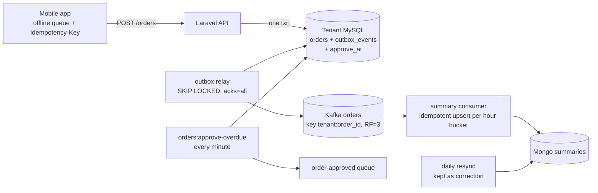
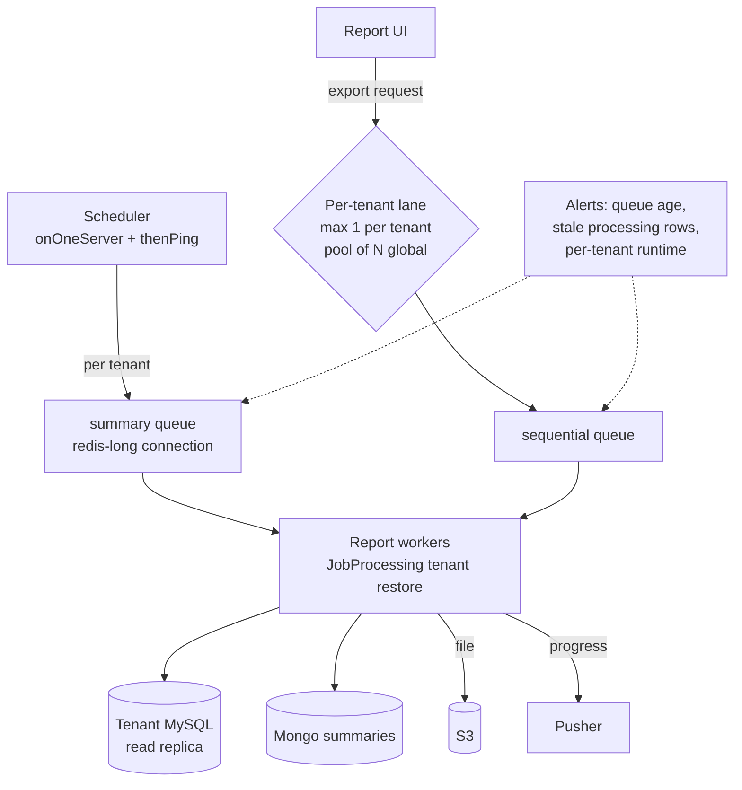
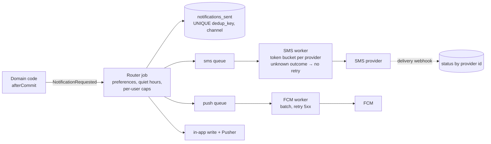

# 08e · Interview Q&A — Sokrio-Derived Questions, STAR Story, System Designs (Q82–Q106)

> **Snapshot:** `sokrio-server` @ `master` · HEAD `d14c0ebb2` · written 2026-10-26.
> Paths are relative to `sokrio-server/`. Framework paths are shortened to `vendor/…/X` = `vendor/laravel/framework/src/Illuminate/X` (Laravel 9.52.22); `phpkafka/…` = `vendor/longlang/phpkafka/src/…`.
> Tags: `[CODE]` verified in app code · `[LIB]` verified in vendored code · `[GENERAL]` industry knowledge · `[INFERENCE]` reasoned, needs a lab · `[ASSUMPTION]` best guess plus how to verify · `[NOTES]` from Komol's PR/blog notes · `[HIST]` deleted file, read from git history.
> Finding ids (F1–F24), conflicts (D1–D20), assumptions (A1–A11) and runbooks (R1–R35) point back to sections 00–07.

**How to use this file:** Q82–Q106 are **new questions**, not from `interview-questions.md`. Each one comes from a real bug or design choice found in Sokrio's code, so you can answer it with "here's what I found, here's why it happens, here's the fix". These are the questions that make you sound like someone who has run the system, not read about it. Where a topic is already covered in 08a–08d, the answer stays short and links back. §8.14 is the 2-minute STAR story. §8.15 holds three Sokrio-based system designs that go deeper than the generic Q69–Q71.

---

## 8.13 New questions from the Sokrio code (Q82–Q106)

### Q82. Your API returns 202 right after publishing to Kafka. How can that event still be lost?

**Short answer (30 seconds):**
If the producer runs with `acks=0`, "published" means "written to the local socket". The broker might reject it (topic missing, message too large, not leader) or crash before writing it, and the producer never hears back. The client already got a 202. Even with `acks=1`, a leader that dies before followers copy the record loses it. A 202 is only honest when the producer waits for `acks=all` with `min.insync.replicas ≥ 2`, or when the event is first written to a durable outbox.

**Deep answer:**
- The loss windows, from weakest to strongest setting:
  - `acks=0`: socket buffer, network, broker rejection, broker crash. No error reaches the app.
  - `acks=1`: leader crash before replication.
  - `acks=all` + minISR 2: lost only if every in-sync replica dies at once.
- The fallback trap: application fallbacks ("if publish fails, write to the DB") only fire on errors the producer **sees**. With `acks=0` most failures are invisible, so the fallback never runs.
- What to measure: produce error rate and record-error rate; a reconciliation count (events produced vs rows written downstream per hour).

**Sokrio example:**
- `[LIB]` phpkafka defaults to `acks=0` (`phpkafka/Producer/ProducerConfig.php:36`) and Sokrio never calls `setAcks()`. With `acks=0` the library doesn't read a response at all (`phpkafka/Producer/Producer.php:159-163`). This is F5 / R26.
- `[CODE]` The tracking controller returns **202** after the publish call (`app/Http/Controllers/Tracking/TrackingController.php:62-83`). Its fallback (write to MySQL directly, or 503 + Retry-After 5) only covers transport errors such as a refused connection.
- `[CODE]` A code comment assumes a stronger setting: `WriteTrackingActions.php:26-28` accepts a "lost-ack duplicate", which can only happen when the producer waits for acks. Line to use: "the comment was written for acks=1, the config is acks=0."
- `[INFERENCE]` Fix order: `setAcks(1)` now (one line, small latency cost), `-1` once there are replicas (RF=3), outbox for departments.

**Follow-up questions the interviewer may ask:**
- What does `acks=1` cost in latency? (One round-trip to the leader per batch, usually a few ms inside a VPC.)
- How would you prove events are being lost today? (Compare per-hour counts: tracking rows written vs accepted 202s logged by the API.)
- Does an idempotent producer need `acks=all`? (Yes; Kafka requires `acks=all` for idempotence.)

**Common mistakes to avoid:**
- Treating "no exception from publish" as "the broker has it".
- Adding broker replicas and assuming durability while the producer still uses `acks=0`.
- Writing a fallback that can only fire on errors the client never receives.

---

### Q83. A Kafka consumer was down for longer than the topic's retention. What offset does it start from when it comes back, and what about a brand-new consumer group?

**Short answer (30 seconds):**
The committed offset now points at data that's been deleted, so the broker returns `OFFSET_OUT_OF_RANGE`, and the client applies `auto.offset.reset`: `earliest` (start at the oldest data still kept), `latest` (skip to the end) or `none` (fail). A brand-new group has no committed offset at all, so the same policy decides where it starts. Either way it's a **silent** jump unless you log and alert on it. Know your client's default; don't assume.

**Deep answer:**
- Java client default: `latest`. Many teams set `earliest` for pipelines that must not skip data.
- `earliest` after an outage: reprocesses everything still in retention, so handlers must be idempotent.
- `latest` after an outage: no duplicates, but the gap is gone. For a stream like GPS that might be acceptable; for master data it isn't.
- Detect: log the reset with old and new offsets, alert on it, and alert on lag well before retention runs out (lag in time > 50% of retention).

**Sokrio example:**
- `[LIB]` phpkafka has **no `auto.offset.reset` setting** (F6, R27):
  - New group → `max(committed, 0)` → offset **0**, i.e. earliest (`phpkafka/Consumer/OffsetManager.php:107`).
  - Out of range → asks for the latest offset and starts at `latest − 1` (`OffsetManager.php:140,150`, `phpkafka/Consumer/Consumer.php:345,364`). So a long outage silently skips the gap.
- `[CODE]` That makes the two cases opposite: a new replay group reads **everything** from offset 0 (08b: set offsets with the CLI before the first start), while an old group that fell off the end reads **nothing** of the gap.
- `[CODE]` For departments the gap is permanent until someone runs the manual `tenant:department_sync_with_mongodb` (F1). Retention is the broker default `[ASSUMPTION]` 7 days.

**Follow-up questions the interviewer may ask:**
- How do you replay a topic for one consumer without affecting others? (A new group id with explicit offsets, or `kafka-consumer-groups --reset-offsets --to-datetime` on a stopped group.)
- How do you alert before you fall off the end? (Time lag vs retention; also disk-based retention can delete sooner than the time setting.)
- Why `latest − 1` and not `latest`? (Library detail; it re-reads the last record, which is harmless only if handlers are idempotent.)

**Common mistakes to avoid:**
- Assuming the library default matches the Java client.
- Not logging offset resets, so nobody knows data was skipped.
- Setting `earliest` on a non-idempotent consumer.

---

### Q84. Your Kafka client tracks the next offset by counting messages instead of reading each record's offset. What can go wrong?

**Short answer (30 seconds):**
Kafka offsets aren't guaranteed to be contiguous (compaction, transaction markers, and a fetch can return a whole record batch that starts **before** the offset you asked for). If the client assumes "next offset = last committed + messages I've seen", it can commit an offset that doesn't match the record it actually processed. After a restart mid-batch, the broker sends the whole batch again from its base offset, the client counts from there, and you get duplicates at the head and skipped records at the tail. Always commit `record.offset + 1` from the record itself.

**Deep answer:**
- Kafka returns data in **record batches**; a fetch at offset 105 can return a batch whose base offset is 100. Clients must skip records below the requested offset.
- Gaps happen with compacted topics, transactional control records and aborted transactions.
- A counting client stays correct only while it never restarts mid-batch and the log has no gaps.
- Test it: produce one batch of 10, consume 4, commit, restart, and check which records come next.

**Sokrio example:**
- `[LIB]` `[INFERENCE]` F7 / R28: phpkafka never reads `RecordBatch::$baseOffset` and advances by count (`phpkafka/Consumer/Consumer.php:321,351-353`); Sokrio's own cursor also does `+1` per message (`app/Services/Kafka/KafkaConsumer.php:279-294`).
- `[INFERENCE]` The producer packs **one record batch per partition per `sendBatch`**, so a v2 bulk tracking publish is one batch. A commit in the middle of it (flush at 200 messages), then a restart, means the broker returns the whole batch → the first records are duplicated and the same number of later records are skipped.
- `[INFERENCE]` Not proven yet; it's a T9 lab. In an interview, say exactly that: "I found it by reading the client, I haven't reproduced it yet, here's the lab I'd run."

**Follow-up questions the interviewer may ask:**
- Does the Java client have this problem? (No; it uses each record's offset and filters records below the fetch position.)
- How would you work around it without changing the library? (Flush only at batch boundaries, or make tracking writes idempotent so duplicates don't matter; skips would remain.)
- Why do topics without compaction still have gaps? (Transaction markers, and in practice not often; that's why the bug can hide.)

**Common mistakes to avoid:**
- Assuming offsets are dense.
- Trusting a less-used client's correctness without a test of restart behaviour.
- Claiming a bug is real before reproducing it.

---

### Q85. Your Kafka client only sends heartbeats when it fetches. How does that change the way you design batch processing?

**Short answer (30 seconds):**
With a background heartbeat thread, slow processing only has to beat `max.poll.interval.ms` (5 minutes by default). Without one, every second spent processing is a second with no heartbeat, so the real limit is `session.timeout.ms` (often 10–45 s). So you cap each flush by **time**, not just by count: small batches, short retries, a time budget per flush, and any slow work moved out of the consumer.

**Deep answer:**
- Budget = session timeout minus a safety margin (e.g. 30 s → plan for 20 s).
- Inside a flush: retries with sleeps count against the budget; per-item fallbacks multiply it.
- Watch out for slow dependencies (one tenant's DB), GC pauses, and large payloads.
- Options: process in a coroutine runtime that can heartbeat (Swoole), a client with a background thread (`rdkafka`), or hand work to a queue and commit after enqueue.
- Overlaps Q78 (rebalance loop) and 08b's "effective poll budget" framing.

**Sokrio example:**
- `[LIB]` F9: outside Swoole, phpkafka uses a `NoopTimer` and only heartbeats from the fetch path (`phpkafka/…/KafkaUtil.php:45-53`, `Consumer.php:292-294,421-427`). Session timeout is 30 s.
- `[CODE]` A tracking flush can retry 3 times with sleeps (1 s + 2 s, `TrackingMessageHandler.php:85-116`) and then fall back to writing up to 200 points one by one (`:125-158`). With a slow tenant DB that crosses 30 s → eviction → the commit is swallowed (`KafkaConsumer.php:329-335`) → the batch is replayed. Tracking writes aren't idempotent, so that means duplicate rows.
- `[INFERENCE]` Cheapest fix: a 15-second time budget per flush (stop early, commit what's done), plus a unique key on tracking rows so replays are harmless (Q102).

**Follow-up questions the interviewer may ask:**
- Why not just raise `session.timeout.ms`? (Broker caps it with `group.max.session.timeout.ms`, and a dead consumer is detected later.)
- How do you see this in production? (Rebalance logs correlated with slow flush durations; the same offsets processed twice.)
- Would Swoole fix it? (The library supports Swoole timers for heartbeats; it's a bigger runtime change than a time budget.)

**Common mistakes to avoid:**
- Using `max.poll.interval.ms` as the processing budget with a client that doesn't heartbeat in the background.
- Retrying with `sleep()` inside a consumer.
- Measuring batch size by count only.

---

### Q86. What does `group.instance.id = ""` mean in a Kafka consumer, and why can it stop you from scaling out?

**Short answer (30 seconds):**
`group.instance.id` turns on **static membership**: the broker identifies the member by that id, so a restart with the same id gets its partitions back without a rebalance. An empty string is still an id. If two processes use the same id, the newer one **fences** the older one (`FENCED_INSTANCE_ID`), the older one rejoins and fences the newer one, and they ping-pong. So you can only run one consumer per id; to scale, each process needs its own id, such as host plus process number.

**Deep answer:**
- Dynamic membership (no instance id): every restart = leave + join = rebalance.
- Static membership: restarts within `session.timeout.ms` don't rebalance. Great for rolling deploys and planned recycles.
- Rules: id unique per process, stable across restarts of the **same** process slot (e.g. `${HOSTNAME}-${process_num}`).
- Trade-off: a dead static member holds its partitions until the session timeout passes.

**Sokrio example:**
- `[CODE]` `KafkaConsumer.php:79-95` sets `group.instance.id` to `""`. The notes said that meant dynamic membership (D1); the code says it's **static** membership under the id "". The code comment at `:92-94` even describes the FENCED ping-pong you'd get with two processes.
- `[CODE]` That's why every Supervisor program has `numprocs=1` (`README.md:178-212`). Topics have 3 partitions (`config/kafka.php:74-75`) but real parallelism is 1.
- `[CODE]` Static membership was a sensible choice for the 6 h self-recycle (`config/kafka.php:70`): the restarted process takes its partitions back with no rebalance.
- `[INFERENCE]` Fix: build the id from `gethostname()` and Supervisor's `%(process_num)s` (passed as an env var), then raise numprocs to 3. R22.

**Follow-up questions the interviewer may ask:**
- What happens if a static member dies for good? (Its partitions sit idle until `session.timeout.ms` expires, then a rebalance.)
- Static membership vs cooperative rebalancing? (Different problems: static avoids rebalances on restart; cooperative makes the rebalances you do have cheaper. Use both.)
- How did you find this? (Reading the consumer code and the library's join request, then the comment that described the ping-pong.)

**Common mistakes to avoid:**
- Assuming an empty string means "not set".
- Copying one consumer config to several processes with the same static id.
- Scaling consumers beyond the partition count.

---

### Q87. Some writes to your table don't fire model events, so the change never reaches Kafka. How do you find and close every bypass?

**Short answer (30 seconds):**
ORM events (Eloquent observers, Hibernate listeners) only fire for writes that go through a loaded model. Bulk `upsert()`, `insert()`, query-builder `update()`/`delete()`, raw SQL, migrations, other services and manual DB fixes all skip them. Find them with a search for the bulk methods on that model and its table name, then close them in one of three ways: write an outbox row explicitly at each bulk site, move publishing to CDC (the binlog sees every committed write), or add a scheduled reconciliation that compares source and copy.

**Deep answer:**
- Search list: `::upsert(`, `::insert(`, `->update([` on a query, `DB::table('x')`, `DB::statement`, `->delete()` on a query, `truncate`.
- Each bypass is a **dual-write gap** (T2 §2.2): the source changed and the copy didn't.
- Defence in depth:
  1. Outbox at the bulk sites (accurate, needs discipline).
  2. CDC (catches everything, more infra).
  3. Nightly reconciliation (cheap, catches drift whatever the cause).
- Also: observers fire **inside** the transaction, so they can publish changes that are later rolled back (F8); use `$afterCommit` or the outbox.

**Sokrio example:**
- `[CODE]` F2: `DepartmentErpCodeSyncJob.php:71` uses `Department::upsert()`, which bypasses `DepartmentChangeObserver`. `erp_code` is part of the Mongo document (`app/Models/MongoDB/Department.php:71,213`), so ERP codes **never** reach Mongo through Kafka.
- `[CODE]` `VanSystemController.php:98,138,152` also uses `->update()` on a query, but the field it changes (`van_sales_enabled`) isn't in the Mongo document, so it's harmless. Saying that shows you checked impact, not just syntax.
- `[CODE]` The reverse problem, F8: `DepartmentBulkDataUpdateController.php:41-52` updates inside a transaction, so the observer publishes before commit; a rollback leaves a phantom event already applied in Mongo.
- `[CODE]` The only repair is manual (`tenant:department_sync_with_mongodb`, F1). Scheduling it nightly is the cheapest safety net (T7 Top 5 #2).

**Follow-up questions the interviewer may ask:**
- Why not make the bulk job loop and `save()` each model? (It works, but it's slow for big imports; an explicit outbox insert per batch is faster.)
- How does CDC handle the ERP case? (It sees the `UPDATE` in the binlog regardless of how it was issued.)
- What's the risk of a nightly full resync? (Load on MySQL/Mongo, and it overwrites changes that arrive during the run unless it's version-aware.)

**Common mistakes to avoid:**
- Assuming observers fire for every write.
- Fixing one bypass and not searching for the rest.
- No reconciliation, so drift is only found by a customer.

---

### Q88. A job implements `ShouldBeUnique` but sets no `uniqueId()` and no `uniqueFor`. What happens?

**Short answer (30 seconds):**
Laravel builds the unique lock key from the job class plus `uniqueId()`. With no `uniqueId`, the key is the **class name alone**, so the job is unique across the whole application: every other dispatch of that class, for any tenant or input, is silently dropped while one is pending or running. With no `uniqueFor`, the lock has no expiry, so if the job dies without releasing it, the class can't be dispatched again until someone clears the lock. Always set a `uniqueId` that matches the real unit of work and a `uniqueFor` longer than the job's worst-case run.

**Deep answer:**
- The lock is taken at **dispatch** (`dispatch()` returns without queuing if it can't get the lock) and released when the job finishes or fails.
- The lock lives in the **cache store**, not the queue, so cache prefix and eviction matter.
- The opposite bug: a `uniqueId` that is different every time (a random number) makes uniqueness a no-op.
- Test: dispatch twice with different inputs and assert both are queued.

**Sokrio example:**
- `[CODE]` F11 / R29: `app/Jobs/Stock/BulkStockImportJob.php:30` is `ShouldBeUnique` with no `uniqueId` and no `uniqueFor`. `BulkStockBatchImportJob` dispatches it in a loop for 30k-row chunks (`:20,104-107`). Chunk 2 onwards, and every other tenant's import, is **silently dropped** while chunk 1 holds the lock. Reproduced in the T4 Redis lab.
- `[CODE]` The opposite bug, F3: `SecondaryOrderSummaryJob::uniqueId()` appends `rand(1000,9999)` (`:40-43`), so the lock never matches and duplicates run. Harmless there because the summary upsert is idempotent, but it shows uniqueness wasn't tested.
- `[CODE]` Good example in the same codebase: `FlushFeatureEventsJob` sets `uniqueFor = 300`, longer than its `timeout = 240` (MEMORY T4).
- `[INFERENCE]` Fix for F11: `uniqueId = org_id + upload_id + startingRow` and `uniqueFor = 3600`. One line each.

**Follow-up questions the interviewer may ask:**
- Where is the lock key stored and with what prefix? (Default cache store; and in Sokrio the web and worker prefixes differ, F12, so a lock taken in a request may never be released by the worker.)
- `ShouldBeUnique` vs `ShouldBeUniqueUntilProcessing`? (The second releases the lock when processing starts, so a new dispatch can queue while the first runs.)
- How do you find stuck unique locks? (Look for `laravel_unique_job:*` keys with no TTL.)

**Common mistakes to avoid:**
- Adding `ShouldBeUnique` to a job that is dispatched once per chunk or per tenant without a `uniqueId`.
- No `uniqueFor`, so a crash locks the job out forever.
- Generating random ids "to be safe".

---

### Q89. Your web requests and your queue workers use different cache key prefixes. What breaks?

**Short answer (30 seconds):**
Anything that is **written by one process type and read or deleted by the other**. A lock or "in progress" flag set in a request is invisible to the worker that should clear it; a cache invalidation in a worker misses the key the web reads; a unique-job lock taken at dispatch (in the web) is never released (by the worker). Symptoms are stale data and features stuck "busy" until a TTL expires. Fix by giving cross-process keys a fixed, explicit prefix, or by making the prefix depend on data in the payload (tenant id) instead of on the process type.

**Deep answer:**
- Typical cross-process keys: job locks, rate-limit or "export running" guards, cache entries invalidated on model events, `queue:restart` signal.
- Tenant-scoped prefixes are good for isolation, but must be set the same way in every process that touches the key.
- Test: one test that dispatches from an HTTP request and runs the job in a worker context, then asserts the guard is cleared.

**Sokrio example:**
- `[CODE]` F12 / R35: `ScopeCacheToTenant` (`app/Http/Middleware/ScopeCacheToTenant.php:37-76`) prefixes the cache with `{CACHE_PREFIX}:tenant_N|landlord:` **only in HTTP**. Workers, the scheduler and Kafka consumers use the bare prefix. Leaks found:
  - **Export guard:** `ReportCacheMacro` sets a guard in 16 controllers; 17 jobs try to remove it under a different prefix → users get 429 until the 3600 s TTL (`app/Support/Macros/ReportCacheMacro.php:24-57`).
  - **Unique locks** dispatched from HTTP are never released by the worker (today `KPISummary` via `Admin/DailyReportController.php:81`, 24 h).
  - **Org cache:** `Org::updated` forgets only the current namespace (`Org.php:45-48`), so a deactivated tenant can still pass `EnsureTenantAccess` until the TTL.
- `[CODE]` The correct template already exists: `SmsResendRun` clones the cache store with a fixed prefix (`:24-25,197-214`).

**Follow-up questions the interviewer may ask:**
- Why did nobody notice? (Every symptom heals itself when the TTL expires, so it looks like "slowness" or "try again later".)
- How would you find all affected keys? (Search for `Cache::put`/`add`/`lock` in HTTP code and `Cache::forget`/`release` in jobs for the same key names.)
- Should jobs set the tenant prefix too? (Yes, from the payload's tenant id; that's the root fix with the `JobProcessing` listener from Q91.)

**Common mistakes to avoid:**
- Setting global state like a cache prefix in middleware and assuming it applies everywhere.
- Long TTLs on guard keys, which turn a bug into an hour-long outage.
- Testing only within one process type.

---

### Q90. The same Redis command works with one PHP client and silently returns nothing with another. How do you protect against client-specific behaviour?

**Short answer (30 seconds):**
Redis clients don't share an API shape: argument order, how options are passed, cursor types and return values differ (for example `SCAN` in phpredis takes the cursor by reference and options differently from Predis). Code written and tested against one client can run without errors on the other and simply do nothing. Protect yourself by pinning the client in config, running the tests against the **same client as production**, wrapping unusual commands in one helper with a test per client, and alerting on "this job did zero work" when zero is unlikely.

**Deep answer:**
- Common differences: `SCAN`/`SSCAN` cursor handling, `SET` options, pipelines and transactions, exceptions vs `false` returns, serialization.
- Mocks hide it: a mocked Redis returns what you told it, in the shape you expected.
- A cheap guard: a smoke test in CI against a real Redis with each supported client.

**Sokrio example:**
- `[CODE]` F14 / R30: `Redis::scan($cursor, 'MATCH', …)` in `FlushFeatureEventsJob.php:68` and `PurgeFeatureTrackingLeaderboards.php:38` uses the **Predis** argument style. Under **phpredis** it finds 0 keys (reproduced in the T4 lab), so feature analytics buffers would never flush to Mongo. No error, no log.
- `[CODE]` Why tests are green: `FlushFeatureEventsJobTest.php:46-48` mocks the Predis `scan` shape.
- `[CODE]` Which client runs in prod is unknown (A7, urgent). Hints point to phpredis: Laravel's default (`config/database.php:195`), the README tells devs to set `REDIS_CLIENT=phpredis` (`README.md:43,85`), and `[HIST]` the 2024 worker image ran `pecl install redis`.
- `[CODE]` A tested fix that works on both: pick the start cursor by client (`null` on phpredis, `'0'` on predis) and pass options as an array, `Redis::scan($cursor, ['match' => $match, 'count' => 50])`. That found 120/120 keys on each client in the T9 lab. A `null` start alone breaks predis (`ERR invalid cursor`, D21).
- `[INFERENCE]` The 10-second check: does Mongo `feature_usage_events` have rows from the last day? Yes → the flush works.

**Follow-up questions the interviewer may ask:**
- Why would anyone run two clients? (Dev machines without the extension use Predis; prod has phpredis. That's exactly how drift starts.)
- How do you alert on "silently does nothing"? (Emit a metric for keys flushed per run; alert when it's zero for a day.)
- `KEYS` would have worked on both; why not use it? (It blocks Redis on big keyspaces; `SCAN` is right, it just needs the right shape.)

**Common mistakes to avoid:**
- Mocking the client in the only test of the code that talks to it.
- Leaving `REDIS_CLIENT` unset or different between environments.
- Treating "no error" as "it worked".

---

### Q91. A queued job uses a model from tenant A, but when it runs, the model is loaded from tenant B's database. How is that possible?

**Short answer (30 seconds):**
Laravel's `SerializesModels` stores only the model class, id and connection **name**. When the worker unserializes the job, it re-queries the model **before** your `handle()` runs. In a database-per-tenant app, the connection name is the same (`tenant`) for every tenant, and it still points at whichever tenant the previous job switched to. So the model is fetched by id from the wrong database: you get another tenant's row with the same id, or nothing. Fix it by restoring tenant context before unserialize (a `JobProcessing` listener reading the tenant id from the payload), or by passing ids plus the tenant and loading models after switching.

**Deep answer:**
- The order of operations in the worker: pop → fire `JobProcessing` → unserialize command (restores models) → `handle()`.
- Anything that sets the tenant inside `handle()` is too late for constructor models.
- Any long-lived process with a "current tenant" global has the same class of bug: state leaks from one unit of work to the next.
- Test it with **two** tenant databases, because a single-tenant test suite can't see it.

**Sokrio example:**
- `[LIB]` F16 / R31: restore happens before `handle()` (`vendor/…/Queue/SerializesAndRestoresModelIdentifiers.php:104-108`, `SerializesModels.php:62-88`, `CallQueuedHandler.php:60`), and `TenantManager` sets the `tenant` connection config globally, so it persists across jobs (`TenantManager.php:96-99`).
- `[CODE]` Reproduced with two SQLite DBs in the T5 lab: dispatched Alice (tenant A) → the job received Bob (tenant B, same id).
- `[CODE]` Live sites: `BatchTransferJob.php:35`, `PreInventoryTransferJob.php:34`, `BulkPrimaryPaymentActions.php:30`, `BulkProductBatchImportJob.php:34`. The last one emails `$this->user` (`:142`), so a failure email can go to **another tenant's user**. That's why it's #1 in the T7 Top 5.
- `[CODE]` The house style avoids it: 119 of 127 jobs pass `Org` (a landlord model, fine to restore) plus ids, and reconnect in `handle()`. The golden example is `SendApprovalNotificationJob.php:34-68`.
- `[CODE]` Root fix: a provider-level `JobProcessing` listener that reads `payload()['tenant_id']` and reconnects; that event fires **before** unserialize (`vendor/…/Queue/Worker.php:412` → `:425`).

**Follow-up questions the interviewer may ask:**
- Why didn't tests catch it? (One tenant DB in tests, `TenantManager::reconnect()` is a no-op in `testing`, and the sync queue runs in the same tenant, T5 §5.6.)
- What else leaks between jobs? (Auth user, `app('tenant')`, static caches; worker auth is never reset, T5 §5.5.)
- Would Horizon fix it? (No; same worker internals.)

**Common mistakes to avoid:**
- Passing tenant-DB models into job constructors.
- Switching tenant inside `handle()` and assuming it covers everything.
- A single-tenant test suite for a multi-tenant system.

---

### Q92. A long-running consumer caches tenant metadata in memory. A tenant is deactivated. How long until the consumer notices?

**Short answer (30 seconds):**
Until the process restarts or the cache entry expires, whichever comes first, and an in-process cache usually has no expiry. Long-lived processes need the same freshness rules as request-scoped code: a TTL on in-memory caches, an explicit check of business state (like `active`) on each use, or an invalidation event the consumer listens to. Otherwise "deactivated" means "deactivated in the web app only".

**Deep answer:**
- Layers of staleness add up: process cache (hours) + shared cache TTL (hours) + any upstream lag.
- Options: a TTL'd in-memory map (e.g. 5 min), reading from the shared cache each time (cheap for Redis), or subscribing to `tenant.updated` events (a GlobalKTable-style copy, 08c Q55).
- Decide what the consumer should do with a deactivated tenant's messages: drop, park, or still process (sometimes data must still be accepted).

**Sokrio example:**
- `[CODE]` F18: both Kafka handlers cache `Org` in a process array (`TrackingMessageHandler.php:33,162`, `DepartmentMessageHandler.php:23,160-180`) for the life of the process, up to the 6 h recycle (`config/kafka.php:70`), and never check `active`. A deactivated tenant is still consumed for up to 6 h.
- `[CODE]` The code comment says the process cache "does not change freshness"; it does, because 6 h is longer than the 2.8 h Redis TTL (D14). And the Redis TTL itself is `60*24*7` **seconds** ≈ 2.8 h, not the "week" the comment claims (D12, `Org.php:57,72`).
- `[CODE]` Related, F17: `EnsureTenantAccess` stamps `tenant_id` into job payloads (`:56-58`), but the listener that would use it is registered only in the HTTP process (`:60-64`), so it's dead on workers.
- `[INFERENCE]` Fix: a 5-minute TTL on the in-process map plus an `active` check before writing.

**Follow-up questions the interviewer may ask:**
- Is it a security issue? (It can be: data for a suspended customer keeps flowing into their DB; usually a billing/compliance issue, not a breach.)
- How do you test it? (Deactivate a tenant in a test, push a message, assert it's dropped or parked.)
- Why cache at all? (One landlord lookup per tenant per batch is cheap; the cache saves little, so a short TTL costs almost nothing.)

**Common mistakes to avoid:**
- In-process caches with no TTL in daemons.
- Trusting code comments about TTLs without doing the arithmetic.
- Checking tenant status only at the HTTP edge.

---

### Q93. You split one server into separate web and worker VMs. What breaks first?

**Short answer (30 seconds):**
Everything that assumed "same machine": files written to the local disk by the web and read by a job, file-based caches and sessions, scheduled tasks that might now run on several boxes, and locks taken through a local driver. Each fails silently in a different way. Before splitting: move file handoffs to object storage, move cache/session/locks to a shared store, run the scheduler on exactly one box (or use `onOneServer()`), and write down which box runs which queue.

**Deep answer:**
- Checklist:
  1. File handoffs → S3 (claim check, Q62).
  2. `CACHE_DRIVER=file` / `SESSION_DRIVER=file` → Redis or DB.
  3. Scheduler → one box, or `onOneServer()` with a shared cache.
  4. `withoutOverlapping()` and locks → shared cache store.
  5. Per-box config drift → config in the repo, deploys that restart every box.
  6. Queue routing → each box's `--queue` list documented.

**Sokrio example:**
- `[CODE]` F19 / R32: `BulkStockController.php:58-62,88` stores the upload on the `local` disk; `BulkStockBatchImportJob.php:23,36-38` (queue `default`) reads it. On another VM: a warning and a silent return. `[INFERENCE]` It depends on which boxes consume `default` (A10); the README's feature-tracking worker consumes `default` too (`README.md:173`).
- `[CODE]` Sokrio already has separate prod, queue and report servers (deploy workflows `ci-cd.yml`, `queue-worker-deploy.yml`, `prod-report-deploy.yml`, T6).
- `[CODE]` Scheduler: guarded by `RUN_SCHEDULER` (`app/Console/Kernel.php:113-117`), with no `onOneServer()` anywhere. Safe only while exactly one box sets it (Q103).
- `[CODE]` Defaults to watch: `config/cache.php:21` defaults to `file`, `config/session.php:21` defaults to `file`. Prod is very likely Redis for cache (A6).
- `[CODE]` Export jobs are fine: they write and read temp files within the same job.

**Follow-up questions the interviewer may ask:**
- Why not a shared NFS/EFS mount? (It works, but adds latency and a failure mode; S3 is simpler for handoffs.)
- How do you find all local-file handoffs? (Search for `Storage::disk('local')` / `storage_path` in controllers and the same paths in jobs.)
- What about uploaded files the user downloads later? (Same: S3 with signed URLs.)

**Common mistakes to avoid:**
- Testing the split with web and workers still on one box.
- Leaving the scheduler enabled on every new VM from the same image.
- No record of which box consumes which queue.

---

### Q94. Exports run one at a time across the whole platform, coordinated by a DB row marked `processing`. A worker is killed mid-export. What happens next?

**Short answer (30 seconds):**
The row stays `processing` forever, because only the job itself clears it (on success or in `failed()`), and a killed process runs neither. Every later export, for every tenant, waits behind a job that no longer exists. A status flag without an owner and an expiry is a lock with no lease. Fix: store `started_at` and treat a `processing` row older than the job's max runtime as dead, run the "kick" often, and make the lane per tenant (or a small pool) so one customer can't block everyone.

**Deep answer:**
- Any "single runner" built on a DB status needs: owner id, heartbeat or start time, a timeout, and a recovery path that re-queues or fails the stuck item.
- `failed()` runs on exceptions and on max-attempts, **not** on SIGKILL/OOM. Recovery on a crash comes from the queue's lease (`retry_after`) re-delivering the job, if the queue still has it.
- Fairness: a global lane means one tenant's huge export delays everyone (noisy neighbour, R18).

**Sokrio example:**
- `[CODE]` `[INFERENCE]` F24 / R34: `SequentialJob` is a **landlord** model (`app/Models/Core/SequentialJob.php:18`), and `SequentialJobDispatcher` returns early if **any** row is `processing` (`app/Support/Dispatcher/SequentialJobDispatcher.php:15,21-23`). The row is cleared only by the export job's own update or `failed()` (e.g. `ProcessOrderSummaryExportJob.php:125,138-149`).
- `[CODE]` After a SIGKILL: the job comes back after `retry_after` = 9000 s (2.5 h), and with `tries=1` it fails, which finally clears the row. If Redis lost the reserved job (restart without persistence), the row is stuck forever. The `sequential:jobs` kick runs every 4 h (`Kernel.php:160`) and does the same "is anything processing?" check, so it doesn't help.
- `[CODE]` Also F15: `SequentialJobDispatcher.php:31` calls `$candidate->lockForUpdate()` without executing a query, so there's no row lock at all (Q95).
- `[INFERENCE]` Fix: `started_at` + "stale after 2 × max timeout", kick every 5 minutes, per-org lane or a pool of N.

**Follow-up questions the interviewer may ask:**
- Why not a Redis lock with a TTL instead? (Fine for the "one runner" part; the DB row is still useful for the user-facing queue and history. Use both, with the TTL as the lease.)
- How would you alert on it? (A query: any `processing` row older than 2 h → Slack.)
- How do you pick the pool size? (Report DB capacity; start with 2–3 concurrent exports, per-tenant cap of 1.)

**Common mistakes to avoid:**
- Relying on `failed()` for crash recovery.
- Global serialization when per-tenant serialization is what you need.
- A recovery job that uses the same broken check as the dispatcher.

---

### Q95. Code calls `lockForUpdate()` but the row is never locked. How can that happen, and how would you catch it?

**Short answer (30 seconds):**
In Laravel (and most query builders) `lockForUpdate()` only adds `FOR UPDATE` to a query **that still has to run**. Calling it on an already-loaded model returns a new query builder, which is then thrown away, so no SQL is sent and no lock is taken. The code looks safe and isn't. Catch it by checking the query log in a test (assert a `select … for update` was executed), by static analysis rules for unused return values, and by a concurrency test with two connections.

**Deep answer:**
- Correct pattern: `Model::whereKey($id)->lockForUpdate()->first()` inside a transaction.
- The lock lasts until commit; outside a transaction it's released immediately (autocommit).
- Tests: two connections, one holds the lock, the other must block (or use `NOWAIT`/`SKIP LOCKED` and assert the result).

**Sokrio example:**
- `[CODE]` F15: `app/Support/Dispatcher/SequentialJobDispatcher.php:31` calls `$candidate->lockForUpdate()` on an already-fetched model; the returned builder is discarded, so no `SELECT … FOR UPDATE` runs.
- `[CODE]` Why it hasn't hurt yet: the dispatcher is also wrapped in a `Cache::lock` (`:15`, 10 s), and the later `UPDATE` takes an InnoDB row lock anyway (T5 §5.4). So it's 🟢: a misleading line, not an incident. Saying "I rated it low and here's why" is a good interview signal.
- `[INFERENCE]` A related trap in the same family: F13, a Redis lock released before the DB commit (Q73). Both are "the lock is not where the commit is".

**Follow-up questions the interviewer may ask:**
- `FOR UPDATE` vs `LOCK IN SHARE MODE`? (Exclusive vs shared row lock; share mode lets others read-lock but not update.)
- What does `SKIP LOCKED` give you? (Workers can claim different rows without waiting; ideal for an outbox relay or job table.)
- How do you avoid deadlocks with row locks? (Lock rows in a consistent order, keep transactions short.)

**Common mistakes to avoid:**
- Calling `lockForUpdate()` outside a transaction.
- Trusting code review to spot an unused return value.
- Using a cache lock and a DB lock together without knowing which one actually protects the data.

---

### Q96. Your Kafka client only supports SASL PLAIN. How does that limit your managed-Kafka options?

**Short answer (30 seconds):**
Managed Kafka services each expect certain auth mechanisms. Amazon MSK supports IAM (needs a SASL/OAUTHBEARER-style signer in the client), SASL/SCRAM, mTLS and unauthenticated TLS inside a VPC; MSK Serverless requires IAM. Confluent Cloud uses SASL PLAIN with API keys over TLS. A client that only speaks PLAIN can't use MSK IAM, SCRAM or Serverless; on MSK it's limited to TLS without client auth (network-level security) or mTLS if the client supports client certificates. Check the client's capabilities before you pick the platform.

**Deep answer:**
- Questions to ask of any client: TLS? client certs? SASL mechanisms (PLAIN, SCRAM-SHA-256/512, OAUTHBEARER, GSSAPI)? idempotent producer? compression codecs?
- Switching clients in PHP: `rdkafka` (librdkafka) supports all of the above but needs a C extension in every image.
- Security in a VPC without SASL: security groups, private subnets, TLS in transit; it's acceptable for many teams but auditors may ask for per-client identity.

**Sokrio example:**
- `[LIB]` F21: `longlang/phpkafka` implements SASL **PLAIN only** (`phpkafka/Sasl/PlainSasl.php:27`, `Client/SyncClient.php:203-211`). TLS is available via `setSsl` (`Config/CommonConfig.php:197-216`), and Sokrio's custom socket calls `parent::connect()`, so TLS would still work (`Socket/StreamSocket.php:270,277-279`).
- `[CODE]` Today there's no TLS or SASL in the Kafka config at all (A4), consistent with a self-hosted broker on a private network.
- `[INFERENCE]` So MSK IAM and MSK Serverless are out; MSK with a TLS listener inside the VPC (or mTLS) is the path (T6 §6.4, §6.12). It's also an argument to evaluate `rdkafka` before any MSK move, together with F5/F7/F9.

**Follow-up questions the interviewer may ask:**
- Is SASL PLAIN insecure? (Only without TLS; over TLS it's fine and is what Confluent Cloud uses.)
- What does mTLS give you over TLS-only? (Per-client identity for ACLs.)
- Would you switch the client? (Probably yes before a managed migration: it fixes heartbeats, offsets and auth together; cost is the extension and a re-test of the consumer loop.)

**Common mistakes to avoid:**
- Choosing the managed service first and discovering the client gap during cut-over.
- Assuming every client supports every SASL mechanism.
- Running PLAIN without TLS.

---

### Q97. After enabling a profiler, your Kafka consumers start reconnecting and producers fail randomly. What's going on?

**Short answer (30 seconds):**
Sampling profilers often use timer **signals**. When a signal arrives while the process is blocked in a system call like `select()` or `connect()`, the call returns early with `EINTR` ("interrupted system call"). Well-written C libraries retry on `EINTR`; a socket layer that treats every error as fatal will close the connection. So the profiler breaks the network code it's observing. Fix: retry the interrupted call, and turn the profiler off for long-running consumers if you don't need it there.

**Deep answer:**
- Signals that cause this: profiler timers (`SIGPROF`, ~100 Hz), `SIGALRM` from timeouts, `SIGCHLD`.
- PHP specifics: `stream_select()` and `stream_socket_client()` can fail with EINTR; with `pcntl_async_signals(true)` PHP handlers can run between opcodes.
- How to recognise it: error text containing "Interrupted system call" or errno 4, errors correlated with an agent being enabled.

**Sokrio example:**
- `[CODE]` R23: Datadog's continuous profiler interrupted phpkafka's blocking socket calls → spurious reconnects and failed publishes. Sokrio wrote `InterruptResilientStreamSocket` that retries interrupted calls (`app/Services/Kafka/Socket/InterruptResilientStreamSocket.php:36-83,85-116`), wired into the producer (`KafkaProducer.php:51`), with a unit test (`tests/Unit/Kafka/InterruptResilientStreamSocketTest.php:88-116`).
- `[CODE]` The consumers also run with `DD_PROFILING_ENABLED=false` and `DD_TRACE_CLI_ENABLED=false` **per Supervisor program**, not container-wide (`README.md:214-226`), so scheduled artisan commands keep tracing.
- Interview line: "an observability agent broke the thing it was observing; the fix was to treat EINTR as retryable, the way C libraries do."

**Follow-up questions the interviewer may ask:**
- Why not just turn the profiler off everywhere? (You lose production profiling for the web app; scoping it is better.)
- What's the risk on a library upgrade? (The upgrade might replace the socket class and remove the fix; keep the test and an upgrade checklist.)
- How do signals interact with DB reads? (See Q98.)

**Common mistakes to avoid:**
- Treating `EINTR` as a dead connection.
- Debugging only the network when errors line up with a deploy of an agent.
- Disabling an agent globally to fix one process type.

---

### Q98. A deploy sends SIGTERM to your PHP consumer in the middle of a MySQL write. What can go wrong, and how do you shut down safely?

**Short answer (30 seconds):**
With async signals enabled, PHP can run your signal handler in the middle of any operation, including reading a MySQL response. If the handler (or shutdown code it triggers) touches the same connection, the protocol stream is torn: "Packets out of order", "server has gone away", and a half-written batch. Safe pattern: the handler only sets a flag; block signals around the critical section (`pcntl_sigprocmask`); check the flag between batches; then flush, commit and leave the group. Make sure the platform's stop timeout is longer than your longest flush.

**Deep answer:**
- Same idea as interrupts in C, or `consumer.wakeup()` in Java: no I/O in the handler.
- Masking delays delivery until unmasked, so a long flush delays shutdown. Supervisor's `stopwaitsecs` (or ECS's 120 s max stop timeout) then decides whether you get SIGKILL.
- After SIGKILL, everything since the last commit is replayed, so idempotent handlers still matter.

**Sokrio example:**
- `[CODE]` R24: `KafkaConsumer.php:309-319` blocks SIGTERM/SIGINT with `pcntl_sigprocmask(SIG_BLOCK)` around `handleBatch` and unblocks after; the shutdown flag is checked between polls, and the consumer flushes before exiting (`:262-266`).
- `[CODE]` Supervisor gives it `stopwaitsecs=35` (`README.md:178-212`). A flush longer than 35 s still ends in SIGKILL and a replay (R9). That's the same 30-second budget as F9 (Q85), so a 15 s flush budget fixes both.
- `[CODE]` For `queue:work`, Laravel handles SIGTERM itself (`vendor/…/Queue/Worker.php:675-681`: quit after the current job). The equivalent risk there is a job longer than `stopwaitsecs`.

**Follow-up questions the interviewer may ask:**
- What happens on ECS? (SIGTERM, then SIGKILL after at most 120 s; long jobs must be chunked first, T6 §6.7.)
- Why not `pcntl_async_signals(false)` and `pcntl_signal_dispatch()` manually? (Also valid; you call dispatch at safe points. Masking gives the same result with async signals kept for other code.)
- How do you test graceful shutdown? (Send SIGTERM mid-batch in an integration test and assert the batch was committed once.)

**Common mistakes to avoid:**
- Doing cleanup I/O inside the signal handler.
- A `stopwaitsecs` shorter than the longest batch or job.
- Assuming a graceful shutdown means no replays ever.

---

### Q99. Your consumer restarts itself every 6 hours on purpose. Why would you do that, and what does it cost?

**Short answer (30 seconds):**
Long-running PHP processes slowly accumulate memory and stale state (leaks in libraries, in-process caches, old config). A planned recycle (finish the batch, commit, exit 0, let Supervisor restart it) caps that drift without monitoring memory precisely. The cost: a short pause in consumption, a rebalance unless you use static membership, and replays if the exit isn't clean. It's the same idea as `queue:work --max-time` / `--max-jobs`.

**Deep answer:**
- Good recycle = drain → commit → leave group (or rely on static membership to skip the rebalance) → exit 0.
- Pair it with a memory cap (exit if RSS > N MB) for faster protection.
- Don't recycle every instance at the same moment (jitter), or the whole group pauses together.
- Recycling also picks up new code, which is why deploys must still restart processes explicitly.

**Sokrio example:**
- `[CODE]` `config/kafka.php:70` sets a 6 h max runtime (21 600 s); the consumer flushes, commits and exits at the deadline (`KafkaConsumer.php:123,229-231,256-258`). Git history: `6486a0607` "6h runtime".
- `[CODE]` Static membership (Q86) is what makes this cheap: the restarted process gets its partitions back without a rebalance.
- `[CODE]` The hidden cost: in-process caches live exactly as long as the process, so the recycle period becomes a freshness bound (F18, Q92). 6 h is longer than the Redis Org TTL.
- `[CODE]` `ConsumeCommand.php:70-73` falls back to 3600 s if the config is missing.

**Follow-up questions the interviewer may ask:**
- How do you know it's leaking at all? (Log RSS per flush; a steady climb means a leak, a plateau means fine.)
- Why not fix the leak instead? (You should if you find it; the recycle is the safety net for leaks in libraries you don't own.)
- What if the recycle happens mid-batch? (It doesn't here: it's checked between polls, after a flush.)

**Common mistakes to avoid:**
- Recycling with `exit(1)`, which Supervisor may count as a crash.
- Forgetting that in-process caches inherit the recycle period as their TTL.
- Restarting all consumers at once.

---

### Q100. Your consumer decodes the event envelope but throws away `event_id` and `occurred_at`. What can't you do anymore?

**Short answer (30 seconds):**
Without `event_id` you can't deduplicate: redeliveries and replays become duplicate rows, and "exactly once" is off the table at the consumer. Without `occurred_at` you lose event time: you can't order late events correctly, can't window by when things happened (only when they arrived), and can't measure end-to-end latency. Both fields are cheap to carry through, and they're the foundation for idempotency, ordering and observability.

**Deep answer:**
- Idempotency options need a key: `event_id` in a processed table, or a natural key (Q102).
- Ordering per key: `occurred_at` or a version lets you drop stale updates (Q60).
- Latency SLOs: now − `occurred_at` at the consumer is the most honest freshness metric.
- Debugging: `event_id` in logs ties the producer's log line to the consumer's.

**Sokrio example:**
- `[CODE]` The producer builds a proper envelope with `event_id`, `event_type`, `occurred_at` and `tenant_id` (`KafkaProducer.php:93-102`), but the consumer's decode drops `event_id` and `occurred_at` (`KafkaConsumer.php:360-364`). Handlers also ignore `event_type` and branch only on topic (T7).
- `[CODE]` Consequences already seen in this file: tracking replays from F9/F7 can't be deduplicated (Q84, Q85); 08c Q57's line "exactly-once starts at the producer" also depends on this.
- `[INFERENCE]` Fix: pass the full envelope to handlers (one decode change), log `event_id` on failures, and store it in a unique column where dedup matters.

**Follow-up questions the interviewer may ask:**
- Where should `event_id` be generated? (At the producer, once per business event, so a producer retry reuses it.)
- How long do you keep processed ids? (Longer than the replay window; with Kafka, at least retention.)
- `occurred_at` from the device or the server? (Both: device time for business meaning, server time to detect bad clocks.)

**Common mistakes to avoid:**
- Designing a good envelope and then not using it.
- Generating `event_id` in the consumer.
- Measuring lag only in offsets, never in time.

---

### Q101. When publishing to the broker fails, should the request fall back to writing the data synchronously? When is that right and when is it wrong?

**Short answer (30 seconds):**
A synchronous fallback is right when the data matters, the write path is idempotent, and the system can absorb the extra latency for a while: you trade speed for not losing data. It's wrong when the fallback hits the same overloaded resource, when it creates a second write path with different behaviour (now you have two code paths to keep consistent), or when it can produce duplicates you can't detect. Always bound it: a timeout, then fail honestly (503 + Retry-After) so the client retries.

**Deep answer:**
- Questions to ask: does the fallback write the **same** thing the consumer writes? Is it idempotent with the async path (will a later replay duplicate it)? Does it hold a DB connection during an incident that's already stressing the DB?
- Alternatives: a local outbox table (publish later), a client-side retry with Retry-After, or an on-disk spool.
- Consistency: make fallback and consumer call the **same** action class.

**Sokrio example:**
- `[CODE]` Tracking v1: publish → on failure `WriteTrackingActions` (MySQL + Mongo) → if that fails too, 503 + `Retry-After: 5` (`Tracking/TrackingController.php:62-83`; D9 corrects the blog, which said "always 202"). Tracking v2 does the same with `WriteBulkTrackingActions` (MySQL transaction, best-effort Mongo, `V2/Tracking/TrackingController.php:52-78`, `WriteBulkTrackingActions.php:67-82`).
- `[CODE]` Good: the consumer and the fallback use the same action classes, so the data has the same shape.
- `[CODE]` Weak spots: the fallback can't fire on broker-side loss with `acks=0` (Q82); and the Mongo half is best-effort, so the fallback itself is a small dual write.
- `[CODE]` Departments have **no** fallback (D11, R25): a broker outage loses the event with only a log line.

**Follow-up questions the interviewer may ask:**
- Why not just return 503 and let the phone retry? (Phones on bad networks may retry late or never; the fallback keeps more points. For a desktop admin action, 503 is fine.)
- What's the latency cost? (The full MySQL + Mongo write in the request; acceptable only during broker incidents.)
- How do you notice the fallback is firing all the time? (A metric or log counter per minute, with an alert.)

**Common mistakes to avoid:**
- A fallback that writes something different from the main path.
- No limit on fallback time, so the API hangs during an outage.
- Having a fallback for low-value data and none for master data.

---

### Q102. GPS points are processed at least once. How do you make the write idempotent when the events have no unique id downstream?

**Short answer (30 seconds):**
Use a **natural key**: one device can't produce two fixes for the same user in the same second, so `(user_id, created_at)` identifies a point. Add a unique index on it and insert with "ignore duplicates" (`INSERT IGNORE` / `insertOrIgnore` in MySQL, `ordered:false` and ignore E11000 in Mongo). Replays then do nothing. If the natural key isn't reliable, carry the producer's `event_id` and put the unique index on that.

**Deep answer:**
- Check the natural key against real data first (count duplicates per `(user_id, created_at)`), and decide the precision (seconds vs milliseconds).
- Adding a unique index to a big existing table: deduplicate first, then build the index online (MySQL 8 `ALGORITHM=INPLACE`, or a tool like gh-ost / pt-online-schema-change).
- Bulk inserts with ignore keep the batch fast; a per-row upsert is slower.

**Sokrio example:**
- `[CODE]` `trackings` has no unique key, only an index on `user_id` and on `(created_at, user_id)` (`database/migrations/2020_08_18_074138_create_trackings_table.php:18,24`). Writes are plain inserts (`WriteBulkTrackingActions.php:67-78`), so every replay (F9 eviction, F7, SIGKILL past `stopwaitsecs`, a phone retrying after a 503 that actually committed) adds duplicate rows.
- `[CODE]` By contrast departments are already idempotent: Mongo `updateOne({department_id}, {$set: …}, upsert)` (`DepartmentMessageHandler.php:87-112`).
- `[INFERENCE]` Fix from T2 §2.7: unique `(user_id, created_at)` + `insertOrIgnore` in MySQL, a unique index `{user_id, created_at}` + `ordered:false` in Mongo. Needs a one-off dedup of existing rows first.

**Follow-up questions the interviewer may ask:**
- What if two points really share a second? (Then the second is dropped; for GPS breadcrumbs that's acceptable, and the business should confirm.)
- Why not a processed-ids table? (Extra write per point and a cleanup job; overkill for breadcrumbs, T2 §2.7.)
- Does `insertOrIgnore` hide real errors? (It ignores all duplicate-key and some other errors in MySQL; check warnings or count inserted rows.)

**Common mistakes to avoid:**
- Adding a unique index without cleaning existing duplicates first (the migration fails).
- Using `updateOrCreate` per point in a hot path.
- Picking a natural key without checking the data.

---

### Q103. How do you make sure a scheduled task runs exactly once when several servers run the same code?

**Short answer (30 seconds):**
Two layers. Operationally, run the scheduler on one designated box. In code, use a distributed lock per task run so a second box that also runs it skips: in Laravel that's `->onOneServer()` (needs a shared cache like Redis), plus `->withoutOverlapping()` so a slow run doesn't overlap the next one. Then make the task idempotent anyway, because locks expire and failover can briefly run two copies. Add a heartbeat (`->thenPing()`) so you also know when it runs **zero** times.

**Deep answer:**
- `onOneServer()` takes a cache lock keyed by task + minute; all servers must share that cache store.
- `withoutOverlapping($minutes)` holds a mutex while the task runs; set the expiry longer than the worst run.
- Failure modes: scheduler disabled everywhere (nothing runs, nobody notices), enabled everywhere (everything runs N times).
- For critical jobs, prefer an external scheduler (EventBridge Scheduler, Kubernetes CronJob with `concurrencyPolicy: Forbid`).

**Sokrio example:**
- `[CODE]` The scheduler is gated by an env flag: `RUN_SCHEDULER` (`app/Console/Kernel.php:113-117`). The comment says it runs only on the "all task" prod server, not the report server (T6).
- `[CODE]` There's **no `onOneServer()`** anywhere, and about 40 scheduled entries, including hourly summaries (`:149-155`), the 05:40 and 06:00 ERP syncs (`:143,147`) and `FlushFeatureEventsJob` every 15 min (`:180-181`). Summaries are idempotent upserts, so a double run costs load, not data; anything that sends messages would duplicate (Q77).
- `[CODE]` No scheduler heartbeat either (T6 §6.9 item 7): if the box with `RUN_SCHEDULER=true` dies, nothing alerts.
- `[INFERENCE]` Fix: `onOneServer()` on every entry (cheap, Redis is already the cache), `thenPing()` on one every-minute task to a dead-man's switch.

**Follow-up questions the interviewer may ask:**
- What happens to `onOneServer()` with the `file` cache driver? (Each box has its own lock, so it does nothing.)
- How do you run a task "at least daily" if the box was down at the scheduled time? (Catch-up logic: the task checks when it last succeeded.)
- Why not cron on one box? (Same single point of failure; the issue is detection, not the scheduler itself.)

**Common mistakes to avoid:**
- Relying only on "we only enable it on one box".
- `withoutOverlapping()` with no expiry, so a crash blocks the task forever.
- No alert for a scheduler that silently stopped.

---

### Q104. A job class declares `public $retry_after` and `public $retries`. Why might neither do anything?

**Short answer (30 seconds):**
Because the framework doesn't read them. In Laravel, `retry_after` is a **connection** setting in `config/queue.php`, not a job property, and the job property for attempts is `$tries`, not `$retries`. Unknown public properties are just serialized data. The danger is false confidence: the code looks configured, reviewers move on, and production uses the defaults. Check job settings against the framework's documented names, and test the behaviour (for example, assert the job is released with the expected backoff).

**Deep answer:**
- Laravel job knobs that **are** read: `$tries`, `$maxExceptions`, `$timeout`, `$failOnTimeout`, `$backoff` (or `backoff()`), `$retryUntil` / `retryUntil()`, `$deleteWhenMissingModels`, `$afterCommit`, `$uniqueFor`, `$queue`/`$connection`.
- Lease length per job type = use a separate connection with its own `retry_after` (Q65).
- A static check: a test that reflects over job classes and fails on unknown public properties from a deny-list (`retry_after`, `retries`, `max_tries`).

**Sokrio example:**
- `[CODE]` `ApproveOrder::$retry_after` (`app/Jobs/ApproveOrder.php:26`) is ignored: the real lease is the connection's 9000 s (`config/queue.php:65`).
- `[CODE]` `PrimaryOrderSummaryMongoDBJob::$retries` (`:32`) is ignored: Laravel reads `$tries`, so the worker's `--tries` value (or 1) decides.
- `[CODE]` Related: 0 of 125 `SerializesModels` jobs set `$deleteWhenMissingModels` (T7), so a job for a deleted model fails noisily instead of being dropped.

**Follow-up questions the interviewer may ask:**
- Which wins, the job's `$tries` or the worker's `--tries`? (The job's property overrides the worker option.)
- How do you set `retry_after` for one job? (You can't per job on the same connection; use another connection.)
- Is `$timeout` always enforced? (Only with `pcntl`; and `0` means no limit.)

**Common mistakes to avoid:**
- Guessing property names from other frameworks.
- Reviewing configuration by reading it, not by testing behaviour.
- One connection for jobs that need very different leases.

---

### Q105. Your application auto-creates Kafka topics on first publish. What's wrong with that in production?

**Short answer (30 seconds):**
Auto-created topics get the **broker defaults**: often 1 partition or a small number, replication factor 1, default retention and cleanup policy. That means no fault tolerance, partition counts you can't easily change later without breaking key ordering, and the wrong retention for data like master data (which wants compaction). A typo in a topic name also silently creates a new topic. In production, create topics explicitly (IaC or a migration step) with chosen partitions, RF, `min.insync.replicas`, retention and cleanup policy, and disable auto-creation on the broker.

**Deep answer:**
- Topic config to decide per topic: partitions (peak throughput ÷ per-consumer throughput, with headroom), RF 3, `min.insync.replicas` 2, `retention.ms`, `cleanup.policy` (`delete` vs `compact`), max message size.
- Changing partitions later changes `hash(key) % N`, so per-key order breaks during the change.
- Broker setting `auto.create.topics.enable=false`; client setting to stop clients requesting it.

**Sokrio example:**
- `[CODE]` `TopicProvisioner` creates topics from the app with **3 partitions, RF 1** from env defaults (`config/kafka.php:74-75`, `app/Services/Kafka/TopicProvisioner.php:52-81`). A creation failure is only a warning (`:69-80`), and "already created" is remembered in the cache for a day (`:114`).
- `[LIB]` phpkafka also has `autoCreateTopic=true` on both producer and consumer (MEMORY T2), so a broker with auto-create on would create topics on first use regardless.
- `[ASSUMPTION]` Production RF is unknown (A3); if topics were auto-created, it's 1 (R21).
- `[INFERENCE]` For departments, the right topic is **compacted** (latest snapshot per department, 08a) with tombstones on delete. Auto-creation can't express that.
- `[CODE]` A nice detail: `TopicProvisioner` survives Redis OOM (`:94-124`, commit `37840a3b5`), so a cache failure can't break publishing.

**Follow-up questions the interviewer may ask:**
- How do you change RF on an existing topic? (`kafka-reassign-partitions` with a new replica list; online but network-heavy.)
- How many partitions would you choose for tracking? (Enough for the target consumer count plus growth, e.g. 6–12; the static id fix comes first, Q86.)
- Who owns topic config? (In code review via IaC or a migration file, not in a broker shell history.)

**Common mistakes to avoid:**
- Relying on broker defaults for durability settings.
- Adding partitions to a keyed topic without planning for the reordering.
- Leaving auto-create on, so typos make new topics.

---

### Q106. You inherit a messaging stack with no alerting. What are the first five alerts you add, and why those?

**Short answer (30 seconds):**
Alert on the things that fail **silently**, ordered by how much damage they do before a customer notices: (1) consumer lag in **time** per group, (2) queue depth and age of the oldest job per queue, (3) failed jobs per hour, (4) Redis memory % and evictions on the queue instance, (5) process liveness for every consumer and worker plus a scheduler heartbeat. Broker health (offline partitions, disk) comes right after once there's more than one broker. Each alert needs an owner and a runbook link.

**Deep answer:**
- Why time-based lag: "50 000 messages behind" means nothing without the rate; "12 minutes behind" is actionable.
- Age of oldest job catches stuck queues even when depth is small.
- Liveness: a process that is up but not consuming shows only through lag, so you need both.
- Heartbeats catch the "nothing ran" failure, which no error-based alert can.
- Avoid noise: alert on symptoms users feel, page only for those; everything else goes to a channel.

**Sokrio example:**
- `[CODE]` Today (T6 §6.9): Sentry for exceptions, Slack log channels, Datadog APM. Missing: consumer lag, queue depth/age, `failed_jobs` growth, Redis memory/evictions, broker health, scheduler heartbeat. The `kafka` log channel is file + stderr only, deliberately kept out of Slack and Sentry (`config/logging.php:54-68`), so nobody is paged if a consumer stalls.
- `[CODE]` Concrete first five for Sokrio (T6 §6.9 list, T7 Top 5 #5):
  1. Kafka lag per group (Datadog Kafka check on the self-hosted broker).
  2. `queue:monitor redis:summary,redis:default,redis:order-approved --max=N` on the scheduler; Laravel 9 has it (`vendor/…/Queue/Console/MonitorCommand.php`), Sokrio doesn't use it.
  3. Count of `failed_jobs` in the last hour → Slack (no `queue:prune-failed` is scheduled either, T7).
  4. Redis `used_memory / maxmemory` > 80% and evicted keys > 0.
  5. Supervisor program state (Supervisor's default 3 start retries end in FATAL with no alert, T7) + `thenPing()` heartbeat.
- `[INFERENCE]` Plus one Sokrio-specific query: any `sequential_jobs` row in `processing` for more than 2 h (F24).

**Follow-up questions the interviewer may ask:**
- What thresholds would you start with? (Lag > 5 min, oldest job > 15 min on `order-approved`, failed jobs > 10/h; then tune from a week of data.)
- How do you avoid alert fatigue? (Few pages, many dashboards; every page has a runbook; review alerts monthly.)
- What would you add after the five? (Broker disk and offline partitions, Redis latency, end-to-end freshness per report.)

**Common mistakes to avoid:**
- Alerting on CPU and memory of boxes while the queues silently stall.
- Lag in messages only.
- Alerts without a runbook or owner.

---

## 8.14 STAR story — "Tell me about a distributed system you worked on" (2 minutes)

> Built from git history (`sokrio-server`), PR-5094 notes `[NOTES]` and T2 §2.4. Numbers in `[brackets]` are **placeholders**: fill them from Datadog/Sentry before using the story. Never quote a number you can't back up.

### The timeline behind the story

| Date | Commit | What happened |
|---|---|---|
| 2025-10-16 | `dcc8984e8` | First Kafka plumbing (`add-kafka`) |
| 2025-12-01 | `22e866c83` / `ad4aa8aa7` | Order-summary over Kafka tried, then reverted |
| 2026-08 | PR-5094 (`59f4f047a`, `fc2d46905`) | Generic producer/consumer + **shadow** tracking pilot `[NOTES]` |
| 2026-08-15 | `d85dcb4bc` → `2b0587fd0` | Tracking pipeline merged, reverted the same day, re-merged |
| 2026-08-16 | `d32d99105` | Shadow table removed; consumer owns persistence |
| 2026-08-30 | `37840a3b5`, `ce3a7aaab`, `59922533e` | Redis-OOM hardening, retry after dead sockets, real DB/Mongo writes + fallback |
| 2026-08-31 | `e99d02a03`, `a7e63f4bb` | Bulk endpoint; batch processing + graceful shutdown |
| 2026-09-15 | `9d902b7e8`, `94791dabd` | Group isolation per topic; departments consumer |

### The answer (about 300 words, 2 minutes spoken)

**Situation.** Sokrio is a multi-tenant SaaS for distribution companies: 100+ clients, each with its own database, and field sales reps whose phones send GPS points all day. Every point was written to MySQL and MongoDB inside the HTTP request, so the phone waited on two database writes and that write load landed on the same databases the reports read from [confirm the symptom you actually saw: slow tracking API, DB load, timeouts]. Order summaries were hourly batch jobs, so dashboards were up to an hour stale.

**Task.** I owned moving tracking ingestion onto Kafka without losing points and without a risky cut-over, and building plumbing other streams could reuse.

**Action.**
- I shipped it as a **shadow** first (PR-5094): the request still wrote synchronously, and a consumer wrote to a shadow table so we could compare both paths. An earlier attempt to move order summaries had been reverted, so de-risking mattered.
- Then the consumer took over persistence. The API returns 202, and if the publish fails it falls back to the same write action synchronously, or returns 503 with Retry-After.
- I replaced the library's auto-commit loop with my own: batches of 200 or 1 second, commit after the write (at-least-once), and signals masked during the write so a deploy can't tear a MySQL read.
- Production taught the rest: Datadog's profiler signals broke socket calls (EINTR), so I made the socket retry them. Two topics sharing a static member id fenced each other, so I split the groups per topic. A Redis OOM, so topic provisioning had to survive cache failures.

**Result.** Tracking writes left the request path: [p95 tracking latency X ms → Y ms]. A broker outage degrades to synchronous writes instead of errors. The same plumbing now carries department master data to MongoDB.

**What I'd do next** (say this, it's what seniors listen for): when I reviewed it later I found the producer runs `acks=0` and the topics have one replica, so a 202 doesn't yet guarantee durability. The next steps are `acks=1` → `all` with three replicas, idempotent tracking writes, and a DLQ.

### Likely follow-ups and short answers
- *Why Kafka and not a Redis queue?* One job per GPS point would put the stream into the same Redis as the cache and queues; Kafka gives batching, per-rep ordering (key `user_id`) and a buffer that survives consumer deploys (T1 §1.3).
- *How did you know the shadow matched?* [Fill in how you compared the real and shadow tables, e.g. counts per user per hour, and how mismatches were handled.] Don't improvise this one.
- *What was the hardest bug?* EINTR from the profiler (Q97) or the FENCED ping-pong (Q86). Pick one and tell it in 30 seconds.
- *What's still wrong?* F5 acks=0 (Q82), RF=1 (Q105), heartbeats only on fetch (Q85), no dedup (Q100/Q102). Owning these is a strength.

### Don't
- Claim exactly-once. It's at-least-once at the consumer and best-effort at the producer.
- Say the order-summary pipeline is on Kafka. It was reverted; the order/delivery publish calls are still commented out (`OrderObserver.php:23`, `DeliveryObserver.php:23`).
- Use invented numbers.

---

## 8.15 System designs using Sokrio as the base

> Q69–Q71 give the generic seven-step frame. These three go further: **today → target → migration steps**, with the findings each step fixes. In an interview, start with the generic frame (2 minutes), then say "here's how I'd actually do it on the system I work on" and use these.

### Design 1 — Order pipeline: from hourly batch to event-driven, without a rewrite

**Today.**

| Concern | Sokrio now | Ref |
|---|---|---|
| Order write | Tenant MySQL, local transactions; `save()` called bare from the controller | `Order/OrderController.php:44` |
| Duplicate orders from offline retries | No idempotency key on orders (only Task Manager has one) | `app/Support/Concerns/HandlesIdempotency.php` |
| Approval | Delayed `ApproveOrder` on Redis `:delayed`, ≤ 60 min, idempotent via `pending()` | `Order.php:240-243`, `ApproveOrder.php:53` |
| Events | Order/delivery publish commented out | `OrderObserver.php:23`, `DeliveryObserver.php:23` |
| Reporting | Hourly Mongo summaries + daily resync, idempotent upserts | `Kernel.php:149-155`, `SummariesQuery.php:229-238` |

**Target.**

**Migration steps (each one ships alone and is reversible).**

| # | Step | Fixes | Effort `[INFERENCE]` |
|---|---|---|---|
| 1 | `Idempotency-Key` on order create (reuse the Task Manager trait), unique `(key)` per tenant | Offline double-submits | 1–2 days |
| 2 | `approve_at` column + `orders:approve-overdue` sweeper; keep `approveAfter` as the fast path | R12 lost delayed approvals; makes F22 irrelevant | 1 day |
| 3 | Producer `setAcks(1)`; topics created explicitly | F5, Q105 | ½ day |
| 4 | `outbox_events` table + relay command under Supervisor | Dual write (R6), F8 phantom events | 3–4 days |
| 5 | Re-enable `OrderObserver` publishing **into the outbox** (snapshot + `version`, key `tenant:order_id`) | B8 | 1–2 days |
| 6 | A summary consumer that upserts the affected hour bucket per event; hourly job stays as a safety net, then becomes daily | Up-to-1-hour staleness | 1 week incl. comparison |
| 7 | When infra allows: RF=3, `acks=all`, MSK with TLS (F21) | R21 | T6 §6.10 phases 3–5 |

**Trade-offs to say out loud.**
- The outbox is per tenant DB, so the relay has to iterate tenants (like `BaseCommand` does for summaries). One relay process looping over active tenants is fine at 100+ tenants; shard by tenant later.
- Step 6 runs side by side with the hourly job; compare the two for a week before trusting the stream (the same shadow approach as PR-5094).
- I would **not** add a saga for stock until stock is a separate service; local transactions are correct today (Q58).

---

### Design 2 — Multi-tenant reporting: fair, fresh and safe

**Today.**

| Concern | Sokrio now | Ref |
|---|---|---|
| Heavy summaries | Scheduler → one job per active tenant on the shared `summary` queue | `BaseCommand.php:12,50-70` |
| Exports | One global lane for the whole platform (landlord `SequentialJob`), a dead `processing` row blocks everyone | F24, R34 |
| Report cache | ~192 `Cache::remember`; only `MatrixAggregator` has stampede protection; request/worker prefix split | R16, F12 |
| Tenant context in jobs | Models restored from the wrong tenant when passed into jobs | F16 |
| Long jobs | `$timeout = 0` reports vs `retry_after` 9000 → double runs | R13 |
| Fairness visibility | None: no per-queue age, no per-tenant metrics | T6 §6.9 |

**Target.**

**Migration steps.**

| # | Step | Fixes |
|---|---|---|
| 1 | `JobProcessing` listener restores the tenant from `payload()['tenant_id']` before unserialize; stamp the id on **every** dispatch, not only HTTP ones | F16, F17 (Q91) |
| 2 | Fixed cross-process cache prefix for guard keys and unique locks (the `SmsResendRun` pattern) | F12 (Q89) |
| 3 | `redis-long` connection (`retry_after` 9000) for reports with real timeouts below it; default connection down to ~300 s | R13 (Q65) |
| 4 | Export lane: `started_at` + stale detection, kick every 5 min, then per-tenant lanes with a global pool of N | F24 (Q94), R18 |
| 5 | `Cache::lock`-guarded remember (the `MatrixAggregator` pattern) for the 5 heaviest reports; cache a sentinel for "no data" | R16, null penetration (08c) |
| 6 | Per-tenant metrics: job runtime and wait per tenant (tags), queue age alerts | R18, Q106 |
| 7 | Read replica for report queries `[ASSUMPTION]` if the DB host supports it | Report load hitting the write DB |

**Trade-offs to say out loud.**
- Per-tenant lanes trade throughput for fairness; a pool of 2–3 with "max 1 per tenant" keeps the report DB safe and stops one customer from blocking everyone.
- Step 1 is the most valuable and the riskiest (it touches every job); roll out behind a flag and test with **two** tenant DBs, which the current test suite can't do (T5 §5.6).
- Freshness for dashboards comes from Design 1 step 6; this design is about fairness and correctness.

---

### Design 3 — Notifications: SMS, push and in-app, without duplicates

**Today.**

| Concern | Sokrio now | Ref |
|---|---|---|
| SMS send | Interface separates "never sent" from "maybe sent"; no auto-retry; manual resend with its own cap | `SMSSender.php:12-19`, `MessageResendService.php:111-198`, `config/sms.php:14-15` |
| Push + in-app | `SendApprovalNotificationJob`: Org + arrays, per-recipient `try`, FCM push, dispatched `afterCommit` | `SendApprovalNotificationJob.php:34-68`, `ApprovalNotifier.php:67` |
| Realtime UI | Pusher; `ReportProgressUpdated` is `ShouldBroadcastNow` (sync call inside the export job) | F4 |
| Queue | Everything on `default`; no per-provider rate limit | MEMORY §Queues |
| Dedup | None beyond per-step `try` | — |
| Scheduler | No `onOneServer()` → double sends if two boxes run it | Q103 |

**Target.**

**Migration steps.**

| # | Step | Fixes |
|---|---|---|
| 1 | `notifications_sent(dedup_key, channel)` unique table; insert before every provider call | Duplicate sends (Q77) |
| 2 | Move SMS and push to their own queues (`sms`, `push`) with their own workers | One slow provider blocking `default` |
| 3 | Laravel `RateLimited` job middleware per provider (Redis-backed; remember it's a fixed window, D20) | Provider throttling |
| 4 | Keep the `SmsDeliveryUnknownException` rule: never auto-retry "maybe sent"; reconcile with the provider's report instead | Duplicates on timeouts |
| 5 | `ReportProgressUpdated` → `ShouldBroadcast` (queued) or wrap in a short timeout | F4: Pusher latency inside export jobs |
| 6 | `onOneServer()` on scheduled senders + heartbeat | Q103 |
| 7 | Preferences and quiet hours in the router, checked again at send time | Opt-outs between enqueue and send |

**Trade-offs to say out loud.**
- Inserting the dedup row **before** the send means a crash right after the insert loses that one message (at-most-once for it). For SMS that's the right side to err on; for critical alerts, write `sending` → `sent` and reconcile.
- Sokrio's volume doesn't need Kafka here; per-message retry and delay are queue features (Q70). Kafka only appears if many services start producing notification requests.
- Step 1 and step 4 alone remove most duplicate risk; the rest is about isolation and scale.

---

### ✅ Quality check
- [x] 25 new questions (Q82–Q106), each from a real Sokrio finding or design choice, each with the exact 5 renderer labels from `README_2.md:227-231`
- [x] Overlaps with 08a–08d kept short and linked (Q85 → Q78, Q95 → Q73, Q100 → 08c Q57, Q101 → D9/D11)
- [x] Unproven items stay `[INFERENCE]` (F7 in Q84, F19 in Q93, F24 in Q94) and are flagged as labs, not facts
- [x] STAR story built from verified git history (commit hashes and dates read with `git log`, read only); metrics left as placeholders, no invented numbers; ends with the honest "what I'd do next" (F5, RF=1)
- [x] Three Sokrio designs (order pipeline, multi-tenant reporting, notifications) each give today → target (Mermaid) → reversible migration steps mapped to finding ids, and don't repeat the generic Q69–Q71 frame
- [x] `### Q<n>.` headings kept for the T11 renderer; STAR and designs use non-Q `###` headings; no literal bold labels in this list
- [x] No secrets: env var names only, no hosts or IPs
