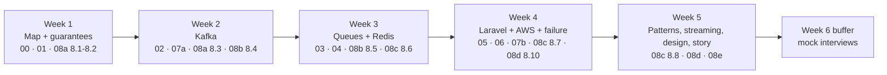
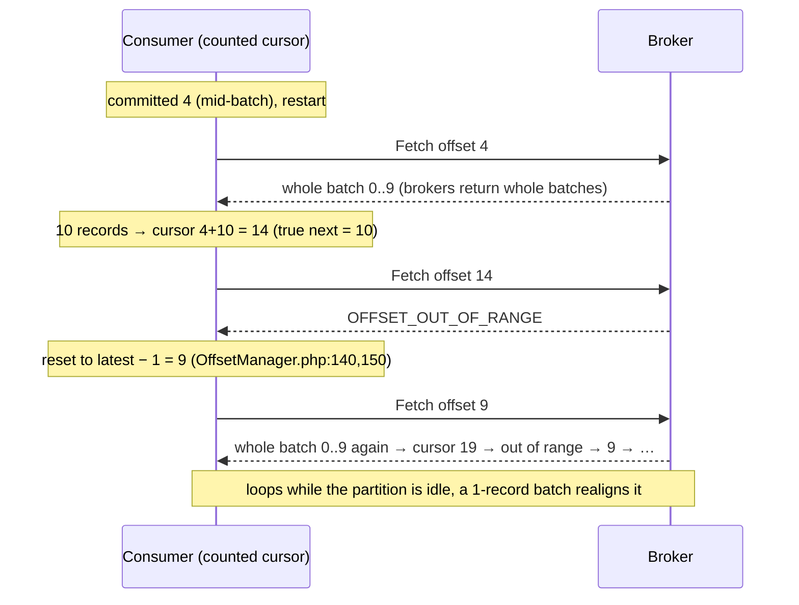

# 09 · Study Plan, Hands-on Labs & Cheat Sheet

> **Snapshot:** `sokrio-server` @ `master` · HEAD `d14c0ebb2` · written 2026-10-26 (`master` = `bf223a126`, no messaging changes). App code read with `git show d14c0ebb2:<path>`; library code read from the installed `vendor/` (phpkafka v1.2.5, Laravel 9.52.22).
> Paths are relative to `sokrio-server/` unless they start with `labs/`, which means this RnD folder's `labs/`. Tags: `[CODE]` app code · `[LIB]` vendor code · `[LAB]` reproduced **in this task** with the scripts in `labs/` · `[LAB-T4]`/`[LAB-T5]` reproduced in an earlier task · `[GENERAL]` industry knowledge · `[INFERENCE]` follows from code + lab, not observed in prod · `[ASSUMPTION]` best guess.
> Question bank links: every week in §9.1 lists the questions to rehearse. Lab ↔ finding ↔ runbook ids point back to sections 02–08e.

**How to use this file:** follow §9.1 week by week. Each week ends with a lab day (§9.3) and a "Quiz me" checkpoint. Keep §9.4 open in a second tab while you do the labs, and again before any interview.

---

## 9.0 What the labs changed (read this first)

T2 and T4 left some findings as `[INFERENCE]` and asked for a T9 lab. All of them were run against a real 3-broker Kafka 3.7, Redis 7 and the **exact** client libraries Sokrio ships (phpkafka v1.2.5 and Laravel 9.52.22 from `sokrio-server/vendor`, mounted read-only).

| Id | Before T9 | After the lab | Sev | Lab |
|---|---|---|---|---|
| **F5** | acks=0 hides broker-side rejections (read from code) | **Confirmed.** A 5 000-byte message sent to a topic capped at 1 000 bytes: with acks=0, `send()` returns normally and nothing is stored (end offset stays 0). With acks=1 it throws `[10] MESSAGE_TOO_LARGE` | 🔴 | L2 |
| **F7** | The counted cursor might duplicate the head of a batch after a mid-batch restart | **Confirmed, and worse (new F25 below).** A restart from offset 4 inside a 10-record batch delivered records 0–9 again | 🟡 | L4 |
| **F25** (new) | — | **Replay loop.** The overshooting cursor triggers OFFSET_OUT_OF_RANGE. The library then resets to `latest − 1`, which is again inside the last batch, so the **whole last batch is delivered again on every poll** while the partition is idle. In the lab, 3 deliveries in 3 polls. It stops only when a single-record batch arrives (v1 tracking publishes one record per call) | 🟡 → 🔴 if a partition carries only bulk (v2) traffic | L4 |
| **F9** | Heartbeats only on fetch → a slow flush gets the consumer evicted | **Confirmed.** A 40 s flush made the commit fail with `[25] UNKNOWN_MEMBER_ID`, and the next process read all three records again. Control: a 20 s flush commits fine | 🟡 | L3 |
| **R13** | `$timeout = 0` + a run longer than `retry_after` double-runs | **Confirmed on real Laravel 9.52.22.** A 12 s job with `retry_after = 5` and two workers ran **3 times**, overlapping, then failed with `MaxAttemptsExceededException` even though each run finished | 🟡 | L6 |
| **D21** (correction) | T4 §4.7, 07b R30 and 08e Q90: "start the cursor at `null` + an options array works on both clients, 120/120" | **Wrong for predis.** `null` → `ERR invalid cursor` on predis; `'0'`/`0` → 0/120 keys on phpredis. **No single start value works on both.** The portable fix picks the start value by client (§9.3 L9). The three files are patched | — | L9 |
| Redis + Lua | — | `[LAB]` Under `noeviction`, one Lua script grew memory to **13.5 MB on a 4 MB `maxmemory`**. Redis checks the limit when a script *starts*, not while it runs. The next plain `RPUSH` then failed with OOM. Laravel's queue scripts are tiny, so this is a teaching point, not a Sokrio bug | 🟢 | L7 |
| Side note | — | `composer create-project laravel/laravel:^9.0` now refuses to install `laravel/framework` 9.19–9.52.22 because of 7 published security advisories. Sokrio runs 9.52.22. Outside messaging scope, but worth raising with the team | 🟡 | — |

---

## 9.1 Study plan — 5 weeks (+1 buffer)

**Rhythm:** about 1.5 h on weekdays, 2–3 h on the lab day.
- **Day 1–4:** read the sections, then say the *Short answer* of each listed question out loud (under 30 s), plus **one** Sokrio story.
- **Day 5:** labs, then the checkpoint.
- Rehearse 🔴 questions twice: once on the day you read them, once on the next week's Day 1.



### Week 1 — The map and the guarantees
| Day | Read | Goal |
|---|---|---|
| 1 | `00-inventory.md` §0.1–0.8 | Name every messaging component and where it lives in the code |
| 2 | `01-architecture-overview.md` (all three flows) | Draw flows A/B/C from memory (tracking, departments, summaries) |
| 3 | `08a` §8.1 (Q1–Q5) | Explain queue vs log, push vs pull, backpressure |
| 4 | `08a` §8.2 (Q6–Q11) | Explain delivery guarantees hop by hop for Sokrio tracking |
| 5 | **Lab:** L0 setup + L1 (kill a broker) | See RF=1 vs RF=3 with your own eyes |

- **Rehearse:** 🔴 Q7, Q9, Q10 · Q6, Q8, Q11 · Sokrio-derived **Q82** (202 but lost), **Q101** (sync fallback).
- **Story to practise:** "Our API returns 202, but the event can still be lost" (F5 + D9).
- **Checkpoint:** `Quiz me on T1`, then `Quiz me on Q6–Q11`.

### Week 2 — Kafka, the Sokrio way
| Day | Read | Goal |
|---|---|---|
| 1 | `02-kafka-in-sokrio.md` §2.0–2.3 | Producer config (acks=0), the envelope, the consumer loop and commit |
| 2 | `02` §2.4–2.10 | Prove the delivery guarantee hop by hop; ordering; idempotency gaps |
| 3 | `08a` §8.3 (Q12–Q19) + `08b` §8.4 (Q20–Q28) | Kafka internals and operations |
| 4 | `07a-failure-modes-kafka.md` (R1–R10, R21–R28) | Walk three runbooks out loud: R1, R21, R26 |
| 5 | **Lab:** L2 (acks=0), L3 (slow consumer / F9), L4 (F7/F25 replay loop) | Turn three `[INFERENCE]`s into facts |

- **Rehearse:** 🔴 Q13, Q14, Q15, Q19, Q22, Q23, Q26 · Q20, Q21, Q24, Q25 · Sokrio-derived **Q83–Q86**, **Q97–Q100**, **Q105**.
- **Story to practise:** "A consumer replays the same batch forever after a restart" (F7 → F25, §9.3 L4).
- **Checkpoint:** `Quiz me on T2`.

### Week 3 — Laravel queues and Redis
| Day | Read | Goal |
|---|---|---|
| 1 | `03-rabbitmq-in-sokrio.md` + `08b` §8.5 (Q29–Q37) | The AMQP model, then the Laravel-on-Redis analog for each idea |
| 2 | `04-redis-in-sokrio.md` §4.0–4.5 | Queue internals (`:reserved`, `retry_after`), unique jobs, cache, locks |
| 3 | `04` §4.6–4.11 + `08c` §8.6 (Q38–Q47) | Rate limiters, the feature buffer, persistence/eviction |
| 4 | `07b` §7.3–7.4 (R11–R20) | Walk R12 (Redis restart) and R13 (double run) out loud |
| 5 | **Lab:** L6 (`retry_after`), L7 (eviction), L8 (F11), L9 (F14) | Reproduce four Redis/queue bugs |

- **Rehearse:** 🔴 Q32, Q35, Q36, Q41, Q42, Q44, Q46 · Q31, Q34, Q39, Q40, Q45 · Sokrio-derived **Q88–Q90**, **Q95**, **Q104**.
- **Story to practise:** "A unique-job lock with no id and no TTL silently dropped other tenants' imports" (F11).
- **Checkpoint:** `Quiz me on T4`.

### Week 4 — Laravel implementation, AWS, failure modes
| Day | Read | Goal |
|---|---|---|
| 1 | `05-laravel-implementation.md` §5.0–5.4 | Recipes A/B, the job rules 1–11, `afterCommit` sites |
| 2 | `05` §5.5–5.9 + `08d` §8.10 (Q64–Q68) | Tenant context in workers (F16), tests, local dev |
| 3 | `06-aws-infrastructure.md` | What runs where; MSK/ElastiCache/SQS trade-offs; the alert set AL1–AL7 |
| 4 | `07b` §7.5–7.6 + `08c` §8.7 (Q48–Q50) | The Top 5 risks and the first fix for each, in 2 minutes |
| 5 | **Lab:** L5 (duplicate → idempotency), L10 (F12), L11 (F16), L12 sandbox; L13 optional | Cross-tenant and idempotency labs |

- **Rehearse:** 🔴 Q49, Q63, Q65, Q67 · Q48, Q50, Q64, Q66, Q68 · Sokrio-derived **Q87**, **Q91–Q94**, **Q96**, **Q103**, **Q106**.
- **Story to practise:** "A queued job loaded tenant B's user while working for tenant A" (F16).
- **Checkpoint:** `Quiz me on T5`, then `Quiz me on T7` (Top 5 only).

### Week 5 — Patterns, streaming, design, the STAR story
| Day | Read | Goal |
|---|---|---|
| 1 | `08d` §8.9 (Q58–Q63) | Saga, ES/CQRS, ECST. Say plainly what Sokrio does *not* have |
| 2 | `08c` §8.8 (Q51–Q57) | Batch vs stream; "Sokrio is batch" + the streaming design |
| 3 | `08d` §8.11 (Q69–Q75) | Two designs on a whiteboard, 7-step frame, 35 min each |
| 4 | `08d` §8.12 (Q76–Q81) + `08e` §8.13 leftovers (Q102) | Incident drills: lag on one partition, triple emails, rebalance loop |
| 5 | `08e` §8.14 STAR + §8.15 designs | Tell the STAR story in 2 minutes; fill its `[placeholders]` first |

- **Rehearse:** 🔴 Q52, Q54, Q56, Q57, Q58, Q59, Q61, Q69–Q78, Q81 · Q51, Q53, Q55, Q60, Q62, Q79, Q80 · **Q102**.
- **Checkpoint:** `Quiz me on T8` (random mix), plus one timed design round.

### Week 6 — Buffer and mock interviews
- Re-run any lab that didn't stick, and re-read the `### ✅ Quality check` lists as a fast review.
- **Two mock rounds:** (1) 45 min concepts, mixing 🔴 questions; (2) 45 min design (Q69 or Q70) with Sokrio as the base (08e §8.15).
- **Before the real interview:** fill the STAR metrics from Datadog/Sentry (never invent numbers), and get answers from Komol to A7, A6, A9, A3–A5, A10, A11 (T6 §6.11). An answer like "prod runs phpredis, so F14 is live" is far stronger than a guess.

---

## 9.2 Lab harness (set up once)

**Safety rules.** Labs run only in throwaway containers on the private `t9lab_default` network.
- Sokrio's `vendor/` is mounted **read-only**. No app code, `.env` or prod host is touched.
- MySQL/Redis containers for L5/L7 are separate and removed at the end.

**Files** (all in `labs/`):

| Path | What it is |
|---|---|
| `compose.yml` | 3 KRaft brokers (`k1`–`k3`, Kafka 3.7.0) + `redis` (7-alpine) |
| `bin/k.sh` | Runs a Kafka CLI tool inside a broker: `bin/k.sh k1 kafka-topics …` |
| `bin/php.sh` | PHP 8.3 (`memo-phptest:jpeg`, with phpredis/pcntl/sqlite) on the lab network, with `sokrio-server/vendor` at `/srv/vendor:ro` |
| `kafka/*.php` | phpkafka probes for F5, F7/F25, F9, written to mirror `KafkaConsumer.php` |
| `laravel/` | A ~10-line Laravel 9.52.22 console (`artisan`) booted on Sokrio's vendor, with lab job classes in `jobs.php` |
| `redis/*.sh`, `mysql/dup.sql` | The eviction and idempotency labs |

The compose file, trimmed (`x-env` holds the five shared KRaft settings):
```yaml
services:
  k1: { image: apache/kafka:3.7.0, environment: { <<: *env, KAFKA_NODE_ID: 1, KAFKA_ADVERTISED_LISTENERS: PLAINTEXT://k1:9092 } }
  k2: { image: apache/kafka:3.7.0, environment: { <<: *env, KAFKA_NODE_ID: 2, KAFKA_ADVERTISED_LISTENERS: PLAINTEXT://k2:9092 } }
  k3: { image: apache/kafka:3.7.0, environment: { <<: *env, KAFKA_NODE_ID: 3, KAFKA_ADVERTISED_LISTENERS: PLAINTEXT://k3:9092 } }
  redis: { image: redis:7-alpine }
```

**Start / stop** (from `labs/`):
```bash
docker compose -p t9lab up -d && sleep 20          # brokers need ~15 s to form the KRaft quorum
docker compose -p t9lab down -v                      # cleanup for every lab
```

**The Laravel console** (`labs/laravel/artisan`, the core of it):
```php
require '/srv/vendor/autoload.php';                  // Sokrio's Laravel 9.52.22, read-only
require __DIR__ . '/jobs.php';
$app = new Illuminate\Foundation\Application(__DIR__);
$app->singleton(Illuminate\Contracts\Console\Kernel::class, Illuminate\Foundation\Console\Kernel::class);
$app->singleton(Illuminate\Contracts\Debug\ExceptionHandler::class, Illuminate\Foundation\Exceptions\Handler::class);
$kernel = $app->make(Illuminate\Contracts\Console\Kernel::class);
if (($argv[1] ?? '') === 'run') { $kernel->bootstrap(); require $argv[2]; exit(0); }   // run a lab script
exit($kernel->handle(new Symfony\Component\Console\Input\ArgvInput, new Symfony\Component\Console\Output\ConsoleOutput));
```
- `config/` holds only what the labs need: `queue.php` (`retry_after` from the `RETRY_AFTER` env, default 9000 like prod), `database.php` (`REDIS_CLIENT` env picks phpredis/predis; DB0 queues, DB1 cache, like Sokrio), `cache.php` (redis store).

**Gotchas we hit** (so you don't):
- zsh does not word-split `$VAR`, so `K="docker compose exec …"; $K` fails. Use the `bin/*.sh` scripts, or run bash.
- A fresh `composer create-project laravel/laravel:^9.0` is blocked by security advisories (§9.0). That's why the harness reuses Sokrio's installed vendor instead.
- The Laravel console needs `bootstrap/cache/` and `storage/` to exist (already in `labs/laravel/`).

---

## 9.3 Labs

Every lab uses the same fields: **Goal · Setup · Steps · What we observed · Sokrio link · Cleanup**. "What we observed" is real output from 2026-10-26.

### L0 — Smoke test
- **Steps:** `docker compose -p t9lab up -d && sleep 20`, then `bin/k.sh k1 kafka-topics --bootstrap-server k1:9092 --create --topic demo --partitions 3 --replication-factor 3 --config min.insync.replicas=2` and `--describe --topic demo`.
- **Observed:** 3 partitions, leaders spread over brokers 1/2/3, `Isr` lists all three replicas.

### L1 — Kill a broker: RF=1 (Sokrio today) vs RF=3
- **Goal:** see why auto-created RF=1 topics (`config/kafka.php:74-75`) mean "one broker down = some partitions offline".
- **Setup:** L0, plus `--create --topic rf1 --partitions 3 --replication-factor 1`.
- **Steps:**
  ```bash
  docker compose -p t9lab stop k2 && sleep 8
  bin/k.sh k1 kafka-topics --bootstrap-server k1:9092 --describe --unavailable-partitions
  bin/k.sh k1 kafka-topics --bootstrap-server k1:9092 --describe --under-replicated-partitions
  docker compose -p t9lab start k2     # describe again: ISR heals; preferred leaders return after the auto leader rebalance (~5 min default)
  ```
- **Observed** `[LAB]`:
  ```
  unavailable:  Topic: rf1   Partition: 0  Leader: none  Replicas: 2      Isr: 2
  URP:          Topic: demo  Partition: 0  Leader: 3     Replicas: 2,3,1  Isr: 3,1
  ```
  - The RF=1 partition owned by `k2` had **no leader**, so every write keyed to it fails or waits.
  - The RF=3 topic only became under-replicated. With `min.insync.replicas=2` and acks=all it keeps accepting writes.
- **Sokrio link:** A3 (prod RF unknown), R1/R21, Top-5 #2, Q14/Q81. With a single prod broker `[ASSUMPTION]` (A4), "one broker down" means *every* partition is down, and the producer's fallback (tracking only) or nothing (departments, F1/D11) takes over.
- **Cleanup:** `docker compose -p t9lab down -v`.

### L2 — acks=0 swallows a broker rejection (F5)
- **Goal:** prove that "publish succeeded" means "bytes were written to a socket", not "the broker stored it".
- **Setup:** L0, plus a topic that rejects big messages: `--create --topic small --partitions 1 --replication-factor 3 --config max.message.bytes=1000`.
- **Steps:** `bin/php.sh -- kafka/f5_acks.php`. It sends 5 000 bytes with the library default (= Sokrio, which never calls `setAcks()`), then with `setAcks(1)`. Then run `bin/k.sh k1 kafka-get-offsets --bootstrap-server k1:9092 --topic small`.
- **Observed** `[LAB]`:
  ```
  acks=0 (library default, = Sokrio): send() returned normally
  acks=1: longlang\phpkafka\Exception\KafkaErrorException — [10] The request included a message larger than the max message size the server will accept.
  small:0:0                                    ← nothing stored
  ```
- **Sokrio link:** F5 (`phpkafka/Producer/ProducerConfig.php:36`, `Producer.php:159-163`). The tracking fallback (`Tracking/TrackingController.php:62-83`) only runs on a *transport* exception, so with acks=0 a rejected batch is a silent loss behind a 202. Fix: `setAcks(1)` in `KafkaProducer` (Top-5 #2). Q82, Q14.
- **Try next:** stop the partition leader's broker and repeat with acks=0 vs acks=1.

### L3 — Slow consumer → eviction → replay (F9, forced rebalance)
- **Goal:** see that a phpkafka consumer outside Swoole heartbeats **only when it fetches** (`phpkafka/Consumer/Consumer.php:292-294,421-427`), so a long flush is the same as a dead consumer.
- **Setup:** L0, plus `--create --topic f9 --partitions 1 --replication-factor 3`.
- **Steps:** `bin/php.sh -- kafka/f9_heartbeat.php 40`, then the control `… 20`. The script reads 3 records, sleeps N seconds as if `flush()` were running the DB write, then commits, and finally a new process reads.
- **Observed** `[LAB]`:
  ```
  40 s: commit FAILED: KafkaErrorException — [25] The coordinator is not aware of this member.
        next process reads: a,b,c                       ← replayed
  20 s: commit OK / next process reads: (nothing)
  ```
- **Sokrio link:** `session_timeout` 30 s (`config/kafka.php:50`). Sokrio catches the failed commit and logs it at **debug** (`KafkaConsumer.php:328-335`), so the replay is invisible. Tracking inserts are not idempotent (no unique key), so a replay means duplicate rows (see L5). R23, Q25, Q85.
- **Watch the group** (not captured in T9): while the sleep runs, `bin/k.sh k1 kafka-consumer-groups --bootstrap-server k1:9092 --describe --group f9-group --members --state` should show the member dropped after ~30 s.
- **Fix ideas:** keep flushes far below 30 s (smaller `batch_size`, bulk writes), or heartbeat from inside long handlers; raise `session_timeout` only together with a lag alert.

### L4 — Counted offsets after a mid-batch restart (F7) → the replay loop (F25)
- **Goal:** test T2's `[INFERENCE]` that phpkafka advances a counter instead of reading record offsets.
- **Setup:** L0, plus `--create --topic f7 --partitions 1 --replication-factor 3` (and `f7b` for the control).
- **Steps:** `bin/php.sh -- kafka/f7_offsets.php`, then `bin/php.sh -- kafka/f7_control.php`. The script does exactly what Sokrio does:
  ```php
  $m = $c->consume();                                          // library hands out decoded records
  $c->getOffsetManager(T)->addFetchOffset($m->getPartition(), 1); // = advanceCursor, KafkaConsumer.php:282
  $c->getOffsetManager(T)->saveOffsets(0, 3);                  // = flush commit, KafkaConsumer.php:328
  ```
- **Observed** `[LAB]`. 10 records were produced by one `sendBatch` (one RecordBatch, offsets 0–9):
  ```
  run 1 read: 0,1,2,3            | committed cursor=4   (then the process restarts)
  run 2 read: 0..9, 0..9, 0..9   | cursor=9             (log end offset is 10)
  + batch 10..13: 0..9,10..13,10..13,10..13
  control, aligned start:        0..9 read once, cursor=10   ✅
  control, one single-record publish after the loop: 10..19, 20 → then 21,22,23 once  (loop ends)
  ```



- **Why** `[LIB]`:
  1. The fetch loop turns every record of every returned batch into a message (`phpkafka/Consumer/Consumer.php:357`) and never checks the record's own offset against the requested one.
  2. The cursor is a counter (`KafkaConsumer.php:282`).
  3. Out-of-range resets to `latest − 1` (`Consumer.php:345,364` → `OffsetManager.php:140,150`). That lands *inside* the last batch whenever it holds more than one record.
- **When Sokrio gets misaligned** `[INFERENCE]`:
  - A flush fires at 200 messages or after 1 s (`KafkaConsumer.php:251`, `config/kafka.php:63-64`), which can be in the middle of a fetched batch, and that offset is committed.
  - Any restart then resumes mid-batch: the 6 h `max_runtime` recycle (`config/kafka.php:70`), a deploy, a crash, or an eviction (L3).
  - v2 bulk tracking publishes one batch per call (F7), so its batches are big.
  - The loop ends at the next v1 single-point publish. On a quiet partition, or one carrying only bulk traffic, it can replay the same batch for a long time, and every replay inserts duplicate `trackings` rows.
- **Skips:** the lab saw duplicates, not skips. A skip is still possible `[INFERENCE]` when the drift is larger than the next batch: the counter can jump over a small batch entirely.
- **Sokrio link:** F7 → **F25** (new), R23/R24, Q84. **Fix options:**
  1. Track offsets from the record batch (`baseOffset + offsetDelta`) and drop records below the requested offset. That needs a patched or forked client.
  2. Commit only at batch boundaries (flush only after the library's buffer is empty).
  3. Make the handler idempotent (L5), so replays are harmless whatever the client does.
  4. Long term, move to an `rdkafka`-based client (T2 §2.10).

### L5 — Reproduce a duplicate, then fix it with idempotency
- **Goal:** turn the L3/L4 replays into duplicate rows, then make the write idempotent.
- **Setup:** `docker run -d --name t9lab-mysql -e MYSQL_ALLOW_EMPTY_PASSWORD=1 mysql:8.0`, wait for `mysqladmin ping`.
- **Steps:** `docker exec -i t9lab-mysql mysql -uroot -t < mysql/dup.sql`. The table has the same indexes as `trackings` (only `user_id` and `(created_at,user_id)`, migration `2020_08_18_074138_create_trackings_table.php:18,24`). The script inserts a batch twice, de-duplicates, adds `UNIQUE (user_id, created_at)` and replays with `INSERT IGNORE` (= Laravel `insertOrIgnore()`).
- **Observed** `[LAB]`:
  ```
  after replay                    | 6
  after dedupe + unique + replay  | 3
  plain INSERT of a replayed row  → ERROR 1062 Duplicate entry '7-2026-10-26 10:00:00' for key 'trackings.trackings_user_time_unique'
  ```
- **Sokrio link:** Q8, Q102. Production rollout order matters:
  1. Clean up the existing duplicates (batched `DELETE … JOIN` by date range on a big table).
  2. Add the unique index online.
  3. Switch the writer to `insertOrIgnore` / `upsert`.
  - Natural-key caveat (Q102): two genuine points from one user in the same second would collide. Use millisecond `created_at` or the dropped `event_id` (Q100) if that's real.
- **Cleanup:** `docker rm -f t9lab-mysql`.

### L6 — The `retry_after` double run (R13)
- **Goal:** watch one job run several times because it outlives its reservation.
- **Setup:** L0 (needs `redis`). `jobs.php` has `SlowReportJob` with `$timeout = 0`, `$tries = 3`, sleeping 12 s, shaped like `GenerateTrackingReport` and the other `$timeout = 0` jobs.
- **Steps:** `bin/php.sh -e RETRY_AFTER=5 -- sh laravel/retry_after.sh` (dispatches once, starts two `queue:work redis` workers).
- **Observed** `[LAB]` on Laravel 9.52.22:
  ```
  [10:21:36] pid 8  START job XC8S… attempt 1
  [10:21:41] pid 14 START job XC8S… attempt 2      ← 5 s later: reservation expired, second worker took it
  [10:21:48] pid 8  END   job XC8S…
  [10:21:48] pid 8  START job XC8S… attempt 3      ← expired again, worker 1 took it back
  [10:21:53] local.ERROR: SlowReportJob has been attempted too many times or run too long.  (MaxAttemptsExceededException)
  ```
- **Why** `[LIB]`: `pop` moves the job to `queues:default:reserved` with score `now + retry_after` (`Queue/RedisQueue.php:224`). Every worker's next `pop` first migrates expired reservations back to the queue (`:244-249`). `$timeout = 0` turns the worker's alarm off (`Queue/Worker.php:229-254`), so nothing kills the first run.
- **Sokrio link:** prod `retry_after = 9000` (`config/queue.php:65`), so a `$timeout = 0` report that runs over 2.5 h starts a second copy. A crashed worker's job waits 2.5 h before anyone retries it (R12/R13, F10, Top-5 #4). Fix: a real `$timeout` below `retry_after` on every job, plus a separate short-`retry_after` connection for quick jobs (`order-approved`). Q65.

### L7 — Fill Redis memory: OOM vs eviction (R11, A9)
- **Goal:** see what each `maxmemory-policy` does to a queue that shares Redis with cache keys, as Sokrio's does.
- **Steps:** `bash redis/evict-many-small.sh` (40 000 small cache keys with TTL), then `bash redis/evict-few-big.sh` (40 × 200 KB keys, with the queue key left idle for 3 s first). Each script starts a 4 MB `redis:7-alpine` and removes it at the end.
- **Observed** `[LAB]`:

| Policy | Push a job after the fill | Queued job survives? | Evicted keys |
|---|---|---|---|
| `noeviction` | `OOM command not allowed when used memory > 'maxmemory'` | yes, but new dispatches fail | 0 (memory hit **13.5 MB on a 4 MB limit**: the Lua fill was checked only at its start) |
| `allkeys-lru`, 40k small keys | OK | yes (one key among 32k is rarely sampled) | 31 919 |
| `allkeys-lru`, 40 big keys | — | **no, LLEN = 0 in 3/3 runs: the queued job was evicted** | 31 |
| `volatile-lru`, both runs | OK | **yes, 3/3**: queue keys have no TTL, so they can't be chosen | 30 / 32 008 |

- **Lesson:** with `allkeys-*`, queued jobs can disappear **silently**. It's probabilistic, so it may pass a quick test and still hit you in prod. `noeviction` fails loudly instead: dispatches throw, and the cache stops writing. `volatile-lru` keeps jobs safe **only** while every cache key has a TTL (Sokrio has 9 `rememberForever` keys, T4 §4.4).
- **Sokrio link:** one Redis for queues (DB0) and cache (DB1) (`config/database.php:202-219`). DB numbers don't split memory. Python also writes to DB0 (F20). Prod policy unknown (A9). **Commands to run on prod** (read-only): `redis-cli CONFIG GET maxmemory*`, `INFO memory`, `INFO stats | grep evicted_keys`. R11, Q45, Q79. The structural fix is a separate Redis for queues (T6 §6.5).

### L8 — `ShouldBeUnique` without an id drops other tenants' chunks (F11)
- **Steps:** `bin/php.sh -- laravel/artisan run laravel/f11.php`. `BulkStockImportLikeJob` copies `Stock\BulkStockImportJob`: `ShouldBeUnique`, no `uniqueId()`, no `uniqueFor`.
- **Observed** `[LAB]` (same as `[LAB-T4]`):
  ```
  dispatch beol chunk@1 -> queued
  dispatch beol chunk@30001 -> DROPPED
  dispatch pvm chunk@1 -> DROPPED
  lock key 'laravel_unique_job:BulkStockImportLikeJob' TTL = -1 (-1 = never expires)
  ```
- **Try the fix:** add `public function uniqueId() { return "{$this->tenant}:{$this->startingRow}"; }` and `public $uniqueFor = 3600;` to the lab job, `FLUSHALL` the lab Redis, and rerun. All three should queue.
- **Sokrio link:** `app/Jobs/Stock/BulkStockImportJob.php:30`, chunk loop `BulkStockBatchImportJob.php:104-107`. R29, Top-5 #3, Q88.

### L9 — Same SCAN call, two clients (F14) and the corrected fix (D21)
- **Steps:** `for c in predis phpredis; do bin/php.sh -e REDIS_CLIENT=$c -- laravel/artisan run laravel/f14.php; done`. It creates 120 `feature_tracking:buffer:*` keys and counts what each call shape finds.
- **Observed** `[LAB]`:

| Client | Sokrio's call `scan('0','MATCH',…,'COUNT',50)` | array options, start `null` | start `0` | start `'0'` |
|---|---|---|---|---|
| predis | **120/120** | `ERR invalid cursor` | 120/120 | 120/120 |
| phpredis | **0/120** (F14) | 120/120 | 0/120 | 0/120 |

- **Why** `[LIB]`: Laravel wraps `scan` only for phpredis (`Redis/Connections/PhpRedisConnection.php:314-326`, options array + by-reference cursor where `null` means "start"). Predis gets the raw arguments, and Redis rejects a `null` cursor.
- **The fix that works on both** (each half verified above):
  ```php
  $cursor = config('database.redis.client') === 'phpredis' ? null : '0';
  do {
      [$cursor, $keys] = Redis::scan($cursor, ['match' => $match, 'count' => 50]) ?: [0, []];
      foreach ($keys as $rawKey) { /* … */ }
  } while ($cursor && (string) $cursor !== '0');
  ```
- **Sokrio link:** `FlushFeatureEventsJob.php:68`, `PurgeFeatureTrackingLeaderboards.php:38`. A7 decides if F14 is live (README recommends phpredis). R30, Q90.

### L10 — Web ↔ worker cache prefix split (F12) — `[LAB-T4]`
- **Goal:** show that a key written under the tenant prefix in a request is invisible to the worker.
- **Steps** (in the `labs/laravel` console):
  1. `Cache::getStore()->setPrefix('lab_cache:tenant_7:')` (what `ScopeCacheToTenant.php:37-69` does in HTTP), then `Cache::put('report_lock:abc', 1, 3600)`.
  2. Reset to the bare prefix (what a worker has), then `Cache::get('report_lock:abc')` returns `null`, and `Cache::forget` removes nothing.
  3. `redis-cli -n 1 KEYS '*report_lock*'` still shows the tenant-prefixed key with its TTL.
- **Sokrio link:** `ReportCacheMacro.php:24-57` (429 until the TTL), Org cache invalidation (`Org.php:45-48`), unique locks dispatched in HTTP. The correct template is `SmsResendRun.php:24-25,197-214` (fixed prefix). R35, Q89.

### L11 — Tenant model restored from the wrong tenant (F16) — `[LAB-T5]`
- **Goal:** reproduce the cross-tenant restore with real `SerializesModels`.
- **Steps** (outline of the T5 sandbox, `05` §5.3):
  1. Create two SQLite files `a.sqlite` and `b.sqlite`, each with `users(id=42)` (Alice in A, Bob in B).
  2. Define a `tenant` connection pointing at A. Serialize a job holding `User::on('tenant')->find(42)`.
  3. `Config::set('database.connections.tenant.database', 'b.sqlite')` + `DB::purge('tenant')` (= the previous job's `reconnect()`, `TenantManager.php:96-99`).
  4. `unserialize()` the payload and print the user's name.
- **Observed** `[LAB-T5]`: dispatched *"Alice (tenant A)"* → restored *"Bob (tenant B)"*.
- **Try the fix:** register a `JobProcessing` listener that sets the connection from `payload()['tenant_id']`, and repeat. The worker fires `JobProcessing` before unserializing (`Queue/Worker.php:412` → `:425`).
- **Sokrio link:** 4 live jobs (`BatchTransferJob.php:35` …). R31, Top-5 #1, Q91.

### L12 — Run Sokrio itself against the lab cluster (the §5.7 sandbox)
- **Goal:** watch the real producer and consumer, not a probe.
- **Setup:** the lab `compose.yml`, with ports published on the host for the app (`k1` → 9092, `redis` → **6380**, so it doesn't clash with other local Redis containers). In a **local** `.env` that you own, set `QUEUE_CONNECTION=redis`, `CACHE_DRIVER=redis`, `REDIS_CLIENT=phpredis|predis`, `KAFKA_BROKERS=localhost:9092`, and **two** tenants. Never point it at a shared or prod host.
- **Steps:**
  ```bash
  php artisan kafka:consume departments --max-runtime=0            # ConsumeCommand.php:18-19
  php artisan queue:work redis --queue=order-approved,summary,sequential,feature-tracking,default --timeout=900
  tail -f storage/logs/kafka-$(date +%F).log                       # daily driver (D16)
  ```
  Edit a department in tenant 1, then watch it arrive in Mongo. Then stop the whole cluster (`docker compose -p t9lab stop k1 k2 k3`) and edit again: the save is ~3.75 s slower (F8) and the event is gone (D11).
- **Sokrio link:** `05` §5.7 local gotchas (the defaults `sync` + `file` hide F12/F16).

### L13 (optional) — SQS delay cap (F22) with LocalStack — *not run in T9*
- **Steps** `[GENERAL]`: `docker run -d --name t9lab-ls -p 4566:4566 localstack/localstack`, then `aws --endpoint-url http://localhost:4566 sqs create-queue --queue-name lab`. Send with `--delay-seconds 3600`.
- **Expected:** `InvalidParameterValue` (the maximum is 900 s). Sokrio's approval delay can be up to 60 min (`SettingRequest.php:39,45`), and `SqsQueue::later` passes it straight through (`vendor/…/Queue/SqsQueue.php:138`). R33, Q74.

---

## 9.4 Cheat sheet (one page)

### Sokrio numbers to know by heart
| Setting | Value | Ref |
|---|---|---|
| Producer acks | **0** (never set) | F5 |
| Topics | auto-created, P=3, RF=1, suffix `.v1.{env}` | `config/kafka.php:74-75`, `TopicRegistry.php:51-58` |
| Consumer | static `group.instance.id=""`, autoCommit off, flush 200 msgs / 1 s | `KafkaConsumer.php:69,79-95`, `config/kafka.php:63-64` |
| Session / rebalance / heartbeat | 30 s / 30 s / 3 s (heartbeat only on fetch, F9) | `config/kafka.php:50` |
| Consumer max runtime | 21 600 s = 6 h (command fallback 3600) | `config/kafka.php:70`, `ConsumeCommand.php:70-73` |
| Producer retries | 3 attempts, ~3.75 s worst case | `KafkaProducer.php:26,113-192` |
| Groups | tracking = `KAFKA_GROUP`; others `{KAFKA_GROUP}-{topic}` | `ConsumeCommand.php:97-107` |
| Queue `retry_after` | **9000 s** (2.5 h) | `config/queue.php:65` |
| Queues | `summary`, `default`, `feature-tracking`, `order-approved`, `sequential` | T0 §0.7 |
| Redis | DB0 queues + `Redis::`, DB1 cache; default client phpredis | `config/database.php:195,202-219` |
| Supervisor | numprocs=1, `stopwaitsecs=35`, `autorestart=true` | `README.md:178-212` |
| Org cache TTL | 10 080 s ≈ 2.8 h (not a week, D12) | `Org.php:57,72` |
| Kafka log | `storage/logs/kafka-YYYY-MM-DD.log`, 7 days | `config/logging.php:54-68` |

### Kafka CLI (`/opt/kafka/bin/*.sh`, or `bin/k.sh k1 <tool>` in the lab)
```bash
kafka-topics --bootstrap-server $BS --list | --describe --topic T | --describe --under-replicated-partitions | --describe --unavailable-partitions
kafka-topics --bootstrap-server $BS --create --topic T --partitions 3 --replication-factor 3 --config min.insync.replicas=2
kafka-configs --bootstrap-server $BS --entity-type topics --entity-name T --describe     # retention, cleanup.policy …
kafka-consumer-groups --bootstrap-server $BS --list | --describe --group G [--members --verbose | --state]   # LAG per partition
kafka-consumer-groups --bootstrap-server $BS --group G --topic T --reset-offsets --to-datetime 2026-10-23T00:00:00.000 --dry-run   # then --execute (group must be stopped)
kafka-consumer-groups --bootstrap-server $BS --group G --topic T:0 --reset-offsets --to-offset 1234 --execute
kafka-console-consumer --bootstrap-server $BS --topic T --partition 0 --offset 100 --max-messages 5 --property print.key=true --property print.offset=true
kafka-console-producer --bootstrap-server $BS --topic T --property parse.key=true --property key.separator=: --producer-property acks=all
kafka-get-offsets --bootstrap-server $BS --topic T                                    # end offsets (present in 3.7)
```
- Replay without touching prod consumers: use a **new** group and set its offsets with `--reset-offsets` **before** it first starts. phpkafka starts a new group at offset 0 (F6). Q26.

### redis-cli
```bash
redis-cli INFO memory | grep -E 'used_memory_human|maxmemory_human|mem_fragmentation_ratio'
redis-cli CONFIG GET maxmemory*          # policy + limit (A9) — read-only
redis-cli INFO stats | grep -E 'evicted_keys|rejected_connections'
redis-cli INFO persistence | grep -E 'aof_enabled|rdb_last_save_time'
redis-cli --bigkeys          |  redis-cli MEMORY USAGE <key>  |  redis-cli SLOWLOG GET 10
redis-cli -n 0 LLEN  "${REDIS_PREFIX}queues:default"           # waiting jobs (list)
redis-cli -n 0 ZCARD "${REDIS_PREFIX}queues:default:reserved"  # running (score = lease expiry)
redis-cli -n 0 ZCARD "${REDIS_PREFIX}queues:default:delayed"   # delayed approvals live here (lost on restart w/o AOF)
redis-cli -n 1 --scan --pattern "${CACHE_PREFIX}:tenant_7:*" | head    # never KEYS * on prod
redis-cli -n 1 TTL "<key>"                                     # -1 = no expiry (F11 lock), -2 = gone
```

### Artisan
```bash
php artisan queue:work redis --queue=order-approved,summary,default --timeout=900 --tries=3 --max-time=3600   # order = priority
php artisan queue:restart                  # graceful: workers exit after the current job (cache key, Worker.php:653-666)
php artisan queue:failed | queue:retry <id|all> | queue:forget <id> | queue:flush
php artisan queue:prune-failed --hours=168 # not scheduled in Sokrio today
php artisan queue:monitor redis:default,redis:summary --max=100   # fires QueueBusy; nothing listens yet (AL2)
php artisan queue:clear redis --queue=default                     # destructive — confirm first
php artisan kafka:consume tracking|departments [--max-runtime=0]
php artisan schedule:list                  # only on the box with RUN_SCHEDULER=true
php artisan tenant:department_sync_with_mongodb   # manual full resync (F1)
```

### Supervisor
```bash
supervisorctl status                                   # RUNNING / BACKOFF / FATAL (FATAL after 3 failed starts, no alert)
supervisorctl restart sokrio-kafka-consumer-departments
supervisorctl tail -f sokrio-kafka-consumer-tracking stderr
supervisorctl reread && supervisorctl update           # after editing a program file
supervisorctl stop all                                 # waits stopwaitsecs (35 s) per program, then SIGKILL
```

### First 5 minutes of an incident
1. `supervisorctl status`: are the consumers and workers alive?
2. `kafka-consumer-groups --describe`: is lag growing on one partition or on all of them?
3. `LLEN`/`ZCARD` on the queues: is work piling up, or are reservations stuck?
4. `INFO memory` / `evicted_keys`: is Redis full?
5. `tail` the kafka log + `queue:failed`, then pick the runbook (R-id) from `07a`/`07b` §7.3.

---

### ✅ Quality check
- [x] §9.1 gives a 5-week plan (+1 buffer week) walking 00 → 08e, with daily goals, the questions to rehearse each week (🔴 first, plus the Sokrio-derived Q82–Q106) and a "Quiz me" checkpoint per week
- [x] All README_2 labs are covered: kill a broker (L1), force a rebalance with a slow consumer (L3), duplicate → idempotency (L5), the `retry_after` double run (L6), Redis memory full + eviction (L7)
- [x] The pending labs from HANDOFF are covered: F7 (L4), F9 (L3), F11 (L8), F12 (L10), F14 (L9), F16 (L11), the §5.7 sandbox (L12), and F22 (L13, marked *not run*)
- [x] L1–L9 were **run** on 2026-10-26 with the scripts saved in `labs/`, against phpkafka v1.2.5 and Laravel 9.52.22 from Sokrio's vendor (read-only). The outputs shown are real. L10/L11 reuse the T4/T5 lab results
- [x] New finding **F25** (replay loop) and correction **D21** (the SCAN fix) recorded. F5, F7 and F9 upgraded from `[INFERENCE]` to `[LAB]`
- [x] Compose snippets are ≤ 15 lines; code snippets are trimmed
- [x] No secrets, hosts or IPs. Env vars are names only; every lab is local and throwaway
