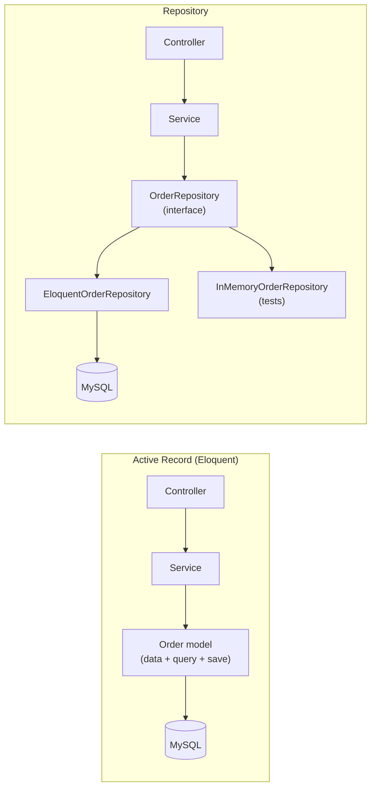

> Tracker ID: DP-14 · Generated: 2026-10-15 · Answers: **DP-Q14** (TRK-02 Phase 9) · Source: Fowler PoEAA (Repository, Active Record, Service Layer) + sokrio-server structure (`app/Repositories/` নেই, `app/Services/`, `app/DTOs/`, `app/Actions/`) · Runnable: `5-tracks/design-patterns/code/repository.ts` (✅ ran + strict tsc 2026-10-15) · Status: 🟡 generated

# DP-Q14: Is the Repository pattern useful on top of Eloquent? Argue both sides.

> **এক লাইনে:** **Repository** = domain-এর ভাষায় একটা collection-এর মতো interface (`pendingForRetailer($id)`, `save($order)`), যার পেছনে storage লুকানো। Eloquent নিজেই **Active Record** (model = row + query + save), তাই তার ওপর generic repository (`find/all/create/update`) প্রায়ই শুধু বাড়তি স্তর। **কিন্তু** দরকারি যখন: storage বদলাতে হবে বা একাধিক উৎস (MySQL + Mongo), জটিল query এক জায়গায় রাখতে হবে, বা business rule DB ছাড়া দ্রুত টেস্ট করতে হবে। দুই পক্ষ বলে, শেষে নিজের অবস্থান: "service layer + query scopes, repository only where it earns its place"।

---

## ১. দুটো ধারণা



| | Active Record | Repository |
|---|---|---|
| query কোথায় | model-এ (`Order::where(...)`, scope) | repository class-এ |
| model জানে DB? | হ্যাঁ (`$order->save()`) | না (plain domain object), repository save করে |
| টেস্ট | DB লাগে (SQLite/MySQL, `RefreshDatabase`) | in-memory fake দিয়ে DB ছাড়া |
| কোড পরিমাণ | কম | বেশি (interface + implementation + binding) |

## ২. পক্ষে (For)

| যুক্তি | ব্যাখ্যা |
|---|---|
| **Testability** | business rule (credit limit, approval) in-memory repo দিয়ে মিলিসেকেন্ডে টেস্ট; DB setup নেই |
| **জটিল query এক জায়গায়** | "pending orders for retailer within territory, excluding returns" ৫ জায়গায় কপি না হয়ে একটা named method |
| **Storage বদল / একাধিক উৎস** | একই entity MySQL-এ লেখা, Mongo summary থেকে পড়া; বা পরে microservice/API-তে সরানো |
| **Domain-কে ORM থেকে আলাদা** | DDD-তে aggregate save করার একমাত্র পথ; Eloquent-এর magic (lazy loading) domain-এ ছড়ায় না |
| **নিরাপত্তা নিয়ম জোর করা** | tenant/territory scope repository-তে বসালে কেউ ভুলতে পারে না |

## ৩. বিপক্ষে (Against)

| যুক্তি | ব্যাখ্যা |
|---|---|
| **Eloquent ইতিমধ্যে abstraction** | query builder, scope, relation: আরেকটা স্তর মানে প্রায় একই method দুবার |
| **Leaky abstraction** | repository Eloquent model ফেরত দেয় → কলার `$order->items()->where(...)` ডাকে → আবার DB-তে সরাসরি; repository অর্থহীন |
| **Generic repository anti-pattern** | `BaseRepository::find/all/create/update/delete` = Eloquent-এর কপি, কোনো domain অর্থ নেই |
| **"Storage বদলাবো" প্রায় কখনো হয় না** | YAGNI; আর বদলালেও query-র semantics আলাদা হয় |
| **Laravel-এ ভালো বিকল্প আছে** | query scope (`scopePending`), custom Eloquent builder, Action/Service class, model factory দিয়ে টেস্ট |
| **বেশি ফাইল, ধীর onboarding** | প্রতিটা entity-তে interface + class + binding |

## ৪. আমার অবস্থান (ইন্টারভিউতে এটাই শেষ কথা)

| অবস্থা | কী করবো |
|---|---|
| সাধারণ CRUD | Eloquent সরাসরি, query **scope** দিয়ে নাম দেওয়া (`Order::pending()->forRetailer($id)`) |
| business logic | **Service / Action** class (controller পাতলা) |
| জটিল, বারবার ব্যবহৃত query (রিপোর্ট) | dedicated **query class** বা custom builder (read-side "repository") |
| একাধিক storage (MySQL + Mongo) বা বাইরের API | **Repository interface**, কারণ এখানে আসলেই লুকানোর কিছু আছে |
| জটিল domain rule-এর দ্রুত unit test | সেই aggregate-এর জন্য repository + in-memory fake |

## ৫. Code

### TypeScript (পূর্ণ চলমান ফাইল: `5-tracks/design-patterns/code/repository.ts`)

```ts
interface OrderRepository {                          // domain words, not SQL
  find(id: number): Promise<Order | null>;
  pendingForRetailer(retailerId: number): Promise<Order[]>;
  save(order: Order): Promise<void>;
}

class ApproveOrders {
  constructor(private readonly orders: OrderRepository, private readonly creditLimit: number) {}
  async approveAllFor(retailerId: number) {
    let used = 0;
    for (const o of await this.orders.pendingForRetailer(retailerId)) {
      if (used + o.amount > this.creditLimit) break;   // the rule we want to test fast
      used += o.amount;
      await this.orders.save({ ...o, status: 'approved' });
    }
  }
}

// test: no database
const repo = new InMemoryOrderRepository([...]);
await new ApproveOrders(repo, 1000).approveAllFor(9);   // -> [1, 2]
```
চালাও: `npx -y tsx 5-tracks/design-patterns/code/repository.ts`

### Laravel-এ: repository ছাড়াই পরিষ্কার রাখা
```php
// Model: named query scopes
public function scopePending(Builder $q): Builder { return $q->where('status', 'pending'); }
public function scopeForRetailer(Builder $q, int $id): Builder { return $q->where('retailer_id', $id); }

// Service: business rule
final class ApproveOrders
{
    public function approveAllFor(int $retailerId, float $creditLimit): array
    {
        return DB::transaction(function () use ($retailerId, $creditLimit) {
            $used = 0; $approved = [];
            foreach (Order::pending()->forRetailer($retailerId)->lockForUpdate()->get() as $order) {
                if ($used + $order->amount > $creditLimit) break;
                $used += $order->amount;
                $order->approve();
                $approved[] = $order->id;
            }
            return $approved;
        });
    }
}
```
আর যদি repository লাগে, তাহলে **domain-নির্দিষ্ট** method, generic CRUD না:
```php
interface OrderRepository {
    public function pendingForRetailer(int $retailerId): Collection;
    public function save(Order $order): void;
}
```

---

## ৬. মুখে বলার লাইন (English)

**মূল উত্তর (৬০ সেকেন্ড, দুই পক্ষ + অবস্থান):**
> "It depends on what you're hiding. Eloquent is already an Active Record data layer, so a generic repository with `find`, `all`, `create` and `update` mostly duplicates it, and it usually leaks anyway because it returns Eloquent models that callers query further. That's extra files without real abstraction. On the other side, a repository earns its place when there is something to hide: data from more than one store, like MySQL for writes and Mongo summaries for reads, a complex query that many places need, or business rules I want to unit-test without a database. So my default is query scopes on the model, business logic in service or action classes, and a repository with domain-specific methods only where one of those reasons applies."

**Sokrio উদাহরণ (সৎভাবে):**
> "We don't have a repository layer. Services use Eloquent directly, and controllers stay thin by delegating to services, which is a team convention. Where it bites is testing: our feature tests need a real database. If I had to make one area easier to test, I'd start with an interface for the read side of reports, since those combine MySQL and Mongo."

---

## ৭. ফলো-আপ প্রশ্ন

| প্রশ্ন | ছোট উত্তর |
|---|---|
| "Repository vs DAO?" | "A DAO mirrors a table: one method per query. A repository mirrors a collection of domain objects, named in business terms." |
| "Repository vs service?" | "Repository answers 'how do I get and store these', service answers 'what does the business do with them'." |
| "Doesn't it help switch databases?" | "In theory. In practice the switch is rare, and query semantics differ anyway. Testability and multiple data sources are better reasons." |
| "How do you test without it?" | "Laravel feature tests with a real database and model factories, transactions rolled back after each test. Slower but realistic." |
| "Unit of Work?" | "The pattern that tracks changes and commits them together. Eloquent doesn't have it; a `DB::transaction` around a service method plays that role." |

---

🔗 **Sokrio link:** (কোডে যাচাই করা)
- **আলাদা Repository layer নেই:** `app/Repositories/` ফোল্ডার নেই (যাচাই করা)। পরিবর্তে `app/Services/` (Allowance, Export, Kafka, Notification, Report, SMS, VanSales…), `app/DTOs/`, `app/Actions/`। CLAUDE.md-এর নিয়ম: "query logic > ~10 লাইন হলে service-এ", "controller-এ query না"। এটা **টিম কনভেনশন**, তোমার সিদ্ধান্ত না: "we chose", "I decided" বলবে না।
- **দুই storage (repository-র পক্ষের যুক্তির আসল উদাহরণ):** MySQL (orders) + MongoDB summary (`order_summaries`, `delivery_summaries`) + read connection (`config/database.php`-এ `read`, ২৭টা report job `reconnect('read')`)। SD-Q04, SD-Q05, SD-Q15 দেখো।
- **টেস্ট:** sokrio-server phpunit docker-এ আসল DB দিয়ে চলে (তোমার মেমরি নোট: `sokrio-server:local` + throwaway mongo)। "Without repositories, tests need a DB" এর সৎ প্রমাণ।
- `[Komol পূরণ করবে]`: তুমি কি কখনো repository যোগ করার কথা টিমে তুলেছ বা কারো সাথে এ নিয়ে তর্ক হয়েছে? হলে এটা S10 (disagreement)-এর প্রার্থী।

📚 আরো: `4-library/cs/09-laravel-backend/` · সম্পর্কিত: [01-principles.md](../01-principles.md) (YAGNI) · [02-sokrio-pattern-map.md](../02-sokrio-pattern-map.md) ("কেন Repository নেই")
