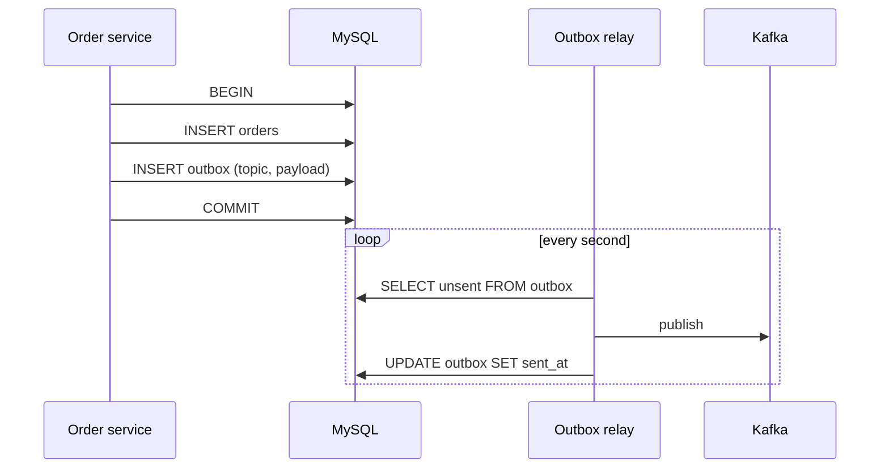
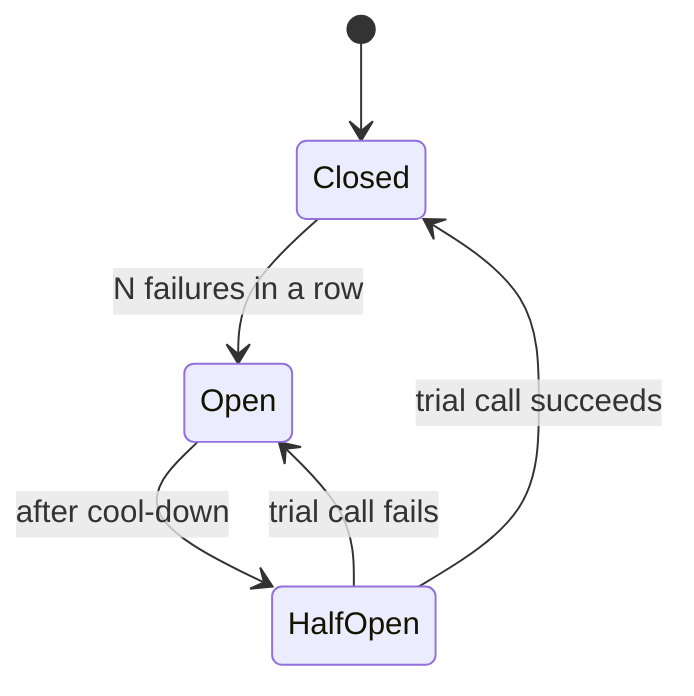

> Tracker ID: DP-15 · Generated: 2026-10-15 · Answers: **DP-Q15** (TRK-02 Phase 10) · Source: Richardson *Microservices Patterns* (Saga, Outbox, CQRS), Nygard *Release It!* (Circuit Breaker) + sokrio-server (`Observers/Concerns/PublishesKafkaMessage`, `config/database.php` `read`, Mongo summaries) + sokrio-benchmark-python (`app/common/tenant_fanout.py`) · Runnable: `5-tracks/design-patterns/code/distributed-patterns.ts` (✅ ran + strict tsc 2026-10-15) · Status: 🟡 generated

# DP-Q15: Explain CQRS, Saga, Outbox and Circuit Breaker. When would you use each one?

> **এক লাইনে:** চারটাই microservice-এর একই মূল সমস্যার উত্তর: **একটা DB transaction আর সব কিছু ঢাকতে পারে না।**
> - **Outbox:** "DB-তে save + event publish" দুটো একসাথে নিশ্চিত করা
> - **Saga:** কয়েকটা সার্ভিস জুড়ে একটা ব্যবসায়িক transaction, ব্যর্থ হলে **compensating action** দিয়ে উল্টানো
> - **CQRS:** লেখা (command) আর পড়া (query)-র জন্য আলাদা model
> - **Circuit Breaker:** অসুস্থ dependency-কে বারবার ডাকা বন্ধ করে দ্রুত fail করা, যাতে পুরো সিস্টেম না ডোবে

---

## ১. Outbox

**সমস্যা (dual write):**
```php
DB::transaction(fn () => $order->save());
$kafka->publish('order.placed', $order);   // এখানে crash বা Kafka down → event চিরতরে হারায়
```
উল্টো ক্রমে (আগে publish, পরে commit) করলে rollback হওয়া order-এর event চলে যায়।

**সমাধান:** event-টা **একই transaction-এ** একটা `outbox` টেবিলে লেখো। আলাদা relay (poller বা CDC যেমন Debezium) outbox পড়ে broker-এ পাঠায়, সফল হলে `sent_at` বসায়।


- গ্যারান্টি: **at-least-once** (publish সফল, কিন্তু `sent_at` লেখার আগে crash → আবার পাঠাবে) → consumer **idempotent** হতে হবে (event id দিয়ে dedupe)
- **কখন:** যখন event হারানো চলবে না (inventory, payment, অন্য সার্ভিসের state)
- **কখন না:** analytics/notification যেখানে মাঝে মাঝে হারানো মেনে নেওয়া যায়, আর একটা সার্ভিস/একটা DB

## ২. Saga

**সমস্যা:** order = stock reserve (Inventory service) + wallet charge (Payment) + van book (Delivery)। তিনটা আলাদা DB, distributed transaction (2PC) ধীর আর ভঙ্গুর।

**সমাধান:** প্রতিটা ধাপ একটা local transaction + একটা **compensating action**। কোনো ধাপ ব্যর্থ হলে আগের সফল ধাপগুলো **উল্টো ক্রমে** compensate।

```
reserve stock  ✅   compensate: release stock
charge wallet  ✅   compensate: refund
book van       ❌   → refund → release stock
```
| ধরন | কীভাবে | ভালো | খারাপ |
|---|---|---|---|
| **Orchestration** | একটা orchestrator ধাপে ধাপে কমান্ড দেয় | flow এক জায়গায় দেখা যায়, debug সহজ | orchestrator-এ লজিক জমে |
| **Choreography** | প্রতিটা সার্ভিস event শুনে পরের কাজ করে | কোনো কেন্দ্র নেই, loose coupling | flow কোথাও লেখা নেই, চক্র হতে পারে |

- Saga-তে **isolation নেই**: মাঝপথে অন্যরা অর্ধেক অবস্থা দেখে (stock reserved কিন্তু payment হয়নি) → "pending" status, semantic lock
- compensation **নিজেও fail** করতে পারে → retry + idempotent + শেষে মানুষের কাছে alert
- কিছু জিনিস compensate হয় না (SMS চলে গেছে) → সেগুলো **শেষে** রাখো

## ৩. CQRS (Command Query Responsibility Segregation)

**সমস্যা:** একই normalized টেবিল লেখার জন্য ভালো (constraint, transaction), কিন্তু dashboard/রিপোর্টের জন্য প্রতিবার বড় join + aggregation → ধীর।

**সমাধান:** **write model** (normalized, MySQL) আর **read model** (screen-এর আকারে, pre-aggregated: Mongo summary, Elasticsearch, Redis)। write model-এর event/job থেকে read model আপডেট হয়।

| মাত্রা | উদাহরণ |
|---|---|
| হালকা | read replica-তে রিপোর্ট পড়া (একই schema, আলাদা server) |
| মাঝারি | write: MySQL orders; read: দিনভিত্তিক summary collection |
| পূর্ণ | event sourcing + আলাদা projection |

- খরচ: **eventual consistency** (রিপোর্ট কয়েক সেকেন্ড/মিনিট পিছিয়ে), দুটো model রক্ষণাবেক্ষণ, rebuild করার উপায় লাগে
- **কখন:** read আর write-এর আকার বা লোড খুব আলাদা (রিপোর্ট-ভারী সিস্টেম)
- **কখন না:** সাধারণ CRUD যেখানে একই model যথেষ্ট

## ৪. Circuit Breaker

**সমস্যা:** SMS provider বা অন্য সার্ভিস ধীর (timeout ৩০s)। প্রতিটা request ৩০s অপেক্ষা করে → worker/thread সব আটকে যায় → **cascading failure**, যে অংশ provider-এর সাথে সম্পর্কিতও না সেটাও ডোবে।

**সমাধান:** তিন অবস্থা।

- **Closed:** স্বাভাবিক, ব্যর্থতা গোনে
- **Open:** dependency ডাকে না, সাথে সাথে **fallback** (cached data, "পরে চেষ্টা করুন", queue-তে রাখা)
- **Half-open:** cool-down-এর পরে একটা trial কল; সফল হলে closed

সাথে লাগে: **timeout** (ছোট), **retry with backoff + jitter** (শুধু idempotent কলে), **bulkhead** (একটা dependency-র জন্য সীমিত worker), monitoring/alert যখন breaker open হয়। (SD বোনাস: `concepts/11-reliability.md`)

---

## ৫. Code

পূর্ণ চলমান ফাইল: `5-tracks/design-patterns/code/distributed-patterns.ts`। চারটাই এক ফাইলে, প্রতিটা ~২০ লাইন।

```ts
class CircuitBreaker {
  private failures = 0;
  private openedAt = 0;
  state: 'closed' | 'open' | 'half-open' = 'closed';
  constructor(private readonly threshold: number, private readonly coolDownMs: number, private readonly now = () => Date.now()) {}

  async call<T>(fn: () => Promise<T>, fallback: () => T): Promise<T> {
    if (this.state === 'open') {
      if (this.now() - this.openedAt < this.coolDownMs) return fallback();   // fail fast
      this.state = 'half-open';
    }
    try {
      const v = await fn();
      this.failures = 0; this.state = 'closed';
      return v;
    } catch {
      this.failures++;
      if (this.state === 'half-open' || this.failures >= this.threshold) { this.state = 'open'; this.openedAt = this.now(); }
      return fallback();
    }
  }
}
```
আউটপুট:
```
Outbox:  broker down → unsent 1 → broker up → published
Saga:    ok reserve, ok charge, FAIL book van → undo charge → undo reserve
Breaker: fail, fail(open), skipped(cached), t=1500 trial → fresh (closed)
CQRS:    read model { '2026-10-15': { orders: 2, amount: 800 } }
```
চালাও: `npx -y tsx 5-tracks/design-patterns/code/distributed-patterns.ts`

---

## ৬. এক টেবিলে: কোনটা কোন সমস্যার

| Pattern | সমস্যা | মূল ধারণা | খরচ |
|---|---|---|---|
| **Outbox** | save + publish একসাথে নিশ্চিত না | event একই transaction-এ টেবিলে, relay পাঠায় | at-least-once, relay চালাতে হয় |
| **Saga** | কয়েক সার্ভিস জুড়ে transaction | local step + compensation, উল্টো ক্রমে | isolation নেই, জটিল |
| **CQRS** | একই model-এ read ধীর | আলাদা read model | eventual consistency |
| **Circuit Breaker** | ধীর dependency সবকিছু ডোবায় | ব্যর্থতা গুনে কল বন্ধ, fallback | fallback ডিজাইন করতে হয় |

এরা একসাথে খাটে: Saga-র ধাপগুলো event পাঠায় **Outbox** দিয়ে; read side **CQRS** projection সেই event থেকে; প্রতিটা সার্ভিস-কল **Circuit Breaker**-এর পেছনে।

---

## ৭. মুখে বলার লাইন (English)

**মূল উত্তর (৭৫ সেকেন্ড):**
> "They all deal with the fact that one database transaction no longer covers everything.
> **Outbox** solves the dual write: instead of saving and then publishing to Kafka, where a crash in between loses the event, I write the event into an outbox table in the same transaction, and a relay publishes it. That's at-least-once, so consumers dedupe by event id.
> **Saga** is a business transaction across services: each step is a local transaction with a compensating action, and on failure you undo the completed steps in reverse, like refund then release stock. Orchestrated if I want the flow visible in one place.
> **CQRS** separates the write model from read models shaped for the screens, updated from events, at the cost of eventual consistency.
> **Circuit breaker** stops calling a dependency that keeps failing, returns a fallback immediately, and lets a single trial call through after a cool-down, so one slow provider doesn't take down everything else."

**Sokrio উদাহরণ (সৎভাবে, কোনটা আছে কোনটা নেই):**
> "We use a light form of CQRS: reports read from pre-aggregated Mongo summaries and a read connection, not the transactional tables. In the benchmark service I built a bounded fan-out across tenants, with a per-tenant timeout and a total budget, and degraded results are never cached. That's the same goal as a circuit breaker, failing fast and isolating a slow tenant, though not a full breaker with open and half-open states. We don't have an outbox: our order observers publish to Kafka directly and log a warning if it fails, so an event can be lost. If those events started driving inventory or payments, an outbox is the first thing I'd add."

---

## ৮. ফলো-আপ প্রশ্ন

| প্রশ্ন | ছোট উত্তর |
|---|---|
| "Why not two-phase commit?" | "It blocks while a coordinator waits, needs every participant to support it, and the coordinator becomes a single point of failure. Brokers like Kafka don't take part in it anyway." |
| "Outbox: polling or CDC?" | "Polling is simple and fine at moderate volume. CDC reads the binlog, so lower latency and no polling load, but more infrastructure." |
| "How do consumers handle duplicates?" | "A processed-events table keyed by event id, inserted in the same transaction as the effect, or naturally idempotent updates." |
| "Saga: what if compensation fails?" | "Retry it with backoff, it must be idempotent, and after that alert a human. Put non-compensatable steps, like sending an SMS, last." |
| "CQRS read model out of date?" | "Show 'as of' time on the screen, make it rebuildable from the source, and for read-your-writes, read the write side right after a user's own change." |
| "Breaker thresholds?" | "Based on error rate over a window rather than a raw count, with a short timeout first, because without a timeout the breaker never sees a failure." |

---

🔗 **Sokrio link:** (কোডে যাচাই করা, Truth Audit-এর জন্য গুরুত্বপূর্ণ)
- **Outbox: নেই।** `app/Observers/Concerns/PublishesKafkaMessage.php` (sihab): `$this->producer->publish($topic, $eventType, $tenantId, $payload, $partitionKey)` `try/catch`-এ, ব্যর্থ হলে শুধু `Log::channel('kafka')->warning(...)`। observer-এ `afterCommit` নেই। অর্থাৎ best-effort: Kafka down থাকলে event হারায়, আর rollback হওয়া change-এর event চলে যেতে পারে। `outbox` শব্দ কোডে কোথাও নেই। "We use an outbox" **বলবে না**। উপরের "improvement" লাইনটা বলো।
- **CQRS-lite: আছে।** MySQL write + MongoDB `order_summaries`/`delivery_summaries` read model (SD-Q15); `config/database.php` `read` connection, ২৭টা report job `reconnect('read')` (SD-Q04)।
- ⭐ **Circuit-breaker-এর কাছাকাছি (তোমার):** `sokrio-benchmark-python/app/common/tenant_fanout.py` → `gather_tenants(..., wall_budget_s=30)`: প্রতিটা tenant `asyncio.wait_for(fn(org), timeout=per_query_s)`, পুরোটা `wait_for(gather(...), timeout=wall_budget_s)`, `_adaptive_concurrency(n_orgs)`; Mongo `maxTimeMS` server-side cancel। degraded ফল cache হয় না (`should_cache`)। একমাত্র লেখক Komol। **আসল circuit breaker (open/half-open state) কোডে নেই** (`circuit`/`breaker` grep: শূন্য)। তাই বলো "bounded fan-out with timeouts", "I built a circuit breaker" না।
- **Compensation-এর ছোট উদাহরণ (তোমার):** `ResendFailedSmsBatch::failed()` → `releaseUnfinished()`: job মরে গেলে claim করা message row-গুলো ছেড়ে দেয় যাতে আটকে না থাকে। Saga না, কিন্তু "on failure, undo what you claimed" একই ধারণা।
- **Saga: নেই** (সব একটা monolith + tenant DB-তে, DB transaction দিয়ে)। সৎভাবে: *"We haven't needed sagas because our core flows run in one service with local transactions."*
- ⚠️ S1 (RabbitMQ microservices) আর S5 (payment webhook) এর সত্যতা Truth Audit-এ যাচাই না হওয়া পর্যন্ত এই প্রশ্নে ওগুলো উদাহরণ হিসেবে **ব্যবহার করবে না**।

📚 আরো: `4-library/cs/08-kafka-redis-rabbitmq/` · `4-library/fieldnation/topics/09-microservices-event-driven.md` · সম্পর্কিত: [09-observer.md](../behavioral/09-observer.md) · [11-command.md](../behavioral/11-command.md) · `5-tracks/system-design/cases/11-payment.md` · `5-tracks/system-design/concepts/11-reliability.md`
