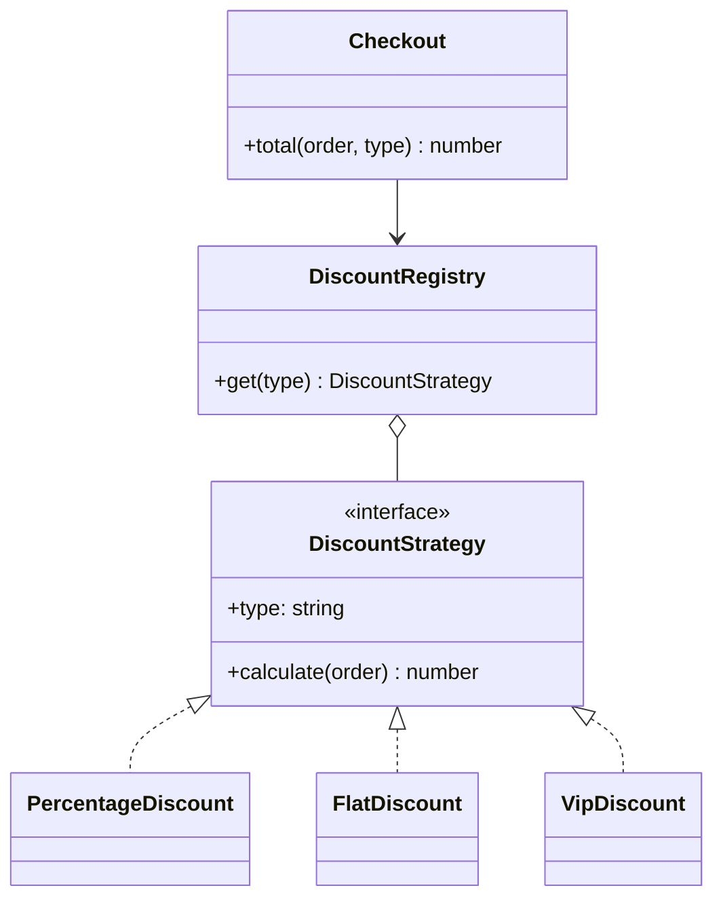

> Tracker ID: DP-03 · Generated: 2026-10-15 · Answers: **DP-Q03** (TRK-02 Phase 2) · Source: GoF + sokrio-server code (`app/Services/VanSales/Alerts/`, `NotificationSender`/`FCMServiceProvider`, `Services/Export/ReportServiceInterface`) · Runnable: `5-tracks/design-patterns/code/strategy.ts` (✅ ran 2026-10-15) · Status: ✅ generated

# DP-Q03: Many `if/else` blocks for discount or payment types. How do you clean this up?

> **এক লাইনে:** প্রতিটা ধরনকে (discount/payment) **নিজের class**-এ নাও, সবাই একই **interface** মানবে। মূল কোড শুধু interface ডাকে, কোন class সেটা জানে না। নতুন ধরন = নতুন class, পুরনো কোড অপরিবর্তিত। এটাই **Strategy pattern** আর **Open/Closed principle**।

---

## ১. Problem: ব্যথাটা কী

```php
// প্রতিটা নতুন discount টাইপে এই ফাংশন খুলতে হয়
if ($type === 'percentage') { ... }
elseif ($type === 'flat') { ... }
elseif ($type === 'vip') { ... }
elseif ($type === 'festival') { ... }   // নতুন, আর আগের সবকিছু আবার টেস্ট করতে হয়
```

সমস্যা:
- **Open/Closed ভাঙে:** নতুন আচরণ যোগ করতে পুরনো, চলমান কোড বদলাতে হয়
- **একই `if` চেইন অনেক জায়গায়** (দাম হিসাব, invoice, রিপোর্ট) → একটায় যোগ করে আরেকটায় ভুলে যাওয়া
- **টেস্ট কঠিন:** একটা rule টেস্ট করতে পুরো ফাংশন চালাতে হয়
- একাধিক ডেভেলপার একই ফাংশনে কাজ করলে merge conflict

## ২. Structure



| ভূমিকা | কী | এখানে |
|---|---|---|
| **Strategy** (interface) | সব variant-এর এক চুক্তি | `DiscountStrategy` |
| **Concrete strategy** | একটা নির্দিষ্ট অ্যালগরিদম | `FlatDiscount`, `VipDiscount` |
| **Context** | strategy ব্যবহার করে, ধরন জানে না | `Checkout` |
| (সাথে) **Registry / Factory** | type string → সঠিক strategy, **একমাত্র** জায়গা যেখানে বাছাই হয় | `DiscountRegistry` |

> `if/else` পুরোপুরি মুছে যায় না, **এক জায়গায় সরে যায়** (registry/factory/DI binding)। ইন্টারভিউতে এটা নিজে বললে ভালো দেখায়।

## ৩. Code

### TypeScript (পূর্ণ চলমান ফাইল: `5-tracks/design-patterns/code/strategy.ts`)

```ts
interface DiscountStrategy {
  readonly type: string;
  calculate(order: Order): number;
}

class FlatDiscount implements DiscountStrategy {
  readonly type = 'flat';
  constructor(private readonly amount: number) {}
  calculate(order: Order): number {
    return Math.min(this.amount, order.subtotal);
  }
}
// PercentageDiscount, VipDiscount, NoDiscount একইভাবে

class DiscountRegistry {
  private readonly byType = new Map<string, DiscountStrategy>();
  constructor(strategies: DiscountStrategy[]) {
    for (const s of strategies) this.byType.set(s.type, s);
  }
  get(type: string): DiscountStrategy {
    const s = this.byType.get(type);
    if (!s) throw new Error(`Unknown discount type: ${type}`);
    return s;
  }
}

class Checkout {
  constructor(private readonly discounts: DiscountRegistry) {}
  total(order: Order, discountType: string): number {
    return order.subtotal - this.discounts.get(discountType).calculate(order);
  }
}
```
চালাও: `npx -y tsx 5-tracks/design-patterns/code/strategy.ts` → আগের `if/else` আর নতুন Strategy দুটোর ফল মিলিয়ে দেখায় (`same=true`)।

### Laravel-এ
```php
interface DiscountStrategy {
    public function type(): string;
    public function calculate(Order $order): float;
}

final class FlatDiscount implements DiscountStrategy { /* ... */ }

// AppServiceProvider: সব strategy একসাথে tag করো
$this->app->tag([PercentageDiscount::class, FlatDiscount::class, VipDiscount::class], 'discounts');

$this->app->singleton(DiscountRegistry::class, fn ($app) =>
    new DiscountRegistry($app->tagged('discounts'))
);

// Controller / service
public function __construct(private DiscountRegistry $discounts) {}
$total = $order->subtotal - $this->discounts->get($request->discount_type)->calculate($order);
```

**পরিবেশ অনুযায়ী Strategy বদলানো (DI binding):**
```php
$this->app->bind(PaymentGateway::class, fn () =>
    app()->environment('testing') ? new FakeGateway() : new RealGateway()
);
```

---

## ৪. Trade-off আর কখন **ব্যবহার করবে না**

| ✅ ব্যবহার করো | ❌ করো না |
|---|---|
| ৩+ ধরন, আর **নতুন ধরন আসতেই থাকবে** | মাত্র ২টা স্থির ধরন, বদলানোর লক্ষণ নেই (→ DP-Q01 rule of three) |
| প্রতিটা ধরনের লজিক কয়েক লাইনের বেশি | প্রতিটা branch এক লাইন: একটা `match`/map-ই যথেষ্ট |
| runtime-এ বাছাই হয় (user-এর পছন্দ, config, env) | |
| প্রতিটা rule আলাদা টেস্ট করতে চাও | |

**হালকা বিকল্প:** লজিক ছোট হলে class না বানিয়ে **function-এর map**:
```ts
const discounts: Record<string, (o: Order) => number> = {
  none: () => 0,
  flat: (o) => Math.min(50, o.subtotal),
};
```
এটাও Strategy, শুধু class ছাড়া। TypeScript/JS-এ প্রায়ই এটাই যথেষ্ট।

**খরচ:** class সংখ্যা বাড়ে; কোন strategy চলছে কোড পড়ে সরাসরি দেখা যায় না (registry দেখতে হয়)।

### Strategy vs কাছাকাছি pattern
| | পার্থক্য |
|---|---|
| **State** (DP-Q12) | গঠন একই, কিন্তু State-এ object **নিজে** অবস্থা বদলায় (Pending → Approved); Strategy বাইরে থেকে বেছে দেওয়া হয় আর সাধারণত বদলায় না |
| **Template Method** (DP-Q13) | Template = inheritance, কাঠামো স্থির, একটা ধাপ বদলায়। Strategy = composition, পুরো অ্যালগরিদম বদলায় |
| **Factory** (DP-Q04) | Factory **তৈরি** করে, Strategy **আচরণ** করে। প্রায়ই একসাথে: factory/registry সঠিক strategy দেয় |

---

## ৫. মুখে বলার লাইন (English)

**মূল উত্তর (৪৫ সেকেন্ড):**
> "I'd use the Strategy pattern. Each discount type becomes its own class behind one interface, say `calculate(order)`. The checkout code only depends on the interface, so it doesn't know or care which rule runs. Picking the right strategy happens in exactly one place, a small registry or the DI container, so the if/else doesn't disappear but it stops being spread everywhere. Adding a new discount means one new class and one registration line, without touching checkout. That's the Open/Closed principle, and each rule can be unit-tested on its own."

**কখন না (এটা বললে সিনিয়র দেখায়):**
> "If there were only two fixed types, I'd keep a simple conditional or a map of functions. Strategy pays off when new variants keep coming."

**Sokrio উদাহরণ:**
> "In our van-sales module, each alert kind, like off-beat or no-sync, is its own rule class behind a `VanAlertRule` interface with `detect()`. A registry lists them, and the detector, the API filters and the feed all read from that one list. Adding a new alert type is a new class and one line in the registry."

---

## ৬. ফলো-আপ প্রশ্ন

| প্রশ্ন | ছোট উত্তর |
|---|---|
| "Where does the if/else go then?" | "Into one place that chooses the strategy: a registry, factory or DI binding. Everything else just uses the interface." |
| "Discounts stack: VIP plus coupon?" | "Compose them: a `CompositeDiscount` that holds a list of strategies and sums or applies them in order, with a cap. Or a Chain/pipeline if order matters." |
| "Rules change without a deploy?" | "Then the parameters, like percent or amount, come from the database, and the strategy classes stay as the fixed set of rule *types*." |
| "Strategy vs State?" | "Same shape, different intent. Strategy is chosen from outside. State changes itself as the object moves through its lifecycle." |
| "How do you test it?" | "Each strategy alone with plain inputs, and the context with a fake strategy." |

---

🔗 **Sokrio link:** (কোডে যাচাই করা, সব **টিমের লেখা** → বলো "our codebase uses", "I built" না)
- **Strategy + registry:** `app/Services/VanSales/Alerts/VanAlertRule.php` (interface: `type()`, `label()`, `detect(VanAlertScope)`) → `OffBeatRule`, `NoSyncRule`; `VanAlertRules.php` = registry (`RULES` const, `all()`, `types()`, `labels()`), যেটা detector, API আর feed সবাই পড়ে। ঠিক ওপরের `DiscountRegistry`-র মতো। লেখক টিম (Rakib)।
- **DI দিয়ে Strategy বদলানো:** `NotificationSender` → `FCM` / `LogFCM`; `FCMServiceProvider` testing env-এ `LogFCM` বাঁধে → টেস্টে আসল push যায় না।
- **Polymorphic export:** `Services/Export/ReportServiceInterface` → ৫টা রিপোর্ট সার্ভিস; export job যেকোনো রিপোর্ট একই interface দিয়ে চালায়।
- **তোমার নিজের গল্প:** তুমি কি কোনো `if/else` চেইন Strategy-তে refactor করেছ? `[Komol পূরণ করবে]`। না থাকলে সৎভাবে: *"I haven't introduced one from scratch, but I've extended our alert rules and export services, which are built this way."* (সত্যি হলে তবেই বলো)

📚 আরো: `4-library/cs/01-oop-design-pattern/` (Strategy অংশ) · সম্পর্কিত: [01-principles.md](../01-principles.md) (কখন না) · Sokrio ম্যাপ: [02-sokrio-pattern-map.md](../02-sokrio-pattern-map.md)
