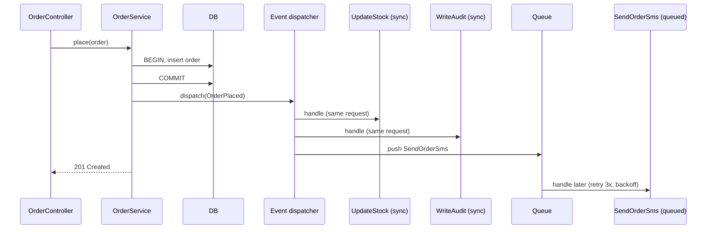

> Tracker ID: DP-09 · Generated: 2026-10-15 · Answers: **DP-Q09** (TRK-02 Phase 6) · Source: GoF + sokrio-server code (`Providers/EventServiceProvider` `OrderApproved` listeners, `app/Observers/`, `Observers/Concerns/PublishesKafkaMessage`, `Notification/ApprovalNotifier` `->afterCommit()`) · Runnable: `5-tracks/design-patterns/code/observer.ts` (✅ ran + strict tsc 2026-10-15) · Status: 🟡 generated

# DP-Q09: When an order is placed, you need to send SMS, update stock and write a log. How do you keep these decoupled?

> **এক লাইনে:** order সার্ভিস শুধু একটা **event** ছাড়ে (`OrderPlaced`), কে শুনছে জানে না। প্রতিটা side-effect (SMS, stock, log) আলাদা **listener**। এটাই **Observer** (publish/subscribe)। আসল সিদ্ধান্ত হলো কোন listener **sync** (একই transaction-এ, ব্যর্থ হলে order-ও ব্যর্থ) আর কোনটা **queued** (পরে, retry সহ)।

---

## ১. Problem

```php
public function place(Request $r) {
    $order = Order::create(...);
    $this->stock->decrement(...);          // stock module
    $this->sms->send($order->phone, ...);  // SMS module, ধীর, মাঝে মাঝে fail
    Log::info(...);                        // audit
    $this->kafka->publish(...);            // analytics
    // নতুন চাহিদা: loyalty point, push notification, target হিসাব...
}
```
- order কোড সব মডিউল জানে → প্রতিটা নতুন চাহিদায় এই ফাংশন বদলায়
- SMS provider ধীর হলে order API-ও ধীর; SMS fail হলে order কি fail হবে?
- এক মডিউলের bug অন্যগুলো আটকে দেয়

## ২. Structure



| ভূমিকা | কী |
|---|---|
| **Subject / Publisher** | event ছাড়ে, listener-দের জানে না | `OrderService` |
| **Event** | কী ঘটেছে, ছোট ডেটা (id, tenant_id), অতীত কাল নাম | `OrderPlaced` |
| **Observer / Listener** | একটা কাজ করে | `UpdateStock`, `SendOrderSms` |
| **Dispatcher** | কোন event-এ কে, এক জায়গায় তালিকা | `EventServiceProvider::$listen` |

### Sync vs queued: আসল ডিজাইন সিদ্ধান্ত
| প্রশ্ন | Sync listener | Queued listener |
|---|---|---|
| ব্যর্থ হলে order rollback হবে? | হ্যাঁ, হতে পারে (একই transaction-এ রাখলে) | না, আলাদা retry |
| উদাহরণ | **stock কমানো** (oversell আটকাতে order-এর সাথে atomic) | **SMS, email, push, analytics** |
| গতি | API-র সময় বাড়ায় | API দ্রুত |
| সমস্যা | ধীর listener পুরো request ধীর করে | at-least-once → listener **idempotent** হতে হবে |

> **নিয়ম:** যা না হলে order-টাই ভুল (stock), সেটা event-এ না দিয়ে **সরাসরি transaction-এর ভেতরে** রাখাও বৈধ। Event = "যা ঘটেছে তার খবর", ব্যবসার মূল invariant না।

## ৩. Code

### TypeScript (পূর্ণ চলমান ফাইল: `5-tracks/design-patterns/code/observer.ts`)

```ts
class EventBus<E extends { type: string }> {
  on(type: E['type'], listener: Listener<E>, opts: { queued?: boolean } = {}) { ... }
  async dispatch(event: E): Promise<string[]> {
    const errors: string[] = [];
    for (const l of this.listeners.get(event.type) ?? []) {
      try { await l(event); } catch (err) { errors.push((err as Error).message); } // one failure doesn't stop others
    }
    return errors;
  }
  async work(maxTries = 3) { /* queued listeners, with retry */ }
}

bus.on('OrderPlaced', (e) => decrementStock(e.items));            // sync
bus.on('OrderPlaced', (e) => audit(e));                            // sync
bus.on('OrderPlaced', (e) => sms.send(e.phone, ...), { queued: true }); // queued + retry
```
আউটপুট: stock 10 → 7 সাথে সাথে; SMS প্রথমবার timeout, worker retry করে পাঠায়।
চালাও: `npx -y tsx 5-tracks/design-patterns/code/observer.ts`

### Laravel-এ
```php
// EventServiceProvider
protected $listen = [
    OrderPlaced::class => [
        UpdateStock::class,       // sync
        WriteOrderAudit::class,   // sync
        SendOrderSms::class,      // implements ShouldQueue
    ],
];

class SendOrderSms implements ShouldQueue
{
    public $tries = 3;
    public $backoff = [10, 60, 300];
    public function handle(OrderPlaced $e): void { /* idempotent: skip if already sent */ }
}

// dispatch, transaction commit হওয়ার পরে
DB::transaction(function () use ($data) {
    $order = Order::create($data);
    OrderPlaced::dispatch($order);   // listener-এ ShouldHandleEventsAfterCommit, অথবা ->afterCommit()
});
```

**Laravel-এ Observer-এর দুই রূপ:**
| | Event + Listener | Model Observer (`app/Observers`) |
|---|---|---|
| ট্রিগার | তুমি `dispatch` করো (ব্যবসায়িক event: `OrderApproved`) | Eloquent নিজে (`created`, `updated`, `deleted`) |
| ভালো | domain event, অনেক listener, queue | history/audit, cache clear, "যেকোনো save-এ" |
| সাবধান | | `Model::query()->update()` (mass update) observer **চালায় না** |

---

## ৪. Trade-off আর কখন **ব্যবহার করবে না**

| ✅ Observer | ❌ সরাসরি কল ভালো |
|---|---|
| side-effect কলারের দায়িত্ব না (notification, analytics, audit) | ফলটা flow-এর জন্য দরকার (দাম হিসাব, validation) |
| অনেক মডিউল একই ঘটনায় প্রতিক্রিয়া দেয়, আরো আসবে | মাত্র একটা প্রতিক্রিয়া, কখনো বাড়বে না |
| ধীর/অনির্ভরযোগ্য কাজ queue-তে পাঠাতে চাও | ক্রম আর atomicity অবশ্যই চাই |

**খরচ:**
- **control flow লুকিয়ে যায়:** "order approve করলে কী কী হয়?" উত্তর কোডে এক জায়গায় না, `EventServiceProvider` খুলতে হয়
- listener-এর ক্রমের ওপর নির্ভর করা বিপজ্জনক
- **transaction-এর আগে dispatch** করলে queued listener এমন order পড়তে পারে যেটা পরে rollback হলো → `afterCommit`
- queued listener at-least-once → idempotent হতে হবে
- প্রক্রিয়ার বাইরে (অন্য সার্ভিসে) পাঠাতে হলে commit আর publish-এর মাঝে crash → event হারায় → **Outbox** (DP-Q15)

### কাছাকাছি pattern
| | পার্থক্য |
|---|---|
| **Pub/Sub (Kafka, RabbitMQ)** | process-এর বাইরে Observer: publisher আর subscriber আলাদা সার্ভিস, broker মাঝে |
| **Mediator** | কম্পোনেন্টগুলো একে অপরকে না ডেকে একটা মধ্যস্থতাকারীর মাধ্যমে কথা বলে; Observer-এ শুধু এক দিক (publisher → listeners) |
| **Command** (DP-Q11) | queued listener আসলে একটা command (serialized job) |

---

## ৫. মুখে বলার লাইন (English)

**মূল উত্তর (৪৫ সেকেন্ড):**
> "The order service saves the order and publishes one event, `OrderPlaced`, after the transaction commits. It doesn't know who listens. Each side effect is its own listener: SMS, audit log, analytics. The key decision is sync versus queued. Anything that must be consistent with the order, like reserving stock, I keep inside the transaction, either directly or as a sync listener. Slow or flaky things like SMS go to a queued listener with retries and backoff, and since queues deliver at least once, that listener checks whether it already sent before sending. Adding a new reaction later, like loyalty points, is one new listener and no change to the order code."

**Sokrio উদাহরণ:**
> "When an order is approved in our system, the model dispatches `OrderApproved`, and the event map lists six listeners: accept the order, start a revision, create the invoice, increase pending quantity in the seller's stock, and fire notifications. The notification and revision listeners are queued. Separately, model observers on orders and deliveries publish change events to Kafka for other services."

---

## ৬. ফলো-আপ প্রশ্ন

| প্রশ্ন | ছোট উত্তর |
|---|---|
| "What if the SMS listener fails?" | "It's queued, so it retries with backoff; after the last try it lands in failed jobs and we alert. The order itself is fine." |
| "Dispatch before or after commit?" | "After. Otherwise a queued listener can run before the commit, or for an order that rolled back. Laravel has `afterCommit` for exactly this." |
| "Listener order matters?" | "Then they're not independent, and I'd make it one listener or an explicit pipeline instead of relying on registration order." |
| "Across services?" | "Same idea through a broker like Kafka, with an outbox so the event isn't lost if we crash between commit and publish." |
| "Downsides?" | "Hidden control flow. You can't read the order code and see everything that happens, so I keep the event map in one place and name events in past tense." |

---

🔗 **Sokrio link:** (কোডে যাচাই করা)
- **Event + listeners:** `app/Providers/EventServiceProvider.php` → `OrderApproved::class => [AcceptOrder, InitOrderRevision, CreateInvoice, IncreasePendingQtyInSellerStock, InitInvoiceRevision, FireAcceptedNotifications]` (আর `AchieveInvoiceTargets`/`AchieveProductTargets` comment করা)। Dispatch: `app/Models/Order/Order.php` → `approve()` → `OrderApproved::dispatch($this)`; MongoDB `PrimaryOrder`-এরও নিজস্ব `OrderApproved`। Queued: `FireAcceptedNotifications`, `InitOrderRevision`, `AchieveProductTargets` (`ShouldQueue`)। লেখক টিম (Tanmay, sihab, shihab)।
- **Model observers:** `app/Observers/` (Order, Delivery, History, Permission, Role, Setting, Unit…)। `Observers/Concerns/PublishesKafkaMessage` trait → Kafka publish (sihab; A4, টিমের)।
- **After commit:** `app/Services/Notification/ApprovalNotifier.php` → `SendApprovalNotificationJob::dispatch(...)->afterCommit()`।
- **আলোচনার মতো পর্যবেক্ষণ:** `OrderApproved`-এর listener-গুলো (invoice তৈরি, stock বাড়ানো) ব্যবসার মূল কাজ, শুধু notification না। অর্থাৎ "approve করলে কী হয়" কোডে লুকানো, আর sync listener-গুলোর ক্রমের ওপর নির্ভরতা আছে। "Downsides of Observer" প্রশ্নে সৎ উদাহরণ: *"In our codebase, approving an order triggers invoice creation through a listener, which works but makes the flow harder to follow."*
- **তোমার নিজের:** `[Komol পূরণ করবে: কোনো listener/observer তুমি যোগ করেছ বা debug করেছ কি না]`

📚 আরো: `4-library/cs/01-oop-design-pattern/` · সম্পর্কিত: [11-command.md](11-command.md) · [15-distributed-patterns.md](../architectural/15-distributed-patterns.md) (Outbox) · `5-tracks/system-design/concepts/07-queues.md`
