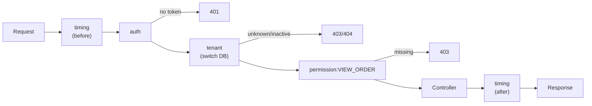

> Tracker ID: DP-10 · Generated: 2026-10-15 · Answers: **DP-Q10** (TRK-02 Phase 6) · Source: GoF + Laravel `Illuminate\Pipeline\Pipeline` + sokrio-server code (`Http/Kernel.php`, `Middleware/EnsureTenantAccess`, `ScopeCacheToTenant`, `app/Filters/` + `vendor/tanmaymishu/laravel-funnel`, `RouteServiceProvider` rate limiters) · Runnable: `5-tracks/design-patterns/code/chain.ts` (✅ ran + strict tsc 2026-10-15) · Status: 🟡 generated

# DP-Q10: How do Laravel middleware work? Which pattern is it?

> **এক লাইনে:** **Chain of Responsibility**, pipeline আকারে। request একটা middleware থেকে পরেরটায় যায়; প্রতিটা middleware হয় `$next($request)` ডেকে এগিয়ে দেয়, নয়তো নিজেই response দিয়ে chain **থামিয়ে** দেয় (401, 403)। `$next`-এর **পরে** লেখা কোড response ফেরার পথে চলে। Laravel এটা বানায় `Pipeline` class দিয়ে: middleware-এর তালিকা `array_reduce` করে closure-এর onion বানায়।

---

## ১. কীভাবে কাজ করে

```php
class EnsureTenantAccess
{
    public function handle($request, Closure $next)
    {
        // ১. আগে: চেক করো, request সাজাও
        $tenant = Org::findByDomain($request->account);
        if (! $tenant?->active) {
            return response()->json(['message' => 'Tenant account is inactive'], 403); // chain থামে
        }
        TenantManager::tenant($tenant)->reconnect();

        // ২. পরের ধাপে পাঠাও
        $response = $next($request);

        // ৩. পরে: response ফেরার পথে (header যোগ, timing, cleanup)
        return $response;
    }
}
```



**Onion মডেল:** প্রথম middleware সবার বাইরে। ভেতরে যাওয়ার পথে "before" কোড, বাইরে আসার পথে "after" কোড, উল্টো ক্রমে।

### Laravel-এ middleware কোথায় বসে
| জায়গা | উদাহরণ |
|---|---|
| **Global** (`$middleware`) | `TrustProxies`, `TrimStrings`, CORS |
| **Group** (`$middlewareGroups`) | `api`, `web`; Sokrio-তে van-sales group: `tenant` → `module.assigned:van_sales_module` → `van.db` |
| **Route alias** (`$routeMiddleware` / `$middlewareAliases`) | `'tenant' => EnsureTenantAccess`, `'landlord'`, `'permission:...'`, `throttle:...` |
| **Controller constructor** | `$this->middleware('permission:' . Permission::VIEW_X)` (Sokrio রিপোর্ট কন্ট্রোলারে) |
| **Terminable** | `terminate($request, $response)`: response পাঠানোর **পরে** চলে (log flush) |

## ২. ভেতরে কী আছে: Pipeline

```php
// Laravel Kernel (সরলীকৃত)
(new Pipeline($app))
    ->send($request)
    ->through($middleware)          // [Auth, Tenant, Permission]
    ->then(fn ($req) => $router->dispatch($req));
```
`Pipeline` middleware-এর তালিকা **উল্টো দিক থেকে** fold করে: শেষ handler-কে শেষ middleware মোড়ায়, সেটাকে তার আগেরটা… ফলে প্রথম middleware সবার বাইরে।

### TypeScript (পূর্ণ চলমান ফাইল: `5-tracks/design-patterns/code/chain.ts`)
```ts
type Middleware = (req: Req, next: Next) => Promise<Res>;

function pipeline(middleware: Middleware[], handler: Next): Next {
  return middleware.reduceRight<Next>((next, mw) => (req) => mw(req, next), handler);
}

const auth: Middleware = async (req, next) =>
  req.token === 'good' ? next(req) : { status: 401, body: 'Unauthenticated' };   // short-circuit

const tenant: Middleware = async (req, next) => {
  const sub = req.host.split('.')[0];
  if (!['thl', 'kitty'].includes(sub)) return { status: 404, body: 'Unknown tenant' };
  return next({ ...req, tenant: sub });                                          // enrich request
};

const app = pipeline([timing, auth, tenant, permission('VIEW_ORDER')], handler);
```
আউটপুট: সঠিক request → 200; খারাপ token → 401; অজানা subdomain → 404; permission নেই → 403। Express/Koa/NestJS middleware একই জিনিস।
চালাও: `npx -y tsx 5-tracks/design-patterns/code/chain.ts`

### একই pattern, query filter-এ (Sokrio-তে আসলে আছে)
```php
// laravel-funnel: Filter::handle($passable, Closure $next)
public function handle($passable, \Closure $next)
{
    if (! request()->filled($this->parameter)) {
        return $next($passable);          // আমার param নেই → এগিয়ে দাও
    }
    $this->builder = $next($passable);
    return $this->apply($this->builder);  // আমার where যোগ করো
}

// HasFilters
app(Pipeline::class)->send($query)->through((new static)->filters)->thenReturn();
```
প্রতিটা filter class একটা query param দেখে (`status`, `territory_id`, `inc_pro_ids`), থাকলে একটা `where` যোগ করে। নতুন filter = একটা class, controller-এ কোনো `if` নেই।

---

## ৩. Classic GoF Chain vs Pipeline

| | Classic Chain of Responsibility | Pipeline / middleware |
|---|---|---|
| কে কাজ করে | **প্রথম যে পারে**, সে handle করে আর থামে (support ticket: L1 → L2 → L3) | **সবাই** একটু একটু করে, যে কেউ থামাতে পারে |
| উদাহরণ | approval chain: ৳১০k পর্যন্ত manager, বেশি হলে director | HTTP middleware, query filters |
| ফেরার পথে কাজ | সাধারণত না | হ্যাঁ (`$next`-এর পরের কোড) |

ইন্টারভিউতে বলো: "Middleware is Chain of Responsibility in its pipeline form, and it also behaves like a stack of decorators around the controller."

---

## ৪. Trade-off আর সাবধানতা

| ✅ ভালো | ⚠️ সাবধান |
|---|---|
| cross-cutting কাজ (auth, tenant, CORS, throttle, logging) controller থেকে আলাদা | **ক্রম ভুল** হলে নিরাপত্তা ভাঙে: tenant switch-এর আগে permission চেক করলে ভুল DB-তে দেখে |
| প্রতিটা ছোট, আলাদা টেস্টযোগ্য | middleware-এ ভারী DB query → প্রতিটা request ধীর |
| route ধরে চালু/বন্ধ | long-running worker-এ middleware চলে না: queue job-এ tenant switch নিজে করতে হয় (Sokrio-তে `JobProcessing` event দিয়ে) |
| | middleware-এ business logic ঢোকানো → লুকানো আচরণ |

---

## ৫. মুখে বলার লাইন (English)

**মূল উত্তর (৪৫ সেকেন্ড):**
> "It's Chain of Responsibility in pipeline form. Each middleware gets the request and a `$next` closure. It can stop the chain by returning a response, like a 401 or 403, or call `$next` to pass the request on. Code after `$next` runs on the way back, so it's an onion: the first middleware is the outermost layer. Internally Laravel's `Pipeline` class folds the middleware list around the router, from the last one to the first. Order matters a lot. In our multi-tenant app, the tenant middleware has to resolve the tenant and switch the database before the permission middleware runs, or the permission check would look at the wrong database."

**Sokrio উদাহরণ:**
> "Every tenant route goes through `EnsureTenantAccess`, which resolves the org from the subdomain, rejects inactive tenants with a 403, and reconnects the tenant database. Module groups then chain a module check, like `module.assigned:van_sales_module`, and a database middleware. We use the same pipeline idea for list filters: around 200 small filter classes, each adding one `where` if its query parameter is present."

---

## ৬. ফলো-আপ প্রশ্ন

| প্রশ্ন | ছোট উত্তর |
|---|---|
| "Before vs after middleware?" | "Code before `$next` runs on the way in, code after it on the way out. Terminable middleware runs after the response has been sent." |
| "How would you write rate limiting?" | "Laravel's `throttle` middleware with a named limiter. The key must include the tenant, because user ids repeat across tenant databases." |
| "Where do you put the permission check, middleware or controller?" | "Route-level permission in middleware. Row-level rules, like 'can see only their territory', in the query or a policy, because they need the data." |
| "What doesn't go through middleware?" | "Queue jobs and console commands. So tenant switching for jobs has to happen in the job or a job middleware." |
| "Classic chain example?" | "An approval chain where each approver handles amounts up to their limit and passes larger ones up." |

---

🔗 **Sokrio link:** (কোডে যাচাই করা)
- **Tenant middleware:** `app/Http/Middleware/EnsureTenantAccess.php`: `Org::findByDomain($request->account)` → inactive হলে 403 → `app()->instance('tenant', $tenant)` → `TenantManager::tenant($tenant)->reconnect()`; tenant DB না থাকলে (MySQL error 1049) আলাদা হ্যান্ডলিং। লেখক টিম (sihab মূল, Tanmay)। Kernel alias: `'tenant' => EnsureTenantAccess`, `'landlord'`, `'guest.access'`, `'admin.permission'`; group-এ `tenant` → `module.assigned:...` → `van.db` / `task_manager.db`। (S3)
- **Cache scoping middleware:** `ScopeCacheToTenant` (sihab) prefix `tenant_{id}` বসায়।
- **Query filter pipeline:** `app/Filters/` (১৯৬টা Filter class) → `vendor/tanmaymishu/laravel-funnel` (`Filter::handle($passable, $next)`, `HasFilters` → `Pipeline::send($query)->through($filters)->thenReturn()`)। প্যাকেজ Tanmay-র।
- ⭐ **তোমার নিজের, middleware-লেভেলে:** SMS resend-এর named rate limiters `RouteServiceProvider::configureSmsResendRateLimiting()` (commit `996fa2bc6`, Komol): `sms-failed-ids` ১০/মিনিট, `sms-resend-check` ১০/মিনিট, `sms-resend` ৫/মিনিট, key = `name|host|user_id` (কারণ: user id tenant জুড়ে repeat হয়, সাধারণ `throttle:5,1` সব tenant-এর একই user id-কে এক counter-এ ফেলে), 429-এ `ERR_RATE_LIMIT` JSON। এটা `throttle:` middleware দিয়ে route-এ বসে।
  > "For the SMS resend endpoints I added named rate limiters keyed by host plus user, because user ids repeat across tenant databases, and a plain throttle would have shared one counter between users of different tenants."

📚 আরো: `4-library/cs/09-laravel-backend/` · সম্পর্কিত: [08-decorator-proxy.md](../structural/08-decorator-proxy.md) · `5-tracks/system-design/cases/09-rate-limiter.md`
