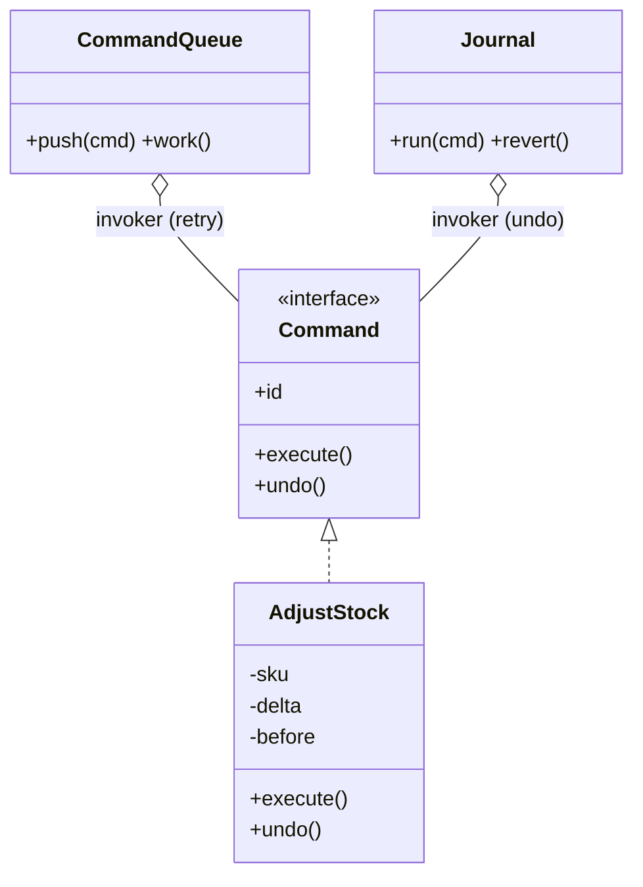

> Tracker ID: DP-11 · Generated: 2026-10-15 · Answers: **DP-Q11** (TRK-02 Phase 7) · Source: GoF + sokrio-server code (`app/Jobs/` 132 files, `Jobs/ResendFailedSmsBatch`, `Support/QaSeed/QaJournal` + `QaReverter`, `Order::approveAfter`) · Runnable: `5-tracks/design-patterns/code/command.ts` (✅ ran + strict tsc 2026-10-15) · Status: 🟡 generated

# DP-Q11: How would you model an action so it can be queued, retried or undone?

> **এক লাইনে:** action-টাকে একটা **object** বানাও যেটা নিজের সব ডেটা বহন করে আর `execute()` জানে (undo লাগলে `undo()`-ও)। তাহলে এটাকে queue-তে রাখা, পরে চালানো, অন্য মেশিনে চালানো, retry করা, log করা আর উল্টো করা যায়। এটাই **Command pattern**। Laravel-এর **Job** = serialized command।

---

## ১. Problem

```php
public function approve(Order $order) {
    $this->invoice->create($order);    // এখনই, এই request-এ
    $this->sms->send(...);              // fail হলে? আবার চেষ্টা কে করবে?
}
```
- কাজটা "এখনই, এই request-এর ভেতরে" বাঁধা: পরে চালানো, ৫ মিনিট পরে চালানো, worker-এ চালানো যায় না
- fail হলে retry করার মতো কিছু নেই: কাজটা কোথাও লেখা নেই
- "এই কাজটা উল্টে দাও" (undo) সম্ভব না, কারণ আগের অবস্থা কেউ মনে রাখেনি

## ২. Structure



| ভূমিকা | কী | Laravel-এ |
|---|---|---|
| **Command** | action + তার ডেটা, `execute()` | Job class (`handle()`) |
| **Invoker** | কখন/কোথায় চালাবে ঠিক করে | Queue + worker, scheduler |
| **Receiver** | যে আসল কাজ করে | service (`SMSSender`, `InvoiceService`) |
| **Client** | command বানিয়ে invoker-কে দেয় | controller: `Job::dispatch(...)` |

### Command থাকলে কী কী পাওয়া যায়
| ক্ষমতা | কীভাবে |
|---|---|
| **Queue / defer** | object serialize হয়ে Redis/DB-তে, worker পরে চালায় (`->delay(now()->addMinutes(5))`) |
| **Retry** | একই object আবার `execute()` (`$tries`, `$backoff`) |
| **Idempotency** | command-এর একটা id; আগে চলে থাকলে skip (ডাবল ক্লিক, redelivery) |
| **Undo** | execute-এর সময় `before` মনে রাখো; undo সেটা ফেরত দেয়। একাধিক হলে **উল্টো ক্রমে** |
| **Audit / replay** | command-গুলোর log = কী ঘটেছে তার ইতিহাস |
| **Batch** | অনেক command একসাথে (`Bus::batch`) |

## ৩. Code

### TypeScript (পূর্ণ চলমান ফাইল: `5-tracks/design-patterns/code/command.ts`)

```ts
interface Command {
  readonly id: string;   // idempotency
  execute(db: Db): void;
  undo(db: Db): void;
}

class AdjustStock implements Command {
  private before: number | undefined;                 // remembered for undo
  constructor(readonly id: string, private readonly sku: string, private readonly delta: number) {}
  execute(db: Db) {
    this.before = db.get(this.sku);
    const next = (this.before ?? 0) + this.delta;
    if (next < 0) throw new Error(`stock for ${this.sku} would go negative`);
    db.set(this.sku, next);
  }
  undo(db: Db) {
    if (this.before === undefined) db.delete(this.sku);   // it was an insert -> delete
    else db.set(this.sku, this.before);                   // it was an update -> restore
  }
}

class Journal {
  private entries: Command[] = [];
  run(c: Command, db: Db) { c.execute(db); this.entries.push(c); }
  revert(db: Db) { for (const c of this.entries.reverse()) c.undo(db); }  // newest first
}
```
আউটপুট: একই id-র command দ্বিতীয়বার skip; negative stock-এর command ২ বার চেষ্টা করে ব্যর্থ; journal revert-এর পরে DB হুবহু আগের মতো (`identical to before? true`)।
চালাও: `npx -y tsx 5-tracks/design-patterns/code/command.ts`

### Laravel-এ: Job = Command
```php
class ResendFailedSmsBatch implements ShouldQueue
{
    use Dispatchable, InteractsWithQueue, Queueable, SerializesModels;

    public $tries = 1;   // ইচ্ছাকৃত: SMS দুবার যাওয়ার ঝুঁকি থাকলে অটো-retry না

    public function __construct(public int $orgId, public array $messageIds) {}  // শুধু id, model না

    public function handle(SMSSender $sms): void { /* receiver container থেকে আসে */ }

    public function failed(Throwable $e): void { /* claim করা row ছেড়ে দাও */ }
}

ResendFailedSmsBatch::dispatch($org->id, $ids);                        // queue
ApproveOrder::dispatch($tenant, $id, $userId)->delay(now()->addMinutes($delay)); // defer
```
**Job-এ ডেটা রাখার নিয়ম:** শুধু id আর ছোট primitive রাখো, পুরো model না: worker চালানোর সময় তাজা ডেটা পড়বে, আর payload ছোট থাকবে। Multi-tenant হলে **tenant id অবশ্যই** job-এ (worker জানে না কোন tenant)।

---

## ৪. Retry নিরাপদ কখন?

| কাজ | auto-retry? | কেন |
|---|---|---|
| রিপোর্ট export, cache গরম করা | ✅ হ্যাঁ | আবার চালালে একই ফল (idempotent) |
| stock কমানো | ⚠️ শুধু idempotency key থাকলে | নাহলে দুবার কমে |
| SMS/email পাঠানো, payment | ❌ সাবধান | "timeout" মানে হয়তো **চলে গেছে**; অন্ধ retry = দুবার |

> **মূল পার্থক্য:** "কখনো পৌঁছায়নি" (নিরাপদে retry) vs "পৌঁছেছে কিন্তু উত্তর আসেনি" (জানা নেই, retry করলে দুবার হতে পারে)। এটা তুমি নিজে SMS resend-এ বানিয়েছ।

### Undo-র সীমা
- **DB-তে লেখা** undo করা যায় (before মনে রাখলে)
- **বাইরের জগতে যা গেছে** (SMS, email, payment) undo হয় না → **compensating action** (refund, "ভুল SMS, দুঃখিত") → Saga (DP-Q15)
- undo-র আগে চেক করো: এর মধ্যে অন্য কেউ রেকর্ড বদলেছে কি না → নাহলে তার কাজ মুছে যায় (conflict detection)

---

## ৫. মুখে বলার লাইন (English)

**মূল উত্তর (৪৫ সেকেন্ড):**
> "I'd use the Command pattern: the action becomes an object that carries its own data and knows how to execute. Once it's an object, a queue can store it and a worker can run it later, retry it, or run it on another machine. In Laravel that's exactly what a queued job is. For undo, the command records the state before it changed anything, and undo restores it; for a sequence, you undo in reverse order. Two things I'm careful about: retries need idempotency, so the same command never applies twice, and anything that left the system, like an SMS or a payment, can't be undone, only compensated."

**Sokrio উদাহরণ (তোমার নিজের, সবচেয়ে শক্তিশালী):**
> "In our QA Test Lab, which I built, every write a test seeder makes goes through a journal with the before and after state. `qa:revert` replays that journal in reverse: inserts become deletes, updates restore the old values, deletes are re-inserted. If someone changed a record since the run, it flags a conflict instead of overwriting it. After a revert, the tables are identical to before. That's Command with undo."

**দ্বিতীয় উদাহরণ (তোমার):**
> "For bulk resend of failed SMS, the job carries only the org id and message ids. Rows are claimed by a status change first, so a double click does nothing, and the job has one try on purpose: if the provider connected but didn't answer, we mark the message as delivery unknown instead of resending it."

---

## ৬. ফলো-আপ প্রশ্ন

| প্রশ্ন | ছোট উত্তর |
|---|---|
| "Why only ids in the job?" | "Smaller payload, and the worker reads fresh data. A serialized model can be stale by the time the job runs." |
| "Job fails after the last retry?" | "`failed()` cleans up, like releasing claimed rows, and it lands in failed jobs with an alert. A human or a scheduled sweep decides." |
| "How do you stop a job running twice?" | "Claim the work first with a conditional update, or `ShouldBeUnique`, or an idempotency key the receiver checks." |
| "Undo when someone changed the row since?" | "Compare the current row with the 'after' we recorded. If they differ, report a conflict and skip, unless forced." |
| "Command vs Strategy?" | "Strategy swaps how something is done. Command packages a specific request to be done, with its data, so it can be queued or undone." |

---

🔗 **Sokrio link:** (কোডে যাচাই করা)
- ⭐ **Command + undo (তোমার, A6):** `app/Support/QaSeed/QaJournal.php` (প্রতিটা write before/after সহ) + `QaReverter::revert(string $runId, bool $force, bool $dryRun)`; `app/Support/QaSeed/`-এর একমাত্র লেখক Komol (`git log`)। Test Lab-এর নিয়ম: "`qa:revert` leaves the tables identical"।
- ⭐ **Queued command (তোমার):** `app/Jobs/ResendFailedSmsBatch.php` (commit `996fa2bc6`, ২০২৬-১০-০৫): `__construct(public int $orgId, public array $messageIds)`, `$tries = 1`, `handle(SMSSender $sms)`, `failed()` + `releaseUnfinished()` claim ছাড়ে, `releaseRows()`। SMS resend স্টোরি (story-bank-এ যোগ বাকি)।
- **Deferred command:** `Order::approveAfter($delay)` → `ApproveOrder::dispatch(app('tenant'), $this->id, $userId)->onQueue('order-approved')->delay(...)`: tenant job-এর সাথে যায়।
- **স্কেল:** `app/Jobs/`-এ ১৩২টা job file; ২৭টা report job `reconnect('read')` করে (SD-Q04)।

📚 আরো: `4-library/cs/09-laravel-backend/` (queues) · সম্পর্কিত: [09-observer.md](09-observer.md) · [15-distributed-patterns.md](../architectural/15-distributed-patterns.md) (Saga) · `5-tracks/system-design/concepts/07-queues.md`
