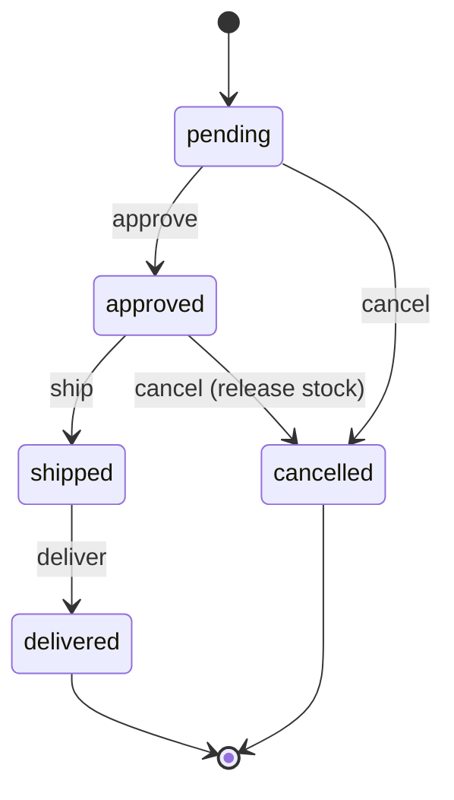
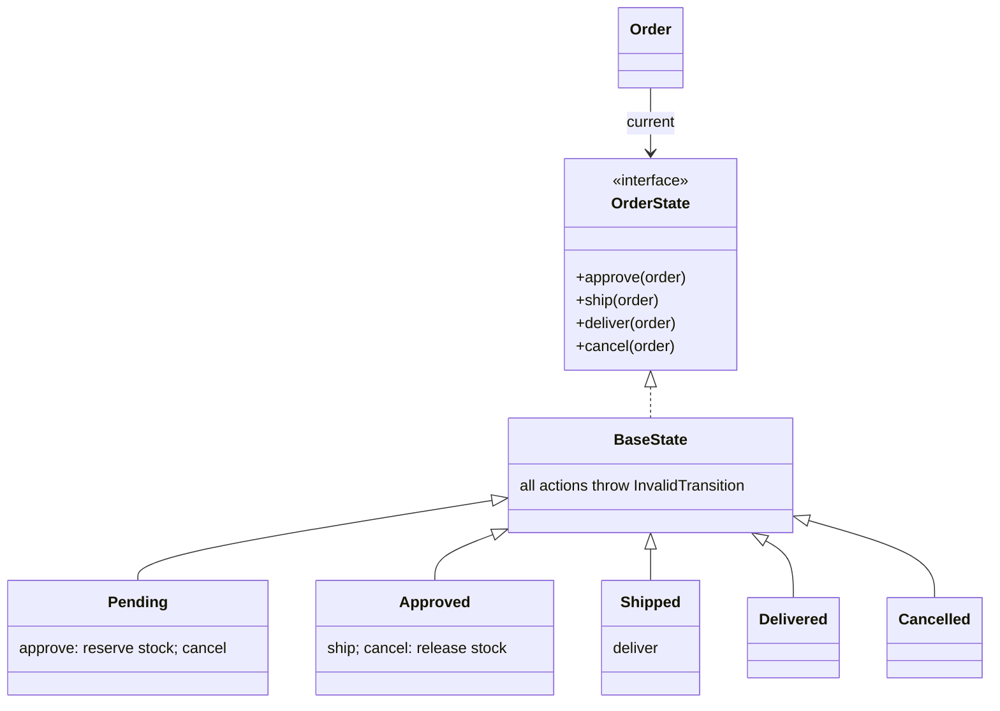

> Tracker ID: DP-12 · Generated: 2026-10-15 · Answers: **DP-Q12** (TRK-02 Phase 7) · Source: GoF + sokrio-server code (`Models/Order/Order.php` guard methods, `Models/Order/OrderStatus.php` 9 constants + `order_statuses` history) · Runnable: `5-tracks/design-patterns/code/state.ts` (✅ ran + strict tsc 2026-10-15) · Machine-coding version: `5-tracks/design-patterns/machine-coding/work-order-lifecycle.ts` · Status: 🟡 generated

# DP-Q12: An order moves through Pending → Approved → Shipped → Delivered. How do you avoid status `if/else` everywhere?

> **এক লাইনে:** "কোন অবস্থা থেকে কোন কাজ করা যায় আর কোথায় যায়" এই নিয়মটা **এক জায়গায়** রাখো। ছোট ক্ষেত্রে একটা **transition table** (state machine) যথেষ্ট। প্রতিটা অবস্থার নিজস্ব আচরণ বেশি হলে **State pattern**: প্রতিটা status একটা class, অনুমোদিত কাজগুলোই শুধু implement করে, বাকি সব ডিফল্টভাবে **নিষেধ**। সাথে প্রতিটা বদল history table-এ।

---

## ১. Problem

```php
// controller-এ
if ($order->status === 'pending' || $order->status === 'approved') { $order->cancel(); }
// আরেক জায়গায়
if ($order->status !== 'delivered' && $order->status !== 'cancelled') { ... }
// রিপোর্টে, job-এ, mobile API-তে... সবখানে নিজস্ব সংস্করণ
```
- নিয়ম ছড়ানো: "shipped order কি cancel করা যায়?" উত্তর ৫ জায়গায় ৫ রকম
- নতুন status যোগ (`on_hold`) = সব `if` খুঁজে বদলানো
- **অবৈধ transition** কেউ আটকায় না: সরাসরি `$order->update(['status' => 'delivered'])` pending থেকেই
- কে কখন বদলালো, ইতিহাস নেই

## ২. Option A: Transition table (বেশিরভাগ সময় এটাই যথেষ্ট)



```ts
const TRANSITIONS: Record<Status, Partial<Record<Action, Status>>> = {
  pending:   { approve: 'approved', cancel: 'cancelled' },
  approved:  { ship: 'shipped', cancel: 'cancelled' },
  shipped:   { deliver: 'delivered' },
  delivered: {},
  cancelled: {},
};

apply(action: Action, by: string) {
  const to = TRANSITIONS[this.status][action];
  if (!to) throw new InvalidTransition(`cannot ${action} an order that is ${this.status}`);
  this.history.push({ from: this.status, to, by });
  this.status = to;
}
```
এক জায়গায় পুরো lifecycle পড়া যায়, UI-তে কোন বাটন দেখাবে সেটাও এখান থেকে (`can('cancel')`)।

## ৩. Option B: State pattern (প্রতিটা অবস্থার আলাদা আচরণ থাকলে)



```ts
abstract class BaseState implements OrderState {
  approve(_: OrderB) { this.deny('approve'); }   // default: everything is forbidden
  ship(_: OrderB) { this.deny('ship'); }
  // ...
}
class Approved extends BaseState {
  readonly name = 'approved' as const;
  ship(o: OrderB) { o.setState(new Shipped()); }
  cancel(o: OrderB) { o.releaseStock(); o.setState(new Cancelled()); } // side effect lives with the state
}
```
আউটপুট: approve → cancel করলে `stock reserved, pending -> approved, stock released, approved -> cancelled`; তারপর ship করলে `cannot ship an order that is cancelled`।
চালাও: `npx -y tsx 5-tracks/design-patterns/code/state.ts`

### কোনটা কখন
| | Transition table | State pattern |
|---|---|---|
| অবস্থা প্রতি আচরণ | শুধু "যাওয়া যায় কি না" | প্রতিটা অবস্থায় আলাদা কাজ (stock রিলিজ, fee হিসাব, notification) |
| পড়া | পুরো lifecycle এক টেবিলে | ছড়ানো, কিন্তু প্রতিটা class ছোট |
| নতুন status | এক সারি | এক class |
| ডিফল্ট | এটা দিয়ে শুরু করো | আচরণ বাড়লে এখানে যাও |

### Laravel-এ
```php
enum OrderStatus: string {
    case Pending = 'pending'; case Approved = 'approved'; case Shipped = 'shipped';
    case Delivered = 'delivered'; case Cancelled = 'cancelled';

    public function canTransitionTo(self $to): bool {
        return in_array($to, match ($this) {
            self::Pending  => [self::Approved, self::Cancelled],
            self::Approved => [self::Shipped, self::Cancelled],
            self::Shipped  => [self::Delivered],
            default        => [],
        }, true);
    }
}

// Model-এ একমাত্র পথ
public function transitionTo(OrderStatus $to, int $by): void
{
    DB::transaction(function () use ($to, $by) {
        $from = OrderStatus::from($this->status);
        throw_unless($from->canTransitionTo($to), InvalidTransition::class);
        // concurrency: একই সময়ে দুজন বদলালে একজনই জিতবে
        $updated = static::whereKey($this->id)->where('status', $from->value)->update(['status' => $to->value]);
        throw_if($updated === 0, StaleStatus::class);
        $this->statuses()->create(['status' => $to->value, 'created_by' => $by]);
    });
}
```
প্যাকেজ: `spatie/laravel-model-states` (State pattern), `symfony/workflow`।

---

## ৪. Trade-off আর ফাঁদ

| ✅ | ⚠️ |
|---|---|
| অবৈধ transition একটাই জায়গায় আটকায় | সরাসরি `update(['status' => ...])` রাস্তা খোলা থাকলে সব ব্যর্থ: transition method-ই **একমাত্র** পথ বানাও |
| নতুন status যোগ সহজ | ৩টা status, কোনো আচরণ নেই → State class-গুলো overkill |
| UI/API "কী করা যায়" একই উৎস থেকে | **concurrency:** দুজন একসাথে approve আর cancel → conditional update (`WHERE status = ?`) বা version column |
| history = audit | DB থেকে লোড করার সময় status column থেকে state object আবার বানাতে হয় |

### Strategy vs State
গঠন একই (interface + কয়েকটা class)। **State**-এ object **নিজে** অবস্থা বদলায় (Pending → Approved, state নিজেই পরেরটা ঠিক করে)। **Strategy** বাইরে থেকে বেছে দেওয়া হয় আর সাধারণত বদলায় না।

---

## ৫. মুখে বলার লাইন (English)

**মূল উত্তর (৪৫ সেকেন্ড):**
> "I'd put the lifecycle in one place. Usually I start with a transition table: for each status, which actions are allowed and where they lead. The model has one `transitionTo` method that checks the table, updates the status with a conditional update so two concurrent changes can't both win, and writes a history row with who and when. Everything else calls that method, never sets the status directly. If each state grows real behaviour, like releasing stock on cancel or calculating fees, I move to the State pattern: one class per state, where every action is forbidden by default and each state only implements what it allows."

**Sokrio উদাহরণ (সৎভাবে):**
> "Our orders keep a status history table, with nine status constants from pending through delivered, return and delivery-rejected. The rules live in guard methods on the order model, like `acceptable()`, `cancellable()` and `deliverable()`. It works, but the rules are spread across methods rather than one table, so if I redesigned it I'd centralize the allowed transitions and route every change through one method."

---

## ৬. ফলো-আপ প্রশ্ন

| প্রশ্ন | ছোট উত্তর |
|---|---|
| "Two people approve and cancel at the same time?" | "Conditional update: `UPDATE ... SET status = 'cancelled' WHERE id = ? AND status = 'approved'`. Zero rows means someone else won; return a conflict." |
| "Where do side effects go?" | "In the transition, inside the same transaction for DB changes, and as events after commit for notifications." |
| "How do you show the allowed buttons in the UI?" | "The API returns the allowed actions from the same table, so the frontend never re-implements the rules." |
| "Status column or history table?" | "Both: a current status column for fast queries, and an append-only history for audit and reports like time spent in each state." |
| "Timeouts, like auto-cancel after 48h?" | "A scheduled job finds orders stuck in a state and applies a system transition through the same method." |

---

🔗 **Sokrio link:** (কোডে যাচাই করা)
- **Status + history:** `app/Models/Order/OrderStatus.php`: `STATUS_PENDING`, `ON_THE_WAY`, `ACCEPTED`, `REJECTED`, `CANCELLED`, `DELIVERED`, `RETURN_BACK`, `READY_TO_DISPATCH`, `DELIVERY_REJECTED` (৯টা)। `Order::statuses()` relation = history (প্রতিটা বদলে নতুন row, `created_by`, `remarks`)। লেখক sihab, shihab; **তোমার ৩টা commit** এই ফাইলে।
- **Guard methods (ছড়ানো নিয়ম):** `app/Models/Order/Order.php`: `acceptable()` (invoice নেই, বা invoice `RETURN_BACK`), `rejectable()`, `cancellable()` (history-তে আগে না থাকলে), `deliverable()` (invoice আছে, `delivered_at` null), সাথে `wantsToAccept/Reject/Cancel/Deliver/Ship($status)`।
- **State pattern class নেই** (DP-02-এও লেখা)। `Task`, `StockHistory`, `Message`, `ReturnModel` ইত্যাদিতেও constant দিয়ে status। এটা সৎভাবে বলো, আর "কীভাবে উন্নত করতাম" দেখাও (ওপরের লাইন)।
- **Field Nation লিংক:** work order lifecycle (draft → published → assigned → in_progress → completed → approved → paid) এর পূর্ণ machine-coding সমাধান: `5-tracks/design-patterns/machine-coding/work-order-lifecycle.ts`। SD-Q13 dispatch ডকের state machine-এর সাথে মেলে। (S9-এর ডোমেইন)

📚 আরো: `4-library/fieldnation/domain/01-work-order-domain.md` · সম্পর্কিত: [03-strategy.md](03-strategy.md) · `5-tracks/system-design/cases/13-dispatch.md` · `5-tracks/system-design/cases/12-order-inventory.md`
