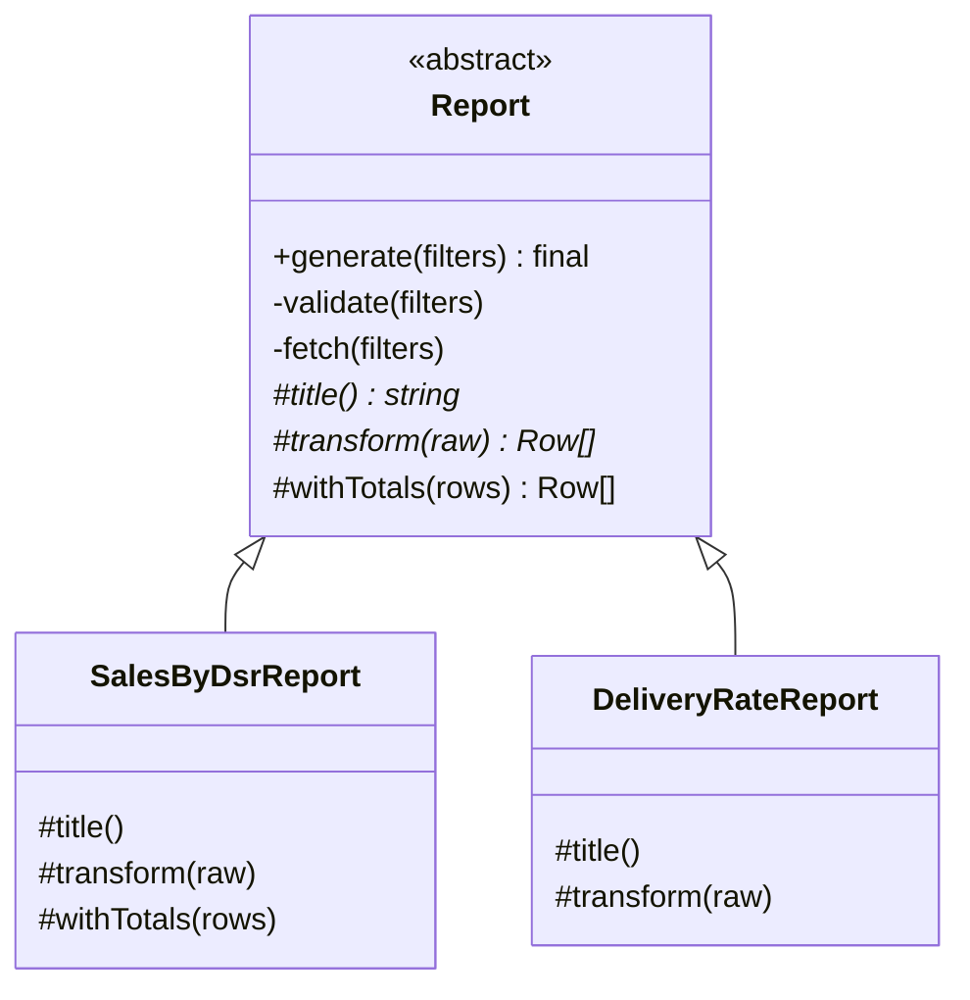

> Tracker ID: DP-13 · Generated: 2026-10-15 · Answers: **DP-Q13** (TRK-02 Phase 8) · Source: GoF + sokrio-server code (`Support/QaSeed/ScenarioSeeder` + `ScenarioRunner`, `Models/Order/TargetAchiever`, `Support/Traits/ReportableJobService`) · Runnable: `5-tracks/design-patterns/code/template-method.ts` (✅ ran + strict tsc 2026-10-15) · Status: 🟡 generated

# DP-Q13: Several reports share the same steps but differ in one part. How do you avoid copy-paste?

> **এক লাইনে:** দুই উপায়। **Template Method** (inheritance): base class-এ ধাপের **ক্রম** স্থির করা একটা method (`generate()`), যেটা কয়েকটা abstract ধাপ ডাকে; প্রতিটা রিপোর্ট শুধু সেই ধাপগুলো লেখে। **Strategy** (composition): ভিন্ন অংশটা একটা object হিসেবে পাস করো। ক্রম/নিয়ম **নিশ্চিত** করতে হলে Template Method; ভিন্ন অংশগুলো স্বাধীন আর মেশাতে হলে Strategy।

---

## ১. Problem

৫টা রিপোর্ট কন্ট্রোলার, প্রতিটায়:
```
validate filters → tenant + date scope দিয়ে ডেটা আনো → [রিপোর্ট-নির্দিষ্ট হিসাব] → total row → cache → JSON/Excel
```
কপি-পেস্ট করলে:
- একটায় tenant scope ভুলে গেলে **data leak** (সবচেয়ে বড় ঝুঁকি)
- cache key-র ধরন, validation, pagination প্রতিটায় একটু আলাদা
- একটা bug fix ৫ জায়গায়

## ২. Structure



| অংশ | কী | কে লেখে |
|---|---|---|
| **Template method** | `generate()`: ধাপের ক্রম, override করা যাবে না | base class |
| **Fixed step** | `validate`, `fetch` (tenant scope এখানে, একবারই) | base class, `private` |
| **Abstract step** | `transform`, `title`: অবশ্যই লিখতে হবে | subclass |
| **Hook** | `withTotals`: ডিফল্ট আছে, চাইলে override | subclass (ঐচ্ছিক) |

> **Hollywood Principle:** "Don't call us, we'll call you." subclass base-কে ডাকে না, base subclass-এর ধাপ ডাকে।

## ৩. Code

### TypeScript (পূর্ণ চলমান ফাইল: `5-tracks/design-patterns/code/template-method.ts`)

```ts
abstract class Report {
  generate(f: Filters) {
    this.validate(f);                         // fixed
    const raw = this.fetch(f);                // fixed: tenant + date scope, one place
    const rows = this.transform(raw);         // varies
    return { title: this.title(), rows: this.withTotals(rows) };  // hook
  }
  protected abstract title(): string;
  protected abstract transform(raw: Row[]): Row[];
  protected withTotals(rows: Row[]): Row[] { return rows; }       // hook with default
  private validate(f: Filters) { ... }
  private fetch(f: Filters): Row[] { ... }
}

class SalesByDsrReport extends Report {
  protected title() { return 'Sales by DSR'; }
  protected transform(raw: Row[]) { /* group by dsr */ }
  protected withTotals(rows: Row[]) { /* add TOTAL row */ }
}
```

**একই সমস্যা, Strategy দিয়ে:**
```ts
interface Transformer { title: string; transform(raw: Row[]): Row[] }
class ReportRunner {
  constructor(private readonly t: Transformer) {}
  generate(f: Filters) { /* validate, fetch, then this.t.transform(raw) */ }
}
new ReportRunner({ title: 'Row count', transform: (raw) => [{ rows: raw.length }] });
```
চালাও: `npx -y tsx 5-tracks/design-patterns/code/template-method.ts`

### PHP / Laravel-এ
```php
abstract class Report
{
    final public function generate(array $filters): array      // final: ক্রম বদলানো যাবে না
    {
        $this->validate($filters);
        $key = $this->cacheKey($filters);                      // tenant সবসময় key-তে
        return Cache::remember($key, $this->ttl(), function () use ($filters) {
            $rows = $this->transform($this->fetch($filters));
            return $this->withTotals($rows);
        });
    }

    abstract protected function transform(Collection $raw): array;
    protected function ttl(): int { return 600; }              // hook
    protected function withTotals(array $rows): array { return $rows; }
    // ...
}
```
PHP-তে `final` দিয়ে template method override আটকানো যায়। TypeScript-এ `final` নেই, convention দিয়ে।

---

## ৪. Template Method vs Strategy: কোনটা কখন

| | Template Method | Strategy |
|---|---|---|
| ভিত্তি | **inheritance** | **composition** |
| কী স্থির | পুরো কাঠামো আর ধাপের **ক্রম** | context, আর একটা অংশ বদলায় |
| বাছাই কখন | compile time (কোন subclass) | runtime (কোন object পাস করলে) |
| কয়েকটা ভিন্ন অংশ মেশানো | কঠিন (প্রতিটা combination = subclass) | সহজ (দুটো strategy পাস করো) |
| ভালো যখন | ক্রম/invariant **নিশ্চিত** করতে হবে (tenant scope, journal, cleanup) | ভিন্ন অংশ স্বাধীন, runtime-এ বদলায় |
| ঝুঁকি | গভীর hierarchy, base class বদলালে সব subclass ভাঙে (fragile base class) | বেশি object, কাঠামো কম নিশ্চিত |

**বাস্তব নিয়ম:** "Favour composition over inheritance", **কিন্তু** যখন framework/lifecycle নিশ্চিত করা মূল উদ্দেশ্য (যেমন test seeder, যেটা অবশ্যই journal দিয়ে লিখবে), তখন Template Method সঠিক।

**কখন কোনোটাই না:** ২টা রিপোর্ট, মিল কম → একটা ছোট shared helper ফাংশনই যথেষ্ট (DP-Q01 rule of three)।

---

## ৫. মুখে বলার লাইন (English)

**মূল উত্তর (৪৫ সেকেন্ড):**
> "If the steps and their order are the same and only one part differs, I'd use Template Method. A base class has one `generate` method that fixes the sequence: validate, fetch with tenant and date scoping, transform, add totals, cache. Subclasses only implement the transform step, and optional hooks have defaults. The big win is that the risky parts, like tenant scoping, live in one place and can't be forgotten. If the varying parts are independent and I want to mix them at runtime, I'd use Strategy instead and pass the transformer in. Template Method is inheritance and fixes the order; Strategy is composition and is more flexible."

**Sokrio উদাহরণ (তোমার নিজের, সবচেয়ে শক্তিশালী):**
> "I built this for our QA Test Lab. An abstract `ScenarioSeeder` defines the lifecycle: profile the tenant's data, plan scenarios, apply them through a journal, compute the expected results, and verify. A runner calls those steps in order and writes each stage to a scenario pack. Each module, like memo target or visit target, is one subclass that implements those steps. A new module's seeder gets the runner, journaling and revert for free, and it can't skip the journal."

---

## ৬. ফলো-আপ প্রশ্ন

| প্রশ্ন | ছোট উত্তর |
|---|---|
| "Why not just a helper function?" | "For two reports, a helper is enough. Template Method pays off when the sequence itself must be guaranteed, not just shared." |
| "Inheritance is bad, right?" | "Deep hierarchies are. One abstract base with a clear template and two-level depth is fine. I'd switch to composition when subclasses start overriding things they shouldn't." |
| "How do you stop a subclass from changing the order?" | "Make the template method `final` in PHP, keep fixed steps private, and only expose abstract steps and hooks." |
| "What's a hook?" | "An optional step with a default implementation, like `withTotals` or `ttl`, that subclasses may override." |
| "Testing?" | "Test the base flow once with a tiny test subclass, then each subclass's steps on their own." |

---

🔗 **Sokrio link:** (কোডে যাচাই করা)
- ⭐ **তোমার নিজের (A6):** `app/Support/QaSeed/ScenarioSeeder.php` (`abstract class`): abstract `module()`, `code()`, `catalogue()`, `profile(array)`, `plan(array)`, `apply(array $plan, QaJournal $journal)`, `expected(array)`, `verify(array)`। `ScenarioRunner` ক্রমে ডাকে (`expected.json` লেখে, `apply` journal-এর ভেতরে)। subclass: `database/seeders/Qa/MemoTarget/`, `VisitTarget/`। `app/Support/QaSeed/`-এর একমাত্র লেখক Komol।
  - DP-Q01-এর খোলা প্রশ্ন এখনো বাকি: base class আগে বানিয়েছিলে, নাকি দুটো seeder লেখার পরে মিল দেখে বের করেছ? `[Komol পূরণ করবে]` (দ্বিতীয়টা হলে "rule of three" গল্প হিসেবে আরো শক্তিশালী)
- **টিমের উদাহরণ:** `app/Models/Order/TargetAchiever.php` (abstract) → Product/Invoice/Delivery/Visit TargetAchiever (Tanmay, sumaisa); `app/Support/Traits/ReportableJobService.php`: export-এর পুরো ধাপ trait-এ, প্রতিটা job `removeCache()` abstract আর `reportServiceClass` দেয় (sihab)। সৎ নোট: trait + abstract method = PHP-তে Template Method-এর একটা রূপ।

📚 আরো: `4-library/cs/01-oop-design-pattern/` · সম্পর্কিত: [03-strategy.md](03-strategy.md) · [01-principles.md](../01-principles.md) · [02-sokrio-pattern-map.md](../02-sokrio-pattern-map.md)
