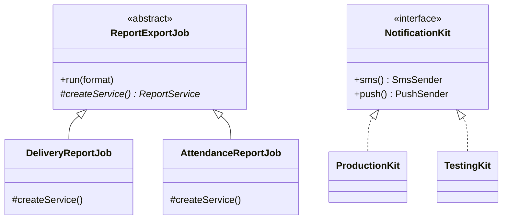

> Tracker ID: DP-04 · Generated: 2026-10-15 · Answers: **DP-Q04** (TRK-02 Phase 3) · Source: GoF + sokrio-server code (`Support/Traits/ReportableJobService`, `Contracts/Kafka/ConsumerFactoryInterface`, `Models/Order/TargetAchiever`, `SMSServiceProvider` + `FCMServiceProvider`) · Runnable: `5-tracks/design-patterns/code/factory.ts` (✅ ran + strict tsc 2026-10-15) · Status: 🟡 generated

# DP-Q04: Factory Method vs Abstract Factory. What is the difference? When do you use each?

> **এক লাইনে:** তিনটা জিনিস আলাদা। **Simple Factory** = একটা function/class যেটা ঠিক করে কোন class বানাবে। **Factory Method** = base class-এ একটা abstract "create" method, **subclass** ঠিক করে কোন object বানাবে। **Abstract Factory** = একটা object যেটা **পুরো একটা পরিবারের** (family) সম্পর্কিত object বানায়, যাতে ভুল জোড়া না মেশে।

---

## ১. Problem: ব্যথাটা কী

```php
// কন্ট্রোলারে, জবে, কমান্ডে: সবখানে একই new + if
if ($format === 'xlsx') $exporter = new ExcelExporter($config, $disk);
elseif ($format === 'csv') $exporter = new CsvExporter($config);
elseif ($format === 'pdf') $exporter = new PdfExporter($config, $fonts, $disk);
```

- `new ConcreteClass` সবখানে ছড়ানো → নতুন format এলে সব জায়গা খুঁজে বদলাতে হয়
- object বানাতে কী কী লাগে (config, disk, font), সেটা প্রতিটা কলারকে জানতে হয়
- টেস্টে আসল class-এর বদলে fake বসানো কঠিন

**মূল ধারণা:** object **ব্যবহার** করা আর **বানানো** আলাদা দায়িত্ব। বানানোটা এক জায়গায় নিয়ে যাও।

## ২. তিনটার পার্থক্য



| | Simple Factory | Factory Method | Abstract Factory |
|---|---|---|---|
| কী | একটা function: input → সঠিক object | base class-এ abstract `create()`, subclass override করে | interface-এ **একাধিক** create method (একটা family) |
| বাছাই হয় কীভাবে | `switch`/map, runtime-এ | **inheritance**: কোন subclass | **composition**: কোন factory object পাস করলে |
| কতগুলো product | এক ধরনের | এক ধরনের | **কয়েকটা সম্পর্কিত** ধরন একসাথে |
| GoF pattern? | না (idiom) | হ্যাঁ | হ্যাঁ |
| উদাহরণ | `makeExporter('csv')` | `ReportExportJob::createService()` | `ProductionKit` (আসল SMS + আসল push) vs `TestingKit` (দুটোই log) |

> **মনে রাখার কৌশল:** Factory **Method** = একটা **method** (subclass override করে)। Abstract **Factory** = একটা **object** (অনেক method, পুরো পরিবার)।

## ৩. Code

### TypeScript (পূর্ণ চলমান ফাইল: `5-tracks/design-patterns/code/factory.ts`)

```ts
// Factory Method: base class runs the job, subclass decides what to create
abstract class ReportExportJob {
  protected abstract createService(): ReportService; // the factory method
  run(format: string): string {
    const service = this.createService();
    return makeExporter(format).export(service.rows());
  }
}
class DeliveryReportJob extends ReportExportJob {
  protected createService() { return new DeliveryReportService(); }
}

// Abstract Factory: a family that must match
interface NotificationKit { sms(): SmsSender; push(): PushSender; }
class ProductionKit implements NotificationKit { /* real SMS + real FCM */ }
class TestingKit implements NotificationKit { /* log SMS + log push */ }

const kit = env === 'production' ? new ProductionKit() : new TestingKit();
notifyOrderApproved(kit, phone, userId); // never mixes real SMS with fake push
```
চালাও: `npx -y tsx 5-tracks/design-patterns/code/factory.ts`

### Laravel-এ
Laravel-এ বেশিরভাগ factory-র কাজ করে **service container** (একটা বড় factory):
```php
// SMSServiceProvider (Sokrio-তে আসলেই আছে)
$this->app->bind(SMSSender::class, function ($app) {
    if ($app->environment('production') && config('sms.enabled') == true) {
        return new SMSGateway();
    }
    return new LogSMSGateway();
});
```
কলার শুধু `SMSSender` চায়, কোনটা পাবে জানে না।

**Static factory method** (named constructor):
```php
// TargetAchiever::on($model), Sokrio-তে আছে
public static function on(Model $model)
{
    $instance = new static;   // late static binding: যে subclass ডাকে, সেটাই তৈরি হয়
    // ...
}
ProductTargetAchiever::on($order);
```

---

## ৪. Trade-off আর কখন **ব্যবহার করবে না**

| ✅ ব্যবহার করো | ❌ করো না |
|---|---|
| বানাতে অনেক dependency/config লাগে, কলারকে জানানো উচিত না | শুধু `new Foo()`, কোনো বাছাই নেই: সরাসরি `new` ঠিক আছে |
| runtime-এ বাছাই (format, env, tenant setting) | মাত্র একটা implementation, বদলানোর লক্ষণ নেই |
| টেস্টে fake বসাতে চাও | framework-এর DI container ইতিমধ্যে কাজটা করছে: নিজের factory class বাড়তি |
| **Abstract Factory:** কয়েকটা object একসাথে মিলতে হবে (prod kit vs test kit, MySQL vs Mongo driver set) | family না, একটাই product: Abstract Factory overkill |

**খরচ:** আরো একটা indirection লেয়ার; "এটা আসলে কোন class?" জানতে factory খুলতে হয়।

### কাছাকাছি pattern
| | পার্থক্য |
|---|---|
| **Strategy** (DP-Q03) | Factory **বানায়**, Strategy **আচরণ করে**। প্রায়ই একসাথে: factory সঠিক strategy ফেরত দেয় |
| **Builder** (DP-Q05) | Factory এক কলে পুরো object দেয়; Builder **ধাপে ধাপে** বানায় (অনেক optional field) |
| **DI container** | একটা generic factory + lifetime manager (singleton/bind) |

---

## ৫. মুখে বলার লাইন (English)

**মূল উত্তর (৪৫ সেকেন্ড):**
> "Both hide which concrete class gets created. Factory Method is a single method in a base class that subclasses override: the base class runs the workflow and asks the subclass 'which object do I use?'. Abstract Factory is an object with several create methods that produce a family of related objects, so they always match. For example, a production kit gives you the real SMS and real push senders, and a test kit gives you logging versions of both, so you can't accidentally mix a real SMS sender with a fake push sender. In Laravel, the service container does most of this for you through bindings."

**Sokrio উদাহরণ:**
> "Our report export jobs share one trait that runs the whole export: chunking, temp files, progress. Each job only names its report service class, and `createReportService()` builds it and checks it implements `ReportServiceInterface`. That's a factory method. And our SMS and push senders are bound in service providers: real gateways in production, logging ones everywhere else."

---

## ৬. ফলো-আপ প্রশ্ন

| প্রশ্ন | ছোট উত্তর |
|---|---|
| "Isn't a factory just a switch statement?" | "Often, yes. The point is that the switch lives in one place, and everything else depends on the interface." |
| "Factory vs DI container?" | "The container is a generic factory with lifetimes. I write my own factory only when the choice depends on runtime data, like the format in the request." |
| "How do you add a new format without editing the factory?" | "Register it: a map of format to constructor, or tagged bindings in the container. Then a new format is one class plus one registration." |
| "When is Abstract Factory worth it?" | "When objects must come in matching sets: drivers for one database, UI widgets for one theme, real vs fake senders for one environment." |
| "Static factory methods: good or bad?" | "Fine as named constructors, like `TargetAchiever::on($model)`. Bad when they hide global state, because you can't swap them in tests." |

---

🔗 **Sokrio link:** (কোডে যাচাই করা, সব **টিমের লেখা** → "our codebase uses" বলো)
- **Factory Method:** `app/Support/Traits/ReportableJobService.php` → `createReportService()`: `$this->reportServiceClass` থেকে instance বানায়, `ReportServiceInterface` না মানলে exception, তারপর `applyTenantCustomizations($org)`। লেখক মূলত sihab।
- **Abstract Factory / Factory interface:** `app/Contracts/Kafka/ConsumerFactoryInterface::make(ConsumerConfig, callable)` → `DefaultConsumerFactory`, `KafkaServiceProvider`-এ singleton হিসেবে বাঁধা; `KafkaConsumer` শুধু interface জানে (টেস্টে fake factory দেওয়া যায়)। লেখক sihab।
- **Static factory:** `app/Models/Order/TargetAchiever::on(Model)` → `new static` → Product/Invoice/Delivery/Visit TargetAchiever। লেখক Tanmay, sumaisa।
- **Container factory:** `app/Providers/SMSServiceProvider.php` → production + `sms.enabled` হলে `SMSGateway`, নাহলে `LogSMSGateway`। একই ধাঁচ `FCMServiceProvider` (`FCM` / `LogFCM`)।
- **তোমার নিজের:** সরাসরি factory class লেখোনি (যাচাই করা যায়নি)। এভাবে বলো: *"I've added report services that plug into our export factory method."* `[Komol পূরণ করবে: কোন report service তুমি যোগ করেছ, যদি করে থাকো]`

📚 আরো: `4-library/cs/01-oop-design-pattern/` · সম্পর্কিত: [03-strategy.md](../behavioral/03-strategy.md) · [05-builder.md](05-builder.md) · Sokrio ম্যাপ: [02-sokrio-pattern-map.md](../02-sokrio-pattern-map.md)
