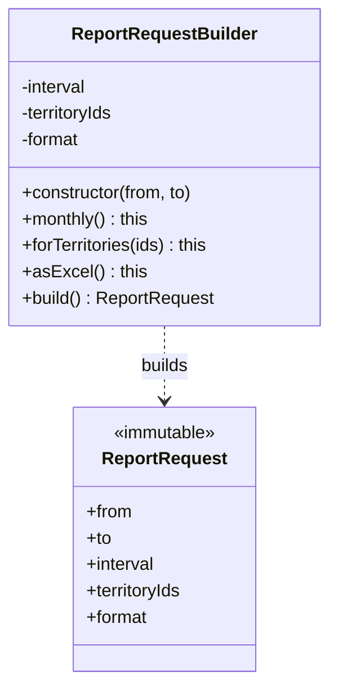

> Tracker ID: DP-05 · Generated: 2026-10-15 · Answers: **DP-Q05** (TRK-02 Phase 4) · Source: GoF + Effective Java (Item 2) + sokrio-server code (`Models/Report/PeriodBuilder`, `CoordinateBuilder`, Laravel Query Builder) · Runnable: `5-tracks/design-patterns/code/builder.ts` (✅ ran + strict tsc 2026-10-15) · Status: 🟡 generated

# DP-Q05: An object needs many optional fields. How do you avoid a constructor with 10 parameters?

> **এক লাইনে:** **Builder** ব্যবহার করো: required field constructor-এ, optional field গুলো নাম দেওয়া method দিয়ে (`->monthly()->forTerritories(12)`), শেষে `build()` সব validation একসাথে করে একটা **immutable** object দেয়। TypeScript-এ প্রায়ই একটা **options object** (named parameters) যথেষ্ট।

---

## ১. Problem: Telescoping constructor

```ts
new ReportRequest('2026-10-01', '2026-10-31', null, null, 5, true, false, 'xlsx', 50, null);
```

- কোন argument কোনটা? `true`-টা কী? class না খুলে বোঝা যায় না
- দুটো একই type-এর argument অদলবদল হলে compiler ধরে না (`perPage` আর `territoryId` দুটোই number)
- optional field বাড়লে constructor overload-এর বিস্ফোরণ
- field গুলোর মধ্যে নিয়ম ("xlsx + daily হলে territory লাগবে") কোথায় চেক হবে? ছড়িয়ে যায়

## ২. Structure



| ভূমিকা | কী |
|---|---|
| **Builder** | mutable, ধাপে ধাপে মান জমায়, প্রতিটা method `this` ফেরত দেয় (fluent) |
| **Product** | immutable, তৈরির পর বদলায় না |
| **`build()`** | **একমাত্র** জায়গা যেখানে cross-field validation হয় |
| (GoF-এর **Director**) | ধাপের নির্দিষ্ট ক্রম জানে এমন class (যেমন "monthly sales preset"); আধুনিক কোডে প্রায়ই বাদ |

## ৩. Code

### TypeScript (পূর্ণ চলমান ফাইল: `5-tracks/design-patterns/code/builder.ts`)

```ts
class ReportRequestBuilder {
  private interval: Interval = 'daily';
  private territoryIds: number[] = [];
  private format: 'json' | 'xlsx' = 'json';
  private perPage = 15;

  constructor(private readonly from: string, private readonly to: string) {} // required

  monthly(): this { this.interval = 'monthly'; return this; }
  forTerritories(...ids: number[]): this { this.territoryIds.push(...ids); return this; }
  asExcel(): this { this.format = 'xlsx'; return this; }

  build(): ReportRequest {
    if (this.from > this.to) throw new Error('from must be before to');
    if (this.format === 'xlsx' && this.interval === 'daily' && this.territoryIds.length === 0)
      throw new Error('daily xlsx for all territories is too big');
    return new ReportRequest(this.from, this.to, this.interval, [...this.territoryIds], this.format, this.perPage);
  }
}

const req = new ReportRequestBuilder('2026-10-01', '2026-10-31')
  .monthly().forTerritories(12, 15).asExcel().build();
```

**হালকা বিকল্প (TypeScript-এ সবচেয়ে প্রচলিত): options object**
```ts
function makeRequest({ from, to, interval = 'daily', format = 'json' }: ReportOptions) { ... }
makeRequest({ from: '2026-10-01', to: '2026-10-31', format: 'xlsx' });
```
নাম দিয়ে পাস হয়, ক্রম লাগে না, default আছে। Validation লাগলে ফাংশনের ভেতরে।

চালাও: `npx -y tsx 5-tracks/design-patterns/code/builder.ts`

### Laravel-এ: তুমি প্রতিদিন Builder ব্যবহার করো
```php
Order::query()
    ->where('status', 'pending')
    ->whereIn('territory_id', $ids)
    ->with(['retailer', 'items'])
    ->orderByDesc('order_date')
    ->paginate(15);          // <- এটাই build(): SQL তৈরি হয়ে চলে
```
`Illuminate\Database\Eloquent\Builder` = Builder pattern: প্রতিটা method query-র একটা অংশ যোগ করে, `get()`/`paginate()` শেষে আসল SQL বানায়। একই ধাঁচ: `Http::asForm()->timeout(10)->post(...)`, `Mail`-এর fluent API, migration-এর `Schema::create(... $table->string()->nullable()->index())`।

PHP 8-এ ছোট কেসে **named arguments** options object-এর মতো কাজ করে:
```php
new ReportRequest(from: $from, to: $to, format: 'xlsx');
```

---

## ৪. Trade-off আর কখন **ব্যবহার করবে না**

| ✅ Builder | ❌ দরকার নেই |
|---|---|
| ৪–৫+ optional field, অনেক combination | ২–৩টা field: সাধারণ constructor বা named args |
| field-গুলোর মধ্যে নিয়ম আছে (cross-field validation) | কোনো validation নেই: options object যথেষ্ট |
| ধাপে ধাপে বানাতে হয় (query, HTTP request, report filter) | একবারে সব জানা থাকে |
| তৈরির পর object immutable রাখতে চাও | |

**খরচ:** প্রায় প্রতিটা field দুবার লেখা হয় (builder + product)। Builder-এ `build()` ডাকতে ভুলে গেলে product-ই আসে না।

**সাবধান:** builder যদি `build()`-এ validation না করে, তাহলে এটা শুধু লম্বা setter chain, কোনো লাভ নেই।

### কাছাকাছি pattern
| | পার্থক্য |
|---|---|
| **Factory** (DP-Q04) | factory এক কলে **কোন** class বানাবে ঠিক করে; builder **কীভাবে** একটা জটিল object বানাবে তা ধাপে ধাপে |
| **Fluent interface** | শুধু method chaining-এর স্টাইল; Builder-এর সাথে প্রায়ই আসে, কিন্তু Query Builder-এর মতো জিনিস fluent আবার builder-ও |

---

## ৫. মুখে বলার লাইন (English)

**মূল উত্তর (৪০ সেকেন্ড):**
> "I'd use a Builder. Required fields go into the builder's constructor, so you can't forget them. Optional ones get named methods, like `monthly()` or `forTerritories(12, 15)`, which read like a sentence. Then `build()` does all the cross-field validation in one place and returns an immutable object. In TypeScript, if there's no validation between fields, I'd just take a single options object with defaults, which gives named parameters for free."

**Laravel উদাহরণ:**
> "Every Eloquent query is a builder: `where`, `with`, `orderBy` add parts, and `get()` or `paginate()` is the build step that produces SQL. Our report filters and the HTTP client work the same way."

---

## ৬. ফলো-আপ প্রশ্ন

| প্রশ্ন | ছোট উত্তর |
|---|---|
| "Builder vs options object in TS?" | "Options object when it's just named parameters with defaults. Builder when fields depend on each other or are added step by step." |
| "Why immutable product?" | "Once it's validated, nobody can change it into an invalid state later, and it's safe to cache or pass around." |
| "Can the builder be reused?" | "Yes, if `build()` copies its arrays. Otherwise building twice shares the same array and the second object changes the first." |
| "Builder in tests?" | "Test data builders: `anOrder()->pending()->forTenant(7)->build()`. Laravel model factories with states are exactly that." |
| "Isn't Query Builder a Builder?" | "Yes. And it's also why `where` order rarely matters: you collect parts, then build." |

---

🔗 **Sokrio link:** (কোডে যাচাই করা)
- **Query Builder:** প্রতিটা রিপোর্ট/লিস্ট এন্ডপয়েন্টে Eloquent Builder। `app/Support/Macros/BuilderMacro` Builder-এ নিজস্ব method যোগ করে (টিমের)। তুমি প্রতিদিন এটা ব্যবহার করো: সৎভাবে "I use it daily" বলতে পারো।
- **Custom builder-ধরনের class:** `app/Models/Report/PeriodBuilder.php`: constructor-এ `($interval, $range)` নিয়ে Carbon period বানায়, `fill($data)` দিয়ে খালি দিন/সপ্তাহ/মাস ভরে (daily/weekly/monthly/quarterly/yearly format)। পাশে `CoordinateBuilder`। লেখক Tanmay। সৎ নোট: এটা পুরো GoF Builder না (fluent step নেই), বরং "complex object একবারে বানানো" class।
- **টেস্ট-ডেটা builder:** Laravel model factory + state, আর তোমার QA Test Lab-এর scenario plan (A6)। প্রশ্ন এলে বলো factory state = test data builder।
- **তোমার নিজের:** নিজে কোনো fluent Builder class লিখেছ? `[Komol পূরণ করবে]`। না হলে বলো: *"I haven't needed a custom builder; the Query Builder and model factories cover most cases."*

📚 আরো: `4-library/cs/01-oop-design-pattern/` · সম্পর্কিত: [04-factory.md](04-factory.md) · [06-singleton.md](06-singleton.md)
