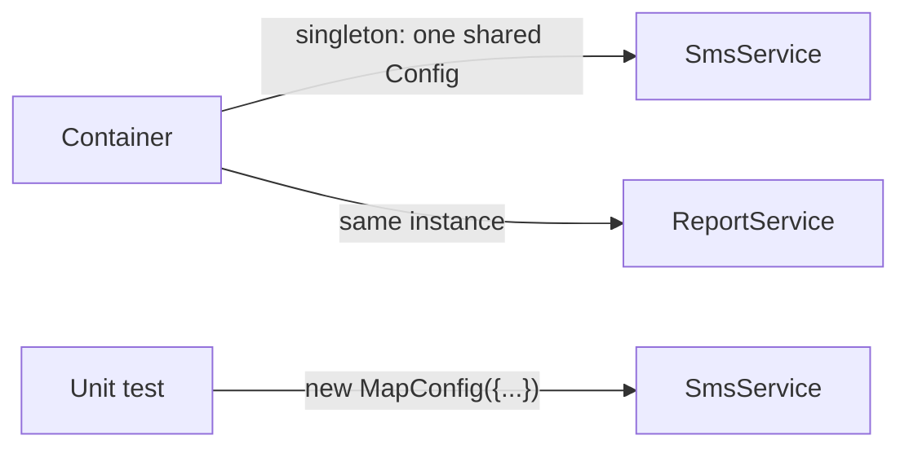

> Tracker ID: DP-06 · Generated: 2026-10-15 · Answers: **DP-Q06** (TRK-02 Phase 4) · Source: GoF + sokrio-server code (`Support/Tenant/TenantManager`, `Providers/KafkaServiceProvider`, `PaymentGatewayServiceProvider`, `ScopeCacheToTenant`) · Runnable: `5-tracks/design-patterns/code/singleton.ts` (✅ ran + strict tsc 2026-10-15) · Status: 🟡 generated

# DP-Q06: Why is Singleton often called an anti-pattern? What do you use instead?

> **এক লাইনে:** "একটাই instance" নিজে সমস্যা না। সমস্যা হলো **class নিজেই** নিজেকে global বানায় (`Foo::getInstance()`), ফলে dependency লুকিয়ে যায়, টেস্টে state এক টেস্ট থেকে আরেকটায় লিক করে, আর বদলানো যায় না। বিকল্প: **Dependency Injection**: instance একটাই থাকুক, কিন্তু সেটা **container** ঠিক করুক আর constructor দিয়ে পাস হোক (Laravel-এ `$this->app->singleton(...)`)।

---

## ১. Classic Singleton

```ts
class Config {
  private static instance: Config | null = null;
  private constructor() {}                   // বাইরে থেকে new করা যাবে না
  static get(): Config { return (this.instance ??= new Config()); }
}

function smsEnabled() { return Config.get().read('sms.enabled') === 'true'; } // dependency লুকানো
```

## ২. কেন anti-pattern বলা হয় (৫টা কারণ)

| সমস্যা | মানে |
|---|---|
| **Hidden dependency** | `smsEnabled()`-এর signature দেখে বোঝা যায় না এটা Config-এর ওপর নির্ভর করে |
| **Global mutable state** | যেকোনো জায়গা থেকে বদলানো যায় → bug খুঁজে পাওয়া কঠিন |
| **টেস্ট কঠিন** | test A যে state রেখে গেল, test B সেটা দেখে (চলমান কোডে `test B sees leftover state from test A: true`); fake বসানো যায় না |
| **Single Responsibility ভাঙে** | class নিজের কাজ + নিজের lifetime দুটোই সামলায় |
| **Concurrency / multi-tenant** | long-running process (queue worker, Octane, Node server)-এ একটা global instance **request-এর মধ্যে শেয়ার** হয়। এক tenant-এর state আরেক tenant-এ চলে যেতে পারে |

> শেষ পয়েন্টটা Sokrio-তে আসল: PHP-FPM-এ প্রতিটা request নতুন process state পায়, কিন্তু **queue worker** একই process-এ অনেক job চালায়। static/singleton-এ tenant রাখলে পরের job ভুল tenant দেখতে পারে।

## ৩. বিকল্প: DI + container-managed lifetime



### TypeScript (পূর্ণ চলমান ফাইল: `5-tracks/design-patterns/code/singleton.ts`)
```ts
class SmsService {
  constructor(private readonly config: Config) {}   // dependency দেখা যায়
  enabled() { return this.config.read('sms.enabled') === 'true'; }
}

app.singleton<Config>('config', () => new MapConfig({...}));  // container: একটাই instance
app.bind('sms', () => new SmsService(app.make('config')));    // প্রতিবার নতুন service

// টেস্টে: কোনো global reset লাগে না
new SmsService(new MapConfig({ 'sms.enabled': 'true' })).enabled();
```
চালাও: `npx -y tsx 5-tracks/design-patterns/code/singleton.ts`

> Node.js-এ: module নিজেই cache হয় (`export const db = new Pool()` একবারই চলে), তাই module-level instance কার্যত singleton। একই সমস্যা আছে: টেস্টে mock করতে `jest.mock` লাগে। NestJS-এ provider ডিফল্টভাবে singleton scope, কিন্তু DI দিয়ে inject হয়, তাই টেস্টে override করা যায়।

### Laravel-এ
```php
// "একটাই instance" = container-এর lifetime, class-এর না
$this->app->singleton(MessageProducerInterface::class, KafkaProducer::class);

// ব্যবহার: constructor injection
public function __construct(private MessageProducerInterface $producer) {}

// টেস্টে বদলানো
$this->app->instance(MessageProducerInterface::class, new FakeProducer());
```
| Laravel binding | lifetime |
|---|---|
| `bind` | প্রতি resolve-এ নতুন |
| `singleton` | পুরো app/process-এ একটা (**queue worker-এ অনেক job জুড়ে!**) |
| `scoped` | প্রতি request/job-এ একটা, শেষে reset (Octane/queue-তে নিরাপদ) |

---

## ৪. কখন Singleton (বা single instance) **ঠিক আছে**

| ✅ ঠিক আছে | ❌ সমস্যা |
|---|---|
| **stateless** বা read-only (logger, config পড়া, HTTP client) | mutable business state (cart, current tenant, current user) |
| দামি resource একবার বানানো (DB connection pool, Kafka producer) | per-request ডেটা |
| container দিয়ে inject করা | `Foo::getInstance()` সব জায়গা থেকে ডাকা |

**মূল নিয়ম:** "একটা instance" ভালো, "global access point" খারাপ।

---

## ৫. মুখে বলার লাইন (English)

**মূল উত্তর (৪৫ সেকেন্ড):**
> "Having one instance is fine. The problem with the classic Singleton is that the class makes itself globally reachable. Dependencies become invisible, state leaks between tests, and you can't swap it for a fake. In long-running processes like queue workers it's worse: a global holding per-request data can leak from one job to the next, which in a multi-tenant app means one tenant's state showing up for another. So I keep the single instance but let the DI container own its lifetime and inject it through the constructor. In Laravel that's `singleton()` for stateless shared things like a Kafka producer, and `scoped()` for anything per request."

**Sokrio উদাহরণ (সৎভাবে):**
> "Our Kafka producer, consumer factory and topic registry are container singletons, injected by interface. Tenant switching goes through a `TenantManager` with a private constructor and a static `tenant()` entry point, which is singleton-like, so we're careful to switch the connection back after each tenant."

---

## ৬. ফলো-আপ প্রশ্ন

| প্রশ্ন | ছোট উত্তর |
|---|---|
| "Is a Laravel Facade a Singleton?" | "It's a static-looking proxy to an object in the container. The object is often a singleton, but you can swap it in tests with `Facade::fake()` or `shouldReceive`, which you can't do with a true Singleton." |
| "Thread-safe singleton?" | "In Java, double-checked locking or an enum or a static holder. PHP and Node run one request per thread of JS execution, so the bigger risk for us is state shared across requests in long-running workers." |
| "Singleton in Node?" | "A module export is cached, so it's effectively a singleton. I still inject it into classes so tests can pass a fake." |
| "When would you still write one?" | "Almost never by hand. A process-wide resource like a connection pool, created once at boot and injected." |
| "`singleton` vs `scoped` in Laravel?" | "`singleton` lives for the whole worker process; `scoped` is reset per request or job. Anything holding tenant or user data should be scoped." |

---

🔗 **Sokrio link:** (কোডে যাচাই করা)
- **Container singletons:** `app/Providers/KafkaServiceProvider.php`: `MessageProducerInterface`, `ConsumerFactoryInterface`, `MessageConsumerInterface`, `TopicRegistryInterface`, `TopicProvisionerInterface` সব `singleton(...)`। `PaymentGatewayServiceProvider`-এও একটা। `app/Providers`-এ মোট ৬টা `singleton(` কল। টিমের (sihab, Tanmay)।
- **Singleton-ধরনের static manager:** `app/Support/Tenant/TenantManager.php`: `private function __construct(Tenantable $tenant)`, `public static function tenant(Tenantable $tenant)`। CLAUDE.md-এর নিয়ম "TenantManager switch করলে সবসময় landlord-এ ফেরত যাও" ঠিক এই global state-এর ঝুঁকির কারণে। লেখক Tanmay; তোমার ৫টা commit (S3)।
- **Process-wide state-এর আসল উদাহরণ (Truth-safe):** `app/Http/Middleware/ScopeCacheToTenant.php` cache prefix প্রতি tenant-এ বদলায় `config(['cache.prefix' => ...])` দিয়ে, কিন্তু শুধু **HTTP request-এ**। Queue job এই prefix দেখে না, তাই request-এ লেখা cache key job পড়তে পারে না (তোমার মেমরিতে লেখা পর্যবেক্ষণ)। "Global state in long-running workers" প্রশ্নে এটা ভালো উদাহরণ।
- **তোমার নিজের:** সরাসরি singleton refactor নেই। বলো: *"I've worked around tenant-scoped global state in jobs."* `[Komol পূরণ করবে: কোনো job-এ tenant/cache প্রিফিক্সের কারণে bug পেয়েছিলে কি না]`

📚 আরো: `4-library/cs/01-oop-design-pattern/` · সম্পর্কিত: [04-factory.md](04-factory.md) · [01-principles.md](../01-principles.md) (DIP)
