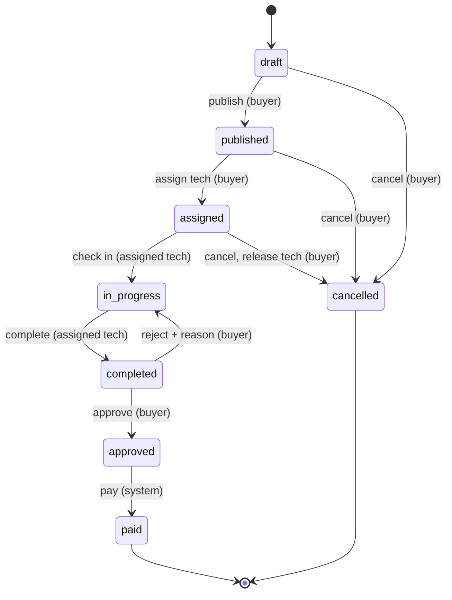

> Tracker ID: DP-16 · Generated: 2026-10-15 · Answers: **TRK-02 বোনাস: Machine coding ×৪** · Source: প্রচলিত LLD/machine-coding রাউন্ড + এই ট্র্যাকের DP উত্তর · Runnable: এই ফোল্ডারের ৪টা `.ts` (✅ সবগুলো ran + strict tsc 2026-10-15, প্রতিটায় নিজস্ব `assert` টেস্ট) · Status: 🟡 generated

# Machine coding: ৪৫ মিনিটে কোড লেখো

> **কীভাবে প্র্যাকটিস করবে:** সমাধান ফাইল **না খুলে** ফাঁকা ফাইলে ৪৫ মিনিটের টাইমার দিয়ে লেখো। জোরে কথা বলতে বলতে (ইংরেজিতে)। তারপর এখানের ফাইলের সাথে মেলাও, আর `assert` টেস্টগুলো তোমার কোডে চালাও। প্রতিটা চেষ্টা `3-practice/`-এ এক লাইনে লেখো (সময়, কোথায় আটকেছিলে)।

## ৪৫ মিনিটের ছক (সব সমস্যায় একই)

| মিনিট | কী করবে | মুখে বলো |
|---|---|---|
| ০–৫ | requirement জিজ্ঞেস করো, সীমা ঠিক করো, ২–৩টা উদাহরণ লেখো | "Before I code, let me confirm the requirements…" |
| ৫–১০ | entity/class আর interface আঁকো, data structure বাছো (কেন, complexity সহ) | "I'll use a hash map plus a doubly linked list, because…" |
| ১০–৩৫ | কোড: আগে **happy path** চালু, তারপর edge case | "Let me get the core working first, then handle edge cases." |
| ৩৫–৪২ | ছোট টেস্ট/উদাহরণ চালাও, bug ঠিক করো | "Let me walk through this example…" |
| ৪২–৪৫ | trade-off, extension, concurrency নিয়ে বলো | "If this had to scale or run on several servers, I'd…" |

**সব রাউন্ডে যা দেখে:** নাম পরিষ্কার, ছোট method, interface দিয়ে extension (Open/Closed), testable (clock inject করা), edge case, আর **কথা বলে চিন্তা দেখানো**।

---

## MC-1: LRU cache → `lru-cache.ts`

**প্রশ্ন:** `get(key)` আর `put(key, value)` দুটোই O(1)। capacity পূর্ণ হলে সবচেয়ে কম সম্প্রতি ব্যবহৃত (least recently used) key বাদ।

**মূল ধারণা:**
- **HashMap** (key → node): O(1) খোঁজা
- **Doubly linked list**: সবচেয়ে নতুন head-এ, পুরনো tail-এ; node সরানো/বাদ O(1)
- **Sentinel** head/tail node → শেষ প্রান্তে `null` চেক লাগে না
- `get` = node খুঁজে head-এ সরাও; `put` = থাকলে মান বদলে head-এ, না থাকলে পূর্ণ হলে tail-এর আগেরটা বাদ, নতুনটা head-এ

**দুই সংস্করণ:** প্রথমে বলো "JS `Map` insertion order রাখে, তাই delete + set দিয়ে ৫ মিনিটে হয়"। তারপর ইন্টারভিউয়ার চাইলে linked-list সংস্করণ (সাধারণত এটাই চায়)।

| Edge case | ফাইলে টেস্ট |
|---|---|
| `get` করলে recency বাড়ে | `get a` তারপর `put c` → b বাদ, a থাকে |
| বিদ্যমান key `put` → size বাড়ে না | ✅ |
| capacity < 1 | constructor-এ error |
| eviction callback | `onEvict` |

**মুখে (৩০ সেকেন্ড):**
> "I need O(1) lookup and O(1) reordering, so a hash map from key to node, plus a doubly linked list ordered by recency. On get, I move the node to the front. On put, if it's full I remove the node before the tail sentinel and delete it from the map. Sentinels mean I never null-check the ends."

**ফলো-আপ:** TTL (node-এ `expiresAt`, get-এ চেক) · thread safety (অন্য ভাষায় mutex; Node single-threaded) · distributed = Redis `maxmemory-policy allkeys-lru` · LFU কীভাবে আলাদা।
🔗 Sokrio: Redis cache সব রিপোর্টে (S2); তুমি LRU নিজে লেখোনি, এটা DSA প্র্যাকটিস।

---

## MC-2: Parking lot → `parking-lot.ts`

**প্রশ্ন:** কয়েক তলা, spot SMALL/MEDIUM/LARGE। bike যেকোনো spot-এ, car MEDIUM+, truck LARGE। park → ticket; unpark(ticket) → fee। free spot দেখাও।

**Class:**
| Class | দায়িত্ব |
|---|---|
| `Vehicle` (plate, type) | ডেটা |
| `Spot` (id, size) | `fits(v)`, `park`, `leave` |
| `Floor` | **best fit**: যে ছোটতম spot ফিট করে (bike যেন truck-এর জায়গা না নেয়) |
| `Ticket` | vehicle, spot, floor, entryAt |
| `PricingStrategy` (interface) → `HourlyPricing` | **Strategy** (DP-Q03): দাম বদলালে lot বদলায় না |
| `ParkingLot` | `park`, `unpark`, `availability`; একই plate দুবার না; ব্যবহৃত ticket আবার না |

**Design পয়েন্ট যেগুলো বলবে:**
- clock inject করা (`now = () => Date.now()`) → fee টেস্ট সময়ের ওপর নির্ভর না
- enum + `MIN_SPOT` map → নতুন vehicle type = এক লাইন
- শুরু হওয়া ঘণ্টা = পূর্ণ ঘণ্টা, প্রথম ১৫ মিনিট ফ্রি (নিয়ম জিজ্ঞেস করে নিয়েছ বলে দেখাও)

**মুখে:**
> "I'll keep spots, floors and the lot separate, put allocation behind a best-fit search so small vehicles don't take large spots, and pricing behind a strategy interface since that's what changes most. I inject the clock so the fee logic is testable."

**ফলো-আপ:** দুটো gate একই spot নিলে → spot-এ lock, বা DB-তে `UPDATE spots SET vehicle=? WHERE id=? AND vehicle IS NULL` (SD-Q12-এর মতো conditional update) · EV charging · display board = Observer (DP-Q09) · payment আলাদা সার্ভিস।
🔗 Sokrio: সরাসরি অভিজ্ঞতা নেই, এটা classic LLD। Strategy/conditional update-এর যুক্তি Sokrio থেকে (DP-Q03, SD-Q12)।

---

## MC-3: Rate limiter class → `rate-limiter.ts`

**প্রশ্ন:** `tryAcquire(key)` → allowed / denied + retry-after। per user/tenant।

**দুটো algorithm (একটা interface `RateLimiter`):**
| | Token bucket | Sliding window log |
|---|---|---|
| কীভাবে | bucket-এ `capacity` টোকেন, সেকেন্ডে `refillPerSec` যোগ; প্রতি request ১টা খরচ | শেষ `windowMs`-এর timestamp রাখো, `limit`-এর বেশি না |
| burst | হ্যাঁ, capacity পর্যন্ত | না, যেকোনো window-এ ঠিক N |
| memory | key প্রতি ২টা সংখ্যা | key প্রতি N timestamp |
| refill | **lazy**: প্রতি কলে সময়ের পার্থক্য দিয়ে হিসাব, কোনো timer না | পুরনো timestamp ফেলে দাও |

**Design পয়েন্ট:** clock inject → টেস্টে সময় নিয়ন্ত্রণ · key = `t{tenant}:u{user}` (user id tenant জুড়ে repeat হয়!) · `retryAfterMs` হিসাব করে `Retry-After` header।

**মুখে:**
> "I'd use a token bucket: it allows short bursts but keeps the average rate. I refill lazily on each call from the elapsed time, so there's no timer per key. The key includes the tenant, because user ids repeat across tenants. For multiple servers the same logic moves into Redis with a Lua script so all servers share one counter."

**ফলো-আপ:** distributed (Redis Lua / `INCR`+`EXPIRE` fixed window) · idle key মেমরি (LRU, MC-1) · Redis down হলে fail open নাকি closed · cost > 1 (ভারী endpoint)।
🔗 Sokrio ⭐: তোমার SMS resend named limiters (`RouteServiceProvider::configureSmsResendRateLimiting`, key = `name|host|user`, ৫–১০/মিনিট, 429 `ERR_RATE_LIMIT`)। System-লেভেল ডিজাইন: `5-tracks/system-design/cases/09-rate-limiter.md`।

---

## MC-4: Work-order lifecycle (State pattern) → `work-order-lifecycle.ts`

**প্রশ্ন (Field Nation-ধরনের):** draft → published → assigned → in_progress → completed → approved → paid; cancel; buyer completion reject করতে পারে। ভূমিকা অনুযায়ী অনুমতি। প্রতিটা বদল রেকর্ড।



**Design পয়েন্ট:**
- প্রতিটা status = একটা class; base `State`-এ **সব কাজ ডিফল্টে নিষেধ** (`TransitionError`), প্রতিটা state শুধু নিজের অনুমোদিত কাজ override করে (DP-Q12)
- **role check** আর **assigned tech check** transition-এর ভেতরে (অন্য tech check-in করতে পারে না)
- `moveTo()`: history row (from, to, by, at, note) + `version++` (optimistic locking) + listener-দের event (**Observer**)
- DB থেকে লোড: `STATES[status]()` দিয়ে status column থেকে state object আবার বানানো
- reject-এ কারণ বাধ্যতামূলক

**মুখে:**
> "Each status is a class, and every action is forbidden by default, so a new action can't accidentally be allowed in the wrong state. Role and assignment checks live inside the transitions. Every transition goes through one `moveTo` that writes history, bumps a version for optimistic locking, and emits an event, which the notification service can listen to."

**ফলো-আপ:** দুই tech একসাথে accept → version check বা conditional update · N ঘণ্টায় check-in না হলে system job assigned → published · "after check-in cancel" এর আলাদা flow (partial payment) · history থেকে রিপোর্ট (প্রতিটা state-এ কত সময়)।
🔗 Sokrio: order-এর `order_statuses` history আর guard methods (DP-Q12); field-force ডোমেইন (S9)। ডোমেইন: `4-library/fieldnation/domain/01-work-order-domain.md` · system-লেভেল: `5-tracks/system-design/cases/13-dispatch.md`।

---

## চালানো

```bash
npx -y tsx 5-tracks/design-patterns/machine-coding/lru-cache.ts
npx -y tsx 5-tracks/design-patterns/machine-coding/parking-lot.ts
npx -y tsx 5-tracks/design-patterns/machine-coding/rate-limiter.ts
npx -y tsx 5-tracks/design-patterns/machine-coding/work-order-lifecycle.ts
```
প্রতিটা `ok  …` লাইন ছাপে; কোনো assert ভাঙলে `FAIL:` দিয়ে থামে। (Node 18-এ চলে।)
