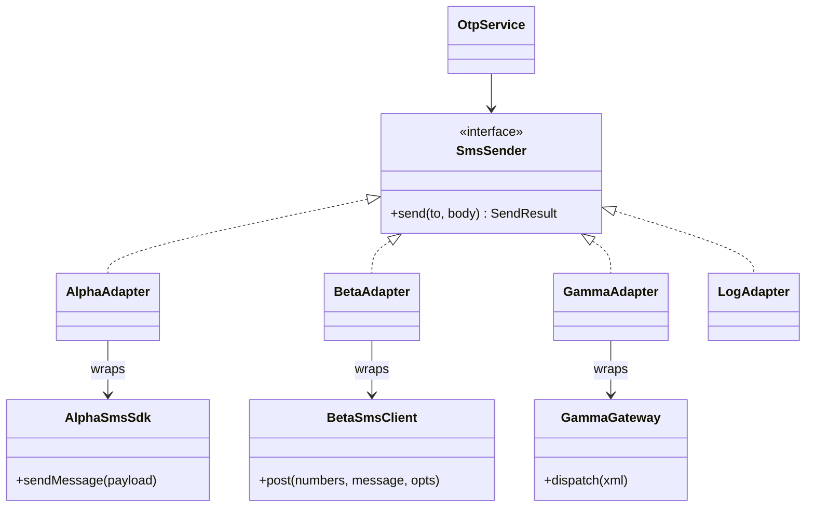

> Tracker ID: DP-07 · Generated: 2026-10-15 · Answers: **DP-Q07** (TRK-02 Phase 5) · Source: GoF + sokrio-server code (`Services/SMSSender`, `BaseSMSGateway`, `SMSGateway`, `LogSMSGateway`, `Retail/RetailerSMSGateway`, `Providers/SMSServiceProvider`) · Runnable: `5-tracks/design-patterns/code/adapter.ts` (✅ ran + strict tsc 2026-10-15) · Status: 🟡 generated

# DP-Q07: You must support three SMS providers with different APIs. How do you design it so switching is easy?

> **এক লাইনে:** **নিজেদের** একটা interface বানাও (`SmsSender::send(to, body): SendResult`), যেটা **আমাদের** কোডের ভাষায় কথা বলে। প্রতিটা provider-এর জন্য একটা **Adapter** class, যেটা আমাদের কলকে provider-এর API-তে অনুবাদ করে আর উত্তরটা আমাদের `SendResult`-এ ফেরত অনুবাদ করে। কোনটা চলবে = config/DI binding। Fallback = adapter-এর তালিকা।

---

## ১. Problem

তিনটা provider, তিন রকম:

| | Alpha | Beta | Gamma |
|---|---|---|---|
| method | `sendMessage({msisdn, text})` | `post(numbers[], message, {unicode})` | `dispatch(xml)` |
| সফল হলে | `{status:'SENT', id}` | `{code:200, ref}` | `'<ok msgid="g-1"/>'` |
| ব্যর্থ হলে | `{status:'FAILED'}` | `{code:400, detail}` | `'<error/>'` |

provider-এর SDK সরাসরি business code-এ ডাকলে:
- provider বদলাতে **সব** জায়গা বদলাতে হয় (OTP, order notification, bulk SMS…)
- প্রতিটা কলারকে provider-এর error format জানতে হয়
- টেস্টে আসল SMS চলে যাওয়ার ঝুঁকি

## ২. Structure



| ভূমিকা | কী | এখানে |
|---|---|---|
| **Target** | যে interface **আমাদের** কোড চায় | `SmsSender` |
| **Adaptee** | বাইরের class, বদলাতে পারি না | `AlphaSmsSdk`, `BetaSmsClient`, `GammaGateway` |
| **Adapter** | Target মানে, ভেতরে Adaptee ডাকে, দুই দিকে অনুবাদ করে | `AlphaAdapter`… |
| **Client** | শুধু Target জানে | `OtpService` |

> **মূল কথা:** interface-টা **আমাদের প্রয়োজন** থেকে ডিজাইন করো, প্রথম provider-এর API কপি করে না। নাহলে দ্বিতীয় provider আসলেই interface ভাঙবে।

## ৩. Code

### TypeScript (পূর্ণ চলমান ফাইল: `5-tracks/design-patterns/code/adapter.ts`)

```ts
type SendResult = { ok: boolean; providerMessageId?: string; error?: string };

interface SmsSender {
  readonly name: string;
  send(to: string, body: string): Promise<SendResult>;
}

class BetaAdapter implements SmsSender {
  readonly name = 'beta';
  constructor(private readonly client = new BetaSmsClient()) {}
  async send(to: string, body: string): Promise<SendResult> {
    const unicode = /[^\x00-\x7F]/.test(body);           // Bangla needs unicode
    const r = await this.client.post([to], body, { unicode });
    return r.code === 200 ? { ok: true, providerMessageId: r.ref } : { ok: false, error: r.detail };
  }
}

// switching = config
const sms = senderFor(process.env.SMS_PROVIDER ?? 'alpha');
await sendOtp(sms, '01711111111', '4821');   // business code never names a provider
```
চালাও: `npx -y tsx 5-tracks/design-patterns/code/adapter.ts`

### Laravel-এ
```php
interface SMSSender {
    public function send(string $body, string ...$to);
}

final class AlphaSmsGateway implements SMSSender { /* Http::post(alpha) + map response */ }
final class BetaSmsGateway  implements SMSSender { /* ... */ }

// AppServiceProvider / SMSServiceProvider
$this->app->bind(SMSSender::class, fn () => match (config('sms.driver')) {
    'alpha' => new AlphaSmsGateway(config('sms.alpha')),
    'beta'  => new BetaSmsGateway(config('sms.beta')),
    default => new LogSMSGateway(),
});
```
Laravel নিজেও এভাবে বানানো: `Mail` (smtp/ses/mailgun), `Cache` (redis/file), `Filesystem` (local/s3): প্রতিটা driver = adapter।

### Fallback আর per-tenant provider
```php
final class FailoverSmsSender implements SMSSender {
    public function __construct(private array $senders) {}   // [primary, secondary]
    public function send(string $body, string ...$to) {
        foreach ($this->senders as $s) {
            try { return $s->send($body, ...$to); }
            catch (ProviderUnavailableException) { continue; }   // শুধু "কখনো connect হয়নি" হলে
        }
        throw new AllProvidersDownException();
    }
}
```
⚠️ **শুধু নিশ্চিতভাবে না-পাঠানো হলে** পরের provider-এ যাও। Timeout-এর পর (হয়তো চলে গেছে) fallback করলে গ্রাহক দুটো SMS পায় (SD-Q10 দেখো)।

---

## ৪. Trade-off আর কখন **ব্যবহার করবে না**

| ✅ Adapter | ❌ দরকার নেই |
|---|---|
| বাইরের API বদলাতে পারো না (SDK, legacy, অন্য টিমের সার্ভিস) | মাত্র একটা provider, বদলানোর পরিকল্পনা নেই: পাতলা wrapper class-ই যথেষ্ট (তবে interface রাখা সস্তা বীমা) |
| একাধিক provider বা ভবিষ্যতে বদলের সম্ভাবনা | |
| টেস্টে fake/log implementation চাও | |

**খরচ / সাবধানতা:**
- **Lowest common denominator:** একজন provider-এর বিশেষ ফিচার (delivery report webhook, scheduling) interface-এ না থাকলে হারিয়ে যায়। সমাধান: optional capability interface (`SupportsDeliveryReport`)
- error mapping সাবধানে: "provider down" vs "নম্বর ভুল" vs "জানা নেই গেছে কি না" আলাদা রাখো, নাহলে retry লজিক ভুল হয়

### কাছাকাছি pattern
| | পার্থক্য |
|---|---|
| **Facade** | Facade একটা জটিল subsystem-কে **সহজ** করে; Adapter একটা interface-কে **অন্য** interface-এ **মেলায়** |
| **Decorator** (DP-Q08) | Decorator **একই** interface রেখে আচরণ যোগ করে; Adapter interface **বদলায়** |
| **Strategy** (DP-Q03) | গঠন কাছাকাছি (interface + কয়েকটা implementation)। Strategy-র উদ্দেশ্য অ্যালগরিদম বদলানো; Adapter-এর উদ্দেশ্য বেমানান API মেলানো |

---

## ৫. মুখে বলার লাইন (English)

**মূল উত্তর (৪৫ সেকেন্ড):**
> "I'd define our own `SmsSender` interface based on what our code needs: send a body to a number and get back a normalized result, success with a message id, or a clear failure type. Then one adapter per provider translates our call into their API and their response back into our result. Business code like OTP or order notifications only sees the interface. Switching providers is a config change in the service provider, and failover is just a sender that tries a list of adapters. The one thing I'm careful about is error mapping: I only fail over when I know the first provider never received the message, otherwise the customer gets two SMS."

**Sokrio উদাহরণ:**
> "Our SMS sending sits behind an `SMSSender` interface. The service provider binds the real gateway only in production with SMS enabled, and a logging gateway everywhere else, so tests and staging never send real messages. When I built bulk resend of failed SMS, I added a `resend()` method that maps the provider's failures into two typed exceptions: never connected, which is safe to retry, and connected but no answer, which we mark as delivery unknown and never resend."

---

## ৬. ফলো-আপ প্রশ্ন

| প্রশ্ন | ছোট উত্তর |
|---|---|
| "Provider-specific features?" | "Optional capability interfaces, like `SupportsDeliveryReports`, checked with `instanceof`. The core interface stays small." |
| "Different provider per tenant?" | "Resolve the adapter from tenant settings at send time, through a small factory, instead of one global binding." |
| "How do you test adapters?" | "Contract tests: the same test suite runs against every adapter with a faked HTTP layer (`Http::fake()`), checking the mapping of success and each error." |
| "Adapter vs Facade?" | "Facade simplifies a complicated subsystem. Adapter converts one interface into another one the client expects." |
| "Delivery reports come back by webhook?" | "Each provider's webhook gets its own controller that maps the payload to our message status, by provider message id, idempotently." |

---

🔗 **Sokrio link:** (কোডে যাচাই করা)
- **Target interface:** `app/Services/SMSSender.php` (`send`, `record`, `isAllowToSend`, `sendWithOutRecord`, `resend`)। `BaseSMSGateway implements SMSSender` → `SMSGateway` (আসল HTTP provider) আর `LogSMSGateway` (শুধু log)। Binding: `app/Providers/SMSServiceProvider.php` (production + `sms.enabled` → আসল, নাহলে log)। মূল লেখক টিম (Tanmay, Shihab, sihab)।
- ⭐ **তোমার নিজের অংশ:** `SMSSender::resend()` + `SMSGateway::resend()` (commit `996fa2bc6`, Komol, ২০২৬-১০-০৫, "Add bulk resend of failed SMS"): `ConnectionException`-কে `ProviderUnavailableException` (কখনো connect হয়নি, cURL 6/7 বা connect timeout) বা `SmsDeliveryUnknownException` (connect হয়েছে, উত্তর আসেনি)-এ অনুবাদ করে; HTTP 5xx → unavailable। এটাই adapter-এর **error mapping**, আর failover নিরাপদ রাখার মূল চাবি। স্টোরি: bulk SMS resend (story-bank-এ যোগ বাকি)।
- **সৎ ফাঁক (ভালো আলোচনার বিষয়):** Sokrio-তে আসলে **একটাই** আসল SMS provider (`config('sms.endpoint')`)। আর `app/Services/Retail/RetailerSMSGateway.php` (Rakib) একই endpoint-এ পাঠায় কিন্তু `SMSSender` **implement করে না**, নিজের timeout/record লজিক। প্রশ্ন এলে বলো: *"We have one provider today, behind an interface. One module has its own gateway class outside that interface; if we added a second provider, I'd fold it into the same adapter first."*
- "তিনটা provider সাপোর্ট করেছি" **বলবে না**, সত্যি না।

📚 আরো: `4-library/cs/01-oop-design-pattern/` · সম্পর্কিত: [08-decorator-proxy.md](08-decorator-proxy.md) · `5-tracks/system-design/cases/10-notification.md` (provider fallback, duplicate আটকানো)
