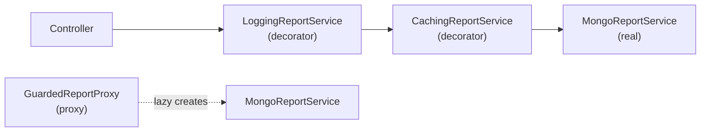

> Tracker ID: DP-08 · Generated: 2026-10-15 · Answers: **DP-Q08** (TRK-02 Phase 5) · Source: GoF + sokrio-server (`Cache::remember` in reports, Laravel Facades, `CheckPermission` middleware) + sokrio-benchmark-python (`app/common/cache.py` `cache_remember`) · Runnable: `5-tracks/design-patterns/code/decorator-proxy.ts` (✅ ran + strict tsc 2026-10-15) · Status: 🟡 generated

# DP-Q08: Add caching and logging to a service without changing its code. How? Decorator vs Proxy?

> **এক লাইনে:** service-এর **একই interface** মানে এমন একটা wrapper class বানাও, যেটা ভেতরে আসল service ধরে রাখে আর কলের আগে/পরে কাজ যোগ করে। **Decorator** = আচরণ **যোগ করা**, বাইরে থেকে stack করা যায় (logging(caching(real)))। **Proxy** = আসল object-এ **access নিয়ন্ত্রণ** (permission, lazy load, remote), সাধারণত নিজেই subject ঠিক করে। গঠন প্রায় একই, **উদ্দেশ্য** আলাদা।

---

## ১. Problem

`ReportService::salesSummary()` ধীর (Mongo aggregation)। চাই:
- ফল cache করতে
- প্রতিটা কল কত সময় নিল log করতে
- কিন্তু `MongoReportService` বদলাবো না (অন্য টিমের, বা Single Responsibility রাখতে)

ভুল উপায়: service-এর ভেতরে `Cache::remember` আর `Log::info` ঢুকিয়ে দেওয়া → ব্যবসায়িক লজিক, caching, logging এক ফাংশনে জট।
আরেক ভুল উপায়: subclass (`CachedMongoReportService extends MongoReportService`) → প্রতিটা combination-এর জন্য নতুন subclass (cached, logged, cached+logged…)।

## ২. Structure



সবগুলো `ReportService` interface মানে, তাই কলার জানে না কতগুলো স্তর আছে।

| | Decorator | Proxy |
|---|---|---|
| **উদ্দেশ্য** | নতুন **দায়িত্ব যোগ** (log, cache, metrics, retry) | **access নিয়ন্ত্রণ** (permission, lazy init, remote call, rate limit) |
| **কে wrap করে** | কলার/container বাইরে থেকে wrap করে, ইচ্ছামতো stack | প্রায়ই proxy নিজেই real object বানায়/খুঁজে পায় |
| **stack করা** | হ্যাঁ, এটাই মূল শক্তি | সাধারণত একটা স্তর |
| **আসল object-কে ডাকবে কি?** | প্রায় সবসময় (আগে/পরে কিছু যোগ করে) | হয়তো **না** (permission নেই, cache hit) |
| **উদাহরণ** | Logging, Caching, Retry wrapper | Protection proxy, Virtual (lazy) proxy, Remote proxy (gRPC stub), Laravel Facade |

> **সৎ কথা:** caching wrapper-কে বইভেদে "caching proxy"-ও বলে। ইন্টারভিউতে নাম নিয়ে তর্ক না করে **উদ্দেশ্য** বলো: "If it adds behaviour and can be stacked, I call it a decorator. If its job is to control access to the real object, it's a proxy."

## ৩. Code

### TypeScript (পূর্ণ চলমান ফাইল: `5-tracks/design-patterns/code/decorator-proxy.ts`)

```ts
interface ReportService { salesSummary(tenantId: number, month: string): Promise<number>; }

class CachingReportService implements ReportService {
  private cache = new Map<string, { v: number; exp: number }>();
  constructor(private readonly inner: ReportService, private readonly ttlMs: number) {}
  async salesSummary(tenantId: number, month: string) {
    const key = `t${tenantId}:sales:${month}`;          // tenant in the key, always
    const hit = this.cache.get(key);
    if (hit && hit.exp > Date.now()) return hit.v;
    const v = await this.inner.salesSummary(tenantId, month);
    this.cache.set(key, { v, exp: Date.now() + this.ttlMs });
    return v;
  }
}

// stack: order matters
const service = new LoggingReportService(new CachingReportService(new MongoReportService(), 60_000), log);
```
আউটপুট: ৩টা রিকোয়েস্টে আসল সার্ভিস ২ বার ডাকা হয় (দ্বিতীয়টা cache hit, `0ms`)।

**Proxy:**
```ts
class GuardedReportProxy implements ReportService {
  private real: ReportService | null = null;
  constructor(private readonly can: (perm: string) => boolean) {}
  async salesSummary(tenantId: number, month: string) {
    if (!this.can('VIEW_SALES_REPORT')) throw new Error('403');   // access control
    this.real ??= new MongoReportService();                         // lazy
    return this.real.salesSummary(tenantId, month);
  }
}
```
চালাও: `npx -y tsx 5-tracks/design-patterns/code/decorator-proxy.ts`

**TypeScript-এর `@decorator` সিনট্যাক্স** (method decorator) আরেক জিনিস: compile-time-এ একটা method wrap করে। ধারণা একই, কিন্তু GoF Decorator হলো **object** wrap করা, runtime-এ।

### Laravel-এ
```php
final class CachingReportService implements ReportService
{
    public function __construct(private ReportService $inner) {}

    public function salesSummary(int $tenantId, string $month): float
    {
        return Cache::remember("t{$tenantId}:sales:{$month}", 600,
            fn () => $this->inner->salesSummary($tenantId, $month));
    }
}

// AppServiceProvider: interface চাইলে wrapped version দাও
$this->app->bind(ReportService::class, fn () =>
    new LoggingReportService(new CachingReportService(new MongoReportService()))
);

// অথবা Laravel-এর built-in decorator hook
$this->app->extend(ReportService::class, fn ($service) => new CachingReportService($service));
```
Laravel-এর **middleware**-ও controller-কে decorate করে (DP-Q10)। **Facade** (`Cache::`, `DB::`) = proxy: static-দেখতে কল container-এর আসল object-এ পাঠায়।

---

## ৪. Trade-off আর কখন **ব্যবহার করবে না**

| ✅ Decorator / Proxy | ❌ দরকার নেই |
|---|---|
| একই cross-cutting কাজ অনেক সার্ভিসে (log, cache, metrics, retry) | একটা জায়গায় এক লাইনের `Cache::remember`: সরাসরি লেখো |
| আসল class বদলাতে পারো না বা চাও না | interface নেই আর বানানোর মতো কারণও নেই |
| combination runtime-এ বদলায় (prod-এ cache, test-এ না) | |

**ফাঁদ:**
- **ক্রম গুরুত্বপূর্ণ:** logging বাইরে থাকলে cache hit-ও log হয়; ভেতরে থাকলে শুধু miss
- interface বড় হলে (২০টা method) প্রতিটা decorator-কে সব method forward করতে হয় → বিরক্তিকর। TS-এ `Proxy` object বা base `ForwardingReportService` সাহায্য করে
- cache decorator-এ **key-তে tenant** না রাখলে এক tenant আরেকজনের ডেটা দেখে (Sokrio CLAUDE.md-এর নিয়ম)
- debug কঠিন: stack trace-এ অনেক স্তর

### কাছাকাছি pattern
| | পার্থক্য |
|---|---|
| **Adapter** (DP-Q07) | interface **বদলায়**; Decorator/Proxy **একই** interface রাখে |
| **Chain of Responsibility** (DP-Q10) | middleware = decorator-এর chain, প্রতিটা স্তর থামিয়ে দিতে পারে |
| **AOP / interceptors** | NestJS interceptor, Spring AOP: framework-লেভেলে decorator |

---

## ৫. মুখে বলার লাইন (English)

**মূল উত্তর (৪৫ সেকেন্ড):**
> "I'd wrap it. A caching class and a logging class both implement the same interface as the real service and hold a reference to the next one. Each does its bit before or after delegating, so the real service doesn't change. I wire them in the container: logging around caching around the real service, and in tests I can skip the caching layer. The difference from a Proxy is intent. A decorator adds behaviour and you can stack as many as you like. A proxy controls access to the real object, like checking permission, creating it lazily, or standing in for a remote service, and it may never call the real object at all."

**ফাঁদ নিয়ে এক লাইন (সিনিয়র দেখায়):**
> "Order matters, and for caching the key has to include the tenant, or one tenant sees another's numbers."

---

## ৬. ফলো-আপ প্রশ্ন

| প্রশ্ন | ছোট উত্তর |
|---|---|
| "Why not inheritance?" | "Each combination would need its own subclass. With decorators I compose them at runtime." |
| "How do you invalidate that cache?" | "TTL for reports that can be a bit stale, plus a tagged or versioned key that I bump when the underlying data changes." (SD-Q03) |
| "Is a Laravel Facade a proxy?" | "Yes, a static proxy to an object resolved from the container, which is why it can be faked in tests." |
| "Decorator vs middleware?" | "Middleware is a chain of decorators around the request handler, where any link can stop the request." |
| "What about a retry decorator?" | "Same shape. Retry only idempotent calls, with backoff, and never around something that may have already succeeded, like a payment." |

---

🔗 **Sokrio link:** (কোডে যাচাই করা)
- ⭐ **ঠিক এই প্রশ্নের উত্তর, তোমার নিজের কোডে (Python):** `sokrio-benchmark-python/app/common/timing.py` → `cached_with_timing(module, endpoint, tenant, key, ttl, fn, should_cache)` = **logging মোড়ানো caching মোড়ানো আসল query**। ভেতরে `cache_remember(...)` (`app/common/cache.py`), বাইরে `log_event(...)` সময় + `cache_hit` লেখে, exception হলেও log করে তারপর re-raise। Docstring বলছে: আগে `market_benchmark/router`-এ private `_cached_with_timing` ছিল, তুমি বের করে shared বানিয়েছ যাতে `benchmark` router-ও একই wrapper পায় (duplication সরানো)। `git log`: `timing.py` আর `common/cache.py` দুটোরই একমাত্র লেখক Komol। এখানে "I built" বলতে পারো।
  > "In our benchmark service I wrote a `cached_with_timing` wrapper: the real query function goes in, it's wrapped by the cache, and that's wrapped by timing and logging, which records duration and whether it was a cache hit, even on errors. The query code itself never changes. That's how we could tell 'slow because uncached' from 'slow regardless'."
  - সৎ নোট: এটা function-wrapping (higher-order function), class-ভিত্তিক GoF Decorator না। ধারণা একই; জিজ্ঞেস করলে এটা বলো।
- `should_cache` (তোমার): degraded/খালি ফল cache না করা (SD-Q03)।
- **Laravel:** প্রায় সব heavy report `Cache::remember($key, $ttl, fn () => ...)` সরাসরি কন্ট্রোলার/সার্ভিসে ব্যবহার করে (CLAUDE.md-এর নিয়ম), **আলাদা decorator class দিয়ে না**। সৎভাবে বলো: *"We mostly inline `Cache::remember` with tenant-scoped keys. If several services needed the same caching, I'd move it into a decorator."*
- **Proxy:** Laravel Facade (`Cache::`, `DB::`)। Protection proxy-র কাজটা Sokrio-তে করে middleware: `CheckPermission`, `EnsureTenantAccess` (DP-Q10)।
- **Tenant-scoped cache key:** `ScopeCacheToTenant` middleware cache prefix-এ `tenant_{id}` বসায় (S3)।

📚 আরো: `4-library/cs/01-oop-design-pattern/` · সম্পর্কিত: [07-adapter.md](07-adapter.md) · [10-chain.md](../behavioral/10-chain.md) · `5-tracks/system-design/concepts/03-caching.md`
