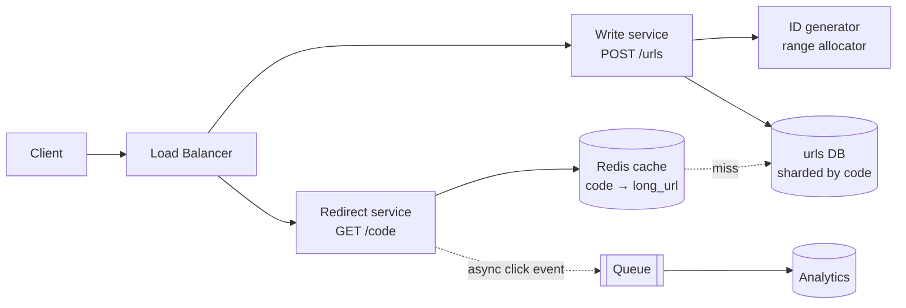

> Tracker ID: SD-20 · Generated: 2026-10-15 · Answers: **SD-Q08** (TRK-02 Phase 5) · Source: general SD knowledge (classic case) · Format: 7-ধাপ ফ্রেমওয়ার্ক ([01-framework.md](../01-framework.md)) · Status: ✅ generated

# SD-Q08: Design a URL shortener (like bit.ly)

> **এক লাইনে:** লম্বা URL → ছোট কোড (`sho.rt/aZ3k9Qx`) → redirect। এটা **অনেক বেশি read, কম write** সিস্টেম। কঠিন অংশ মাত্র দুটো: **unique ছোট কোড কীভাবে বানাবে** আর **redirect কীভাবে খুব দ্রুত করবে**।

---

## ১. Requirements (৫ মিনিট)

**Functional:**
1. লম্বা URL দিলে ছোট URL ফেরত
2. ছোট URL-এ গেলে আসল URL-এ redirect
3. (ঐচ্ছিক) custom alias, expiry, ক্লিক কাউন্ট

**Non-functional:** redirect খুব দ্রুত (p99 < ৫০ms), খুব বেশি available (link ভাঙা মানে সবার ক্ষতি), কোড অনুমান করা কঠিন হলে ভালো।
**Out of scope:** user account, বিস্তারিত analytics ড্যাশবোর্ড।

**জিজ্ঞেস করার প্রশ্ন:** "Same long URL twice: same short code or a new one?" · "Can links expire or be deleted?" · "Expected scale?"

## ২. Estimation (৩ মিনিট)

| | হিসাব |
|---|---|
| নতুন URL | ১০০M/মাস → ~**৪০ write/sec** (peak ~৪০০) |
| Read:Write | ১০০:১ → ~**৪,০০০ read/sec** (peak ~৪০K) |
| Storage | ১০০M × ১২ × ৫ বছর = ৬B রেকর্ড × ~৫০০B ≈ **৩ TB** |
| কোড দৈর্ঘ্য | base62 (a–z, A–Z, 0–9): 62⁷ ≈ **৩.৫ ট্রিলিয়ন** → ৭ অক্ষর যথেষ্ট |

> শিক্ষা: write খুব কম, read অনেক → **cache-ই মূল ডিজাইন**।

## ৩. API (৩ মিনিট)

```
POST /api/v1/urls        { longUrl, customAlias?, expiresAt? }  → 201 { shortUrl, code }
GET  /{code}             → 301/302 Location: longUrl   (404 যদি না থাকে / expired)
```

**301 vs 302:**
| | 301 Permanent | 302 Found (temporary) |
|---|---|---|
| ব্রাউজার | cache করে, পরের বার আমাদের সার্ভারে আসেই না | প্রতিবার আমাদের কাছে আসে |
| ভালো | সার্ভার লোড কম | **ক্লিক গোনা যায়**, পরে URL বদলানো যায় |

## ৪. Data model (৫ মিনিট)

```sql
urls (
  code        VARCHAR(10) PRIMARY KEY,
  long_url    TEXT NOT NULL,
  created_at  TIMESTAMP,
  expires_at  TIMESTAMP NULL,
  user_id     BIGINT NULL
)
```
Access pattern = শুধু `code` দিয়ে lookup → key-value ধরনের। MySQL (PK lookup) বা DynamoDB/Cassandra দুটোই চলে। ৩ TB-তে sharding লাগবে → shard key = `code` (hash, সমান বণ্টন)।

## ৫. High-level design (১০ মিনিট)



Redirect পথ: `GET /aZ3k9Qx` → Redis (৯৯% hit) → `302 Location` → ক্লিক event async queue-তে (redirect-কে ধীর করে না)।

## ৬. Deep dive: ছোট কোড কীভাবে বানাবে ⭐

| পদ্ধতি | কীভাবে | ভালো | খারাপ |
|---|---|---|---|
| **A. Hash + কাটা** | `base62(md5(longUrl))[0..7]` | একই URL → একই কোড | collision → DB চেক করে আবার চেষ্টা; প্রতি write-এ extra read |
| **B. Counter + base62** | DB auto-increment `id` → `base62(id)` | collision নেই, ছোট | কোড অনুমানযোগ্য (`aaab`, `aaac`); এক counter = bottleneck/SPOF |
| **C. Range allocator** ⭐ | প্রতিটা app সার্ভার একটা কেন্দ্রীয় store (ZooKeeper/DB) থেকে ১০০০-এর ব্লক নেয়, মেমোরিতে গুনে যায় | collision নেই, দ্রুত, কেন্দ্রীয় store-এ চাপ খুব কম | সার্ভার মরলে ব্লকের বাকি নম্বর নষ্ট (সমস্যা না, স্পেস বিশাল) |
| D. Snowflake-ধরনের ID | timestamp + machine id + sequence | সমন্বয় ছাড়াই unique | ৬৪-bit → base62-এ ১১ অক্ষর, একটু লম্বা |
| E. Random + check | random ৭ অক্ষর, DB-তে unique constraint | অনুমান করা কঠিন | ভরাট হতে থাকলে collision বাড়ে |

**আমার পছন্দ:** C (range allocator)। অনুমানযোগ্যতা নিয়ে চিন্তা থাকলে id-কে base62-এর আগে একটা reversible shuffle (bijective permutation) দিয়ে ঘুরিয়ে নাও।

```ts
const ALPHABET = '0123456789abcdefghijklmnopqrstuvwxyzABCDEFGHIJKLMNOPQRSTUVWXYZ';
function toBase62(n: bigint): string {
  if (n === 0n) return ALPHABET[0];
  let out = '';
  while (n > 0n) {
    out = ALPHABET[Number(n % 62n)] + out;
    n /= 62n;
  }
  return out;
}
// range allocator: সার্ভার শুরুতে [next, next+1000) ব্লক নেয়
class RangeIdGenerator {
  private current = 0n; private end = 0n;
  constructor(private allocate: () => Promise<bigint>) {}   // কেন্দ্রীয় counter += 1000
  async next(): Promise<string> {
    if (this.current >= this.end) {
      this.current = await this.allocate();
      this.end = this.current + 1000n;
    }
    return toBase62(this.current++);
  }
}
```

**অন্য deep dive:**
- **Hot link** (ভাইরাল): Redis-এ থাকে; আরো বেশি হলে app-এর ভেতরে ছোট L1 cache, বা CDN edge-এ redirect
- **Custom alias:** একই `code` কলাম, `INSERT` unique constraint-এ ব্যর্থ হলে "taken"
- **Abuse:** POST-এ rate limit (→ SD-Q09), malicious URL blocklist চেক
- **Expiry:** read-এ `expires_at` চেক + রাতের ব্যাচে মুছে ফেলা; cache TTL ≤ expiry

## ৭. Wrap-up

> "The first bottleneck is read traffic, solved by cache and stateless redirect servers. Next is storage growth, solved by sharding on the code. I'd monitor redirect p99, cache hit rate and 404 rate."

---

## মুখে বলার লাইন (English)

> "It's a read-heavy key-value problem: about 40 writes and 4,000 reads per second, so the design centers on a cache in front of a simple code-to-URL table. For codes I'd use base62 on a unique numeric id, with each app server leasing a block of a thousand ids from a central counter, so there are no collisions and no hot counter. Redirects read from Redis, return a 302 so we can count clicks, and push the click event to a queue so analytics never slows the redirect. Storage grows to a few terabytes over years, so I'd shard by code."

## ফলো-আপ প্রশ্ন

| প্রশ্ন | ছোট উত্তর |
|---|---|
| "Why not just hash the URL?" | "Truncated hashes collide, so every write needs a check and retry. A unique id never collides." |
| "Same URL submitted twice?" | "If we want the same code, keep a `long_url_hash → code` index and look it up first. Many shorteners just create a new code, which is simpler." |
| "Counter server dies?" | "Servers already hold blocks, so they keep working; the counter itself is replicated. Lost ids from an unused block don't matter." |
| "Make codes unguessable?" | "Permute the id before encoding, or use random codes with a uniqueness check." |

---

🔗 **Sokrio link:** সরাসরি অভিজ্ঞতা নেই, এটা ক্লাসিক ওয়ার্ম-আপ কেস। কাছাকাছি যা বলতে পারো:
- **Read-heavy + cache + TTL:** A2-এর benchmark cache (TTL 600→10800s) আর `cache_remember` (SD-Q03)
- **ID/uniqueness:** per-tenant DB-তে auto-increment id টেন্যান্টের মধ্যে repeat করে, তাই Sokrio-র rate-limit key আর cache key-তে tenant prefix লাগে (SD-Q09) → "globally unique ID কেন দরকার" প্রশ্নে কাজে লাগে
- এভাবে বলো: *"I haven't built a shortener, but the shape is familiar: a read-heavy lookup where the cache is the design."*

📚 পরে: [09-rate-limiter.md](09-rate-limiter.md)
