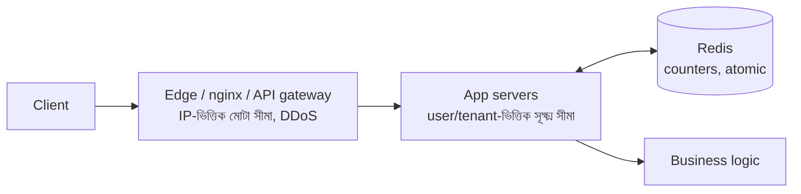

> Tracker ID: SD-21 · Generated: 2026-10-15 · Answers: **SD-Q09** (TRK-02 Phase 6) · Source: general SD knowledge + sokrio-server code (`app/Providers/RouteServiceProvider.php`, `config/rate_limiting.php`, `git log`) · Format: 7-ধাপ · Status: ✅ generated

# SD-Q09: Design a rate limiter for an API

> **এক লাইনে:** প্রতিটা client-এর জন্য একটা counter রাখো, সীমা পেরোলে `429 Too Many Requests`। তিনটা সিদ্ধান্তই আসল: **কাকে গুনবে (key)**, **কোন অ্যালগরিদম**, আর **একাধিক সার্ভারে counter কোথায় থাকবে** (Redis, atomic)।

---

## ১. Requirements

**Functional:** প্রতি client (user/IP/API key) প্রতি সময়ে সর্বোচ্চ N request; বেশি হলে `429` + `Retry-After`; আলাদা endpoint-এর আলাদা নিয়ম (login কড়া, read নরম)।
**Non-functional:** প্রতি request-এ < ১–২ms যোগ; **distributed** (অনেক app সার্ভার একই counter মানবে); limiter নিজে পড়ে গেলে API যেন বন্ধ না হয় (**fail open**)।

**জিজ্ঞেস করো:** "Limit per user, per IP, or per API key?" · "Hard limit or allow short bursts?" · "Where: API gateway or inside the app?"

## ২. Estimation
১০K request/sec × প্রতিটায় ১টা Redis `INCR` = ১০K Redis op/sec, একটা Redis node সহজে পারে (~১০০K+ op/sec)। মেমোরি: ১M active key × ~১০০B = ~১০০MB।

## ৩. API / response

```
HTTP/1.1 429 Too Many Requests
Retry-After: 30
X-RateLimit-Limit: 600
X-RateLimit-Remaining: 0
X-RateLimit-Reset: 1760500000
```

## ৪. অ্যালগরিদম ⭐ (deep dive-এর মূল)

| অ্যালগরিদম | কীভাবে | ভালো | খারাপ |
|---|---|---|---|
| **Fixed window** | `key:minute` counter, `INCR` + `EXPIRE` | সবচেয়ে সহজ, কম মেমোরি | **সীমানায় burst**: ১২:০০:৫৯-এ ১০০ + ১২:০১:০০-এ ১০০ = ২ সেকেন্ডে ২০০ |
| **Sliding window log** | প্রতিটা request-এর timestamp sorted set-এ | একদম সঠিক | প্রতি request-এ মেমোরি, ভারী |
| **Sliding window counter** ⭐ | বর্তমান + আগের window-এর ওজনযুক্ত যোগ | প্রায় সঠিক, কম মেমোরি | আনুমানিক |
| **Token bucket** ⭐ | বালতিতে টোকেন নির্দিষ্ট হারে ভরে; প্রতি request ১টা খায় | **burst দেয়** কিন্তু গড় হার বাঁধে; AWS/Stripe এটা ব্যবহার করে | দুটো মান (tokens, last refill) রাখতে হয় |
| Leaky bucket | queue থেকে স্থির হারে বের হয় | output মসৃণ | burst-এ request দেরি হয় বা বাদ যায় |

**কোনটা বাছবে:** সাধারণ API → **token bucket** (মোবাইল sync-এর মতো bursty client-এর জন্য ভালো) বা sliding window counter। login/OTP-এর মতো নিরাপত্তা → কড়া fixed/sliding window, একাধিক স্তরে।

### Token bucket (Redis + Lua, atomic)
```ts
// Lua script Redis-এর ভেতরে atomic চলে: read-modify-write-এর race নেই
const TOKEN_BUCKET = `
local key, capacity, refillPerSec, now = KEYS[1], tonumber(ARGV[1]), tonumber(ARGV[2]), tonumber(ARGV[3])
local b = redis.call('HMGET', key, 'tokens', 'ts')
local tokens = tonumber(b[1]) or capacity
local ts = tonumber(b[2]) or now
tokens = math.min(capacity, tokens + (now - ts) * refillPerSec)
local allowed = tokens >= 1
if allowed then tokens = tokens - 1 end
redis.call('HSET', key, 'tokens', tokens, 'ts', now)
redis.call('EXPIRE', key, math.ceil(capacity / refillPerSec) * 2)
return allowed and 1 or 0`;

async function allow(redis: Redis, clientKey: string): Promise<boolean> {
  try {
    const ok = await redis.eval(TOKEN_BUCKET, 1, `rl:${clientKey}`, 100, 10, Date.now() / 1000);
    return ok === 1;          // capacity 100, ১০/সেকেন্ড ভরে
  } catch {
    return true;              // Redis ডাউন → fail open (API চালু রাখো, alert দাও)
  }
}
```

### Laravel-এ
```php
RateLimiter::for('api', fn (Request $r) =>
    Limit::perMinute(600)->by($tenantPrefix . ':' . ($r->user()?->id ?: $r->ip()))
);
Route::middleware('throttle:api')->group(...);
```
Laravel-এর limiter মূলত fixed window (cache `INCR` + expiry)।

## ৫. High-level design



**কোথায় বসাবে:**
| স্তর | কী আটকায় |
|---|---|
| Edge (CDN/WAF/nginx/gateway) | বেনামি flood, DDoS, IP-ভিত্তিক |
| App middleware (auth-এর **পরে**) | authenticated user/API key-ভিত্তিক, ব্যবসায়িক নিয়ম (plan অনুযায়ী) |

## ৬. আরো deep dive

- **Key বাছাই:** user id (login থাকলে), না থাকলে IP; NAT/অফিসের পেছনে অনেক user এক IP → শুধু IP দিয়ে কড়া সীমা দিলে নিরীহ লোক আটকায়
- **Multi-tenant:** user id টেন্যান্টে টেন্যান্টে repeat করে → key-তে **tenant prefix** না দিলে এক কোম্পানির traffic আরেকটাকে থামাবে
- **একাধিক স্তর:** login = প্রতি identifier + প্রতি IP দুটো সীমা (brute force আর credential stuffing দুটোই)
- **Race condition:** `GET` তারপর `SET` = দুই সার্ভার একসাথে পার পায় → **`INCR` (atomic) বা Lua script**
- **Redis ডাউন:** fail open (availability) vs fail closed (নিরাপত্তা: login/OTP-এর জন্য কড়া হতে পারো)
- **Kill switch:** config দিয়ে deploy ছাড়াই বন্ধ/চালু

## ৭. Wrap-up
> "I'd watch 429 rate per route and per tenant, to catch both abuse and limits that are too tight for real clients, and Redis latency since it's on every request."

---

## মুখে বলার লাইন (English)

> "I'd keep a counter per client in Redis, because the limit must hold across all app servers, and update it atomically with INCR or a small Lua script to avoid races. For a general API I'd use a token bucket, since it allows short bursts but caps the average rate, which suits mobile sync clients. Sensitive endpoints like login and OTP get stricter, layered limits: per identifier and per IP. Rejected requests get a 429 with Retry-After. Coarse IP limits belong at the edge; per-user and per-plan limits in the app after authentication. If Redis is down I'd fail open for normal APIs and alert."

**Sokrio (তোমার টিমের কাজ + তোমার অংশ):**
> "Our API has named limiters for general API traffic, auth, OTP send and verify, and bulk endpoints. One lesson: user ids repeat across tenant databases, so every limiter key is prefixed with the tenant. Otherwise one company's traffic could throttle another's. The limiter runs after authentication, so it keys by the real user. It caps authenticated abuse; unauthenticated floods are shed at nginx. For the SMS resend feature I built, I added per-route limiters keyed by host and user."

## ফলো-আপ প্রশ্ন

| প্রশ্ন | ছোট উত্তর |
|---|---|
| "Fixed window problem?" | "Bursts at the boundary can double the rate. Sliding window counter or token bucket fixes it." |
| "Multiple data centers?" | "Either a per-region limit, which is simpler, or sync counters asynchronously and accept small overshoot." |
| "Different limits per pricing plan?" | "Look up the plan with the API key (cached) and pass capacity and refill rate into the same algorithm." |
| "Why after auth, not before?" | "After auth you can key by user and plan. Before auth only IP is known, which belongs at the edge." |

---

🔗 **Sokrio link:** (কোডে যাচাই করা, 2026-10-15)
- **Named limiters:** `app/Providers/RouteServiceProvider.php::configureRateLimiting()`: `api` (ডিফল্ট ৬০০/মিনিট, `config/rate_limiting.php`), `auth` (প্রতি identifier **এবং** প্রতি IP, দুই স্তর), `otp` (প্রতি মিনিট + প্রতি ঘণ্টা), `otp-verify`, `bulk`। **Tenant-scoped key** (`scopedKey()`), auth-এর **পরে** চলে, `RATE_LIMITING_ENABLED` = deploy ছাড়া kill switch। লেখক: **sihab** (2026-09) → বলো *"our API's limiters"*।
- ⭐ **তোমার অংশ:** `configureSmsResendRateLimiting()` (Komol, 2026-10-05): `sms-failed-ids` ১০/মিনিট, `sms-resend-check` ১০/মিনিট, `sms-resend` ৫/মিনিট; key = route নাম + host + user id। কারণ কোডেই লেখা: plain `throttle:5,1` সব route-এ একই counter শেয়ার করে, আর user id টেন্যান্টে repeat করে।
- এটা SD-Q03-এর "multi-tenant key" নিয়মের আরেকটা প্রমাণ (S3)।

📚 আগে: [08-url-shortener.md](08-url-shortener.md) · পরে: [10-notification.md](10-notification.md)
