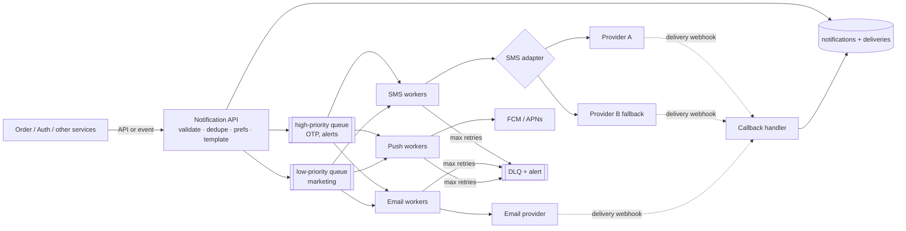

> Tracker ID: SD-22 · Generated: 2026-10-15 · Answers: **SD-Q10** (TRK-02 Phase 7) · Source: general SD knowledge + sokrio-server code (`app/Services/SMS/`, `app/Jobs/SMS/ResendFailedSmsBatch.php`, `app/Services/SMSGateway.php`, `SMSServiceProvider`, `FCMServiceProvider`, `git log`) · Format: 7-ধাপ · Status: ✅ generated

# SD-Q10: Design a notification service (SMS, email, push)

> **এক লাইনে:** অন্য সার্ভিস শুধু বলে "এই user-কে এই ঘটনা জানাও"; notification service ঠিক করে **কোন channel-এ, কোন template-এ, কখন**, তারপর **queue + worker + provider adapter** দিয়ে পাঠায়। কঠিন অংশ: **দুবার না পাঠানো, provider ডাউন হলে কী হবে, আর খরচ/স্প্যাম সামলানো।**

---

## ১. Requirements

**Functional:**
1. অন্য সার্ভিস API/event দিয়ে notification চায় (`order.shipped`, user 42)
2. Channel: SMS, email, push (FCM/APNs), in-app
3. Template + ভাষা; user preference (opt-out, quiet hours)
4. স্ট্যাটাস দেখা (sent/delivered/failed) আর ব্যর্থগুলো আবার পাঠানো

**Non-functional:** একই notification **দুবার যাবে না** (বিশেষ করে SMS: টাকা লাগে, বিরক্তিকর); OTP-এর মতো জরুরি জিনিস কয়েক সেকেন্ডে; marketing ব্লাস্ট জরুরি জিনিসকে আটকাবে না; provider ডাউন হলেও ডেটা হারাবে না।

**জিজ্ঞেস করো:** "Transactional (OTP, order) or also marketing blasts?" · "Volume per day?" · "Do we pay per SMS?"

## ২. Estimation
১০M notification/দিন → গড় ~১২০/sec, ব্লাস্টে peak ~১০K/sec (মিনিটে ৫০০K marketing)। তাই **queue বাধ্যতামূলক**: peak worker আর provider-এর সীমার চেয়ে অনেক বেশি।

## ৩. API

```
POST /v1/notifications
{
  "idempotencyKey": "order-981-shipped",   ← একই কী = একবারই পাঠানো
  "userId": 42,
  "event": "order.shipped",
  "data": { "orderNo": "981" },
  "channels": ["push", "sms"],              ← ঐচ্ছিক, না দিলে preference থেকে
  "priority": "high"
}
→ 202 Accepted { "notificationId": "..." }
GET /v1/notifications/{id} → status per channel
```

## ৪. Data model

```sql
notifications (id, idempotency_key UNIQUE, user_id, event, payload JSON, priority, created_at)
deliveries    (id, notification_id, channel, provider, status, attempt_count,
               provider_message_id, failure_reason, last_attempt_at)
               -- status: queued → sending → sent → delivered | failed | unknown
templates     (event, channel, locale, body)
preferences   (user_id, channel, enabled, quiet_from, quiet_to)
```

## ৫. High-level design



ধাপ: request → **dedupe** (idempotency key unique) → preference আর quiet hours চেক → template render → প্রতি channel-এ একটা `delivery` row → priority অনুযায়ী queue → worker provider-এ পাঠায় → status আপডেট → provider-এর delivery webhook এলে `delivered`।

## ৬. Deep dive ⭐

### A. দুবার না পাঠানো (সবচেয়ে জরুরি)
| স্তর | কৌশল |
|---|---|
| Caller দুবার ডাকলে | `idempotency_key` UNIQUE → দ্বিতীয়টা আগের id ফেরত পায় |
| Worker দুবার পেলে (at-least-once) | **status দিয়ে claim**: `UPDATE deliveries SET status='sending' WHERE id=? AND status='queued'` → ০ row হলে অন্য কেউ নিয়েছে, skip |
| Provider-এ পাঠানোর মাঝে crash | **"unknown" অবস্থা**: `sending` row-কে অন্ধভাবে আবার পাঠিও না। provider-এর status API থাকলে জিজ্ঞেস করো; না থাকলে `unknown` চিহ্ন দাও, মানুষ সিদ্ধান্ত নেবে |
| Timeout-এর ধরন | **Connect হয়নি** = নিশ্চিতভাবে যায়নি → retry নিরাপদ। **Connect হয়েছে, উত্তর আসেনি** = হয়তো গেছে → unknown |

### B. Provider failure
- **Adapter interface** (`send(to, body)`) এর পেছনে প্রতিটা provider (→ DP-Q07 Adapter)
- Retry: exponential backoff + jitter, শুধু transient error-এ
- **Circuit breaker / short-circuit:** provider পরপর ব্যর্থ হলে বাকি ব্যাচ চেষ্টা না করে fail/requeue → একটা outage-এ হাজারটা timeout খেতে হয় না
- **Fallback provider:** A ডাউন → B (খরচ/ডেলিভারি রেট অনুযায়ী routing)

### C. Priority আর throttling
- আলাদা queue: OTP marketing ব্লাস্টের পেছনে আটকাবে না
- Provider-এর rate limit মানা (প্রতি সেকেন্ডে N) → worker concurrency বাঁধা
- প্রতি user সীমা (দিনে সর্বোচ্চ ৩টা marketing), quiet hours-এ হলে delay queue

### D. খরচ (SMS)
- পাঠানোর **আগে** ব্যালান্স/কোটা চেক, আর চলমান কাজের জন্য **reserve** করো, যাতে দুটো ব্যাচ একই ব্যালান্সে পার না পায়
- লম্বা SMS = একাধিক segment = বেশি খরচ → আগে হিসাব করে দেখাও

## ৭. Wrap-up
> "I'd monitor queue depth per priority, send success rate per provider, p95 time-to-deliver for OTPs, and DLQ size. The first bottleneck is provider rate limits during blasts, handled by priority queues and throttled workers."

---

## মুখে বলার লাইন (English)

**মূল উত্তর (৬০ সেকেন্ড):**
> "Other services just say 'notify user 42 about order shipped' with an idempotency key. The notification service checks for duplicates, applies user preferences and quiet hours, renders the template, creates one delivery row per channel and puts it on a priority queue, so OTPs never wait behind a marketing blast. Channel workers send through an adapter per provider, with retries and backoff, a fallback provider, and a dead-letter queue. Provider webhooks update delivery status."

**Duplicate (সিনিয়র-স্তরের অংশ):**
> "The hard part is never sending twice. Workers claim a delivery with a conditional status update, so a redelivered message does nothing. The subtle case is a crash or timeout during the provider call. If we never connected, it's safe to retry. If we connected but got no answer, the SMS may have gone out, so I mark it 'delivery unknown' instead of retrying automatically."

**নিজের গল্প (তোমার লেখা, সবচেয়ে শক্তিশালী):**
> "I built exactly this for failed SMS in Sokrio: bulk resend for up to fifty thousand failed messages. The rows carry the state: failed to pending when claimed, processing right before the provider call. A double click gets a 409 because the rows are already pending. The claim runs under a per-tenant lock and checks the SMS balance minus what other resends have reserved, so two admins can't overspend. If the provider is down, the rest of the batch isn't attempted, so an outage costs one timeout per batch, not per message. And the gateway separates 'never connected' from 'connected but no answer', so we never silently send the same SMS twice."

## ফলো-আপ প্রশ্ন

| প্রশ্ন | ছোট উত্তর |
|---|---|
| "Push token is invalid?" | "Provider says unregistered → delete the token, don't retry." |
| "User gets the same alert from 3 services?" | "Dedupe or collapse by (user, event type, window) in the notification service." |
| "Guarantee OTP arrives?" | "Can't guarantee SMS delivery; high-priority queue, fast fallback provider, and a 'resend code' option with rate limits." |
| "Email bounces?" | "Bounce webhook marks the address; stop sending after hard bounces to protect sender reputation." |

---

🔗 **Sokrio link:** (কোডে যাচাই করা, 2026-10-15)
- ⭐ **তোমার নিজের, সরাসরি এই কেস:** bulk resend of failed SMS (Komol, 2026-10-05 → 08):
  - `app/Services/SMS/MessageResendService.php`: `failedIds()` (সর্বোচ্চ `max_select` ৫০,০০০), `balanceCheck()` (দেখানোর জন্য), `startResend()` → `claim()` (per-tenant `Cache::lock` + `DB::transaction` + `lockForUpdate`, reserved SMS বাদ দিয়ে ব্যালান্স চেক), `dispatch()` (queue না পেলে claim ফেরত)
  - `app/Jobs/SMS/ResendFailedSmsBatch.php`: ১০০-র ব্যাচ, আলাদা `sms-resend` queue, `$tries = 1` + নিজের `retry_count` (max ৫), provider ডাউন হলে বাকি ব্যাচ skip, `failed()`-এ release (`pending → failed`, `processing → failed "Delivery unknown"`)
  - `app/Services/SMSGateway.php::resend()`: connect হয়নি → `ProviderUnavailableException`; connect হয়েছে কিন্তু উত্তর নেই → `SmsDeliveryUnknownException`
  - Rate limit: `sms-resend` ৫/মিনিট (SD-Q09)
- **Adapter/Strategy (টিমের):** `SMSSender` interface → `SMSGateway` (production + `sms.enabled`) / `LogSMSGateway` (বাকি সব); push-এ `NotificationSender` → `FCM` / `LogFCM`।
- কোনো সংখ্যা (কত SMS resend হয়েছে, কত টাকা বাঁচল) CV-তে নেই → বানিও না: `[Komol পূরণ করবে]`।

📚 আগে: [09-rate-limiter.md](09-rate-limiter.md) · সম্পর্কিত: [../concepts/07-queues.md](../concepts/07-queues.md) · পরে: [11-payment.md](11-payment.md)
