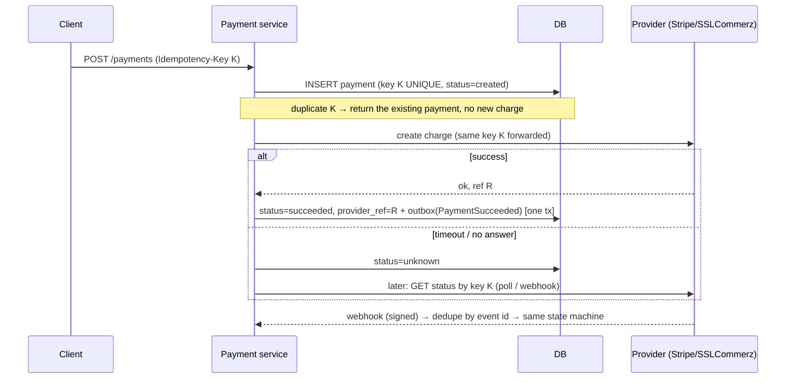

> Tracker ID: SD-28 · Generated: 2026-10-15 · Answers: **SD-Q11** (TRK-02 Phase 8) · Source: general SD knowledge (Stripe-style idempotency, ledger, reconciliation) + sokrio-server code (`SMSGateway::resend`, `MessageResendService`) · Format: 7-ধাপ · Status: ✅ generated

# SD-Q11: Design a payment flow. How do you stop a customer from being charged twice?

> **এক লাইনে:** ডাবল চার্জ আটকানোর তিনটা স্তম্ভ: **(১) Idempotency key**: একই চেষ্টা যতবারই আসুক, একবারই চার্জ; **(২) State machine + "unknown" অবস্থা**: timeout মানে "ব্যর্থ" না, "জানি না", তাই অন্ধ retry না; **(৩) Reconciliation**: প্রতিদিন নিজের রেকর্ড আর payment provider-এর রেকর্ড মিলিয়ে দেখা।

---

## ১. Requirements

**Functional:** checkout-এ কার্ড/মোবাইল ওয়ালেট দিয়ে পেমেন্ট; সফল হলে অর্ডার confirm; refund; পেমেন্ট ইতিহাস।
**Non-functional:** **সঠিকতা > গতি** (ডাবল চার্জ বা হারানো পেমেন্ট = সবচেয়ে খারাপ); অডিটযোগ্য; কার্ড ডেটা আমাদের সার্ভারে না (PCI) → provider-এর hosted page/tokenization।

**জিজ্ঞেস করো:** "Do we use a payment provider (Stripe, SSLCommerz, bKash) or are we the processor?" (প্রায় সবসময় provider) · "One-time or also subscriptions?"

## ২. Estimation
সাধারণত কম QPS (ধরো ১০০ payment/sec peak)। এখানে স্কেল সমস্যা না, **সঠিকতা** সমস্যা। তাই estimation ছোট রাখো আর deep dive-এ সময় দাও।

## ৩. API

```
POST /v1/payments
Idempotency-Key: 7f3c-...-a91      ← client checkout শুরুতে একবার বানায়, retry-তে একই কী
{ "orderId": 981, "amount": 150000, "currency": "BDT", "method": "card" }
→ 201 { "paymentId": "...", "status": "pending", "redirectUrl": "..." }

POST /v1/webhooks/provider          ← provider জানায় ফলাফল (HMAC signature সহ)
GET  /v1/payments/{id}
```

> টাকা সবসময় **integer** (পয়সা/সেন্ট), float না।

## ৪. Data model

```sql
payments (
  id, order_id, amount, currency,
  idempotency_key  VARCHAR UNIQUE,         ← ডাবল চার্জের প্রথম প্রতিরক্ষা
  status           ENUM('created','pending','succeeded','failed','unknown','refunded'),
  provider_ref     VARCHAR UNIQUE NULL,    ← provider-এর transaction id
  created_at, updated_at
)
payment_events (id, payment_id, from_status, to_status, source, payload, created_at)   ← audit
webhook_events (provider_event_id UNIQUE, received_at, processed_at)                   ← webhook dedupe
ledger_entries (id, txn_id, account, debit, credit, created_at)                         ← double-entry
outbox (id, event_type, payload, published_at NULL)
```

## ৫. High-level design



## ৬. Deep dive ⭐: ডাবল চার্জ কোথা থেকে আসে, আর প্রতিটার সমাধান

| কোথা থেকে | সমাধান |
|---|---|
| **User দুবার "Pay" ক্লিক** | UI বাটন disable + **একই Idempotency-Key** → সার্ভারে UNIQUE, দ্বিতীয়টা প্রথমটার ফল ফেরত পায় |
| **Client/network retry** (মোবাইল টাইমআউট পেয়ে আবার পাঠায়) | একই key → একই ফলাফল (key-এর সাথে request hash রাখো, অন্য body-তে একই key = 422) |
| **আমাদের সার্ভার provider-কে ডাকল, উত্তর আসার আগে timeout** | ⚠️ সবচেয়ে বিপজ্জনক। চার্জ হয়তো হয়ে গেছে। **status = `unknown`**, নতুন চার্জ না। provider-কে **একই idempotency key** পাঠাও (Stripe এটা সমর্থন করে) বা status API-তে জিজ্ঞেস করো |
| **Connect-ই হয়নি** | নিশ্চিতভাবে চার্জ হয়নি → retry নিরাপদ |
| **Webhook দুবার আসে** (provider at-least-once পাঠায়) | `webhook_events.provider_event_id` UNIQUE → দ্বিতীয়টা skip; state transition conditional: `UPDATE ... WHERE status IN ('pending','unknown')` |
| **Webhook আর redirect দুটোই "success" বলে** | একই conditional transition → যে আগে আসে সে জেতে, অন্যটা no-op |
| **Payment সফল কিন্তু order confirm করার আগে crash** | payment status + outbox event **একই DB transaction**-এ → relay পরে order সার্ভিসকে জানায় (→ SD-Q07 Outbox) |
| **সব ব্যর্থ হলে** | **Reconciliation job** প্রতিদিন: provider-এর settlement রিপোর্ট vs আমাদের `payments` → অমিল হলে alert + auto-refund/ম্যানুয়াল রিভিউ |

### State machine
```
created → pending → succeeded → refunded
              ↘ failed
              ↘ unknown → (status check / webhook) → succeeded | failed
```
অবৈধ transition (যেমন `failed → succeeded` বিনা যাচাইয়ে) কোডে নিষিদ্ধ। প্রতিটা বদল `payment_events`-এ লেখা।

### Webhook নিরাপত্তা
- **HMAC signature** যাচাই (shared secret দিয়ে body-র hash), timestamp দিয়ে replay আটকাও
- webhook-এর বিশ্বাস না করে provider API থেকে status আবার পড়া (সবচেয়ে নিরাপদ)
- দ্রুত `200` ফেরত দাও, ভারী কাজ queue-তে

### Ledger (double-entry)
প্রতিটা টাকার নড়াচড়া দুটো entry: customer account debit, merchant account credit; যোগফল সবসময় শূন্য। `balance` কলাম আপডেট না করে **entry append** করো (অডিট, ভুল ধরা সহজ)।

## ৭. Wrap-up
> "I'd monitor the count and age of payments stuck in unknown, webhook failures, and reconciliation mismatches, and alert on any mismatch, since even one is a customer problem."

---

## মুখে বলার লাইন (English)

**মূল উত্তর (৬০ সেকেন্ড):**
> "Double charges come from retries: a double click, a mobile client retrying after a timeout, or our server timing out while calling the provider. My first defense is an idempotency key: the client creates it once per checkout, the server stores it under a unique constraint, and a repeat returns the original result. I also forward that key to the provider. Second, a strict state machine with an explicit 'unknown' state. A timeout is not a failure. If we connected but got no answer, the charge may have happened, so we never charge again; we check status by the same key or wait for the webhook. Webhooks are verified with HMAC and deduplicated by event id. Third, a daily reconciliation against the provider's records catches anything that slipped through."

**Order confirm (Outbox):**
> "The payment status update and the 'payment succeeded' event go in the same database transaction through an outbox table, so the order can't miss a successful payment."

**নিজের অভিজ্ঞতার সেতু (সৎ):**
> "I applied the same 'unknown is not failed' rule in our SMS resend. The gateway separates 'never connected', which is safe to retry, from 'connected but no answer', which is marked delivery-unknown and never resent automatically. Charging money and sending a paid SMS have the same failure shape."

## ফলো-আপ প্রশ্ন

| প্রশ্ন | ছোট উত্তর |
|---|---|
| "How long do you keep idempotency keys?" | "At least as long as clients may retry, typically 24 hours to a few days, then expire them." |
| "Same key, different amount?" | "Reject with an error: the key is bound to a hash of the original request." |
| "Refund fails halfway?" | "Refund is its own idempotent operation with its own key and state machine." |
| "Why not 2PC between payment and order?" | "Providers don't take part in our transactions. Local transaction plus outbox, and compensating actions (a saga) if a later step fails." |

---

🔗 **Sokrio link:**
- ⚠️ **S5 সাবধান:** CV/S5 বলে "payment gateway: webhook, HMAC, idempotency"। কিন্তু ২০২৬-১০-১৫-এ **সব লোকাল Sokrio রিপোতে** (server, app/admin frontend, mobile, benchmark) কোনো HMAC বা payment-webhook কোড পাওয়া যায়নি। একমাত্র পেমেন্ট কোড `app/Models/Core/OrgPayment.php` = সাবস্ক্রিপশনের **ম্যানুয়াল bKash** পেমেন্ট, admin `approve()`/`reject('No transaction record matched!')` করে (লেখক Tanmay); webhook না। কাজটা কি অন্য রিপো/প্রজেক্টে? কোন provider? কী তুমি নিজে লিখেছিলে? **Truth Audit-এ নিশ্চিত করো** `[Komol পূরণ করবে]`। নিশ্চিত না হলে S5 দিয়ে উত্তর দিও না, নিচের সেতু ব্যবহার করো।
- ⭐ **যাচাই করা সেতু (তোমার লেখা):** `app/Services/SMSGateway.php::resend()` (connect হয়নি → retry নিরাপদ, উত্তর নেই → "delivery unknown") আর `ResendFailedSmsBatch::releaseRows()` (`processing` row কখনো অন্ধভাবে আবার পাঠায় না)। এটা ঠিক "timeout ≠ failure" নীতি।
- **টাকা-ধরনের সঠিকতা:** `MessageResendService::claim()`: ব্যালান্স চেক lock + transaction-এর ভেতরে, অন্য চলমান resend-এর reserved বাদ দিয়ে (SD-Q06)।

📚 আগে: [10-notification.md](10-notification.md) · পরে: [12-order-inventory.md](12-order-inventory.md)
