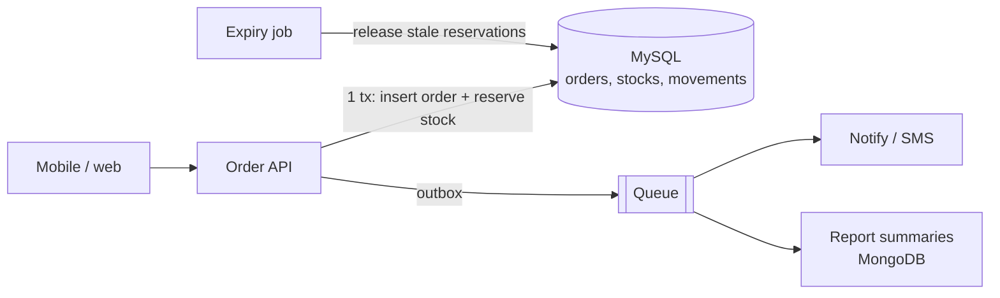

> Tracker ID: SD-29 · Generated: 2026-10-15 · Answers: **SD-Q12** (TRK-02 Phase 9) · Source: general SD knowledge + `4-library/cs/07-system-design-bd/01-notes.md` §১ + sokrio-server code (`Services/VanSales/VanLoadOutStockService.php`, `Http/Controllers/Guest/StockUpdateController.php`, `Requests/VanSales/StoreVanOrderRequest.php`, `git log`) · Format: 7-ধাপ · Status: ✅ generated

# SD-Q12: Design order + inventory for a distribution company. How do you prevent overselling?

> **এক লাইনে:** Oversell হয় যখন দুজন একসাথে "স্টক আছে?" পড়ে, দুজনেই "হ্যাঁ" দেখে, দুজনেই কমায়। সমাধান: **চেক আর কমানো একটা atomic ধাপে করো** (conditional update বা row lock), আর অর্ডার থেকে ডেলিভারি পর্যন্ত সময়ের জন্য **reservation** রাখো: `available = on_hand − reserved`।

---

## ১. Requirements

**Functional (FMCG ডিস্ট্রিবিউশন, Sokrio-র মতো):**
1. Sales rep / retailer অর্ডার দেয় (মোবাইল, কখনো অফলাইন)
2. Distributor (depot) অর্ডার approve → challan → ডেলিভারি
3. স্টক প্রতি depot × product × batch; ফ্যাক্টরি থেকে স্টক আসে (stock-in), ভ্যানে লোড হয় (transfer)
4. স্টক কম থাকলে অর্ডার আটকাও বা আংশিক দাও

**Non-functional:** **কখনো oversell না** (strong consistency স্টকে); অর্ডার নেওয়া দ্রুত; মোবাইল retry-তে ডুপ্লিকেট অর্ডার না; অডিট (কে কখন স্টক বদলাল)।

**জিজ্ঞেস করো:** "Reserve stock at order time or at approval?" · "Can stock go negative (backorder)?" · "Flash-sale style spikes, or steady B2B orders?"

## ২. Estimation
B2B: ধরো ১,০০০ distributor × দিনে ৫০০ অর্ডার = ৫০০K অর্ডার/দিন ≈ গড় ৬/sec, সকালে peak ~১০০/sec। **Contention**-টা আসল: জনপ্রিয় SKU-র একই stock row-তে অনেকে একসাথে লেখে (hot row)।

## ৩. API
```
POST /orders           { code (client-generated, idempotency), outletId, items[] }  → 201 / 409 insufficient stock
POST /orders/{id}/approve      → reserve → challan
POST /orders/{id}/deliver      → reserved → deducted
POST /orders/{id}/cancel       → reservation released
POST /stock/in         { challanNo, depot, items[] }   (factory → depot)
```

## ৪. Data model

```sql
stocks (
  id, depot_id, product_id, batch_id,
  on_hand   INT NOT NULL,          -- গুদামে আসলে আছে
  reserved  INT NOT NULL DEFAULT 0,-- অর্ডারে আটকানো, এখনো বের হয়নি
  version   INT NOT NULL DEFAULT 0,-- optimistic locking-এর জন্য
  UNIQUE (depot_id, product_id, batch_id),
  CHECK (on_hand >= 0 AND reserved >= 0 AND reserved <= on_hand)
)
orders (id, code UNIQUE, outlet_id, depot_id, status, ...)
order_items (order_id, product_id, batch_id, qty)
stock_movements (id, stock_id, delta, reason, ref_type, ref_id, user_id, created_at)   -- append-only audit
```
**available = on_hand − reserved**। Ledger (`stock_movements`) থেকে যেকোনো সময় `on_hand` আবার হিসাব করা যায়।

## ৫. High-level design



## ৬. Deep dive ⭐: oversell আটকানোর ৪টা উপায়

### ১. Atomic conditional update (প্রথম পছন্দ)
```sql
UPDATE stocks
SET reserved = reserved + :qty
WHERE id = :id AND on_hand - reserved >= :qty;
-- affected_rows = 1 → পেয়েছি · 0 → স্টক নেই → 409
```
চেক আর লেখা একটা statement-এ, DB নিজে row lock নেয়। Read-modify-write race-ই নেই।

### ২. Pessimistic lock: `SELECT ... FOR UPDATE`
```php
DB::transaction(function () use ($items) {
    foreach (collect($items)->sortBy('stock_id') as $item) {    // ⚠️ সবসময় একই ক্রমে lock → deadlock এড়ায়
        $stock = Stock::whereKey($item['stock_id'])->lockForUpdate()->first();
        if ($stock->on_hand - $stock->reserved < $item['qty']) throw new InsufficientStock();
        $stock->increment('reserved', $item['qty']);
    }
});
```
জটিল নিয়ম থাকলে ভালো (একাধিক row, batch বাছাই)। খরচ: lock ধরে রাখা সময়ে অন্যরা অপেক্ষা করে, transaction ছোট রাখো।

### ৩. Optimistic lock: version column
```sql
UPDATE stocks SET reserved = :new, version = version + 1 WHERE id = :id AND version = :readVersion;
-- 0 row → অন্য কেউ আগে বদলেছে → আবার পড়ে retry
```
Contention কম হলে ভালো; hot SKU-তে retry ঝড় হয়।

### ৪. Flash sale / খুব hot SKU
Redis-এ `DECRBY` দিয়ে আগে ছাঁকা (atomic, খুব দ্রুত) → সফল হলে queue-তে অর্ডার → DB-তে আসল reservation। খরচ: Redis আর DB-র মধ্যে মিল রাখতে reconciliation।

| | কখন |
|---|---|
| Conditional update | ডিফল্ট, সরল চেক |
| `FOR UPDATE` | একাধিক row/জটিল নিয়ম, B2B |
| Optimistic | কম contention, লম্বা user flow |
| Redis pre-decrement | বিশাল spike (flash sale) |

### Reservation lifecycle
```
order placed/approved → reserved += qty
delivered            → on_hand −= qty, reserved −= qty
cancelled / expired  → reserved −= qty   (expiry job: ধরো ২৪ ঘণ্টায় approve না হলে)
```

### ডুপ্লিকেট অর্ডার (মোবাইল retry)
Client অর্ডারের একটা unique `code` বানায় → `orders.code` UNIQUE → retry-তে একই অর্ডার ফেরত, দ্বিতীয় reservation না।

### সাধারণ ভুল ⚠️
- **lock ছেড়ে দেওয়ার পরে commit:** application-level lock (যেমন Redis lock) transaction **commit-এর আগে** ছেড়ে দিলে, পরের request DB-র পুরনো (committed) মান পড়ে → **lost update**। নিয়ম: lock commit-এর **পরে** ছাড়ো, বা DB-কেই atomic করতে দাও (`qty = qty + ?`)
- PHP-তে `$stock->qty + $x` হিসাব করে `update(['qty' => ...])` = read-modify-write; `increment()` atomic

## ৭. Wrap-up
> "The first bottleneck is hot rows for popular SKUs. I'd keep transactions tiny, lock in a consistent order, and if needed split one hot stock row into a few sub-rows (buckets) and sum them. I'd monitor lock wait time, deadlocks, and reservations that never got released."

---

## মুখে বলার লাইন (English)

**মূল উত্তর (৬০ সেকেন্ড):**
> "Overselling happens when two orders read 'in stock' at the same time and both subtract. So the check and the update must be one atomic step. My default is a conditional update: add to reserved only where on-hand minus reserved is at least the quantity, and check affected rows. For multi-line B2B orders I'd lock the stock rows with SELECT FOR UPDATE inside one short transaction, always in the same order to avoid deadlocks. I separate on-hand from reserved, so stock is held from approval until delivery and released on cancel or by an expiry job. Every change is also written to a stock movement ledger for audit. And a client-generated order code with a unique constraint stops mobile retries from creating duplicate orders."

**Sokrio:**
> "In Sokrio's van-sales module, confirming a van load-out locks the depot's stock rows with lockForUpdate, ordered by product, and computes available stock as quantity minus what's already in transit before allowing the transfer. Van orders also carry a client-generated code used as an idempotency key."

## ফলো-আপ প্রশ্ন

| প্রশ্ন | ছোট উত্তর |
|---|---|
| "Pessimistic vs optimistic?" | "Pessimistic when conflicts are likely, like a popular SKU; optimistic when they're rare, since it avoids holding locks." |
| "Deadlock?" | "Lock rows in a consistent order (sorted ids), keep transactions short, and retry the transaction on deadlock errors." |
| "Offline mobile orders?" | "Accept them as requests, not guarantees. When they sync, reserve; if stock is gone, the order becomes partial or rejected and the rep is notified." |
| "Stock across warehouses?" | "Reserve from a chosen depot by rule (nearest, most stock); a cross-depot order becomes several reservations in one transaction, or a saga if they're in different services." |

---

🔗 **Sokrio link:** (কোডে যাচাই করা, 2026-10-15; সব **টিমের লেখা**)
- **Pessimistic lock + available হিসাব:** `app/Services/VanSales/VanLoadOutStockService.php`: `Cache::lock("van_load_out_confirm_{id}")` (একই load-out দুবার confirm না) → `Stock::lockForUpdate()->...->orderBy('product_id')` → `available = qty − on_transit_send` → কম হলে `ValidationException`। লেখক **Rakib** (১০ commit)।
- **Idempotency key:** `Requests/VanSales/StoreVanOrderRequest.php`: van order-এর client-generated `code` = idempotency key (Rakib)।
- **Challan-প্রতি lock:** `Guest/StockUpdateController.php` (stock-in API): `Cache::lock({domain}_stock_update_{challan_no})` → একই challan দুবার process হয় না (429)। লেখক **sihab** (2026-02-24)।
- ⚠️ **কোড রিভিউতে পাওয়া সম্ভাব্য bug (যাচাই করো, দাবি করো না):** একই ফাইলে per-stock `Cache::lock` **line ~166-এ ছাড়া হয়, কিন্তু `DB::commit()` line ~263-এ**। মাঝে `$stock->update(['qty' => $stock->qty + $qty])` = read-modify-write (atomic `increment()` লাইনটা comment করা)। দুটো **আলাদা challan** একই stock row-তে একসাথে এলে, দ্বিতীয়টা প্রথমটার commit-এর আগের পুরনো `qty` পড়তে পারে → **lost update**। ঠিক করা: `$stock->increment('qty', $qty)` বা lock commit-এর পরে ছাড়া। একটা concurrency test দিয়ে প্রমাণ করে fix করলে এটা তোমার নিজের **S11 / debugging গল্প** হতে পারে: `[Komol সিদ্ধান্ত নেবে]`।
- **তোমার নিজের সংযোগ:** SMS resend-এর `claim()` আসলে একই reservation pattern: balance = on_hand, pending/processing SMS = reserved, lock + transaction-এর ভেতরে চেক (SD-Q06)। আর তুমি claim-এর আগে id `sort()` করো (consistent lock order)।

📚 আরো: `4-library/cs/07-system-design-bd/01-notes.md` §১ · আগে: [11-payment.md](11-payment.md) · পরে: [13-dispatch.md](13-dispatch.md)
