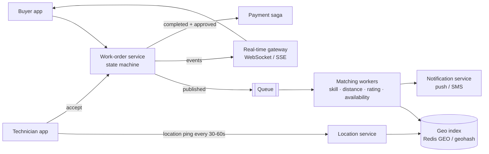

> Tracker ID: SD-30 · Generated: 2026-10-15 · Answers: **SD-Q13** (TRK-02 Phase 10) · Source: **পূর্ণ ৭-ধাপ ডিজাইন আগে থেকেই আছে → `4-library/fieldnation/system-design/01-work-order-dispatch.md` (FN-14)**; এই ফাইল শুধু ইন্টারভিউ কার্ড + FN-14-এ যা নেই (state machine, geo index তুলনা, real-time, location ingest) + কোডে যাচাই করা Sokrio link · Status: ✅ generated

# SD-Q13: Design a work-order dispatch system that matches jobs to nearby technicians

> **এক লাইনে:** Buyer একটা কাজ (work order) পোস্ট করে → সিস্টেম **কাছের, যোগ্য, available** টেকনিশিয়ান খোঁজে → তাদের জানায় → **প্রথম যে accept করে সে-ই পায় (ঠিক একজন)** → কাজ একটা **state machine** ধরে এগোয় → শেষে approve আর পেমেন্ট। তিনটা কঠিন অংশ: **geo search, accept race, আর lifecycle।**

> 📖 **প্রথমে FN-14 পড়ো** (requirements, estimation, API, data model, HLD, ৩টা deep dive: accept race, matching, approve→pay saga)। নিচে শুধু যোগ।

---

## ১. ৩০-সেকেন্ডের কাঠামো (বোর্ডে)



## ২. Work-order state machine (FN-14-এ নেই) ⭐

```
draft → published → assigned → en_route → checked_in → work_done → approved → paid
            │            │                                   │
            ↓            ↓                                   ↓
        cancelled    unassigned (tech withdraws / no-show)  disputed → resolved
            ↑
         expired (no one accepted by deadline)
```

| নিয়ম | কেন |
|---|---|
| শুধু অনুমোদিত transition (`ALLOWED[from]` টেবিল) | `paid → assigned`-এর মতো অসম্ভব বদল কোডে আটকানো |
| প্রতিটা transition **conditional update** (`WHERE id=? AND status=?`) | race-এ ঠিক একজন জেতে (accept, cancel একসাথে) |
| প্রতিটা বদল `work_order_events`-এ (কে, কখন, কোথা থেকে) | অডিট, dispute, SLA হিসাব |
| `checked_in`-এ GPS + সময় যাচাই | টেকনিশিয়ান আসলে সাইটে ছিল কি না (→ নিচে) |

ক্লাসে মডেল করা: **State pattern** (DP-Q12)।

## ৩. Geo index: অপশনের তুলনা (FN-14-এ শুধু Redis GEO)

| অপশন | কীভাবে | ভালো | খারাপ |
|---|---|---|---|
| **Redis GEO** (`GEOADD`, `GEOSEARCH`) | sorted set-এ geohash | খুব দ্রুত, ঘনঘন বদলানো লোকেশনের জন্য আদর্শ | শুধু point + radius, ফিল্টার (skill) আলাদা করতে হয় |
| **Geohash prefix** in DB | lat/lng → string (`tuvz4`), prefix মিল = কাছাকাছি; পাশের ৮টা cell-ও খোঁজো | যেকোনো DB-তে index করা যায় | cell সীমানার সমস্যা, পাশের cell লাগে |
| **MySQL spatial / PostGIS** | `ST_Distance_Sphere`, R-tree index | skill/rating ফিল্টার একই query-তে | খুব ঘন write-এ ধীর |
| **H3 / S2 cell** (Uber/Google) | পৃথিবী hexagon/cell-এ ভাগ | সমান আকারের cell, analytics-এ ভালো | বেশি জটিল |
| Elasticsearch `geo_distance` | | geo + text + ফিল্টার একসাথে | আলাদা সিস্টেম চালাতে হয় |

**আমার পছন্দ:** লাইভ লোকেশন **Redis GEO**-তে (TTL সহ: ১০ মিনিট ping না এলে offline), প্রার্থী তালিকা পেয়ে MySQL-এ skill/rating/availability ফিল্টার। Field Nation-এর মতো **নির্ধারিত সময়ের কাজ** হলে টেকনিশিয়ানের **home base / service area**-ও যথেষ্ট, লাইভ GPS শুধু day-of-job ট্র্যাকিংয়ে।

## ৪. Location ingest (FN-14-এ নেই)
২০০K টেকনিশিয়ান × প্রতি ৩০ সেকেন্ডে ping = **~৬,৭০০ write/sec**। তাই:
- ping সরাসরি MySQL-এ না → **stream/queue** (Kafka) → consumer শুধু সর্বশেষ লোকেশন Redis GEO-তে আপডেট করে, ইতিহাস ব্যাচে cold storage-এ
- মোবাইল ব্যাচ করে পাঠায় (অফলাইনে জমিয়ে রাখে), স্থির থাকলে ping কম

## ৫. Real-time আপডেট (FN-14-এ নেই)
| | কখন |
|---|---|
| **Push notification** | টেকনিশিয়ানকে নতুন অফার (অ্যাপ বন্ধ থাকলেও) |
| **WebSocket / SSE** | buyer-এর স্ক্রিনে "technician en route", লাইভ ম্যাপ |
| Polling | সহজ fallback, কম ঘন আপডেট |

WebSocket সার্ভার stateful → connection-এর জন্য আলাদা gateway, ঘটনা pub/sub (Redis) দিয়ে সব gateway-তে ছড়ায়।

## ৬. Matching কৌশল (সংক্ষেপে, বিস্তারিত FN-14 deep dive ২)
- **Broadcast** (সবাইকে একসাথে, প্রথম accept জেতে): দ্রুত, কিন্তু অনেক হতাশ টেকনিশিয়ান
- **Sequential / tiered offer** (সেরা ৫ জনকে ৫ মিনিট, তারপর পরের ১০ জন): ন্যায্য, ধীর
- **Ranking:** distance, rating, on-time %, buyer-এর পছন্দের তালিকা, fairness (একই জনকে বারবার না)
- ⚠️ accept race → conditional update (FN-14 deep dive ১)

## ৭. Check-in যাচাই আর fraud
- check-in লোকেশন সাইটের geofence-এর ভেতরে কি না (radius + GPS accuracy)
- **Mock location** ধরা (Android `isMocked`), অস্বাভাবিক গতি (৫ মিনিটে ৫০ কিমি), একই ডিভাইসে অনেক অ্যাকাউন্ট
- সন্দেহজনক হলে আটকানো না, **flag** করে রিভিউ (ভুল positive-এ টেকনিশিয়ানের টাকা আটকায়)

---

## মুখে বলার লাইন (English)

**ওপেনিং (৬০ সেকেন্ড):**
> "I'd split it into a work-order service that owns the lifecycle, a location service, matching workers, and notifications. When a buyer publishes a job, a matching worker finds candidates near the site, from a geo index like Redis GEO, filters by skill, rating and availability, ranks them, and sends offers in tiers. Accepting is a conditional update, 'set provider where status is published', so exactly one technician wins. From there the job follows a strict state machine: assigned, en route, checked in, done, approved, paid, with every transition logged. Check-in verifies the technician is inside the site's geofence. Payment after approval is a saga with compensation if the payout fails."

**Trade-off:**
> "Broadcasting offers fills jobs fastest but frustrates technicians who lose the race. Tiered offers are fairer but slower. I'd pick based on job urgency, maybe broadcast for same-day jobs and tiered for scheduled ones."

**Sokrio সেতু:**
> "I haven't built geo-matching at this scale, but the lifecycle side is familiar. I built Task Manager in Sokrio, where supervisors plan tasks for field staff, approve them and lock achievements, a one-way state flow very similar to a work order. Sokrio is a field-force platform, so GPS-based attendance and tracking are core. The mock-location checks and the Kafka tracking pipeline were built by teammates, and I worked alongside them."

## ফলো-আপ প্রশ্ন

| প্রশ্ন | ছোট উত্তর |
|---|---|
| "No one accepts?" | "Widen the radius and tier, raise the rate suggestion, and alert the buyer before the deadline. Expire it at the deadline." |
| "Technician no-shows?" | "Check-in deadline passes → status back to published, penalty on reliability score, rematch automatically." |
| "Hot region with 1,000 jobs at once?" | "Partition matching workers by region, so one city's spike doesn't delay others." |
| "Why not just query MySQL by distance?" | "Fine for scheduled jobs and home bases. For live locations updated every 30 seconds, an in-memory geo index is much cheaper." |

---

🔗 **Sokrio link:** (কোডে যাচাই করা, 2026-10-15)
- ⭐ **তোমার নিজের:** Task Manager (A5, S9): plan → approve → one-way `achievement_locked_at` lock = work-order lifecycle-এর ছোট রূপ; MySQL বেছে নেওয়া, `user_supervisors` টেবিলের আগে কোডবেস অডিট।
- **Tracking (টিমের):** `app/Actions/Tracking/WriteTrackingActions.php`, `WriteBulkTrackingActions.php` (লেখক sihab) + Kafka layer (sihab/Rakib) → লোকেশন ingest-এর বাস্তব উদাহরণ, কিন্তু "I worked with it" বলো।
- ⚠️ **S9 "GPS-spoofing detection" সাবধান:** কোডে পাওয়া mock-location চেক আছে মোবাইল অ্যাপে (`sokrio-app-mobile/lib/utils/validators/location_validator/location_validator.dart`, `isMocked`), লেখক মোবাইল টিম (Himel, Meshkat-Shadik), আর তার একটা অংশ comment করা। তোমার নিজের ভূমিকা কী ছিল (server-side নিয়ম? রিপোর্ট? ডিজাইন?) `[Komol পূরণ করবে]`, Truth Audit-এ নিশ্চিত করো।
- ⚠️ FN-14-এর শেষ টেবিল "Event-driven, RabbitMQ ✅ S1" আর "Webhook HMAC ✅ S5" বলে। দুটোই এখনো কোডে যাচাই হয়নি (SD-Q07, SD-Q11 দেখো)। Truth Audit-এর পর FN-14-এর টেবিলটা ঠিক করো।

📚 পূর্ণ ডিজাইন: `4-library/fieldnation/system-design/01-work-order-dispatch.md` · আগে: [12-order-inventory.md](12-order-inventory.md) · সম্পর্কিত: DP-Q12 State
