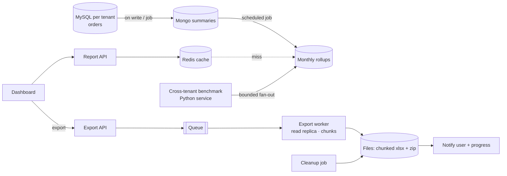

> Tracker ID: SD-24 · Generated: 2026-10-15 · Answers: **SD-Q15** (TRK-02 Phase 4) · Source: `0-now/hm-qbank.md` A2 + sokrio code (`sokrio-benchmark-python/app/common/tenant_fanout.py`, `app/common/cache.py`; `sokrio-server/app/Jobs/Reports/`, `reconnect('read')`, `git log`) · Format: 7-ধাপ, তোমার নিজের সিস্টেম হিসেবে · Status: ✅ generated

# SD-Q15: Heavy reports are slow and time out. Design a reporting pipeline that stays fast as data grows.

> **এক লাইনে:** রিপোর্ট ধীর হয় কারণ প্রতিটা request **কাঁচা ডেটা আবার পুরোটা স্ক্যান করে**। সমাধান চার স্তরে: **(১) আগে থেকে হিসাব করে রাখো (pre-aggregate / rollup), (২) cache, (৩) ভারী read মূল DB থেকে সরাও (replica / আলাদা store), (৪) যা বড় তা request-এর বাইরে চালাও (async export + notify)।** আর আগে **মাপো**: কোন অংশ আসলে দামি।

> এটা তোমার **সবচেয়ে শক্তিশালী কেস (A2)**। ইন্টারভিউয়ার "design a reporting system" বললে এই ফাইল ধরে **নিজের সিস্টেম** হিসেবে বলবে।

---

## ১. Requirements

**Functional:** ড্যাশবোর্ড (সারাংশ, সংখ্যা, চার্ট) সেকেন্ডে; বিস্তারিত রিপোর্ট (লাখ লাখ row) Excel-এ ডাউনলোড; ফিল্টার: তারিখ, territory, product; multi-tenant: প্রতি কোম্পানি শুধু নিজের ডেটা, আর cross-tenant benchmark (নাম ছাড়া)।
**Non-functional:** ড্যাশবোর্ড p95 < ২ সেকেন্ড; export ঘণ্টায় না, মিনিটে; **রিপোর্ট যেন order নেওয়াকে ধীর না করে**; কিছুটা পুরনো ডেটা চলে (কত পুরনো? জিজ্ঞেস করো)।

**জিজ্ঞেস করো:** "How fresh must reports be: real-time, minutes, or yesterday?" · "Interactive dashboard or downloadable export?" · "Data volume per tenant?"

## ২. Estimation (উদাহরণ)
বড় টেন্যান্ট: দিনে ৫০K অর্ডার × ১০ লাইন = ৫০০K row/দিন → বছরে ~১৮০M row। "গত ৬ মাসের product-wise বিক্রি" = ৯০M row স্ক্যান **প্রতি request-এ** → এটাই timeout-এর কারণ। মাসিক rollup-এ সেটা হয় ৬ মাস × কয়েক হাজার product = কয়েক হাজার row।

## ৩. API
```
GET  /reports/sales-summary?from&to&territory      → sync, rollup থেকে, cached
POST /reports/exports   { type, filters }          → 202 { exportId }   (async)
GET  /reports/exports/{id}                         → { status, progress %, downloadUrl }
```

## ৪. Data model (layered)

| স্তর | কী | কোথায় |
|---|---|---|
| **Raw / source of truth** | orders, order_items, deliveries | MySQL (per tenant) |
| **Summary (denormalized)** | প্রতি অর্ডার/ডেলিভারির রিপোর্ট-বান্ধব document | MongoDB `order_summaries`, `delivery_summaries` |
| **Rollup (pre-aggregated)** | (tenant, month, product/category) → qty, value, count | MongoDB `order_rollups_monthly` |
| **Cache** | তৈরি response | Redis, tenant-scoped key |
| **Export files** | Excel chunk / zip, মেয়াদসহ | object storage / ডিস্ক + cleanup job |

## ৫. High-level design



## ৬. Deep dive ⭐

### A. প্রথমে মাপো (সবচেয়ে বড় শিক্ষা)
"Our first instinct was caching, but the real cost was the fan-out shape." Request log-এ duration + cache_hit, তারপর `EXPLAIN` / Mongo `explain()`। অনুমান করে optimise করলে ভুল জায়গায় সময় যায়।

### B. Pre-aggregation: কখন আর কীভাবে
| কৌশল | ভালো | খারাপ |
|---|---|---|
| **Scheduled rollup** (রাতে/ঘণ্টায় job) | সহজ, source সিস্টেম থেকে আলাদা | ডেটা job-এর ব্যবধানে পুরনো; job ব্যর্থ হলে stale |
| **Event-driven / incremental** (প্রতিটা অর্ডারে counter +=) | প্রায় real-time | source-এ hook লাগে (coupling), duplicate event সামলাতে হয় |
| **Materialized view / OLAP DB** (ClickHouse, BigQuery) | যেকোনো slice দ্রুত | আলাদা সিস্টেম, ETL/CDC |

### C. Cross-tenant fan-out (per-tenant DB-র বিশেষ সমস্যা)
১০০+ টেন্যান্টের প্রতিটা DB-তে query → একটা ধীর টেন্যান্ট পুরো request আটকায়। সমাধান:
- **Bounded concurrency** (semaphore): একসাথে সীমিত টেন্যান্ট, যাতে DB-তে চাপ না পড়ে
- **Per-query timeout + পুরো request-এর wall budget**
- **Partial result সৎভাবে জানানো** (`degraded_tenants`), চুপচাপ ভুল মোট না
- শেষমেশ fan-out-কে **request path থেকে সরানো**: rollup job আগে থেকে হিসাব করে রাখে

### D. বড় export
- কখনো request-এর ভেতরে না → queue job, `202` + progress %
- **Read replica**-তে চালাও (order write-এর সাথে প্রতিযোগিতা না)
- **Chunk/stream:** সব row মেমোরিতে না; প্রতি N row-এ আলাদা ফাইল, শেষে zip
- শেষে user-কে notify, ফাইলের মেয়াদ আর cleanup job
- একই রিপোর্ট দুবার চাইলে আগেরটা reuse (cache by filter hash)

### E. Guardrail
- তারিখের সীমা (সর্বোচ্চ ৬ মাস → `400`), ডিফল্ট ছোট window
- pagination, `SELECT` শুধু দরকারি কলাম
- index চেক স্ক্রিপ্ট (per-tenant DB-তে index অবস্থা আলাদা হতে পারে)

## ৭. Wrap-up
> "Next I'd move the remaining fan-out entirely off the request path by extending rollups to the other benchmark tabs, add stampede protection to the cache, and alert if the rollup job hasn't run, since stale data is the failure mode of this design."

---

## মুখে বলার লাইন (English)

**মূল উত্তর (৯০ সেকেন্ড, নিজের সিস্টেম হিসেবে):**
> "Reports get slow because every request rescans raw data that keeps growing. I'd fix it in layers, after measuring. First, pre-aggregate: keep report-friendly summaries next to the transactional data, and roll them up per month on a schedule, so a six-month report reads thousands of rows instead of tens of millions. Second, cache the results in Redis with tenant-scoped keys and TTLs that match how fast the data really changes. Third, keep heavy reads off the write database, on a read replica or a separate store. Fourth, anything big runs as an async export job: it returns immediately, reports progress, writes chunked files, zips them and notifies the user. Plus guardrails: bounded date ranges and pagination."

**Sokrio (A2, তোমার কাজ):**
> "That's close to what we did in Sokrio. Our cross-tenant market benchmark fanned out over every tenant's database and timed out. I measured first and found the fan-out itself was the cost, not a single query. I built a bounded fan-out helper: adaptive concurrency based on tenant count, a 12-second per-tenant timeout and a 30-second total budget, and it reports which tenants degraded instead of returning a silently wrong total. Then shorter default lookback windows with a hard cap, a cache TTL raised from 10 minutes to 3 hours since monthly data doesn't change hourly, the missing indexes with a check script, and finally monthly rollups written by a scheduled job. I chose scheduled over event-driven so the Python service didn't need hooks inside Laravel's order flow."

## ফলো-আপ প্রশ্ন

| প্রশ্ন | ছোট উত্তর |
|---|---|
| "Rollup job fails?" | "Reports show the last good data with its 'as of' time, and an alert fires if the job hasn't succeeded within its window. The job is idempotent, so a rerun is safe." |
| "User needs real-time numbers?" | "Combine: rollup up to yesterday plus a small live query for today." |
| "Late or corrected orders change last month?" | "Recompute the affected month: the rollup job rebuilds whole periods, not increments, so it's naturally idempotent." |
| "When would you add a data warehouse?" | "When ad-hoc slicing across many dimensions becomes common, a columnar store like ClickHouse or BigQuery fed by CDC beats hand-built rollups." |

---

🔗 **Sokrio link:** (কোডে যাচাই করা, 2026-10-15)
- ⭐ **তোমার নিজের (Python benchmark, `git log`-এ একমাত্র লেখক Komol):**
  - `app/common/tenant_fanout.py::gather_tenants()`: `asyncio.Semaphore` + `_adaptive_concurrency(n)` (`[8, 24]`), প্রতি টেন্যান্ট `_MB_PER_QUERY_SEC = 12`, মোট `_MB_WALL_BUDGET_SEC = 30`, `degraded_domains` ফেরত দেয়
  - `app/common/cache.py::cache_remember(should_cache=...)`: timeout/degraded ফল cache করে না
  - A2: lookback enum (১/২/৩/৬), >৬ → `400 INVALID_DATE_RANGE`; TTL 600 → 10800s; index script + `--check`; `order_rollups_monthly` (scheduled)
- **Laravel export (টিমের, sihab):** `app/Jobs/Reports/ProcessCustomSummaryReportExportJob.php`: `CHUNK_SIZE = 75000` row প্রতি Excel ফাইল, progress `tick()`, `ZipArchiveService`, শেষে `NotifyUserOfCompleteExport`; `DeleteExpiredReportFiles` = cleanup।
- **Read replica:** ২৭টা report job `reconnect('read')` (SD-Q04)।
- ⚠️ সংখ্যা: "Reports ৮৫% দ্রুত" (S2, CV) কীভাবে মাপা, আর A2-এর before/after p50/p95: `[Komol পূরণ করবে]`। মাপা সংখ্যা না থাকলে "85%" বলো না, "from timing out to returning within the budget" বলো।

📚 আগে: [13-dispatch.md](13-dispatch.md) · সম্পর্কিত: [../concepts/03-caching.md](../concepts/03-caching.md), [../concepts/04-db-scaling.md](../concepts/04-db-scaling.md), `0-now/hm-qbank.md` A2
