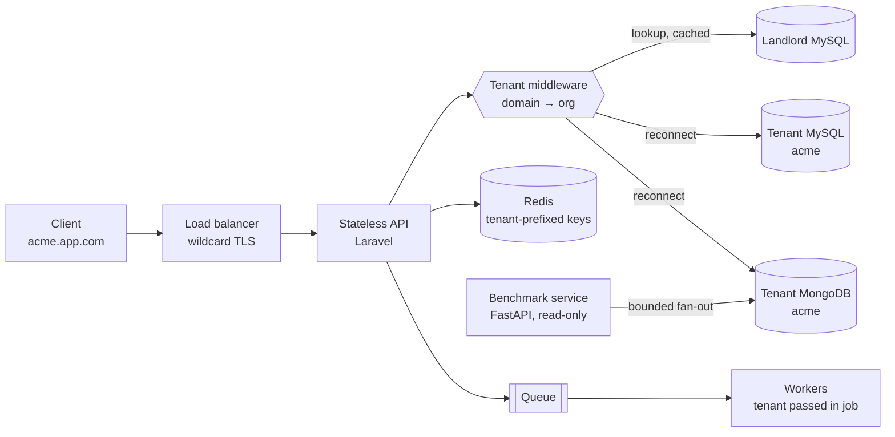

> Tracker ID: SD-23 · Generated: 2026-10-15 · Track: TRK-01 Phase 0 · Source: `0-now/hm-qbank.md` A1/A2 + sokrio-server কোড · Status: ✅ generated

# SD-23: Design a Multi-tenant SaaS Platform

> **কেন এই কেস:** এটা তোমার নিজের সিস্টেম (A1)। প্রশ্ন "design a multi-tenant B2B SaaS" হোক বা "tell me about your architecture", একই কাঠামো চলে।
> ছাঁচ = SD-01-এর ৭ ধাপ। প্রতিটা ধাপের শেষে **🟢 Sokrio-তে** = যা আছে (কোডে যাচাই করা), **🔵 নতুন** = যা ইন্টারভিউতে বাড়তি বলবে।

---

## 1. Requirements (৫ মিনিট)

**জিজ্ঞেস করার প্রশ্ন (EN):**
- "How many tenants, and how uneven are they? A few big enterprises, or thousands of small ones?"
- "Do any tenants need hard isolation, for contracts, compliance or data residency?"
- "Do we need cross-tenant analytics, like platform-wide benchmarks?"

**Functional:** টেন্যান্ট onboarding (provision) · টেন্যান্টের ইউজার login + role/permission · টেন্যান্টের ব্যবসায়িক ডেটা CRUD (অর্ডার, ডেলিভারি…) · রিপোর্ট · প্ল্যাটফর্ম অ্যাডমিন (সব টেন্যান্ট ম্যানেজ)

**Non-functional:**
- **Isolation**: এক টেন্যান্ট কখনো অন্যের ডেটা দেখবে না (সবচেয়ে জরুরি, এটা ভাঙলে ব্যবসা শেষ)
- **Noisy neighbour নেই**: বড় টেন্যান্টের ভারী রিপোর্ট ছোটদের ধীর করবে না
- Per-tenant backup/restore, schema migration নিরাপদে সব টেন্যান্টে
- রিপোর্ট কয়েক মিনিট পুরনো হলে চলে (eventual), অর্ডার লেখা strong

**Out of scope:** billing engine, SSO/SAML, multi-region

---

## 2. Estimation (৩ মিনিট)

> ⚠️ নিচের সংখ্যাগুলো **উদাহরণ অনুমান**, Sokrio-র আসল সংখ্যা না। আসল সংখ্যা বলতে চাইলে `[Komol পূরণ করবে: টেন্যান্ট সংখ্যা, সবচেয়ে বড় টেন্যান্টের ইউজার/অর্ডার/দিন]`

ধরো ২০০ টেন্যান্ট, বড়টায় ২,০০০ ফিল্ড ইউজার, জনপ্রতি দিনে ~১০০ API কল:
- বড় টেন্যান্ট: 2×10³ × 10² ÷ 10⁵ ≈ **২ QPS গড়**, অফিস-আওয়ারে peak ×৫ ≈ ১০ QPS
- পুরো প্ল্যাটফর্ম: বড়-ছোট মিলিয়ে কয়েকশো QPS → **QPS সমস্যা না**
- আসল চাপ: **রিপোর্ট** (বড় aggregation) আর **টেন্যান্ট সংখ্যা** (N টা DB-তে migration, connection)

> বলো: "Raw QPS is modest. The real scaling axes are the number of tenants and heavy report queries, so the design should focus on isolation and keeping reports off the hot path."

---

## 3. API (৩ মিনিট)

```
POST /admin/orgs                       → tenant provision (landlord)
GET  https://{tenant}.app.com/api/orders?page=&per_page=   → tenant scoped
POST https://{tenant}.app.com/api/orders  (Idempotency-Key header)
GET  https://{tenant}.app.com/api/reports/sales?from=&to=
```

**মূল সিদ্ধান্ত: টেন্যান্ট কীভাবে চিনব?** subdomain · header (`X-Tenant-Id`) · JWT claim · path
- Subdomain: ব্রাউজারে স্বাভাবিক, cookie আলাদা থাকে; কিন্তু DNS/TLS wildcard লাগে
- JWT claim: সবচেয়ে নিরাপদ (ক্লায়েন্ট বদলাতে পারে না), সার্ভিস-টু-সার্ভিসে ভালো

🟢 **Sokrio-তে:** subdomain। সব রুট `Route::domain("{account}.$appHost")`-এ মোড়ানো। FastAPI benchmark সার্ভিস `X-Tenant-Domain` header নেয়।
🔵 **নতুন:** subdomain থেকে টেন্যান্ট পাওয়ার পর token-এর টেন্যান্টের সাথে **মিলিয়ে দেখা** (token অন্য টেন্যান্টের হলে 403)। `[Komol পূরণ করবে: Sokrio-তে এই চেক আছে কি? Sanctum token কি org-scoped?]`

---

## 4. Data model: আসল ইন্টারভিউ এখানেই (৫ মিনিট)

### তিনটা isolation মডেল

| মডেল | কীভাবে | ✅ | ❌ |
|---|---|---|---|
| **Shared schema** (`tenant_id` প্রতিটা টেবিলে) | এক DB, সব row-তে `tenant_id` | সস্তা, এক migration, cross-tenant query সহজ | একটা `WHERE` ভুললেই data leak; noisy neighbour; per-tenant restore কঠিন |
| **Schema-per-tenant** | এক DB সার্ভার, টেন্যান্ট প্রতি schema | মাঝামাঝি isolation | MySQL-এ schema = database, তাই আসলে পরেরটাই |
| **DB-per-tenant** | টেন্যান্ট প্রতি আলাদা DB | সবচেয়ে শক্ত isolation, per-tenant backup/restore/move | N টা migration, connection overhead, cross-tenant analytics কঠিন |

**সাথে একটা আলাদা landlord / control-plane DB:** org লিস্ট, domain → DB ম্যাপিং, প্ল্যান, প্ল্যাটফর্ম অ্যাডমিন।

🟢 **Sokrio-তে:** landlord MySQL + টেন্যান্ট প্রতি **MySQL DB + MongoDB DB** (দুটোর নাম একই = `org.domain`)। Migration দুই ভাগে: `base:migrate` (landlord) আর `tenant:migrate {db?}`।

**Trade-off বাক্য (EN):**
> "We chose database-per-tenant over a shared schema because our clients are enterprises: one missed `WHERE tenant_id` must never leak data, and we need to back up or restore one client alone. The cost is running migrations across N databases and harder cross-tenant analytics, which we solved with a separate read-only fan-out service."

🔵 **নতুন (hybrid):** হাজার হাজার ছোট টেন্যান্ট হলে → ছোটরা shared-schema pool-এ, বড়/enterprise টেন্যান্ট নিজস্ব DB-তে ("silo + pool")। landlord-এ `tenant → placement` ম্যাপ থাকলে টেন্যান্টকে pool থেকে silo-তে সরানো যায়।

---

## 5. High-level design (১০ মিনিট)



**একটা request-এর পথ (মুখে বলো):**
1. `acme.app.com/api/orders` → LB → যেকোনো API instance (stateless)
2. Tenant middleware: domain দিয়ে org খোঁজে (**cache করা**), inactive হলে 403
3. Connection switch: এই request-এর জন্য default DB = acme-র MySQL + Mongo
4. তারপর auth → permission gate → controller → service → acme-র DB
5. Response; cache key-তে টেন্যান্ট prefix

🟢 **Sokrio-তে:** `EnsureTenantAccess` → `LOWER(domain)` দিয়ে Org খোঁজে (৭ দিন cache `org_by_domain_{domain}`) → `TenantManager::tenant($org)->reconnect()` MySQL + Mongo একসাথে সুইচ করে → `auth:sanctum` → `permission:` gate। Cache prefix: `ScopeCacheToTenant` middleware।

---

## 6. Deep dives (১০–১২ মিনিট): ইন্টারভিউয়ারকে বাছতে দাও

### 6a. Tenant context leak: সবচেয়ে বিপজ্জনক bug
- **HTTP-তে** middleware context বসায়। কিন্তু **queue job, cron, Kafka consumer**-এ middleware চলে না
- 🟢 Sokrio-র আসল gotcha: `ScopeCacheToTenant` শুধু HTTP request-এ cache prefix দেয়, job সেই key দেখে না। আর switch-এর পর landlord-এ ফিরতে ভুললে পরের query ভুল DB-তে যায়
- **প্রতিকার:**
  - job payload-এ `tenant_id` **explicitly** পাঠাও, job শুরুতে switch + শেষে (finally) reset
  - cache key-তে টেন্যান্ট নিজে বসাও, middleware-এর ওপর ভরসা না
  - **টেস্ট:** tenant prefix ছাড়া কোনো cache key থাকলে টেস্ট fail
- বলো: *"Tenant context is ambient state, and ambient state disappears at every async boundary. So I make it explicit in jobs and assert it."*

### 6b. N টা DB-তে schema migration
- সমস্যা: ২০০ DB-র ৮০-তে migration সফল, তারপর একটা fail → schema drift
- প্রতিকার: প্রতিটা migration **backward-compatible** (expand → deploy → contract), টেন্যান্ট-বাই-টেন্যান্ট চালাও, ফলাফল landlord-এ লগ করো, fail হলে retry/resume
- 🟢 Sokrio-তে: `tenant:migrate {db?}` একটা বা সব টেন্যান্টে চালায়। `[Komol পূরণ করবে: fail হলে কী হয়? কোনো রেকর্ড রাখা হয় কি?]`

### 6c. Noisy neighbour + ভারী রিপোর্ট
- DB আলাদা হলেও **একই DB সার্ভার** শেয়ার করলে বড় টেন্যান্টের রিপোর্ট CPU/IO খেয়ে ফেলে
- প্রতিকার: রিপোর্ট hot path থেকে সরাও (pre-aggregated rollup, read replica), per-tenant rate limit/queue, বড় টেন্যান্টকে আলাদা DB সার্ভারে (placement map দিয়ে)
- 🟢 Sokrio-তে (A2): benchmark fan-out-এ bounded adaptive concurrency `[8, 24]`, cache TTL 600s → 10800s, monthly `order_rollups_monthly` rollup

### 6d. Cross-tenant analytics
- DB-per-tenant মানে "সব টেন্যান্টে গড়" = N টা query
- বিকল্প: (১) request-time fan-out (সহজ, ধীর) · (২) scheduled rollup → এক জায়গায় · (৩) CDC/stream → warehouse (সবচেয়ে scalable, সবচেয়ে জটিল)
- 🟢 Sokrio-তে: (১) + (২), আলাদা read-only FastAPI সার্ভিস। Event-driven না করে scheduled কেন: লেখে Laravel, তাই hook লাগলে দুই সার্ভিস কাপল হয়ে যেত, আর benchmark কয়েক ঘণ্টা পুরনো হলেও চলে।
- 🔵 ১০× হলে: (৩), যেমন Kafka/CDC → columnar store

### 6e. Connection management
- প্রতি request-এ switch সস্তা, কিন্তু worker pool অনেক টেন্যান্টে ঘুরলে DB connection বাড়ে
- প্রতিকার: connection pooler (ProxySQL/PgBouncer), টেন্যান্টদের কয়েকটা DB সার্ভারে ভাগ (sharding by tenant)

---

## 7. Wrap-up (৩ মিনিট)

| ১০× হলে প্রথম যা ভাঙবে | কী করব |
|---|---|
| টেন্যান্ট ১০০০+ → migration সময়, connection | ছোট টেন্যান্ট shared pool-এ (hybrid), parallel migration runner |
| বড় টেন্যান্টের রিপোর্ট | rollup/replica, বড় টেন্যান্টকে আলাদা সার্ভারে |
| Async-এ tenant context | job middleware যা tenant switch + reset করে, আর একটা টেস্ট |

**মনিটরিং:** per-tenant p95 latency + error rate (কোন টেন্যান্ট ভুগছে), migration status per tenant, ভুল টেন্যান্টে query-র জন্য alert (যেমন landlord-এ টেন্যান্ট টেবিল query হলে)

**L5 Reflect (EN, A1 থেকে):**
> "If I redid it, I'd make tenant context explicit in jobs, passed as a parameter and asserted, rather than relying on middleware state, and I'd add an automated test that fails if any cache key lacks a tenant prefix."

---

## ✋ Honesty চেক (বলার আগে)

- `[Komol পূরণ করবে: DB-per-tenant সিদ্ধান্ত কি তোমার, নাকি তুমি আসার আগেই ছিল (তোমার প্রথম commit ২০২৩-০৮-২৮)?]` → উত্তর অনুযায়ী বলো "I designed…" বা "I extended and hardened…"
- `TenantManager.php`-এর git history-তে মূল লেখক টিমমেট (Tanmay Mishu, ১২ commit); তোমার ৫ commit। তাই **"I worked deeply in / extended"** বলা নিরাপদ, "I built" না
- আসল টেন্যান্ট সংখ্যা/লোড না জানলে বলো "I'd estimate…" আর §২-এর মতো অনুমান করো

## প্র্যাকটিস (২০ মিনিট)

1. ⬜ খাতায় §৫-এর ডায়াগ্রাম না দেখে আঁকো + একটা request-এর পথ জোরে বলো (EN)
2. ⬜ ৩টা isolation মডেলের টেবিল মুখে বলো, ৯০ সেকেন্ডে
3. ⬜ 6a জোরে বলো: এটাই তোমার সবচেয়ে "senior" শোনানো অংশ

🔗 Sokrio link: S3 (multi-tenant), S2 (report/benchmark performance) · `0-now/hm-qbank.md` A1, A2 · কোড: `EnsureTenantAccess`, `TenantManager`, `ScopeCacheToTenant`
